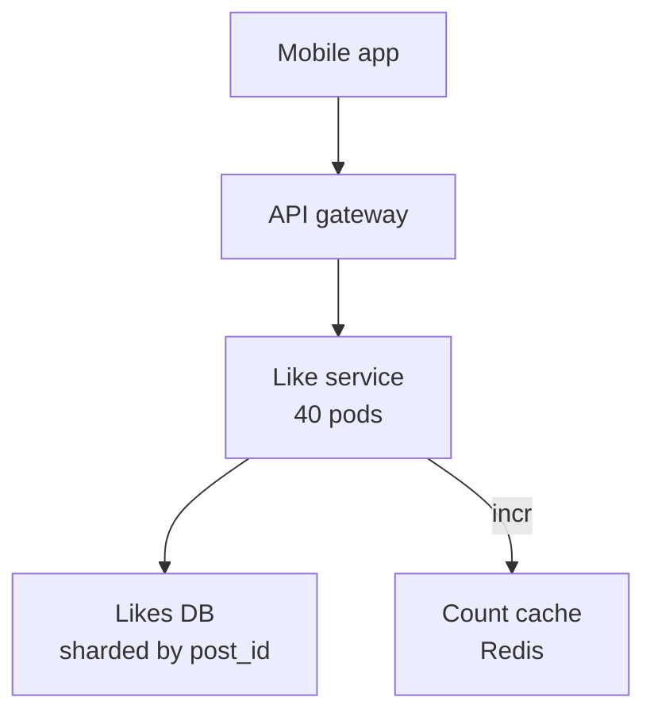
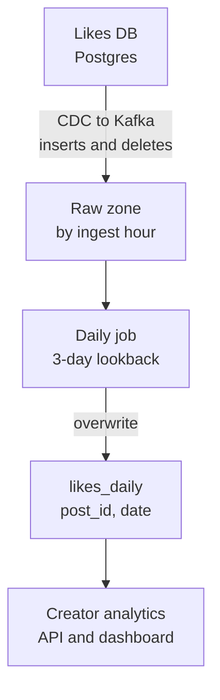
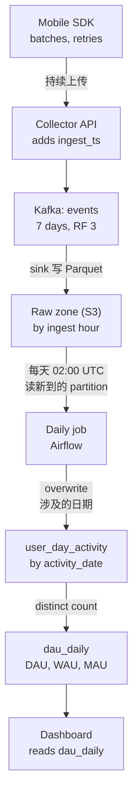
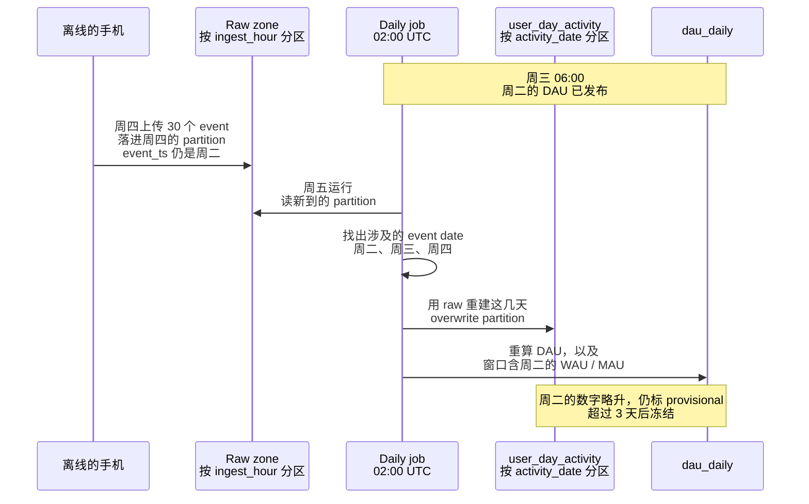

# How a data engineering design interview runs｜DE 系统设计面试怎么进行

> 原文：[DataInterview · Data Engineering System Design · Playbook Framework](https://www.datainterview.com/courses/data-engineering-system-design/playbook-framework)（课程第 1 课，原文标注阅读约 24 分钟），抓取于 2026-11-14。

译文说明：

- 段落：英文原文放在引用块里，中文紧跟其后。
- 列表：用「English｜中文」两栏表格逐条对照。多列的大表格只直接展示中文版，英文原表折叠在下方。
- 原页面的交互组件（时间轴、tab 切换、逐步演示的架构图）已改写成静态表格和 Mermaid 图；折叠的 strong answer、hint 和参考答案都已展开；测验用 ✅ 标出正确选项。
- 译者自己加的内容都标了「译注」。

## 速览（译注）

- 一场 DE 设计面试分 6 个阶段：需求 → 估算 → data model → high-level design → deep dive → wrap-up。45 分钟的面试按 7 / 4 / 6 / 10 / 14 / 4 分钟分配，开场就把这个计划说出来。
- DE 面试和 SWE 面试的区别：SWE 跟着一个请求走（latency、availability）；DE 跟着数据随时间走（数字对不对、多新鲜、迟到的数据怎么重算、成本、下游谁在用）。
- DAU 例题的核心设计：raw 表按数据到达时间分区，衍生表按事件发生时间分区，每次 rerun 都 overwrite 受影响的 partition。这一套同时解决了迟到上传、重复数据和精确的 WAU / MAU。
- 面试官说「你来定」时：给一个数字和理由，再说清楚换一种情况设计会怎么变。

---

## 开篇

> “Design the data pipeline behind a daily active users dashboard for our mobile app.” That is the whole prompt, and you have 45 minutes, sometimes 60, and a whiteboard. It is short on purpose: the interviewer wants to see what you ask, what you decide, and whether the design you end with would produce the right number on the dashboard every morning. Candidates who draw Kafka, Spark and a warehouse in the first five minutes usually spend the rest of the round answering questions they never asked themselves. What counts as active? What happens when a phone uploads Tuesday’s events on Thursday? Can yesterday’s number change after the CEO has seen it?

「为我们 mobile app 的 DAU dashboard 设计背后的 data pipeline。」题目就这一句，你有 45 分钟（有时 60 分钟）和一块白板。题目故意出得很短：面试官想看你问什么、决定什么，以及你最后的设计能不能每天早上在 dashboard 上给出正确的数字。开场 5 分钟就画出 Kafka、Spark 和 warehouse 的候选人，后面整场通常都在回答那些本该自己先问、却没问的问题：什么算 active？手机周四才上传周二的 event，怎么办？CEO 看过昨天的数字之后，这个数字还能改吗？

> This lesson is the process the rest of the course follows. You’ll see the six stages of a round with a time budget for each, then change the budget on an interactive timeline and see which parts of your answer go missing when one stage is skipped or runs long. Then you’ll work the DAU prompt through every stage, writing your own answer before each reveal, and finish with two exercises from its deep dives: loading late and duplicated uploads without double counting, and computing WAU and MAU correctly.

这一课讲的流程，整门课后面都会沿用。先看一场面试的 6 个阶段和各自的时间预算；再在交互时间轴上调整预算，看某个阶段被跳过或超时后，你的回答会缺掉哪一块。然后用 DAU 这道题把每个阶段走一遍（每次揭晓答案前先自己写），最后做两道来自 deep dive 的练习：加载迟到和重复的上传数据而不重复计数，以及正确地计算 WAU 和 MAU。

---

## Six stages and a time budget｜六个阶段与时间预算

> Almost every data engineering design round moves through the same stages, whether the interviewer names them or not. The minutes below are a budget to plan with, not a rule; what matters is that each stage gets enough time to produce its output, because each one feeds the next.

几乎所有 DE 设计面试都会经过同样几个阶段，不管面试官有没有点明。下面的分钟数是用来做规划的预算，不是硬性规定。关键是每个阶段都要拿到足够的时间产出结果，因为每个阶段的产出都是下一个阶段的输入。

| 阶段 | 45 分钟 | 60 分钟 | 你要产出什么 | 面试官在考察什么 |
|---|---|---|---|---|
| Requirements（需求） | 7 | 9 | consumer、查询、freshness、正确性、规模和范围，全部写成具体数字 | 设计之前有没有先弄清什么重要，能不能把模糊的说法变成可衡量的目标 |
| Estimates（估算） | 4 | 5 | 每秒 event 数、每天字节数、retention 期内的存储量、大致成本 | 能不能估出量级，并说出这些数字对设计意味着什么 |
| Data model | 6 | 8 | 核心表或 event，每个都说清 grain 和 key | 设计是否建立在可去重、可 join、可重算的行之上 |
| High-level design | 10 | 13 | 端到端架构图：source、ingestion、storage、processing、serving、调度 | 整条链路能不能跑通，每个组件是否都有存在的理由 |
| Deep dives | 14 | 20 | 这道题的 2–3 个难点，每个都给出决策、备选方案和 failure case | 深度：late data、rerun、skew、故障、成本，以及被追问时怎么推理 |
| Wrap-up | 4 | 5 | 简短总结、要监控什么、下一步做什么 | 能不能跳出细节，主动说出风险 |

<details>
<summary>英文原表</summary>

| STAGE | 45 MIN | 60 MIN | WHAT YOU PRODUCE | WHAT THE INTERVIEWER IS CHECKING |
|---|---|---|---|---|
| Requirements | 7 | 9 | Consumers, queries, freshness, correctness, scale and scope, written down as numbers | Whether you find out what matters before designing, and turn vague words into targets |
| Estimates | 4 | 5 | Events per second, bytes per day, storage over retention, rough cost | Whether you can size things and say what the numbers mean for the design |
| Data model | 6 | 8 | The core tables or events, each with its grain and key | Whether your design rests on rows that can be deduplicated, joined and recomputed |
| High-level design | 10 | 13 | An end-to-end diagram: sources, ingestion, storage, processing, serving, schedule | Whether the whole path works and each component has a reason |
| Deep dives | 14 | 20 | Two or three hard parts of this problem, each with a decision, its alternative and its failure case | Depth: late data, reruns, skew, failures, cost, and how you reason under follow-up questions |
| Wrap-up | 4 | 5 | A short summary, what you would monitor, what you would do next | Whether you can step back and name the risks yourself |

</details>

### 时间分配出错会怎样（原文为交互时间轴）

> Pick a scenario below, or drag the sliders, and watch which stages run out of time. The bar past the red line is the part of your plan the interviewer never sees.

原文这里是一个交互时间轴：选一个场景或拖动滑块，看哪些阶段时间不够。超出红线（45 分钟）的那一段，就是面试官永远看不到的那部分计划。

译注：下表是我把每个场景点一遍后整理的结果。分钟数顺序为 需求 / 估算 / data model / design / deep dive / wrap-up。

| 场景 | 各阶段分钟 | 总计 | 结果 |
|---|---|---|---|
| As planned（按计划） | 7 / 4 / 6 / 10 / 14 / 4 | 45 | 6 个阶段全部覆盖 |
| Skip requirements（跳过需求） | 0 / 4 / 6 / 17 / 14 / 4 | 45 | **需求缺失**：没有 freshness 和正确性的数字，设计里没有任何东西能拿来对照需求检验。面试官做到一半问「这需要多新鲜？」，设计就得改掉一部分。 |
| Requirements run 20 min（需求拖到 20 分钟） | 20 / 4 / 6 / 10 / 5 / 0 | 58，超出 13 | **Deep dive 太薄**：只碰了一个难点，没有 failure scenario，也没有数字。**Wrap-up 缺失**：没有总结、监控和下一步，面试官最后看到的是一张没画完的图。 |
| Skip estimates（跳过估算） | 7 / 0 / 6 / 10 / 18 / 4 | 45 | **估算缺失**：没有量级数字，谁也判断不了该用一台 Postgres 还是 200 节点的 Spark 集群；partition、存储和成本全靠猜。 |
| Kafka internals in the design（画架构时讲 Kafka 内部机制） | 7 / 4 / 6 / 25 / 3 / 0 | 60，超出 15 | **Deep dive 缺失**：还没聊到 late data、rerun 和故障面试就结束了，而大部分追问考的恰恰是这些。**Wrap-up 缺失**：同上。 |

<details>
<summary>交互组件里的英文原文</summary>

| Scenario | Stage flagged | Original text |
|---|---|---|
| Skip requirements | Requirements (0 min) · missing | No freshness or correctness numbers, so nothing in the design can be checked against a requirement. The interviewer asks "how fresh does this need to be?" halfway through, and part of the design changes. |
| Requirements run 20 min | Deep dives (5 min) · thin | One hard part touched, without the failure scenario or its numbers. |
| Requirements run 20 min | Wrap-up (0 min) · missing | No summary, no monitoring, no next steps: the last thing the interviewer sees is an unfinished diagram. |
| Skip estimates | Estimates (0 min) · missing | No volume numbers: nobody can tell whether one Postgres instance or a 200-node Spark cluster is right, and partitions, storage and cost become guesses. |
| Kafka internals in the design | Deep dives (3 min) · missing | No deep dive: the round ends before late data, reruns or failures come up, and those are what most follow-up questions test. |
| Kafka internals in the design | Wrap-up (0 min) · missing | No summary, no monitoring, no next steps: the last thing the interviewer sees is an unfinished diagram. |

</details>

> A stage counts as covered when it gets at least the minutes it usually takes to show (requirements 5, estimates 2, data model 3, design 7, deep dives 10, wrap-up 2). These thresholds are a rule of thumb for this figure, not a scoring sheet any company publishes.

一个阶段拿到「通常需要的最少分钟数」才算覆盖：需求 5、估算 2、data model 3、design 7、deep dive 10、wrap-up 2。这些阈值只是这张图用的经验值，不是任何公司公开的评分表。

### 三种常见失败

> Two failures are common and look opposite. Skipping requirements feels efficient and frees 7 minutes for the design, but the design is then built for guessed needs, and the interviewer’s first follow-up (“how fresh does this need to be?”) can invalidate half of it. Letting requirements run 20 minutes feels thorough, but the 13 extra minutes come off the end of the round, which is where the deep dives and the wrap-up live. The third failure is the rabbit hole: explaining Kafka’s replication protocol while drawing the high-level design. It is real knowledge, spent where the interviewer was waiting for the next box. If a component deserves depth, say so and offer it as a deep dive later.

有两种常见失败，表现正好相反：

- **跳过需求**：感觉很高效，给设计多腾出 7 分钟。但这样设计是按猜测的需求做的，面试官第一个追问（「这需要多新鲜？」）就可能推翻一半。
- **需求拖到 20 分钟**：感觉很周全，但多出来的 13 分钟是从面试末尾扣掉的，而 deep dive 和 wrap-up 恰好都在末尾。

第三种失败是**陷进细节**：画 high-level design 时讲 Kafka 的 replication 协议。知识是真的，但花错了地方：面试官当时在等你画下一个框。如果某个组件值得深挖，说一句，留到后面作为 deep dive 主动提出来。

> When the interviewer interrupts, follow them: a question in the middle of your design usually points at what they want to evaluate. Then say where you were and continue. Glancing at a clock is fine; announcing the plan at the start (“about 7 minutes on requirements, then a quick estimate”) makes it easier for both of you to notice when a stage overruns.

面试官打断你时，顺着面试官的问题走：设计中途的提问，通常就指向对方想考察的地方。回答完，说一下刚才讲到哪了，再接着讲。看一眼时间没问题；开场先说出计划（「需求大约花 7 分钟，然后快速估算一下」），能让双方都更容易发现某个阶段超时了。

### 测验 1

> You ask how fresh the DAU dashboard must be, and the interviewer says: 'You decide.' What is the strongest reply?

你问 DAU dashboard 需要多新鲜，面试官说：「你来定。」最好的回答是哪个？

| | English | 中文 |
|---|---|---|
| A | Leave freshness open and come back to it once the high-level design is drawn | 先不定 freshness，等 high-level design 画完再回来定 |
| B | Ask again until the interviewer gives a number | 一直追问，直到面试官给出一个数字 |
| C | Choose real time to be safe, since a fresher dashboard is never worse for the people reading it | 保险起见选实时，反正 dashboard 越新鲜对看的人来说不会更差 |
| D ✅ | Say "yesterday complete by 06:00 UTC, because it is read each morning", and note what would change if it had to be hourly | 说「昨天的数据在 06:00 UTC 前完整产出，因为大家每天早上看」，并指出如果要按小时更新，设计会有哪些变化 |

> Right. A number makes the design checkable, the reason shows it comes from the consumer, and naming the alternative shows you know which parts of the design depend on it. Interviewers often leave choices open to see whether you can make and defend one.

解析：给一个数字，设计就可以被检验；给出理由，说明这个数字来自 consumer 的实际使用；点出另一种情况，说明你清楚设计的哪些部分依赖这个决定。面试官经常故意不给答案，就是想看你能不能自己做决定，并为这个决定辩护。

---

## How data engineering rounds differ from SWE system design｜DE 面试和 SWE 系统设计有什么不同

> A software engineering design round follows a request: a user clicks, a service answers, and the questions are about latency, availability and scaling the request path. A data engineering round follows data over time: where it comes from, when it arrives, how it is turned into tables, who reads them, and what happens when any of that goes wrong last week. The same product produces two very different rounds.

SWE 设计面试跟着一个请求走：用户点击，服务响应，问题都围绕 latency、availability 和请求链路的扩展。DE 面试跟着数据随时间走：数据从哪来、什么时候到、怎么变成表、谁读这些表，以及上周其中任何一环出错了会怎样。同一个产品，能出成两场完全不同的面试。

### 同一个产品，两种面试（原文为 tab 切换图）

**SWE：design likes（设计点赞功能）**：request path，关注 latency 和 availability。



面试官会追问：

| English | 中文 |
|---|---|
| What is the p99 latency of a like, and the write QPS at peak? | 点赞的 p99 latency 是多少？峰值写 QPS 是多少？ |
| How do you shard likes, and what happens to a post that goes viral? | likes 怎么 shard？某个帖子爆火了怎么办？ |
| Is the like count on the post page allowed to lag behind for a few seconds? | 帖子页上的点赞数允许落后几秒吗？ |
| What happens when the cache node holding a hot post fails? | 存着热门帖子的 cache 节点挂了怎么办？ |

**Data engineering：likes per post per day（每个帖子每天的点赞数）**：data path，关注正确性、freshness 和历史数据。



面试官会追问：

| English | 中文 |
|---|---|
| Which day does a like at 23:30 in Tokyo count for: UTC or the creator’s time zone? | 东京时间 23:30 的一个赞算哪一天：按 UTC，还是按创作者的时区？ |
| A user unlikes, or deletes their account: can yesterday’s count go down, and who notices? | 用户取消点赞或注销账号：昨天的数字可以变小吗？谁会注意到？ |
| A bug double counted last week: how do you rebuild those 7 days, and what does it cost? | 一个 bug 让上周的数据重复计数：这 7 天怎么重建？要花多少钱？ |
| The job failed at 02:00: when do creators see yesterday’s numbers, and how do you know? | 02:00 的 job 挂了：创作者什么时候能看到昨天的数字？你怎么知道它挂了？ |
| Who else reads likes_daily, and what breaks for them if a column changes? | 还有谁在读 likes_daily？某个 column 改了，会弄坏谁的东西？ |

### DE 面试的五个核心关注点

> Five concerns carry most data engineering rounds, and they are worth naming in your own answers:

大部分 DE 面试都围绕下面五个关注点，回答时值得明确点出来：

| English | 中文 |
|---|---|
| **Correctness of numbers.** Duplicates from retries, events counted on the wrong day, a join that drops rows. A dashboard can be up and fast and still wrong. | **数字的正确性。** retry 产生的重复、event 算到了错误的日期、join 丢了行。dashboard 可以在线、很快，但数字是错的。 |
| **Freshness.** How long after something happens it shows up, stated as a number (by 06:00 UTC, within 5 minutes), because it picks batch or streaming and the schedule. | **Freshness。** 事情发生后多久能看到，要用数字说（06:00 UTC 前、5 分钟内），因为它决定了用 batch 还是 streaming，以及调度频率。 |
| **Late data and recomputation.** Data arrives after the period it belongs to, and bugs are found after the numbers were published. A design needs a way to recompute a past range safely, which the course calls a backfill. | **迟到数据与重算。** 数据在它所属的时间段过去之后才到；bug 在数字发布之后才被发现。设计必须能安全地重算过去某段时间的数据，本课程把这叫做 backfill。 |
| **Cost.** Storage over years of retention and compute for every scheduled run add up, and cloud warehouses bill by bytes scanned or by running time, so cost is a design input. | **成本。** 多年 retention 的存储，加上每次调度运行的计算，会累积起来；云 warehouse 按扫描字节数或运行时长计费，所以成本是设计的输入，而不是事后才算的东西。 |
| **The consumers.** Analysts, dashboards, ML models, finance and other teams’ pipelines read your tables, so schema changes, definitions (“what is active?”) and published numbers have downstream owners. | **下游使用方。** analyst、dashboard、ML model、财务和其他团队的 pipeline 都在读你的表，所以 schema 变更、指标定义（「什么算 active？」）和已发布的数字，都有下游的 owner 在依赖。 |

### 测验 2

> Which question would a data engineering interviewer push on for the DAU pipeline, where a SWE system design interviewer for the same app would rarely go?

对同一个 app 的 DAU pipeline，下面哪个问题是 DE 面试官会深挖、而 SWE 系统设计面试官很少会问的？

| | English | 中文 |
|---|---|---|
| A | How many pods does the API need at peak? | 峰值时 API 需要多少个 pod？ |
| B ✅ | Thursday’s uploads contain Tuesday’s events: what happens to Tuesday’s published DAU, and how do you recompute it safely? | 周四的上传里有周二的 event：周二已发布的 DAU 会怎样？怎么安全地重算？ |
| C | What is the p99 latency of the endpoint that receives events? | 接收 event 的 endpoint，p99 latency 是多少？ |
| D | Which load balancer do you put in front of the collector? | collector 前面放哪种 load balancer？ |

> Right. Data that arrives late, numbers that change after they were shown, and recomputing history idempotently are central to data rounds. A request-path design rarely has to answer for a number published two days ago.

解析：迟到的数据、已经展示过又会变的数字、以 idempotent 的方式重算历史，这些是 DE 面试的核心。而 request-path 的设计，很少需要为两天前发布的一个数字负责。

---

## Worked example, stage 1: requirements｜例题第 1 阶段：需求

> Now the DAU prompt, start to finish. Write your own answer first at every checkpoint; the reveal is one strong answer, not the only one.

下面把 DAU 这道题从头做到尾。每个检查点都先自己写答案；揭晓的只是一个好答案，不是唯一答案。

### 练习：澄清 DAU 题目

> The interviewer says: “Design the data pipeline behind a daily active users dashboard for our mobile app.” Write the questions you would ask in the first 7 minutes, and the kind of answer (a number, a yes or no) you want back for each.

面试官说：「为我们 mobile app 的 DAU dashboard 设计背后的 data pipeline。」写下你在前 7 分钟会问的问题，以及每个问题你希望拿到什么形式的回答（一个数字，或者是 / 否）。

**参考答案（strong answer）**

> A strong answer turns each unknown into a number or a yes or no, and writes it down.

好的回答会把每个未知项变成一个数字或一个是 / 否，并写在白板上。

| English | 中文 |
|---|---|
| What counts as active: any event, or a foreground session? Background pings would inflate DAU. Here: at least one foreground event. | **什么算 active**：任意 event，还是前台 session？后台 ping 会虚高 DAU。本题答案：至少一个前台 event。 |
| Who looks at it and when: executives each morning. Freshness: yesterday complete by 06:00 UTC. An hourly “today so far” is a nice-to-have. | **谁看、什么时候看**：高管每天早上看。Freshness：昨天的数据在 06:00 UTC 前完整产出。按小时更新的「今天截至目前」是 nice-to-have。 |
| Which cuts: country, platform, app version. Which day: UTC for the company report. | **按哪些维度切**：country、platform、app version。**一天按哪个时区算**：公司报表用 UTC。 |
| Exactness: exact distinct users, because the numbers go into monthly reports. May a published day change? Yes, for 3 days, then frozen. | **精确度**：精确的 distinct 用户数，因为数字要进月报。**已发布的某天还能改吗**：3 天内可以改，之后冻结。 |
| Scale: 10 M DAU, about 40 events per active user a day, 2 years of history to backfill from. | **规模**：1000 万 DAU，每个活跃用户每天约 40 个 event，需要 backfill 2 年历史。 |
| Data quality at the source: the SDK batches and retries, so duplicates exist; phones upload up to 3 days late. | **源头数据质量**：SDK 会攒批并 retry，所以有重复；手机最多迟到 3 天上传。 |
| Out of scope: funnels, retention cohorts, real-time per-user features. | **不在范围内**：funnel、retention cohort、实时的 per-user feature。 |

自查清单（Tick what your answer covered）：

| English | 中文 |
|---|---|
| Defines "active": which events count | 定义了 active：哪些 event 算数 |
| Who reads it, and how fresh: a time of day or a lag | 谁在看、要多新鲜：一个时间点或一个延迟 |
| Dimensions, and which time zone a day is in | 有哪些维度，一天按哪个时区算 |
| Exact or approximate; can past days change | 精确还是近似；过去的日期能不能改 |
| Scale: DAU, events per user, history kept | 规模：DAU、每用户 event 数、保留多久历史 |
| Late and duplicate uploads from the SDK | SDK 的迟到上传和重复上传 |
| States what is out of scope | 说明了哪些不在范围内 |

### 本课后续使用的假设

> For the rest of the lesson, assume the interviewer answered like this. Active means at least one foreground event. There are about 10 million daily active users. The dashboard shows DAU, WAU and MAU by country, platform and app version, with days in UTC. Yesterday must be complete by 06:00 UTC. Numbers must be exact distinct counts, because they go into monthly reports; the last 3 days may still change, older days may not. The SDK retries uploads, so duplicates happen, and phones upload up to 3 days late. History goes back 2 years. Funnels and retention cohorts are out of scope.

本课后面都假设面试官是这样回答的：

- active = 至少一个前台 event。
- 约 1000 万 DAU。
- dashboard 按 country、platform、app version 展示 DAU、WAU、MAU，日期按 UTC 算。
- 昨天的数据必须在 06:00 UTC 前完整产出。
- 数字必须是精确的 distinct count，因为要进月报；最近 3 天的数字还可以变，更早的不能变。
- SDK 会 retry 上传，所以会有重复；手机最多迟到 3 天上传。
- 历史数据保留 2 年。
- funnel 和 retention cohort 不在范围内。

---

## Stage 2: estimates｜第 2 阶段：估算

### 练习：先估算，再画图

> 10 M DAU, 40 events per active user a day, 1 KB per event as JSON, a peak hour 3 times the average, 2 years of history. Estimate events per second, the raw volume per day and over 2 years, and the size of user_day_activity. Say what the numbers tell you about the design.

已知：1000 万 DAU，每个活跃用户每天 40 个 event，每个 event 是 1 KB 的 JSON，峰值小时是平均值的 3 倍，保留 2 年历史。估算每秒 event 数、每天和 2 年的原始数据量，以及 user_day_activity 表的大小。说出这些数字对设计意味着什么。

**参考答案（strong answer）**

> Round, write the assumptions, compute out loud, then say what it means.

取整，写下假设，边算边说出来，最后说这些数字意味着什么。

| English | 中文 |
|---|---|
| 10 M × 40 = 400 M events a day; ÷ 86,400 s ≈ 4,600 a second on average, ≈ 14,000 at a 3× peak. | 1000 万 × 40 = 每天 4 亿个 event；÷ 86,400 秒 ≈ 平均每秒 4,600，3 倍峰值 ≈ 每秒 14,000。 |
| At 1 KB: 400 GB a day of JSON, 4.6 MB/s on average, 14 MB/s at peak. Modest for Kafka: the partition count will come from how many consumers you want, not from throughput. | 按 1 KB 算：每天 400 GB JSON，平均 4.6 MB/s，峰值 14 MB/s。对 Kafka 来说很轻松：partition 数量取决于你想要多少个 consumer，而不是吞吐量。 |
| Assume Parquet with compression is about 10 times smaller than JSON for this data: 40 GB a day, 730 days × 40 GB ≈ 29 TB. On S3 Standard at $0.023 per GB-month (us-east-1 list price, read October 2026) that is about $670 a month once full. | 假设压缩后的 Parquet 比 JSON 小约 10 倍：每天 40 GB，730 天 × 40 GB ≈ 29 TB。按 S3 Standard 每 GB 每月 $0.023（us-east-1 标价，2026 年 10 月查询）算，存满后每月约 $670。 |
| user_day_activity: 10 M rows a day at about 50 bytes compressed ≈ 0.5 GB a day, 365 GB for 2 years. | user_day_activity：每天 1000 万行，压缩后每行约 50 字节 ≈ 每天 0.5 GB，2 年 365 GB。 |
| So: no exotic infrastructure is needed. The design effort goes into late uploads, duplicates and exact distinct counts. | 结论：不需要什么特殊的基础设施。设计的精力应该花在迟到上传、重复数据和精确 distinct count 上。 |

自查清单：

| English | 中文 |
|---|---|
| 400 M events a day, about 4,600 a second | 每天 4 亿个 event，约每秒 4,600 |
| Peak about 14,000 a second, about 14 MB/s | 峰值约每秒 14,000，约 14 MB/s |
| 400 GB/day JSON; about 40 GB/day as Parquet (assumed ratio) | 每天 400 GB JSON；Parquet 约每天 40 GB（压缩比是假设的） |
| About 29 TB of Parquet over 2 years | 2 年约 29 TB Parquet |
| user_day_activity: 10 M rows a day, under 1 GB | user_day_activity：每天 1000 万行，不到 1 GB |
| Concludes volume is moderate; late data and distinct counts are the hard part | 得出结论：数据量中等，难点在迟到数据和 distinct count |

> An estimate earns its minutes only if you say what it means. Here it means the volume is moderate, about 14 MB/s at peak and 40 GB a day of Parquet, and the hard parts are elsewhere: late uploads that change published days, duplicates, and distinct counts over 7 and 28 days. The next lesson on estimation goes through the numbers to know and a method for any prompt.

只有说出估算意味着什么，这几分钟才花得值。这里的意思是：数据量中等（峰值约 14 MB/s，每天约 40 GB Parquet），难点在别处：会改动已发布日期的迟到上传、重复数据，以及 7 天和 28 天窗口上的 distinct count。下一课（估算）会讲需要记住的常用数字，以及适用于任何题目的估算方法。

---

## Stage 3: the data model｜第 3 阶段：data model

> State the grain of every table, what one row means, before listing columns. The grain decides how duplicates are removed, what a late event changes, and which counts can be added up.

列 column 之前，先说清每张表的 grain，也就是一行代表什么。grain 决定了怎么去重、一个迟到的 event 会改动什么，以及哪些计数可以直接相加。

### 三张表，三种 grain（原文为 tab 切换）

译注：先给三张表的对比总览，再逐张看 schema。

| 表 | Grain（一行代表什么） | Key | 分区 | 每天行数 | 每天大小 |
|---|---|---|---|---|---|
| raw_events | 收到的每个 event 一行 | event_id | ingest_hour（到达时间） | 4 亿 | 约 40 GB（Parquet，假设值） |
| user_day_activity | 每个用户每个活跃日一行 | (activity_date, user_id) | activity_date（发生时间） | 1000 万 | 约 0.5 GB（假设每行 50 B） |
| dau_daily | 每个日期 × 维度组合一行 | (date, country, platform, app_version) | — | 几千 | 不到 1 MB |

**raw_events**

```sql
raw_events                      -- append only, as the SDK sent it
  event_id      string           -- set by the SDK, unique per event
  user_id       string
  event_name    string
  event_ts      timestamp (UTC)  -- when it happened on the phone
  ingest_ts     timestamp (UTC)  -- when the collector received it
  country, platform, app_version
  partitioned by ingest_hour
```

> Partitioned by when it arrived, so a late upload is written to today’s partition and nothing old is rewritten. It is the replay source for every fix.

按到达时间分区，所以迟到的上传会写进今天的 partition，旧数据一律不重写。它是所有修复用来 replay 的数据源。

**user_day_activity**

```sql
user_day_activity               -- one row per user per active UTC day
  activity_date date             -- from event_ts, not ingest_ts
  user_id       string
  events        int
  first_ts      timestamp
  country, platform, app_version -- last seen that day
  primary key (activity_date, user_id)
  partitioned by activity_date
```

> Turns 400 M events into 10 M rows. DAU, WAU and MAU are distinct counts over it, and a late event touches one partition.

把每天 4 亿个 event 压成 1000 万行。DAU、WAU、MAU 都是在这张表上做 distinct count；一个迟到的 event 只会影响一个 partition。

**dau_daily**

```sql
dau_daily                       -- what the dashboard reads
  date          date
  country       string
  platform      string
  app_version   string
  dau, wau, mau bigint           -- distinct users, not sums
  is_final      boolean          -- false for the last 3 days
  primary key (date, country, platform, app_version)
```

> Small enough for any BI tool to read in milliseconds. is_final tells readers which days can still move.

小到任何 BI 工具都能在毫秒级读完。is_final 告诉读者哪些天的数字还可能变。

### 关键：两种时间，两种分区

> The raw table is partitioned by when data arrived, the derived tables by when it happened. That split is what lets a late upload be written once, to today’s raw partition, and then change exactly one partition of user_day_activity for the day it belongs to.

raw 表按数据**到达**的时间分区，衍生表按事件**发生**的时间分区。正是这种拆分，让一条迟到的上传只需写一次（写进今天的 raw partition），然后只改动 user_day_activity 里它所属那一天的那一个 partition。

---

## Stage 4: the high-level design｜第 4 阶段：high-level design

> Step through the whole round below. The diagram fills in as the candidate reaches the design, and the highlighted boxes are the ones each step is about.

原文这里是一个逐步演示：走完整场面试，候选人进入设计阶段后架构图逐步补全，每一步高亮这一步讨论的组件。下面是最终的完整架构图和 9 个步骤。



### 一场 45 分钟面试的 9 个步骤

**Step 1 · 0:00 Prompt｜题目**

> “Design the data pipeline behind a daily active users dashboard for our mobile app.” Nothing is drawn yet. The candidate says they will spend about 7 minutes on requirements and asks to write the answers on the board.

「为我们 mobile app 的 DAU dashboard 设计背后的 data pipeline。」白板上什么都还没画。候选人说会先花约 7 分钟问需求，并提出把答案写在白板上。

**Step 2 · 0:00–7:00 Requirements｜需求**

> Answers written down: active means at least one foreground event; 10 M DAU; numbers by country, platform and app version; yesterday by 06:00 UTC; exact distinct counts, since the numbers go into monthly reports; days in UTC; phones upload up to 3 days late; 2 years of history; funnels and retention cohorts out of scope.

写下来的答案：active = 至少一个前台 event；1000 万 DAU；按 country、platform、app version 切分；昨天的数据 06:00 UTC 前产出；精确 distinct count（因为要进月报）；日期按 UTC；手机最多迟到 3 天上传；2 年历史；funnel 和 retention cohort 不在范围内。

**Step 3 · 7:00–11:00 Estimates｜估算**

> 10 M users × 40 events = 400 M events a day ÷ 86,400 s ≈ 4,600 a second, about 14,000 at a 3× peak. At 1 KB of JSON that is 400 GB a day, 14 MB/s at peak; as Parquet, assume 10 times smaller, 40 GB a day and 29 TB for 2 years. Conclusion said out loud: volume is moderate; late data and exact distinct counts are the hard parts.

1000 万用户 × 40 个 event = 每天 4 亿 ÷ 86,400 秒 ≈ 每秒 4,600，3 倍峰值约每秒 14,000。按 1 KB JSON 算每天 400 GB，峰值 14 MB/s；Parquet 假设小 10 倍，每天 40 GB，2 年 29 TB。说出结论：数据量中等；难点是迟到数据和精确 distinct count。

**Step 4 · 11:00–17:00 Data model**

> Three tables with their grain: raw_events (one row per event, key event_id, partitioned by ingest hour), user_day_activity (one row per user per active day), and dau_daily (one row per date and dimension, what the dashboard reads).

三张表及其 grain：raw_events（每个 event 一行，key 是 event_id，按 ingest hour 分区）、user_day_activity（每个用户每个活跃日一行）、dau_daily（每个日期 × 维度一行，dashboard 读的就是它）。

**Step 5 · 17:00–21:00 Design: ingestion**

> The SDK batches events and retries uploads, so the same event can arrive twice: each event carries an event_id set on the phone. The collector validates, stamps ingest_ts and produces to Kafka; a sink writes Parquet to the raw zone by ingest hour.

SDK 攒批发送 event，上传失败会 retry，所以同一个 event 可能到达两次；为此每个 event 都带一个在手机上生成的 event_id。collector 做校验、打上 ingest_ts，然后写入 Kafka；一个 sink 按 ingest hour 把 Parquet 写进 raw zone。

**Step 6 · 21:00–27:00 Design: processing and serving**

> At 02:00 UTC Airflow runs the daily job: it reads the raw partitions that arrived since the last run, rebuilds user_day_activity for every event date they touch, then recomputes dau_daily for those dates. The dashboard only reads dau_daily, a few thousand rows a day.

每天 02:00 UTC，Airflow 触发 daily job：读取上次运行以来新到的 raw partition，对这些数据涉及的每一个 event date 重建 user_day_activity，再为这些日期重算 dau_daily。dashboard 只读 dau_daily，每天只有几千行。

**Step 7 · 27:00–34:00 Deep dive: late data｜迟到数据**

> A phone offline since Tuesday uploads on Thursday. Its events land in Thursday’s raw partition with Tuesday’s event_ts. Friday’s run sees Tuesday among the touched dates and overwrites Tuesday’s partition of user_day_activity. Days within the 3-day window show as provisional; events later than that leave frozen days unchanged and are counted as a late-data metric.

一台从周二起就离线的手机在周四上传。它的 event 落进周四的 raw partition，但 event_ts 是周二。周五的运行发现涉及的日期里有周二，于是 overwrite user_day_activity 中周二的 partition。3 天窗口内的日期显示为 provisional（临时）；比这更晚到的 event 不改动已冻结的日期，而是计入一个 late-data 指标。

**Step 8 · 34:00–41:00 Deep dive: distinct counts**

> WAU is not the sum of 7 DAUs: a user active on 5 days would count 5 times. Each date’s WAU and MAU are distinct counts over user_day_activity for 7 and 28 days; MAU reads 28 × 10 M = 280 M small rows a day, cheap for a warehouse. Approximate sketches (HyperLogLog) are the fallback if this grows 100 times.

WAU 不是 7 个 DAU 的和：一个活跃 5 天的用户会被算 5 次。每个日期的 WAU 和 MAU，是在 user_day_activity 上分别对 7 天和 28 天做 distinct count；MAU 每天读 28 × 1000 万 = 2.8 亿条小行，对 warehouse 来说很便宜。如果规模涨 100 倍，退而用近似 sketch（HyperLogLog）。

**Step 9 · 41:00–45:00 Wrap-up**

> Summary in four sentences, then monitoring: dau_daily lands by 06:00 (freshness), row counts against the same weekday last week (volume), share of events arriving more than a day late, and the job’s runtime. Next steps if there were time: an hourly “today so far” view and deletion requests.

用四句话总结，然后讲监控：dau_daily 在 06:00 前产出（freshness）、行数和上周同一天对比（volume）、迟到超过一天的 event 占比、job 运行时长。如果还有时间，下一步做：按小时更新的「今天截至目前」视图，以及用户数据删除请求。

### 每个组件都有理由

> Each component has a reason tied to a requirement. Kafka buffers the collector from the sinks so a slow S3 write does not drop events. The raw zone keeps every event for the 2-year history and for replays. A daily batch job fits a 06:00 UTC freshness target with hours to spare, so streaming would add cost and on-call work without changing what anyone sees; the batch versus streaming lesson does this arithmetic in general. If the interviewer pushes for an hourly view, the same job can run hourly over the same tables.

每个组件都能对应到一条需求：

- **Kafka**：在 collector 和下游 sink 之间做缓冲，S3 写慢了也不会丢 event。
- **Raw zone**：保留每一个 event，用于 2 年历史和 replay。
- **每日 batch job**：满足 06:00 UTC 的 freshness 目标还富余好几个小时。上 streaming 只会增加成本和 on-call 负担，而看数据的人感受不到任何区别（batch vs streaming 那一课会讲这类计算的通用方法）。
- 如果面试官要求按小时看，同一个 job 可以在同样的表上改成每小时跑一次。

---

## Stage 5: deep dives｜第 5 阶段：deep dive

> Choose deep dives from the requirements, not from the components you know best. This prompt has two: late uploads that change published days, and exact distinct counts over windows.

deep dive 的话题要从需求里挑，而不是挑你最熟的组件。这道题有两个：会改动已发布日期的迟到上传，以及时间窗口上的精确 distinct count。

### Deep dive 1：晚两天才上传的手机

> Tuesday's DAU was published on Wednesday at 06:00. On Thursday a phone that was offline uploads 30 events from Tuesday. What does your pipeline do with them, and what does the dashboard show on Friday morning?

周二的 DAU 在周三 06:00 发布。周四，一台之前离线的手机上传了 30 个周二的 event。你的 pipeline 怎么处理它们？周五早上 dashboard 显示什么？

**参考答案（strong answer）**

> Separate when data arrived from when it happened, and make the rerun idempotent.

把「数据什么时候到」和「事件什么时候发生」分开，并让 rerun 是 idempotent 的。

| English | 中文 |
|---|---|
| The events land in Thursday’s raw partition (by ingest hour) with Tuesday’s event_ts. Nothing old is rewritten in the raw zone. | 这些 event 落进周四的 raw partition（按 ingest hour），event_ts 是周二。raw zone 里的旧数据不会被重写。 |
| Friday’s run reads the new raw partitions, collects the distinct event dates in them (Tuesday, Wednesday, Thursday) and rebuilds user_day_activity for those dates from all raw data with those event dates, overwriting each partition. | 周五的运行读取新的 raw partition，收集其中出现过的 event date（周二、周三、周四），然后用 raw 里所有属于这些日期的数据重建 user_day_activity 对应的 partition，逐个 overwrite。 |
| It then recomputes dau_daily for each affected date, and WAU and MAU for every date whose window includes Tuesday (up to 27 days after it). | 然后为每个受影响的日期重算 dau_daily；所有窗口覆盖到周二的日期（周二之后最多 27 天），也要重算 WAU 和 MAU。 |
| The dashboard shows Tuesday’s number slightly higher than on Wednesday, with the last 3 days marked provisional. After 3 days a day is frozen; events that arrive later are not added to it and are reported as a late-data metric. | dashboard 上周二的数字比周三看到的略高，最近 3 天标为 provisional。超过 3 天该日就冻结；之后再到的 event 不再计入，而是作为 late-data 指标单独报告。 |
| Rerunning Friday’s job gives the same tables, because every step overwrites partitions from the raw data instead of adding to them. | 重跑周五的 job 会得到完全相同的表，因为每一步都是从 raw 数据重新生成并 overwrite partition，而不是往上追加。 |

自查清单：

| English | 中文 |
|---|---|
| Raw lands by ingest time; event_ts kept | raw 按 ingest 时间落盘，保留 event_ts |
| The run finds which event dates the new raw data touches | 运行时找出新 raw 数据涉及哪些 event date |
| Overwrites those partitions of user_day_activity (no appends) | overwrite user_day_activity 的这些 partition（不追加） |
| Recomputes DAU, WAU and MAU for affected dates | 为受影响的日期重算 DAU、WAU、MAU |
| Recent days marked provisional; a cutoff after which days freeze | 最近几天标为 provisional；超过 cutoff 的日期冻结 |
| Measures the share of late events to tune the cutoff | 统计迟到 event 的占比，用来调 cutoff |

下面的时序图把这个过程画出来（译注：原文没有这张图，是我根据参考答案整理的）。



### 模拟：一天的 DAU 在发布后还会持续上涨

> The playground makes the late-data problem concrete with made-up events: 3,000 users, 90% of uploads within 10 minutes, 3% between 6 hours and 3 days late. Each day’s DAU, as the dashboard would have shown it on later mornings, keeps rising.

原文这里有一个 playground，用编造的 event 把迟到数据问题具体化：3,000 个用户，90% 的上传在 10 分钟内到达，3% 迟到 6 小时到 3 天。每一天的 DAU，在之后每天早上的 dashboard 上看，都在持续上涨。

<details>
<summary>Playground 代码（DuckDB，原文可在浏览器里运行）</summary>

```python
import duckdb, random
import pandas as pd

# Made-up events for 6 days: 3,000 users, each active on some days. Most phones upload within
# minutes; some upload hours or days later (offline, app in the background).
random.seed(4)
rows = []
for day in range(6):
    for u in range(3000):
        if random.random() < 0.55:                      # this user is active today
            t = day * 86400 + random.randint(0, 86399)  # event time, seconds since day 0 00:00 UTC
            r = random.random()
            delay = (random.randint(0, 600) if r < 0.9 else
                     random.randint(600, 6 * 3600) if r < 0.97 else
                     random.randint(6 * 3600, 3 * 86400))
            rows.append((f"u{u}", t, t + delay))

con = duckdb.connect()
ev = pd.DataFrame(rows, columns=["user_id", "event_s", "upload_s"])
con.register("ev", ev)                                  # query the DataFrame as a table

# DAU for each day, as the dashboard would have shown it at 06:00 UTC on later mornings.
# A day's number can only rise as late uploads arrive: the daily job must recompute old days.
print("day   as of D+1 06:00   D+2 06:00   D+4 06:00   final")
for d in range(3):
    vals = []
    for k in [1, 2, 4, 99]:
        cutoff = (d + k) * 86400 + 6 * 3600
        n = con.execute("""select count(distinct user_id) from ev
                           where event_s // 86400 = ? and upload_s <= ?""", [d, cutoff]).fetchone()[0]
        vals.append(n)
    print(f"D{d}    {vals[0]:>13,}   {vals[1]:>9,}   {vals[2]:>9,}   {vals[3]:>5,}")

# The classic mistake: WAU as a sum of DAU counts users once per active day.
dau_sum = con.execute("select sum(n) from (select event_s // 86400 d, count(distinct user_id) n from ev group by d)").fetchone()[0]
wau = con.execute("select count(distinct user_id) from ev").fetchone()[0]
```

</details>

> In this simulation D0 shows 1,623 users at 06:00 the next morning and 1,672 once every upload is in: 3% low on the first morning. A pipeline that computes each day once, on the morning after, keeps that error forever. Now write the load step that handles it.

在这次模拟中，D0 在次日 06:00 显示 1,623 个用户，等所有上传到齐后是 1,672：第一天早上少算了 3%。如果 pipeline 每天只在第二天早上算一次，这个误差就会永远留在那里。下面来写处理这个问题的加载步骤。

### 练习：从上传批次加载 user_day_activity

> Activity.load_batch(events, run_date) loads one batch of raw events into self.rows, the user_day_activity table, and returns the activity dates whose rows changed, so the job knows which days of dau_daily to recompute. The starter counts every event on the day the batch was loaded and never skips a duplicate.

`Activity.load_batch(events, run_date)` 把一批 raw event 加载进 `self.rows`（也就是 user_day_activity 表），并返回哪些 activity date 的行变了，这样 job 就知道 dau_daily 要重算哪几天。starter 代码有两个 bug：把每个 event 都算到 batch 加载的那一天，而且从不跳过重复。

> Fix it. The checks load events near midnight, an upload three days late, the same batch twice (a rerun after a failure), and a batch where the SDK sent one event twice.

修好它。测试会加载这几种情况：午夜前后的 event、迟到 3 天的上传、同一个 batch 加载两次（失败后 rerun）、以及 SDK 把同一个 event 发了两次的 batch。

> Hint: Two changes: skip events whose event_id is in self.seen (and add new ones to it), and take the date from the event: e["ts"][:10].

提示：改两处。跳过 event_id 已经在 `self.seen` 里的 event（新的要加进去）；日期从 event 本身取：`e["ts"][:10]`。

参考答案（改动的是 `load_batch` 循环开头的三行注释处）：

```python
class Activity:
    """The user_day_activity table: one row per (activity_date, user_id).

    rows: {(activity_date, user_id): {"events": int, "first_ts": str}}
    seen: the event ids already loaded (in production, the raw zone's dedup key).
    Each event is a dict with event_id, user_id and ts, an ISO-8601 time in UTC.
    """

    def __init__(self):
        self.rows = {}
        self.seen = set()

    def dau(self, date):
        return sum(1 for (d, _user) in self.rows if d == date)

    def load_batch(self, events, run_date):
        """Load one upload batch. Return the sorted activity dates whose rows changed."""
        changed = set()
        for e in events:
            if e["event_id"] in self.seen:        # a retried upload or a rerun of the batch
                continue
            self.seen.add(e["event_id"])
            d = e["ts"][:10]                      # the event's own UTC date, not the day it arrived
            key = (d, e["user_id"])
            row = self.rows.setdefault(key, {"events": 0, "first_ts": e["ts"]})
            row["events"] += 1
            row["first_ts"] = min(row["first_ts"], e["ts"])
            changed.add(d)
        return sorted(changed)

act = Activity()
print(act.load_batch([
    {"event_id": "a1", "user_id": "u1", "ts": "2026-03-02T23:59:58Z"},
    {"event_id": "a2", "user_id": "u2", "ts": "2026-03-03T00:10:00Z"},
], run_date="2026-03-03"))
```

### Deep dive 2：distinct count

> The second deep dive is the distinct count. DAU per day is easy; WAU and MAU are where designs go wrong, because distinct counts do not add up across days. A user active on five days of a week is one weekly user and five daily ones. Computing WAU and MAU from user_day_activity, one row per user per day, keeps them exact: MAU for one date reads 28 days of about 10 million small rows. If that grew a hundredfold, the usual alternative is an approximate distinct count with mergeable sketches, such as BigQuery’s HyperLogLog++ functions (HLL_COUNT.INIT per day, HLL_COUNT.MERGE over the window), at the cost of a small error the requirements would have to accept.

第二个 deep dive 是 distinct count。每天的 DAU 很简单；WAU 和 MAU 才是设计容易出错的地方，因为 distinct count 不能跨天相加：一周里活跃 5 天的用户，算 1 个周活跃用户，却是 5 个日活跃用户。

在 user_day_activity（每用户每天一行）上算 WAU 和 MAU 能保持精确：某一天的 MAU 要读 28 天、每天约 1000 万条小行。如果规模再涨 100 倍，常见的替代方案是用可合并的 sketch 做近似 distinct count，比如 BigQuery 的 HyperLogLog++ 函数（每天做一次 `HLL_COUNT.INIT`，在窗口上做 `HLL_COUNT.MERGE`）。代价是一点误差，需要需求方能接受。

### 练习：不重复计数地算 WAU 和 MAU

> active_users(rows, end, days) takes user_day_activity rows, (activity_date, user_id) pairs, and returns the number of distinct users active in the days days ending on end, the end date included. WAU is 7 days and MAU 28 here (28 keeps the same number of each weekday in every window).

`active_users(rows, end, days)` 接收 user_day_activity 的行，即 `(activity_date, user_id)` 对，返回以 `end` 结尾（含 `end` 当天）的 `days` 天内活跃的 distinct 用户数。这里 WAU 是 7 天，MAU 是 28 天（28 天能保证每个窗口里周一到周日各出现同样多次）。

> The starter adds up daily counts over a window that starts one day too early. The checks use a user active on three days of one week, the exact window boundary, and a brute-force count on random rows.

starter 代码有两个 bug：把每天的计数直接相加，而且窗口起点早了一天。测试用例包括：一周内活跃 3 天的用户、窗口的精确边界，以及在随机数据上和暴力计数做对比。

> Hint: The window starts at end_d - timedelta(days=days - 1). Collect users in a set and return its size.

提示：窗口起点是 `end_d - timedelta(days=days - 1)`。把用户收进一个 set，返回它的大小。

参考答案：

```python
from datetime import date, timedelta

def active_users(rows, end, days):
    """Distinct users active in the `days` days that end on `end` (both 'YYYY-MM-DD'), end included.

    rows: (activity_date, user_id) pairs, one per user per active day (user_day_activity).
    DAU is active_users(rows, end, 1), WAU uses 7 days and MAU 28.
    """
    end_d = date.fromisoformat(end)
    start_d = end_d - timedelta(days=days - 1)       # 7 days ending on Sunday start on Monday
    users = {user for d, user in rows if start_d <= date.fromisoformat(d) <= end_d}
    return len(users)                                # a set: a user active on 3 days counts once

rows = [("2026-03-01", "u1"), ("2026-03-03", "u1"), ("2026-03-07", "u1"), ("2026-03-07", "u2")]
print(active_users(rows, end="2026-03-07", days=7))   # 2 distinct users, not 4
```

---

## Stage 6: wrap-up｜第 6 阶段：wrap-up

### 练习：两分钟收尾

> Four minutes are left and the interviewer says: 'Summarize your design, and tell me what you would monitor.' Write what you would say.

还剩 4 分钟，面试官说：「总结一下你的设计，再说说你会监控什么。」写下你会怎么说。

**参考答案（strong answer）**

> A short path, the decisions, the numbers you would watch, what comes next.

一条简短的数据链路、关键决策、要盯的数字、下一步做什么。

| English | 中文 |
|---|---|
| Path: the SDK sends events with ids to a collector, Kafka buffers them, a sink writes Parquet to the raw zone by ingest hour, and a daily 02:00 UTC job rebuilds user_day_activity and dau_daily for every event date it touches. | **链路**：SDK 把带 id 的 event 发给 collector，Kafka 做缓冲，sink 按 ingest hour 把 Parquet 写进 raw zone；每天 02:00 UTC 的 job 为涉及到的每个 event date 重建 user_day_activity 和 dau_daily。 |
| Decisions: raw by ingest time so late data never rewrites the past; per-user-per-day table so distinct counts are exact and cheap; overwrites so reruns are safe; a 3-day provisional window. | **决策**：raw 按 ingest 时间分区，迟到数据永远不会重写过去；用每用户每天一行的表，distinct count 精确又便宜；用 overwrite，rerun 安全；3 天的 provisional 窗口。 |
| Monitoring: dau_daily for yesterday present by 06:00; row counts and DAU within a band of the same weekday last week; share of events more than 1 day late; job runtime and cost per run. | **监控**：昨天的 dau_daily 在 06:00 前已产出；行数和 DAU 落在上周同一天的正常区间内；迟到超过 1 天的 event 占比；job 运行时长和每次运行的成本。 |
| Next: an hourly “today so far” table from the same raw data, and deletion of a user’s rows on request. | **下一步**：基于同一份 raw 数据做一张按小时更新的「今天截至目前」表；支持按请求删除某个用户的数据。 |

自查清单：

| English | 中文 |
|---|---|
| One sentence on the path, from SDK to dashboard | 一句话说清从 SDK 到 dashboard 的链路 |
| Names the key decisions with their reasons | 说出关键决策及理由 |
| Freshness check against the 06:00 deadline | 针对 06:00 截止时间的 freshness 检查 |
| Volume or anomaly check on row counts | 针对行数的 volume 或异常检查 |
| Late-event share and job runtime or cost | 迟到 event 占比，以及 job 运行时长或成本 |
| One or two next steps | 一两个下一步 |

### 测验 3

> In the wrap-up the interviewer asks what single check would tell them first that Monday's DAU on the dashboard is wrong because events were lost upstream. Which is best?

wrap-up 时面试官问：如果上游丢了 event 导致 dashboard 上周一的 DAU 是错的，哪一个检查能最先发现？

| | English | 中文 |
|---|---|---|
| A | Check that the daily job finished with exit code 0 | 检查 daily job 是否以 exit code 0 结束 |
| B | Alert when Kafka consumer lag is above zero | Kafka consumer lag 大于 0 时告警 |
| C | Check that dau_daily has no null values | 检查 dau_daily 没有 null 值 |
| D ✅ | Compare raw events and DAU for each day with the same weekday in previous weeks, and alert when they fall outside a band | 把每天的 raw event 数和 DAU 跟前几周的同一天对比，超出正常区间就告警 |

> Right. Lost events show up as a drop in volume and in DAU. Comparing with the same weekday handles the weekly pattern, which a fixed threshold or a day-over-day comparison misreads every Saturday.

解析：丢失的 event 会表现为数据量和 DAU 的下降。和同一天（同为周几）对比能消掉每周的周期性波动；用固定阈值或和前一天对比，每到周六都会误报。

---

## How this comes up in interviews｜实际面试中是什么样

> Most rounds do not announce the stages, so you set the structure yourself: say at the start that you will clarify, estimate, model, draw and then go deep, and check with the interviewer that they agree. The follow-up questions then come from what you skipped or left vague. Expect “what happens when this data arrives late?”, “how would you backfill the last 6 months after a bug?”, “what if volume grows 10 times?”, “how do you know the numbers are right?” and “what does this cost per month?”. A complete answer to each names the table or component involved, the decision you made, what happens on a rerun, and a number. When you do not know an exact limit or price, say what you would assume and how you would check it.

大多数面试不会告诉你有哪些阶段，所以结构要你自己定：开场就说你会先澄清需求、估算、建模、画图，然后深挖，并和面试官确认对方同意这个安排。之后的追问会集中在你跳过或说得含糊的地方。可以预期会被问到：

- 「这批数据迟到了怎么办？」
- 「出了 bug 之后，过去 6 个月怎么 backfill？」
- 「数据量涨 10 倍怎么办？」
- 「你怎么知道数字是对的？」
- 「每月成本多少？」

每个问题的完整回答都要包含四样东西：涉及哪张表或哪个组件、你做了什么决策、rerun 时会发生什么、一个具体数字。不知道确切的限制或价格时，说出你的假设，以及你会怎么去核实。

---

## Common mistakes｜常见错误

| 错误 | 后果 | 怎么改 |
|---|---|---|
| 还没问 freshness 和正确性就开始画组件 | 设计是按猜测的需求做的，一个追问就要改掉一半 | 花 5–8 分钟问需求，把答案写成数字 |
| 估算完不给结论 | 四分钟的算术，什么都没改变 | 每次估算都以「这意味着什么」结尾：难点在哪、系统大概多大 |
| 表没有 grain | 去重、迟到 event、distinct count 都没有明确规则 | 每张表都说清一行代表什么，以及它的 key |
| 只按加载日期分区 | 迟到的 event 算到错误的日期；修一天的数据要全量扫描 | raw 按到达时间分区；衍生表按事件时间分区；重算一次加载涉及到的那些日期 |
| 把每天的 distinct count 加起来当周数据 | 每个重复访问的用户都会让 WAU 和 MAU 虚高 | 在每用户每天一行的表上做 distinct count，或者用可合并的 sketch |
| 设计阶段花在某一个组件的内部机制上 | 末尾的 deep dive 和 wrap-up 被挤掉 | 先画完整条链路；内部机制留作 deep dive 主动提出 |
| 没有 wrap-up | 面试结束在一张没画完的图上，也没有监控 | 留 3–5 分钟做总结、检查项和下一步 |

<details>
<summary>英文原表</summary>

| MISTAKE | WHAT GOES WRONG | FIX |
|---|---|---|
| Drawing components before asking about freshness and correctness | The design is built for guessed needs; a follow-up question changes half of it | Spend 5 to 8 minutes on requirements and write the answers as numbers |
| Estimating without a conclusion | Four minutes of arithmetic that changes nothing | End every estimate with what it means: where the difficulty is, what size of system |
| Tables without a grain | Duplicates, late events and distinct counts have no clear rule | Say what one row means and its key for every table |
| Partitioning by load date only | Late events count on the wrong day, and fixing a day means scanning everything | Raw by arrival time; derived tables by event time; recompute the dates a load touches |
| Summing daily distinct counts into weekly ones | WAU and MAU are inflated by every repeat visitor | Count distinct over a per-user-per-day table, or use mergeable sketches |
| Spending the design stage on one component’s internals | Deep dives and wrap-up are cut off at the end | Draw the full path first; offer the internals as a deep dive |
| No wrap-up | The round ends on an unfinished diagram and no monitoring | Keep 3 to 5 minutes for a summary, checks and next steps |

</details>

---

## Recap｜回顾

| English | 中文 |
|---|---|
| A round has six stages: requirements, estimates, data model, high-level design, deep dives and wrap-up. Budget about 7, 4, 6, 10, 14 and 4 minutes of a 45-minute round, and say the plan out loud. | 一场面试分 6 个阶段：需求、估算、data model、high-level design、deep dive、wrap-up。45 分钟的面试大约按 7、4、6、10、14、4 分钟分配，并把计划说出来。 |
| Each stage produces something the next one needs: numbers for freshness and correctness, sizes, grains and keys, an end-to-end path, then depth on the hard parts. | 每个阶段都产出下一阶段需要的东西：freshness 和正确性的数字 → 量级 → grain 和 key → 端到端链路 → 难点的深度。 |
| Data engineering rounds are about correctness, freshness, late data and recomputation, cost, and the people who consume the tables. | DE 面试关注的是：正确性、freshness、迟到数据与重算、成本，以及使用这些表的人。 |
| In the DAU example, raw events partitioned by arrival, a per-user-per-day table partitioned by event date, and reruns that overwrite partitions handle late uploads, retries and exact WAU and MAU. | DAU 例题里，raw event 按到达时间分区、每用户每天一行的表按事件日期分区、rerun 时 overwrite partition，这三点合起来解决了迟到上传、retry 重复和精确的 WAU / MAU。 |
| When the interviewer says “you decide”, decide with a number and a reason, and say what would change otherwise. | 面试官说「你来定」时，用一个数字和一个理由来决定，并说明换一种情况会有什么变化。 |

> Next up: requirements, SLAs and the questions to ask, where you turn vague prompts into freshness, completeness and accuracy targets you can measure.

下一课：Requirements, SLAs and the questions to ask，讲怎么把模糊的题目变成可度量的 freshness、completeness 和 accuracy 目标。
