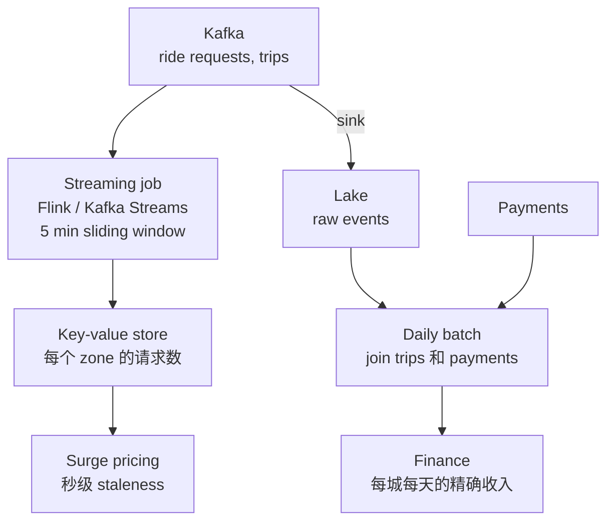

# Batch, micro-batch or streaming｜Batch、micro-batch 还是 streaming

> 原文：[DataInterview · Data Engineering System Design · Batch, micro-batch or streaming](https://www.datainterview.com/courses/data-engineering-system-design/concept-batch-vs-stream)（课程第 2 部分 Building blocks 的第 1 课，原文标注阅读约 22 分钟），抓取于 2026-11-14。

译文说明：

- 段落：英文原文放在引用块里，中文紧跟其后。
- 列表：用「English｜中文」两栏表格逐条对照。多列的大表格只直接展示中文版，英文原表折叠在下方。
- 原页面的交互组件（tab 切换、两张可调参数的图表、逐步演示）已改写成静态表格；折叠的 strong answer、hint 和参考答案都已展开；测验用 ✅ 标出正确选项。原文引用官方文档的链接只保留了链接文字。
- 译者自己加的内容都标了「译注」。

## 速览（译注）

- 选 batch、micro-batch 还是 streaming，只看两个数：数据要多新鲜，以及这份新鲜要花多少钱。
- 定时 job 的 staleness 最坏 = interval + wait + runtime，平均值再少半个 interval。interval 不再是最大的那一项之后，再缩短它就没用了。
- 跑得越频繁越贵，而且贵得比工作量涨得快：每次运行的固定开销、每次唤醒至少计费 60 秒、auto-suspend 前的空转。频率高到一定程度，warehouse 根本不会休眠，等于一直开着。
- 「实时」要先翻译成数字：谁根据这个数据做什么动作、多快做。自动决策要毫秒级，人盯着看要分钟级，报表按小时或天。
- streaming 额外带来 state、watermark、exactly-once sink（可见性跟着 checkpoint 走）和 24 小时 on-call。

---

## 开篇

> A product manager asks for a “real-time” signups dashboard. The team builds it with Kafka, a Flink job with state and checkpoints, and a real-time OLAP store, and puts two engineers on call for it. Three months later someone looks at the dashboard’s access log: it is opened twice a day, at the morning stand-up and before the weekly review. An hourly batch job would have shown the same numbers to the same people for a small fraction of the cost and none of the night pages. The opposite mistake happens too: a fraud check built as a nightly batch, discovering stolen cards a day after they were used.

产品经理要一个「实时」的注册数 dashboard。团队用 Kafka、一个带 state 和 checkpoint 的 Flink job、再加一个实时 OLAP store 搭了出来，还安排了两个工程师 on call。三个月后有人去看 dashboard 的访问日志：一天只被打开两次，早上站会一次，周会前一次。一个每小时跑一次的 batch job 就能让同样的人看到同样的数字，成本只是零头，也不会有半夜告警。反方向的错误也有：把盗刷检测做成每晚跑的 batch，卡被盗用一天后才发现。

> This lesson is about choosing between batch, micro-batch and streaming from two numbers: how fresh the data must be, and what that freshness costs. You’ll compute staleness as interval plus wait plus runtime on a live chart, follow one order through an hourly job, a micro-batch and a streaming job, and price schedules on a warehouse with its real billing rules. The exercises compute staleness from a run log and pick the cheapest schedule that meets a freshness SLO.

这一课讲怎么用两个数字在 batch、micro-batch 和 streaming 之间做选择：数据需要多新鲜，以及这份新鲜要花多少钱。你会在一张实时图表上把 staleness 算成 interval + wait + runtime；跟着一笔订单依次走过 hourly job、micro-batch 和 streaming job；按 warehouse 真实的计费规则给不同的调度频率算价钱。两道练习分别是：从 run log 算 staleness，以及挑出满足 freshness SLO 的最便宜调度。

---

## Three ways to run the same pipeline｜同一条 pipeline 的三种跑法

> The transformation can be identical; what changes is when it runs and how much data each run sees.

转换逻辑可以完全一样；变的是它什么时候跑，以及每次跑能看到多少数据。

| English | 中文 |
|---|---|
| **Batch:** a scheduler starts a job for a bounded slice of data, an hour or a day, after the slice is complete. In Airflow, a run for a data interval generally does not start until that interval has ended (Airflow docs); in Airflow 3 a bare cron string gets no data interval unless [scheduler] create_cron_data_intervals is turned on (timetables), so pick an interval timetable when the job needs one. Compute exists only while a run runs. | **Batch：** 一段有界数据（一小时或一天）完整之后，调度器为这段数据启动一个 job。在 Airflow 里，某个 data interval 的 run 一般要等这个 interval 结束才开始（Airflow docs）；Airflow 3 里，单写一个 cron 字符串默认没有 data interval，除非打开 `[scheduler] create_cron_data_intervals`（timetables），所以 job 需要 interval 时要选 interval timetable。只有 run 在跑的时候才占用 compute。 |
| **Micro-batch:** a long-running job wakes up on a short trigger and processes whatever arrived since the last batch. Spark Structured Streaming’s default trigger starts the next micro-batch as soon as the previous one finishes; a processing-time trigger starts them at a fixed interval; an available-now trigger processes everything available and stops, which turns the same code into a scheduled job (Spark docs). Spark’s documentation puts micro-batch latency at about 100 ms at best, with exactly-once guarantees. | **Micro-batch：** 一个常驻 job 按很短的 trigger 醒来，处理上一批之后到达的所有数据。Spark Structured Streaming 的默认 trigger 是上一个 micro-batch 一结束就开始下一个；processing-time trigger 按固定间隔开始；available-now trigger 处理完当前所有数据就停下，等于把同一份代码变成一个定时 job（Spark docs）。Spark 文档给出的 micro-batch latency 最好约 100 ms，并有 exactly-once 保证。 |
| **Streaming:** a job processes each event as it arrives and keeps state (counts, windows, joins) between events, as Flink and Kafka Streams do. Latency can be seconds or less, and the job, its state and its checkpoints run all day. | **Streaming：** job 每到一个 event 就处理一个，并在 event 之间保留 state（计数、window、join），Flink 和 Kafka Streams 就是这样。latency 可以到秒级甚至更低，而 job、它的 state 和 checkpoint 全天都在运行。 |

### 同一条 pipeline，三种跑法（原文为 tab 切换图）

| | Batch | Micro-batch | Streaming |
|---|---|---|---|
| 链路 | Raw files（S3，按小时）→ 定时 job（Spark 或 dbt）→ warehouse 表（按小时 overwrite）→ dashboard | Kafka topic 或新文件 → micro-batch job（Spark Structured Streaming）→ Delta 或 Iceberg（每批一次 commit）→ dashboard | Kafka topic → streaming job（Flink，逐个 event 处理）→ serving 表（upsert）→ dashboard |
| 由什么驱动 | Scheduler：Airflow 每小时一次 | Trigger：每 60 秒 | State：checkpoint |
| Staleness | interval + wait + runtime | trigger 间隔 + 批处理时间 | 处理时间；用 exactly-once sink 时再加上 checkpoint 间隔 |
| 成本 | 只有 run 在跑时才花 compute | 集群全天开着，批与批之间空闲 | 集群全天开着，还要存 state |
| 运维 | run 失败就重试，半夜不会叫醒人 | 常驻 job、checkpoint、要 compact 的小文件 | watermark、state 大小、replay、24 小时 on-call |

<details>
<summary>交互组件里的英文原文</summary>

| | batch | micro-batch | streaming |
|---|---|---|---|
| Path | Raw files (S3, by hour) → Scheduled job (Spark or dbt) → Warehouse table (overwrite by hour) → Dashboard (reads the table) | Kafka topic or new files → Micro-batch job (Spark Structured Streaming) → Delta or Iceberg (one commit a batch) → Dashboard | Kafka topic (events) → Streaming job (Flink, event at a time) → Serving table (upserts) → Dashboard |
| Driver | Scheduler: Airflow, hourly | Trigger: every 60 s | State: checkpoints |
| Staleness | interval + wait + runtime | trigger interval + batch time | processing time, plus the checkpoint interval for exactly-once sinks |
| Cost | compute only while a run is running | a cluster up all day, idle between batches | a cluster up all day, with state |
| Operations | a failed run is retried; nobody is paged at night | a long-running job, checkpoints, small files to compact | watermarks, state size, replays, on-call around the clock |

</details>

> Warehouses blur the line from the other side. Snowflake’s dynamic tables refresh to a target lag whose minimum is 60 seconds (docs), and Snowpipe Streaming’s high-performance architecture makes rows queryable in as little as 5 seconds (docs). The choice is less about the product than about how often work runs and what it keeps between runs.

warehouse 从另一头把这条界线弄模糊了。Snowflake 的 dynamic table 按 target lag 刷新，最小 60 秒（docs）；Snowpipe Streaming 的 high-performance 架构最快 5 秒就能让数据可查（docs）。所以这个选择与其说是选产品，不如说是选工作多久跑一次、两次之间保留什么。

---

## Staleness is interval + wait + runtime｜Staleness = interval + wait + runtime

> Staleness at a moment is how old the newest published data is. For a scheduled job it follows a sawtooth: right after a run publishes, the newest data is as old as the wait for late data plus the runtime; then it ages for a whole interval until the next run publishes. So the worst case is interval + wait + runtime, and the average is half an interval less. Set the sliders to your own job and an SLO.

某一时刻的 staleness，就是已发布的最新数据有多旧。定时 job 的 staleness 是锯齿形的：一次 run 刚发布时，最新数据的年龄 = 等迟到数据的时间 + runtime；之后它会整整老化一个 interval，直到下一次 run 发布。所以最坏情况是 interval + wait + runtime，平均值比最坏少半个 interval。原文可以拖动滑块，设成你自己的 job 和 SLO。

### 表的 staleness 随时间变化（原文为交互图表）

译注：图表纵轴是 staleness，横轴是第一次发布后的分钟数，曲线呈锯齿形，另有一条 SLO 水平线。下表是默认参数下的读数。

| 输入 | 默认值 | 输出 | 读数 |
|---|---|---|---|
| Run every（调度间隔） | 1 h | Best（最好） | 35 min |
| Wait for late data（等迟到数据） | 15 min | Worst（最坏） | 1 h 35 min |
| Runtime | 20 min | Average（平均） | 1 h 5 min |
| Freshness SLO | 1 h 30 min | Time within SLO（满足 SLO 的时间占比） | 92% |

> Right after a run publishes, the newest data is wait + runtime old. Then it ages for a full interval until the next run publishes, so the worst case is interval + wait + runtime and the average is half an interval less. Shortening the interval only helps until wait and runtime dominate.

一次 run 刚发布时，最新数据是 wait + runtime 那么旧；之后它会老化整整一个 interval，直到下一次发布。所以最坏是 interval + wait + runtime，平均再少半个 interval。缩短 interval 只在 wait 和 runtime 还不是主要部分时才有用。

> Two things fall out of the formula. A daily job is never fresher than a day, however fast it runs, and a 5-minute schedule with a 20-minute runtime is still more than 25 minutes stale at its worst. Shortening the interval pays off only while it is the largest term; after that, cut the wait (accept late data as corrections) or the runtime (process incrementally). Follow one order through three pipelines to see the terms at work.

从这个公式能直接得出两点：

- daily job 无论跑多快，都不会比一天更新鲜；5 分钟一次的调度，如果 runtime 是 20 分钟，最坏时也超过 25 分钟。
- 只有当 interval 是最大的那一项时，缩短它才划算。之后要么缩短 wait（把迟到数据当作后续修正来接受），要么缩短 runtime（改成增量处理）。

下面跟着一笔订单走过三条 pipeline，看这几项各自怎么起作用。

### 一笔订单，三条 pipeline（原文为逐步演示）

订单在 10:07 下单。前 5 步是 hourly batch，第 6 步是 micro-batch，第 7 步是 streaming。

**Step 1 · 10:00 interval [10:00, 11:00) opens｜这个小时的 interval 开始**

订单可见：not yet · Dashboard staleness：60 min

> An hourly batch job. Airflow runs the job for an interval after the interval ends; the job waits 15 minutes for late uploads, then runs for about 20 minutes. At 10:00 the dashboard shows data up to 09:00, published by the previous run at 09:35.

一个每小时跑一次的 batch job。Airflow 在 interval 结束后才为它跑 job；job 先等 15 分钟迟到上传，再跑约 20 分钟。10:00 时，dashboard 显示的是截至 09:00 的数据，由上一次 run 在 09:35 发布。

**Step 2 · 10:07 an order is placed (event time)｜订单下单**

订单可见：not yet · Dashboard staleness：67 min

> An order is placed at 10:07 and reaches the raw zone within seconds. Nothing reads it yet: the run that covers 10:07 has not started.

10:07 下了一笔订单，几秒内就进了 raw zone。但还没有任何东西读它：覆盖 10:07 的那次 run 还没开始。

**Step 3 · 11:00 interval closes (data_interval_end)｜interval 结束**

订单可见：not yet · Dashboard staleness：60 min

> 11:00: the interval closes. The dashboard still shows data up to 10:00 (published at 10:35), so it is 60 minutes stale and getting older.

11:00，interval 结束。dashboard 仍然显示截至 10:00 的数据（10:35 发布的），所以已经旧了 60 分钟，而且还在变旧。

**Step 4 · 11:15 run starts after the 15 min wait｜等完 15 分钟，run 开始**

订单可见：not yet · Dashboard staleness：75 min

> 11:15: the run starts and reads every event with an event time in [10:00, 11:00) that has arrived so far. Events from that hour arriving after 11:15 are picked up by a later run’s lookback.

11:15，run 开始，读取所有 event time 在 [10:00, 11:00) 内、并且到目前为止已经到达的 event。这个小时的 event 如果在 11:15 之后才到，会由之后某次 run 的 lookback 补上。

**Step 5 · 11:35 table overwritten; dashboard as of 11:00｜表被 overwrite，dashboard 更新到 11:00**

订单可见：11:35，88 min later · Dashboard staleness：35 min

> 11:35: the run overwrites the 10:00 hour and the order appears, 88 minutes after it was placed. A minute earlier the dashboard was 94 minutes stale; the worst case is 60 + 15 + 20 = 95 minutes.

11:35，run overwrite 了 10:00 这个小时的数据，订单终于出现，距离下单已经 88 分钟。一分钟前 dashboard 的 staleness 是 94 分钟；最坏情况是 60 + 15 + 20 = 95 分钟。

**Step 6 · micro-batch, Spark trigger every 60 s｜换成 micro-batch，每 60 秒触发**

时间线：10:07:02 订单进入 Kafka → 10:08:00 下一个 micro-batch 开始 → 10:08:20 这一批 commit 到表里。订单可见：10:08:20，80 s later · Dashboard staleness：up to 80 s

> The same order with Spark Structured Streaming and a 60-second processing-time trigger: it waits for the next batch, which takes 20 seconds to run and commit. The order shows up more than 60 times sooner; the cluster now runs all day.

同一笔订单，换成 Spark Structured Streaming 加 60 秒的 processing-time trigger：它要等下一批，而这一批跑完加 commit 要 20 秒。订单出现的速度快了 60 多倍；代价是集群现在要全天开着。

**Step 7 · streaming, Flink with 60 s checkpoints｜换成 streaming，Flink 每 60 秒 checkpoint**

时间线：10:07:02 订单进入 Kafka → 10:07:03 处理完，写进一个未提交的 transaction → 10:08:00 checkpoint 完成，transaction 提交。订单可见：最晚 10:08:00 · Dashboard staleness：up to about 60 s

> With Flink and an exactly-once Kafka sink, results are written inside a transaction committed at the next checkpoint, so read_committed consumers see the order only after it. Event-at-a-time processing does not mean second-level visibility: the checkpoint interval sets it. An idempotent upsert sink with at-least-once delivery shows it within seconds.

用 Flink 加 exactly-once 的 Kafka sink 时，结果写在一个 transaction 里，下一次 checkpoint 才提交，所以 read_committed 的 consumer 要等提交之后才能看到这笔订单。逐个 event 处理并不等于秒级可见：可见性由 checkpoint 间隔决定。如果改用 at-least-once 投递加幂等 upsert 的 sink，几秒内就能看到。

译注：三条 pipeline 的结果对比。

| Pipeline | 订单什么时候可见 | 从下单到可见 | Dashboard staleness |
|---|---|---|---|
| Hourly batch（等 15 min，跑 20 min） | 11:35 | 88 min | 最坏 95 min |
| Micro-batch（60 s trigger，每批 20 s） | 10:08:20 | 80 s | 最多 80 s |
| Streaming（Flink，60 s checkpoint，exactly-once sink） | 最晚 10:08:00 | 最多约 60 s | 最多约 60 s |

### 测验 1

> A job runs every 30 minutes, waits 10 minutes for late data and takes 25 minutes. The SLO is 'data no older than 1 hour'. Does it meet it?

一个 job 每 30 分钟跑一次，等 10 分钟迟到数据，运行 25 分钟。SLO 是「数据不超过 1 小时」。它满足吗？

| | English | 中文 |
|---|---|---|
| A | Yes: runs happen every 30 minutes, well within an hour | 满足：每 30 分钟跑一次，远在一小时以内 |
| B | It depends on how many events arrive | 取决于来了多少 event |
| C | Yes: the average staleness is 50 minutes | 满足：平均 staleness 是 50 分钟 |
| D ✅ | No: staleness peaks at 30 + 10 + 25 = 65 minutes, just before each publish | 不满足：每次发布前 staleness 达到峰值 30 + 10 + 25 = 65 分钟 |

> Right. The newest published data is wait + runtime = 35 minutes old right after a run, then ages for a full interval. It is over an hour old for the last 5 minutes of every cycle, about 17% of the time.

解析：每次 run 刚发布时，最新数据是 wait + runtime = 35 分钟旧，之后再老化整整一个 interval。每个周期的最后 5 分钟都超过一小时，约占 17% 的时间。

### Event 本身也会迟到（原文为可运行的 playground）

> Staleness of the table is not the whole story, because events also arrive late: a phone offline for 20 minutes delays its events by 20 minutes whatever the pipeline does. The playground measures, for every event of a made-up day, the time from when it happened to when it became visible, under four schedules.

表的 staleness 还不是全部，因为 event 本身也会迟到：一台离线 20 分钟的手机，不管 pipeline 怎么设计，它的 event 都会晚 20 分钟。下面的 playground 对编造的一天里的每个 event，计算它从发生到可见的时间，比较四种调度。

<details>
<summary>Playground 代码（50,000 个编造的 event，3% 迟到上传）</summary>

译注：缩进按页面文本还原；原页面编辑器只显示到 `fmt` 这一行，后面打印和画图的代码没有抓到。

```python
import math, random
import numpy as np

# One made-up day of events: event time in seconds, and the delay before each reaches the platform.
random.seed(3)
events = []
for _ in range(50_000):
    t = random.uniform(0, 86_400)
    r = random.random()
    delay = random.expovariate(1 / 2) if r < 0.97 else random.uniform(60, 1800)  # 3% arrive 1 to 30 min late
    events.append((t, t + delay))

def batch(interval, wait, runtime):
    """Run k starts at the end of interval k plus a wait for late data, reads everything that has
    arrived by then, and publishes runtime seconds later."""
    out = []
    for t, a in events:
        k = max(math.floor(t / interval), math.ceil((a - wait) / interval) - 1)  # first run that sees it
        start = (k + 1) * interval + wait
        out.append(start + runtime - t)
    return out

def micro_batch(trigger, runtime):
    """A batch starts every trigger seconds with whatever has arrived."""
    return [math.ceil(a / trigger) * trigger + runtime - t for t, a in events]

def streaming(processing, checkpoint):
    """Each event is processed on arrival; an exactly-once sink makes it visible at the next checkpoint."""
    return [math.ceil((a + processing) / checkpoint) * checkpoint - t for t, a in events]

for name, lag in [("daily batch, 2 h wait, 40 min run", batch(86_400, 7_200, 2_400)),
                  ("hourly batch, 15 min wait, 20 min run", batch(3_600, 900, 1_200)),
                  ("micro-batch every 60 s, 20 s run", micro_batch(60, 20)),
                  ("streaming, 60 s checkpoints", streaming(1, 60))]:
    p50, p95, top = np.percentile(lag, [50, 95, 100])
    fmt = lambda s: f"{s / 3600:6.1f} h" if s >= 3600 else f"{s / 60:6.1f} m" if s >= 60 else f"{s:6.1f} s"
```

</details>

> In this simulation the hourly batch shows a typical event after about an hour and the micro-batch and streaming lines are both around a minute at p95, because both are bounded by 60 seconds: one by its trigger, the other by its checkpoints. The maximum, about 30 minutes for both, is set by the 3% of uploads that arrived late, not by the pipeline. When you quote a freshness number, say whether it is the table’s staleness or the event’s end-to-end delay, and at which percentile.

在这次模拟里，hourly batch 中一个典型 event 大约一小时后可见；micro-batch 和 streaming 的 p95 都在一分钟左右，因为两者都被 60 秒卡住了：一个是 trigger，一个是 checkpoint。两者的最大值都约 30 分钟，这是那 3% 迟到上传决定的，和 pipeline 无关。报 freshness 数字时，要说清楚是表的 staleness 还是 event 的端到端延迟，以及是哪个百分位。

### 练习：从 run log 算 staleness

> In production you measure staleness from run metadata, which is what the next exercise does. The checks replay the cases that make the naive version report a fresher table than readers actually have.

生产环境里，staleness 是从 run 的元数据算出来的，下面这道练习就做这个。测试会重放几种情况：朴素的实现在这些情况下会报出比读者实际看到的更新鲜的数字。

> staleness(runs, t) returns how stale the published table is at minute t: t minus the newest data any successful, finished run has published. The checks build an hourly job with a 15-minute wait and a 20-minute runtime, then replay a failed run, a backfill of an older hour that finishes late, and a check before the first run of the day.

`staleness(runs, t)` 返回第 t 分钟时已发布表的 staleness：t 减去所有「已完成且成功」的 run 发布过的最新数据。测试先构造一个每小时跑、等 15 分钟、跑 20 分钟的 job，然后重放三种情况：一次失败的 run、一次较晚才完成的旧小时 backfill、当天第一次 run 之前的检查。

> The starter takes the most recent run to finish, whatever its status and whatever hour it covered.

starter 代码直接取最近完成的那次 run，不管它成功没有、覆盖的是哪个小时。

> Hint: Keep only runs with r["ok"] and r["finished"] <= t, then take the largest covers_until, not the latest run.

提示：只保留 `r["ok"]` 为真且 `r["finished"] <= t` 的 run，然后取其中最大的 `covers_until`，而不是最近那次 run 的。

参考答案：

```python
def staleness(runs, t, initial=0):
    """How stale the published table is at time t (minutes since midnight).

    runs: one dict per run: covers_until (minute up to which its data is complete), finished (minute
    the run finished and its output became visible) and ok (False if it failed).
    Staleness is t minus the newest covers_until among successful runs finished by t. Before any
    successful run, it is t minus `initial`, what the table held at midnight.
    """
    done = [r for r in runs if r["finished"] <= t and r["ok"]]      # a failed run publishes nothing
    if not done:
        return t - initial
    newest = max(r["covers_until"] for r in done)    # a late backfill of an older hour must not move it back
    return t - max(newest, initial)


runs = [{"covers_until": 60, "finished": 95, "ok": True},
        {"covers_until": 120, "finished": 150, "ok": False},
        {"covers_until": 120, "finished": 175, "ok": True}]
print([staleness(runs, t) for t in (30, 100, 160, 180)])
```

---

## What freshness costs｜新鲜度的成本

> A batch job pays for compute only while it runs. Run it more often and two things grow faster than the work itself. Each run carries a fixed overhead (starting up, planning, committing, small files), and the platform may bill more than the runtime: Snowflake bills warehouses per second with a 60-second minimum each time a warehouse starts, and a warehouse stays up, billing, until it has been idle for its AUTO_SUSPEND time, 600 seconds by default (compute billing, CREATE WAREHOUSE). Snowflake’s own guidance warns that very short auto-suspend settings with queries every few minutes lead to repeated minimum charges (warehouse considerations). Below some interval the warehouse never suspends, and the job costs as much as leaving it on.

batch job 只在运行时花 compute。但跑得越频繁，有两样东西涨得比工作量本身还快：

- **每次运行的固定开销**：启动、生成执行计划、commit、产生小文件。
- **平台的计费可能比实际运行时间多**：Snowflake 的 warehouse 按秒计费，但每次启动至少计 60 秒；而且 warehouse 会一直开着、一直计费，直到空闲满 AUTO_SUSPEND 时间，默认 600 秒（compute billing、CREATE WAREHOUSE）。Snowflake 自己的指南也提醒过：auto-suspend 设得很短、又每隔几分钟就来一次查询，会反复触发最低计费（warehouse considerations）。

interval 短到一定程度，warehouse 就永远不会休眠，这个 job 的成本就和一直开着 warehouse 一样。

### 新鲜度在 warehouse 上的成本（原文为交互图表）

译注：图表横轴是调度间隔（对数刻度，1 分钟到 1 天），纵轴是每天的美元成本，有三条线：warehouse 上的定时 run、warehouse 一直开着、streaming 集群（假设价格）。可调参数和截图时的读数如下（Small warehouse、60 秒 auto-suspend、每 15 分钟跑一次）。

| 可调参数 | 当时的值 | 读数 | 值 |
|---|---|---|---|
| Work for a full day（一天的总工作量） | 1 h | Per run（每次运行） | 1.4 min |
| Overhead per run（每次运行的固定开销） | 45 s | Warehouse up（warehouse 每天开着的时间） | 3.8 h/day |
| Streaming vCPUs | 8 vCPU | Cost a day（每天成本） | $15.20 |
| Warehouse | X-Small (1 credit/h) / **Small (2)** / Medium (4) | Worst staleness（最坏 staleness） | 26.4 min |
| Auto-suspend | **60 s** / 5 min / 10 min (default) | | |
| Run every | 1 min / 5 min / **15 min** / 1 h / 4 h / 1 day | | |

> Each run takes the fixed overhead plus its share of a day’s work, keeps the warehouse up for its runtime plus the auto-suspend time, and is billed at least 60 seconds per resume; if the next run starts before the warehouse suspends, it never suspends (Snowflake compute billing, AUTO_SUSPEND). Credits per hour are for standard Gen1 warehouses; $2.00 per credit is the Standard edition list price on AWS us-east-1, read October 2026. Worst staleness assumes a 10-minute wait for late data. The work, the overhead and the streaming line (vCPUs at an assumed $0.10 per vCPU-hour) are assumptions.

计算方式：每次运行的时长 = 固定开销 + 分摊到这次的工作量；每次运行让 warehouse 开着「runtime + auto-suspend 时间」；每次 resume 至少计费 60 秒；如果下一次 run 在 warehouse suspend 之前就开始，它就永远不会 suspend（Snowflake compute billing、AUTO_SUSPEND）。每小时 credit 数按 standard Gen1 warehouse 算；每 credit $2.00 是 AWS us-east-1 上 Standard edition 的标价（2026 年 10 月查询）。最坏 staleness 假设等迟到数据 10 分钟。工作量、固定开销和 streaming 那条线（按每 vCPU 小时 $0.10 假设）都是假设值。

> With the defaults (a Small warehouse, 60 minutes of work a day, 45 seconds of overhead and a 60-second auto-suspend), a daily run costs about $4 a day, hourly about $7, every 15 minutes about $15, every 5 minutes about $38, and every minute the full $96 of an always-on warehouse. Switch auto-suspend to the 10-minute default and anything more frequent than every 15 minutes is always on. A streaming job is always-on compute too, so the useful comparison is between the price of the freshness and the value of acting sooner.

默认参数下（Small warehouse、一天 60 分钟工作量、每次 45 秒固定开销、60 秒 auto-suspend），每天的成本：

| 调度 | 每天成本 |
|---|---|
| 每天一次 | 约 $4 |
| 每小时 | 约 $7 |
| 每 15 分钟 | 约 $15 |
| 每 5 分钟 | 约 $38 |
| 每分钟 | $96，等于 warehouse 一直开着 |

如果把 auto-suspend 改回默认的 10 分钟，任何比 15 分钟更频繁的调度都等于一直开着。streaming job 本来也是常驻 compute，所以真正有意义的比较是：这份新鲜度的价格，和早一点行动带来的价值。

### 测验 2

> A dbt job on a Snowflake warehouse runs every 5 minutes and takes 90 seconds. The warehouse uses the default AUTO_SUSPEND of 600 seconds. What does the warehouse cost a day?

一个 dbt job 在 Snowflake warehouse 上每 5 分钟跑一次，每次 90 秒。warehouse 用默认的 AUTO_SUSPEND（600 秒）。这个 warehouse 每天花多少钱？

| | English | 中文 |
|---|---|---|
| A ✅ | The same as leaving it on 24 hours, because it never suspends | 和开 24 小时一样，因为它永远不会 suspend |
| B | 288 runs × 60 s minimum = 4.8 hours of credits | 288 次 × 最低 60 秒 = 4.8 小时的 credit |
| C | 288 runs × 90 s = 7.2 hours of credits | 288 次 × 90 秒 = 7.2 小时的 credit |
| D | Nothing between runs, because Snowflake bills per query | 两次 run 之间不花钱，因为 Snowflake 按查询计费 |

> Right. After each run it waits 600 seconds before suspending, but the next run starts after 210 seconds of idle time. The warehouse never suspends, so it bills every second of the day. With AUTO_SUSPEND at 60 seconds, each run would bill 150 seconds, about half the day. Snowflake’s own guidance warns about this trade-off for frequent workloads.

解析：每次 run 结束后要空闲 600 秒才会 suspend，但下一次 run 在空闲 210 秒后就开始了。warehouse 永远不会 suspend，所以全天每一秒都在计费。如果 AUTO_SUSPEND 设成 60 秒，每次 run 计费 150 秒，加起来大约半天。Snowflake 自己的指南也提醒过高频负载下的这个取舍。

### 练习：满足 SLO 的最便宜调度

> daily_credits prices a schedule on a warehouse billed like Snowflake: per second, 60 seconds minimum per resume, idle time until auto-suspend included, and all day if runs come faster than the warehouse can suspend. cheapest picks the cheapest interval whose worst-case staleness (interval + wait + runtime) meets the freshness SLO.

`daily_credits` 按 Snowflake 的计费方式给一个调度算价钱：按秒计费，每次 resume 最少 60 秒，算上 auto-suspend 之前的空闲时间；如果 run 来得比 warehouse 能 suspend 的速度还快，就按全天算。`cheapest` 在最坏 staleness（interval + wait + runtime）满足 freshness SLO 的 interval 里挑最便宜的那个。

> The starter bills runtime only and ignores the SLO. The checks replay a 20-second run, a 10-minute auto-suspend, a 5-minute schedule that never lets the warehouse sleep, and two SLO choices.

starter 代码只按 runtime 计费，而且忽略 SLO。测试会重放：一次 20 秒的 run、10 分钟的 auto-suspend、一个让 warehouse 永远睡不着的 5 分钟调度，以及两种 SLO 选择。

> Hint: Up time per run is runtime_s + auto_suspend_s. If that is at least the interval in seconds, return 24 * credits_per_hour; otherwise bill max(60, up) per run. In cheapest, skip intervals with i + wait_min + runtime(i) / 60 > slo_min.

提示：每次 run 让 warehouse 开着 `runtime_s + auto_suspend_s`。如果它不小于 interval 的秒数，返回 `24 * credits_per_hour`；否则每次 run 按 `max(60, up)` 计费。在 `cheapest` 里，跳过 `i + wait_min + runtime(i) / 60 > slo_min` 的 interval。

参考答案（译注：`cheapest` 部分的缩进按页面文本还原）：

```python
def daily_credits(interval_min, runtime_s, credits_per_hour, auto_suspend_s=600):
    """Credits a day for running a job every interval_min minutes on a warehouse that is resumed for
    each run and suspended auto_suspend_s seconds after it goes idle.

    Billing, as Snowflake documents it: per second, with a 60-second minimum each time the warehouse
    starts. One run keeps the warehouse up for runtime_s + auto_suspend_s seconds. If the next run
    starts before the warehouse has suspended, it never suspends: the day costs 24 hours.
    """
    up = runtime_s + auto_suspend_s                    # running, then idle until it suspends
    if up >= interval_min * 60:
        return 24 * credits_per_hour                   # the next run arrives first: never suspends
    runs = 24 * 60 / interval_min
    billed = max(60, up)                               # the minimum applies to every resume
    return runs * billed / 3600 * credits_per_hour

def cheapest(intervals, slo_min, wait_min, runtime, credits_per_hour, auto_suspend_s=600):
    """Among intervals (minutes), the cheapest whose worst-case staleness (interval + wait + runtime)
    meets slo_min. runtime(interval) gives a run's seconds for that interval. Returns the interval,
    or None if none meets the SLO. Ties go to the shorter interval."""
    best = None
    for i in sorted(intervals):
        if i + wait_min + runtime(i) / 60 > slo_min:   # misses the freshness target
            continue
        cost = daily_credits(i, runtime(i), credits_per_hour, auto_suspend_s)
        if best is None or cost < best[1]:
            best = (i, cost)
    return best[0] if best else None

print(round(daily_credits(15, 90, credits_per_hour=2, auto_suspend_s=60), 2))
print(cheapest([5, 15, 60, 240], slo_min=90, wait_min=10, runtime=lambda i: 30 + 2.5 * i,
               credits_per_hour=2, auto_suspend_s=60))
```

---

## When “real time” is really hourly batch｜当「实时」其实是 hourly batch

> “Real time” in a prompt has to become a number before it can drive a design. Turn it into one by asking who acts on the data, how, and how fast: a model blocking a payment acts in milliseconds; a person watching a map acts in minutes; a marketer moving budgets acts a few times a day; an executive reading a report acts weekly. Then ask what a stale number costs. If nothing changes when the number is an hour old, the requirement is an hour, and the design is a batch.

题目里的「实时」要先变成一个数字，才能拿来驱动设计。方法是问：谁根据这份数据做动作、做什么、多快做。

| 谁在用 | 多快行动 |
|---|---|
| 拦截支付的模型 | 毫秒 |
| 盯着地图的人 | 几分钟 |
| 调预算的市场人员 | 一天几次 |
| 看报告的高管 | 每周 |

然后再问：数字旧了会造成什么损失。如果数字晚一小时什么都不会改变，需求就是一小时，设计就是 batch。

### 测验 3

> A product manager asks for a 'real-time' dashboard of daily signups. Which question settles the design fastest?

产品经理要一个「实时」的每日注册数 dashboard。哪个问题最快能把设计定下来？

| | English | 中文 |
|---|---|---|
| A | Which streaming engine does the company already run? | 公司已经在用哪个 streaming 引擎？ |
| B | Should we use Kafka or Kinesis? | 用 Kafka 还是 Kinesis？ |
| C ✅ | What will someone do differently if the number is 5 minutes old instead of 1 hour old? | 数字是 5 分钟前的还是 1 小时前的，会让谁做出不同的决定？ |
| D | How many signups are there per second? | 每秒有多少注册？ |

> Right. Freshness is worth paying for only when someone acts on it within that time. If the answer is “nothing”, an hourly or 15-minute batch is the design, and the streaming costs disappear.

解析：只有当有人会在那么短的时间内据此行动时，新鲜度才值得花钱。如果答案是「没人会做什么不同的事」，设计就是每小时或每 15 分钟一次的 batch，streaming 的成本也就不存在了。

### 练习：真的需要 streaming 吗？

> Three requests arrive the same week. For each, decide batch, micro-batch or streaming, and say which question settled it. (1) Marketing: “We need real-time campaign spend so we can adjust budgets.” (2) Payments: “Block a card when it makes more than 5 purchases in 10 minutes.” (3) Operations: “A live map of open support tickets by region for the shift leads.”

同一周来了三个需求。分别判断用 batch、micro-batch 还是 streaming，并说出是哪个问题让你做出了决定。

1. 市场：「我们需要实时的广告花费数据来调整预算。」
2. 支付：「一张卡 10 分钟内消费超过 5 次就拦截。」
3. 运营：「给值班主管一张按区域显示未关闭工单的实时地图。」

**参考答案（strong answer）**

> Freshness is set by the fastest action someone takes on the data.

需要多新鲜，由针对这份数据最快的那个动作决定。

| English | 中文 |
|---|---|
| Marketing: ask how often budgets are changed. If it is a few times a day by people in a tool, an hourly batch with a 95-minute worst case is plenty, at a fraction of the cost. “Real time” meant “today, not tomorrow”. | **市场**：问预算多久调一次。如果是人在工具里一天调几次，最坏 95 分钟的 hourly batch 就足够了，成本只是零头。这里的「实时」意思是「今天就要，不是明天」。 |
| Payments: the action is automatic and happens during authorization, within a second. That needs a streaming job keeping a count per card over a 10-minute window in state, read by the payment service. Here streaming is the requirement. | **支付**：动作是自动的，发生在授权过程中，一秒以内。这需要一个 streaming job 在 state 里按卡维护 10 分钟 window 的计数，由支付服务来读。这里 streaming 是真需求。 |
| Operations: shift leads look at the map every few minutes. A micro-batch every 1 to 5 minutes, or a dynamic table with a few minutes of target lag, is enough. | **运营**：值班主管每隔几分钟看一次地图。每 1 到 5 分钟的 micro-batch，或者 target lag 为几分钟的 dynamic table，就够了。 |
| Each answer comes with a number: 95 minutes, under a second, 5 minutes. And the streaming one comes with its cost: an always-on job, state, and someone on call. | 每个答案都带一个数字：95 分钟、一秒以内、5 分钟。streaming 那个还要说出它的代价：常驻 job、state，以及有人 on call。 |

自查清单：

| English | 中文 |
|---|---|
| Asks who acts on the data and how often | 问了谁根据数据行动、多久一次 |
| Marketing: budgets change a few times a day, so hourly batch | 市场：预算一天改几次，所以 hourly batch |
| Payments: the decision is inside authorization, so streaming with state | 支付：决策发生在授权过程中，所以用带 state 的 streaming |
| Operations: people glance every few minutes, so micro-batch | 运营：人每隔几分钟看一眼，所以 micro-batch |
| States a staleness number for each | 每个都给了 staleness 数字 |
| Mentions cost or on-call for the streaming one | 提到了 streaming 方案的成本或 on-call |

---

## What streaming adds｜Streaming 额外带来什么

> When the answer is seconds, streaming is the right tool, and it brings work a batch job does not have. The job keeps state that must be checkpointed and restored. It must decide when a window is complete without seeing the future, which is what watermarks are for, and what to do with events that arrive after that. Exactly-once results need either transactional sinks or idempotent writes. And because it never stops, failures happen at night and replays happen with live traffic. Our streaming course covers each of these: why streaming, watermarks, state and checkpoints and exactly-once processing.

当答案是秒级时，streaming 就是对的工具，但它会带来 batch job 没有的工作：

- job 要保存 state，而且 state 必须能 checkpoint 和恢复。
- 它必须在看不到未来的情况下判断一个 window 什么时候算完整（watermark 就是干这个的），还要决定 window 关闭后才到的 event 怎么处理。
- 要得到 exactly-once 的结果，需要 transactional sink 或幂等写入。
- 因为它从不停止，故障会在半夜发生，replay 也要在有线上流量的情况下进行。

这个网站的 streaming 课程逐一讲了这些：why streaming、watermarks、state and checkpoints、exactly-once processing。

> One consequence surprises people in interviews: exactly-once can cost freshness. Flink’s Kafka sink with an exactly-once guarantee writes inside a Kafka transaction committed on checkpoint, which delays record visibility for committed-only readers until the checkpoint is written (Flink Kafka connector). Spark’s experimental continuous mode reaches about 1 ms latency but only with at-least-once guarantees (Spark docs).

有个结论在面试里常让人意外：exactly-once 可能要牺牲 freshness。Flink 的 Kafka sink 在 exactly-once 模式下，把数据写在一个 Kafka transaction 里，到 checkpoint 时才 commit，所以只读已提交数据的 reader 要等 checkpoint 写完才能看到这些记录（Flink Kafka connector）。Spark 实验性的 continuous mode 能做到约 1 ms 的 latency，但只有 at-least-once 保证（Spark docs）。

### 测验 4

> A Flink job writes to Kafka with an exactly-once sink and checkpoints every 5 minutes. Downstream consumers read with isolation.level=read_committed. How fresh can their data be?

一个 Flink job 用 exactly-once sink 写 Kafka，每 5 分钟 checkpoint 一次。下游 consumer 用 `isolation.level=read_committed` 读取。它们读到的数据能有多新鲜？

| | English | 中文 |
|---|---|---|
| A | Milliseconds, because Flink processes events one at a time | 毫秒级，因为 Flink 逐个处理 event |
| B | Exactly 5 minutes for every record | 每条记录都正好 5 分钟 |
| C ✅ | Up to about 5 minutes old: records become visible when the checkpoint commits the transaction | 最多约 5 分钟旧：记录在 checkpoint 提交 transaction 时才可见 |
| D | It depends only on consumer lag | 只取决于 consumer lag |

> Right. Flink’s Kafka sink writes inside a transaction that commits on checkpoint, and committed-only readers wait for it. The documentation warns that this delays visibility until a checkpoint is written and says to adjust the checkpoint duration accordingly. A shorter interval, or an at-least-once sink with idempotent writes downstream, gets you seconds.

解析：Flink 的 Kafka sink 在一个 transaction 里写数据，checkpoint 时才提交，只读已提交数据的 reader 必须等它。文档也提醒了这会把可见性推迟到 checkpoint 写完之后，并建议相应调整 checkpoint 间隔。缩短间隔，或者改用 at-least-once sink 加下游幂等写入，就能做到秒级。

---

## Lambda and kappa, briefly｜简单说说 lambda 和 kappa

> Two named architectures answer “what if I need both?”. Lambda runs a streaming path for fresh, approximate results and a batch path that recomputes exact results from the raw data, and merges them at serving time; the cost is two implementations of the same logic. Kappa keeps only the streaming path and reprocesses history by replaying the log into a new version of the job. The streaming course’s architectures lesson compares them in depth. In a design round, the useful version of the idea is narrower: when two consumers need the same data at very different freshness and correctness, give each its own path from a shared source.

有两种有名字的架构专门回答「两样都要怎么办」：

- **Lambda**：同时跑一条 streaming 路径（新鲜但近似的结果）和一条 batch 路径（从 raw 数据重算精确结果），在 serving 时合并。代价是同一套逻辑要实现两遍。
- **Kappa**：只保留 streaming 路径；需要重算历史时，把 log replay 进新版本的 job。

streaming 课程的架构那一课会深入对比两者。在设计面试里，这个思路更有用的版本要窄一些：两个 consumer 对同一份数据的 freshness 和正确性要求差别很大时，从共享的 source 给它们各开一条路径。

### 练习：给不同 consumer 的「快」和「准」

> Ride-hailing: the surge pricing service needs ride requests per zone over the last 5 minutes, within 10 seconds. Finance needs exact trip revenue per city per day, matching payments. One pipeline or two? Sketch it and say where each number comes from.

网约车：动态加价（surge pricing）服务需要每个区域过去 5 分钟的叫车请求数，延迟在 10 秒以内。财务需要每个城市每天精确的行程收入，要和支付对得上。一条 pipeline 还是两条？画出来，并说明每个数字从哪来。

**参考答案（strong answer）**

> Share the source, split the paths by freshness and correctness.

共享 source，按 freshness 和正确性拆成两条路径。

| English | 中文 |
|---|---|
| Ride requests and trips go to Kafka once. A streaming job (Flink or Kafka Streams) counts requests per zone in 5-minute sliding windows and writes them to a key-value store the surge service reads: seconds of staleness, approximate in edge cases, which surge tolerates. | 叫车请求和行程只写一次 Kafka。一个 streaming job（Flink 或 Kafka Streams）按区域在 5 分钟滑动 window 里计数，写进一个 key-value store 供 surge 服务读取：staleness 是秒级，边界情况下是近似值，surge 能接受。 |
| A sink lands the same events in the lake. A daily batch job joins trips with payments and produces exact revenue per city per day, reconciled with the payment provider. | 一个 sink 把同样的 event 落进 lake。每日 batch job 把行程和支付 join 起来，产出每个城市每天的精确收入，并和支付服务商对账。 |
| This is the lambda shape in miniature, justified here because the two outputs have different consumers. Do not merge the streaming counts into the finance numbers. | 这就是缩小版的 lambda，在这里成立是因为两个产出有不同的 consumer。不要把 streaming 的计数混进财务数字里。 |
| If the surge job had a bug, replay the topic from Kafka’s retention (7 days by default) into a fixed job; if finance had one, rerun the daily batch over the affected days. | surge job 出 bug 时，在 Kafka 的 retention 范围内（默认 7 天）把 topic replay 进修好的 job；财务出 bug 时，对受影响的日期重跑每日 batch。 |

译注：按参考答案画的数据流。



自查清单：

| English | 中文 |
|---|---|
| Two consumers, two freshness targets: seconds and a day | 两个 consumer，两个 freshness 目标：秒级和一天 |
| Streaming job for surge: windowed counts per zone, in state | surge 用 streaming job：在 state 里按区域做 window 计数 |
| Daily batch for finance from the raw events and payments | 财务用每日 batch，数据来自 raw events 和 payments |
| Both read the same Kafka topics; raw events land in the lake | 两条路径读同样的 Kafka topic；raw events 落进 lake |
| Finance numbers never come from the streaming path | 财务数字绝不来自 streaming 路径 |
| Says how a bug in the streaming job is fixed (replay) | 说明了 streaming job 出 bug 怎么修（replay） |

---

## How this comes up in interviews｜实际面试中是什么样

> Interviewers test the choice from both sides. If you propose streaming, expect “why not hourly?”, “what does it cost?” and “what happens when the job is down for an hour?”. If you propose batch, expect “the business wants it faster, what changes?” and “how stale can it get?”. A complete answer starts from the consumer’s action and a freshness number with a percentile, computes staleness as interval + wait + runtime for the batch option, prices the options (runs a day, minimum billing, idle time, an always-on cluster), names what streaming adds (state, watermarks, exactly-once sinks, on-call) and says which consumer, if any, gets a separate fast path.

面试官会从两个方向考这个选择：

- 你提议 streaming，就准备被问：「为什么不每小时跑一次？」「要花多少钱？」「job 挂一个小时会怎样？」
- 你提议 batch，就准备被问：「业务想要更快，要改什么？」「最旧会旧到什么程度？」

一个完整的回答包括：

1. 从 consumer 的动作出发，给出带百分位的 freshness 数字。
2. 对 batch 方案，按 interval + wait + runtime 算 staleness。
3. 给各个方案算价钱：每天跑几次、最低计费、空闲时间、常驻集群。
4. 说出 streaming 额外带来什么：state、watermark、exactly-once sink、on-call。
5. 说明哪个 consumer（如果有的话）需要一条单独的快速路径。

---

## Common mistakes｜常见错误

| 错误 | 后果 | 怎么改 |
|---|---|---|
| 把「实时」按字面理解 | 为一个一天只看两次的数字搭了一套常驻 streaming 系统 | 问清谁根据它行动、多快行动；把 staleness 目标写成数字 |
| 把调度频率当成 freshness | 「每小时」最坏其实是 95 分钟 | 用 interval + wait + runtime，给出最坏值和平均值 |
| 在默认 auto-suspend 下每隔几分钟跑一次 warehouse job | warehouse 永远不休眠，全天计费 | 按最低计费和空闲时间给调度算价钱；调低 auto-suspend 或拉长 interval |
| 以为 streaming 就是秒级可见 | exactly-once sink 要到每次 checkpoint 才发布 | 按 freshness 目标设定 checkpoint 间隔，或者用幂等 upsert |
| 用最近一次 run 而不是最新数据来衡量 freshness | 一次迟到的 backfill 或一次失败的 run 会让监控说谎 | 用成功的 run 发布过的最新数据来算 freshness |
| 同一个 consumer 用两条代码路径 | 无缘无故承担 lambda 的成本：两条路径的逻辑会逐渐不一致 | 每种 consumer 需求一条路径；只有 freshness 或正确性要求不同时才加第二条 |

<details>
<summary>英文原表</summary>

| MISTAKE | WHAT GOES WRONG | FIX |
|---|---|---|
| Taking “real time” literally | An always-on streaming system for a number read twice a day | Ask who acts on it and how fast; write the staleness target as a number |
| Quoting the schedule as the freshness | “Hourly” turns out to be 95 minutes at worst | Interval + wait + runtime, worst case and average |
| Running a warehouse job every few minutes with default auto-suspend | The warehouse never suspends and bills all day | Price the schedule with minimum billing and idle time; lower auto-suspend or lengthen the interval |
| Assuming streaming means second-level visibility | Exactly-once sinks publish at each checkpoint | Size the checkpoint interval to the freshness target, or use idempotent upserts |
| Using the latest run, not the newest data, to measure freshness | A late backfill or a failed run makes monitoring lie | Freshness from the newest data published by successful runs |
| Two code paths for one consumer | Lambda’s cost without a reason: logic drifts between paths | One path per consumer need; a second only when freshness or correctness differ |

</details>

---

## Recap｜回顾

| English | 中文 |
|---|---|
| Batch runs on a schedule over complete slices; micro-batch wakes on a short trigger; streaming processes each event and keeps state. | batch 按调度处理完整的数据切片；micro-batch 按短 trigger 醒来；streaming 逐个处理 event 并保留 state。 |
| Staleness of a scheduled job is between wait + runtime and interval + wait + runtime; quote the worst case and the percentile. | 定时 job 的 staleness 在 wait + runtime 和 interval + wait + runtime 之间；报数字时给出最坏值和百分位。 |
| Frequent runs cost more than their share of work: fixed overhead per run, minimum billing per resume, idle time before suspend, and eventually an always-on warehouse. | 频繁运行的成本高于它分摊的工作量：每次运行的固定开销、每次 resume 的最低计费、suspend 前的空闲时间，最后变成一直开着的 warehouse。 |
| Choose from the consumer’s action: milliseconds for automated decisions, minutes for people watching, hours or a day for reports. | 根据 consumer 的动作来选：自动决策要毫秒级，人盯着看要分钟级，报表按小时或天。 |
| Streaming adds state, watermarks, exactly-once sinks whose visibility follows checkpoints, and round-the-clock operations. | streaming 额外带来 state、watermark、可见性跟着 checkpoint 走的 exactly-once sink，以及 24 小时的运维。 |
| Lambda and kappa answer “both”; in practice, give consumers with different freshness and correctness their own path from a shared source. | lambda 和 kappa 回答的是「两样都要」；实践中，给 freshness 和正确性要求不同的 consumer 从共享 source 各开一条路径。 |

> Next up: getting data in, with CDC, API extraction and event collection.

下一课：数据接入，讲 CDC、API 抽取和 event 采集。
