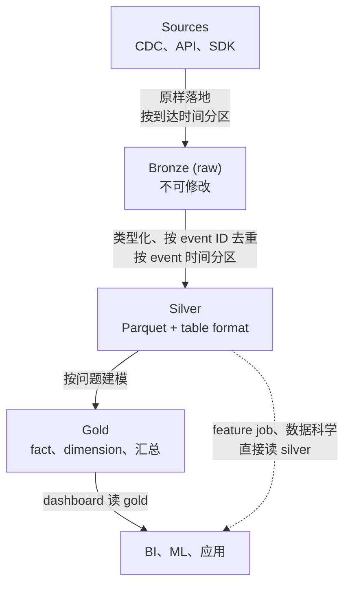
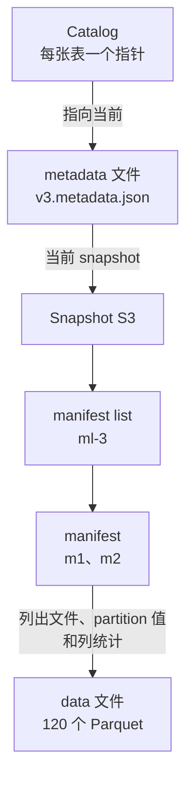

# Storage layout: lakes, table formats and partitioning｜存储布局：lake、table format 和 partitioning

> 原文：[DataInterview · Data Engineering System Design · Storage layout: lakes, table formats and partitioning](https://www.datainterview.com/courses/data-engineering-system-design/concept-data-lakes)（课程第 2 部分 Building blocks 的第 3 课，原文标注阅读约 23 分钟），抓取于 2026-11-14。

译文说明：

- 段落：英文原文放在引用块里，中文紧跟其后。
- 列表：用「English｜中文」两栏表格逐条对照。多列的大表格只直接展示中文版，英文原表折叠在下方。
- 原页面的交互组件（两个逐步演示、文件格式图表、小文件滑块、partition 方案切换、三种 table format 的代码 tab）已改写成静态表格和代码块；折叠的 hint 和参考答案都已展开；测验用 ✅ 标出正确选项。练习的编辑器里显示的是官方 solution，这里直接作为参考答案。
- 译者自己加的内容（包括两张 Mermaid 图）都标了「译注」。

## 速览（译注）

- lake 分 zone：bronze 按到达原样保存、不可修改、按到达时间分区；silver 做类型化和去重；gold 按问题建模。出了 bug 就从 bronze 重建。
- silver 和 gold 默认用 Parquet + zstd：列式读取、带 min/max 统计，典型数据比 JSON 小 5 到 10 倍。
- 文件应该是几百 MB。小文件 = 写入 task 数 × 提交频率 × 每次碰到的 partition 数；修法是改 writer，再加 compaction。
- 按时间分区，并对照引擎的限制算出 partition 数和大小（BigQuery 每表 10,000 个；Databricks 每个至少 1 GB）。高基数的 key 用 clustering，不要分区。
- Table format（Iceberg、Delta、Hudi）带来原子提交、乐观并发、time travel、schema evolution 和行级变更。compaction、snapshot 过期、孤儿文件清理都要算进设计里。

---

## 开篇

> A common production incident: a query that counts yesterday’s clickstream events on S3 takes nine minutes, and most of that time goes to listing and opening files. A streaming job writes the table every minute from 16 tasks into hourly folders, so one day is about 92,000 files of 1 MB each. Nobody chose that layout; it followed from a few defaults. In an interview the same thing appears as “how would you lay out 2 PB of logs on object storage?” or as a follow-up after you draw a box labelled “data lake”.

一个很常见的生产事故：在 S3 上数昨天的 clickstream event，一条 query 跑了九分钟，大部分时间花在 list 和打开文件上。一个 streaming job 每分钟用 16 个 task 往按小时分的目录里写，于是一天大约有 92,000 个 1 MB 的文件。没人特意选这个布局，它是几个默认值叠出来的。面试里同样的问题会以「2 PB 的日志你怎么在 object storage 上布局？」的形式出现，或者在你画了一个写着「data lake」的框之后被追问。

> This lesson is about the decisions inside that box. You’ll walk a lake’s zones from raw to curated with real paths, compare file formats by what they store and what a query reads, find where small files come from, do the partition arithmetic against real limits, and step through a table format commit with two writers. Then you’ll measure formats and pruning with DuckDB, write a compaction planner, and prune files across a partition spec change.

这一课讲那个框里面的决策：用真实路径走一遍 lake 从 raw 到 curated 的各个 zone；从存储大小和 query 读取量比较文件格式；找出小文件从哪来；对照真实的限制算 partition；一步步看两个 writer 在 table format 上提交。然后用 DuckDB 实测格式和 pruning，写一个 compaction planner，再写一个跨 partition spec 变更做文件裁剪的函数。

---

## Zones｜Zone

> A lake is not one pile of files. Data moves through zones, each with its own guarantees, owners and access rules. Step through them, including the day a bug forces a rebuild.

lake 不是一堆文件。数据在几个 zone 之间流动，每个 zone 有自己的保证、owner 和访问规则。下面一步步走一遍，包括某天一个 bug 逼得你重建的情况。

译注：按演示整理的数据流。



### Lake 的各个 zone（原文为逐步演示）

S3 上的路径；数据量是假设值。

**Step 1｜三个 zone**

路径：`s3://acme-lake/` 下有 `bronze/`、`silver/`、`gold/`

> A lake on object storage is split into zones by how much has been done to the data. Databricks calls them bronze, silver and gold (the medallion architecture); others say raw, cleaned and curated. The example: assume 1.2 billion app events a day at about 1 KB each as JSON.

object storage 上的 lake 按数据被加工了多少分成几个 zone。Databricks 叫 bronze、silver、gold（medallion architecture）；也有人叫 raw、cleaned、curated。例子：假设每天 12 亿条 app event，每条 JSON 约 1 KB。

**Step 2｜Bronze**

路径：`s3://acme-lake/bronze/app_events/ingest_date=2026-10-12/hour=09/part-0000.json.gz`

> Bronze keeps what arrived, as it arrived, partitioned by arrival time so each ingestion run writes its own prefix. About 1.2 TB a day of JSON, about 150 GB gzipped (assumed ratio). Append-only, never edited, kept long enough to rebuild everything downstream.

Bronze 按到达时的原样保存数据，按到达时间分区，所以每次 ingestion run 写自己的 prefix。每天约 1.2 TB JSON，gzip 后约 150 GB（压缩比是假设的）。只追加、从不修改，保留时间要足够长，能重建下游的一切。

**Step 3｜Silver**

路径：`s3://acme-lake/silver/app_events/`（Iceberg 表）`data/ts_day=2026-10-12/00000-14-....parquet`

> Silver is typed, deduplicated on the event ID, with timestamps corrected and personal data tokenized, stored as Parquet (zstd) in a table format and partitioned by event day. Assume about 90 GB a day. Most analysis and most joins start here.

Silver 是类型化的，按 event ID 去重，时间戳已校正，个人数据已 tokenize；以 Parquet（zstd）存在 table format 里，按 event 日期分区。假设每天约 90 GB。大部分分析和 join 从这里开始。

**Step 4｜Gold**

路径：`s3://acme-lake/gold/fct_orders/`、`s3://acme-lake/gold/daily_active_users/`

> Gold holds the models people query: facts and dimensions, and aggregates such as daily active users, a few GB a day. It is shaped by the questions asked, which is the subject of the next lesson.

Gold 放大家实际 query 的模型：fact 和 dimension，以及 DAU 之类的汇总，每天几 GB。它的形状由大家问的问题决定，这是下一课的主题。

**Step 5｜Consumer**

`dashboards -> gold.daily_active_users`；`feature jobs -> silver.app_events`

> Consumers read gold, and some (data science, feature pipelines) read silver. Access control follows the zones: few people can read bronze, which holds raw personal data.

consumer 读 gold，有一些（数据科学、feature pipeline）读 silver。权限控制跟着 zone 走：bronze 里有原始个人数据，能读的人很少。

**Step 6｜发现 bug，重建**

`rebuild silver for ts_day 2026-09-01 .. 2026-10-12`，`from bronze ingest_date 2026-09-01 .. 2026-10-14`

> A bug in the dedupe step is found after six weeks. Because bronze is untouched, silver is rebuilt for the affected days from bronze (reading two extra days of arrivals for late events), then gold is rebuilt from silver. If bronze had been cleaned in place, the data would be gone.

去重步骤里的一个 bug 六周后才被发现。因为 bronze 没被动过，可以从 bronze 重建受影响那些天的 silver（为了迟到的 event 多读两天的到达数据），再从 silver 重建 gold。如果当初直接在 bronze 里原地清洗，数据就没了。

> Two rules make zones work. Bronze is immutable and partitioned by arrival, so every ingestion run writes its own prefix and can be rerun on its own, and a rebuild has an untouched source. Silver and gold are partitioned by the time the business cares about (event time), because that is what queries filter on. A late event lands in today’s bronze prefix and in last Tuesday’s silver partition, which is why the rebuild in the last step reads two extra days of arrivals.

zone 能起作用靠两条规则：

| English | 中文 |
|---|---|
| Bronze is immutable and partitioned by arrival, so every ingestion run writes its own prefix and can be rerun on its own, and a rebuild has an untouched source. | Bronze 不可修改、按到达时间分区。所以每次 ingestion run 写自己的 prefix，可以单独重跑；重建时也有一份没被动过的源数据。 |
| Silver and gold are partitioned by the time the business cares about (event time), because that is what queries filter on. | Silver 和 gold 按业务关心的时间（event 时间）分区，因为 query 就是按它过滤的。 |

一条迟到的 event 会落在今天的 bronze prefix 里，同时落在上周二的 silver partition 里。这就是上面最后一步重建时要多读两天到达数据的原因。

---

## File formats｜文件格式

> Three formats cover almost every lake. JSON (often gzipped) is what APIs and SDKs produce: self-describing, large, slow to parse, and a gzip file cannot be split between readers. Avro is a binary row format with the schema in the file header, good for writing record by record and the usual encoding on Kafka; it suits bronze. Parquet is columnar: rows are grouped into row groups (128 MB by default in Iceberg’s writer), each column of a group is stored and compressed separately, and the footer holds the min and max of every column chunk, so a reader fetches only the columns it needs and skips groups whose range cannot match. Silver and gold are Parquet, inside a table format. ORC is the columnar alternative from the Hive world.

三种格式几乎覆盖所有 lake：

| 格式 | 特点 | 适合 |
|---|---|---|
| JSON（常常 gzip） | API 和 SDK 产出的就是它。自描述、体积大、解析慢；gzip 文件没法拆给多个 reader 并行读 | 原样落地 |
| Avro | 二进制行格式，schema 在文件头。适合逐条写入，是 Kafka 上常见的编码 | bronze |
| Parquet | 列式。行先分成 row group（Iceberg writer 默认 128 MB），每个 row group 里每一列单独存储和压缩；footer 存着每个 column chunk 的 min 和 max。reader 只取需要的列，还能跳过范围不可能匹配的 row group | silver 和 gold（放在 table format 里） |

ORC 是 Hive 生态里的列式替代品。

### 一天的 event，五种格式（原文为交互图表）

1.2 TB JSON；压缩比是假设值。

| 格式 | 每天存储量 | query A 读取量（按 event 和 country 计数，40 列里用 3 列） | query B 读取量（`SELECT *` 当天） |
|---|---|---|---|
| JSON | 1200 GB | 1200 GB | 1200 GB |
| JSON gzip | 144 GB | 144 GB | 144 GB |
| Avro deflate | 168 GB | 168 GB | 168 GB |
| Parquet snappy | 120 GB | 9.0 GB | 120 GB |
| Parquet zstd | 90.0 GB | 6.8 GB | 90.0 GB |

| 成本读数 | query A | query B |
|---|---|---|
| Athena 成本，JSON | $6.00 | $6.00 |
| Athena 成本，Parquet zstd | $0.03 | $0.45 |
| S3，一年的 zstd 数据，每月 | $756/mo | $756/mo |

> Row formats (JSON, Avro) read whole records, so a query pays for every column; Parquet reads only the column chunks it needs. Athena list price $5 per TB scanned and S3 Standard $0.023 per GB-month, us-east-1, read 2026-10-12; list prices change.

行格式（JSON、Avro）读的是整条记录，所以 query 要为每一列付钱；Parquet 只读需要的 column chunk。价格：Athena 牌价每扫描 1 TB $5，S3 Standard 每 GB-月 $0.023，us-east-1，2026-10-12 读取；牌价会变。

<details>
<summary>交互组件里的英文原文</summary>

- Title: One day of events in five formats — 1.2 TB as JSON; ratios are assumptions
- Query: count by event and country (3 of 40 columns) / SELECT * for the day
- Show: GB read by the query / GB stored
- GB stored per day: JSON 1200 · JSON gzip 144 · Avro deflate 168 · Parquet snappy 120 · Parquet zstd 90.0
- GB read (count by event and country): JSON 1200 · JSON gzip 144 · Avro deflate 168 · Parquet snappy 9.0 · Parquet zstd 6.8
- GB read (SELECT *): JSON 1200 · JSON gzip 144 · Avro deflate 168 · Parquet snappy 120 · Parquet zstd 90.0
- Readouts: Athena cost, JSON $6.00 · Athena cost, Parquet zstd $0.03 (SELECT *: $0.45) · S3, one year of zstd, monthly $756/mo

</details>

> With the assumed ratios, one day of 1.2 TB of JSON is 90 GB as Parquet with zstd, and a query that touches 3 of 40 columns reads 6.8 GB instead of 1.2 TB: about $0.03 on Athena’s $5 per TB instead of $6. Selecting every column narrows the gap to the compression ratio. The ratios depend on the data, so in an interview say “assume 5 to 10 times smaller as Parquet” and that you would measure it, which the playground below does.

按假设的压缩比，一天 1.2 TB 的 JSON 存成 Parquet + zstd 是 90 GB；一条只用 40 列中 3 列的 query 读 6.8 GB 而不是 1.2 TB，在 Athena 每 TB $5 的价格下约 $0.03，而不是 $6。如果选所有列，差距就缩小到只剩压缩比。压缩比取决于数据本身，所以面试里说「假设 Parquet 小 5 到 10 倍」，并说明你会实测，后面的 playground 就是在测这个。

---

## File sizes and the small files problem｜文件大小和小文件问题

> Object storage charges per request and answers each one in tens of milliseconds, and every engine plans a query by listing or reading metadata for every file. So the cost of a scan grows with the number of files, not only with bytes. A table format’s writer aims for large files: Iceberg’s write.target-file-size-bytes defaults to 512 MB, Spark reads up to 128 MB per input split (spark.sql.files.maxPartitionBytes), and Snowflake keeps its micro-partitions between 50 and 500 MB of uncompressed data. Streaming writers work against this. Move the sliders.

object storage 按请求收费，每个请求要几十毫秒；每个引擎做 query plan 时都要 list 或读取每个文件的元数据。所以一次扫描的成本随文件数增长，而不只是随字节数。table format 的 writer 都倾向写大文件：

- Iceberg 的 `write.target-file-size-bytes` 默认 512 MB；
- Spark 每个 input split 最多读 128 MB（`spark.sql.files.maxPartitionBytes`）；
- Snowflake 把 micro-partition 维持在未压缩 50 到 500 MB 之间。

streaming writer 正好和这个反着来。

### 小文件从哪来（原文为交互图表）

一个往分区表里写的 streaming writer。默认参数：每天数据量（Parquet）100 GB，每 1 min 提交一次，16 个并行写入 task，每个 task 每次提交写 4 个 partition。

| 读数 | 值 |
|---|---|
| 每天文件数 | 92,160 |
| 平均文件大小 | 1.11 MB |
| 扫描一天要发的 GET 请求 | 276,480 |
| 打开文件的时间（64 线程） | 2.2 min |
| 同一天如果是 512 MB 的文件 | 200 个文件 |
| 它们的打开时间 | 0.3 s |

> files per day = commits per day × tasks × partitions each task touches. Assumed: 3 GET requests per Parquet file (footer length, footer, column chunks) at 30 ms each, 64 in parallel. GETs cost $0.0004 per 1,000 on S3 Standard (us-east-1, read 2026-10-12), so money is rarely the issue; time, metadata size and the per-prefix request rate are.

每天文件数 = 每天提交次数 × task 数 × 每个 task 碰到的 partition 数。假设每个 Parquet 文件要 3 个 GET（footer 长度、footer、column chunk），每个 30 ms，64 个并行。S3 Standard 的 GET 每 1,000 次 $0.0004（us-east-1，2026-10-12 读取），所以钱很少是问题；问题在时间、元数据大小和每个 prefix 的请求速率上限。

<details>
<summary>交互组件里的英文原文</summary>

- Title: Where small files come from — a streaming writer into a partitioned table
- Sliders: Data per day (Parquet) 100 GB · Writer commits every 1 min · Parallel writer tasks 16 · Partitions each task writes per commit 4
- Readouts: Files per day 92,160 · Average file size 1.11 MB · GET requests to scan the day 276,480 · Time opening files (64 threads) 2.2 min · Same day as 512 MB files 200 files · Their open time 0.3 s

</details>

> The default is the incident from the introduction: 16 tasks committing every minute into 4 hourly partitions each write 92,160 files a day, about 1.1 MB each. Scanning the day takes 276,480 GET requests and, at the assumed 30 ms per request with 64 threads, over two minutes just opening files. The same 100 GB as 512 MB files is 200 files and well under a second. Commit every 10 minutes from 4 tasks into one partition and you get 576 files of 178 MB, which is fine.

默认参数就是开头那个事故：16 个 task 每分钟提交一次，每个 task 写 4 个按小时的 partition，一天写出 92,160 个文件，每个约 1.1 MB。扫描一天要 276,480 个 GET；按假设的每请求 30 ms、64 线程，光打开文件就要两分多钟。同样 100 GB 如果是 512 MB 的文件，只有 200 个，打开时间远不到一秒。改成 4 个 task 每 10 分钟往一个 partition 提交一次，得到 576 个 178 MB 的文件，就没问题了。

> There are two fixes and you usually need both. Write fewer files: a longer commit interval (if freshness allows), fewer writer tasks, or a shuffle by partition before writing (Iceberg’s write.distribution-mode=hash) so each task writes one partition. And compact afterwards: Iceberg’s rewrite_data_files bin-packs files under 75% of the target (by default, and only in groups of at least 5 files) into target-sized files; Delta has OPTIMIZE and auto compaction. Compaction is itself a write, so it needs the table format’s commit protocol to run beside the streaming job.

修法有两个，通常两个都要：

1. **少写文件**：拉长提交间隔（freshness 允许的话）、减少写入 task，或者写之前按 partition shuffle 一次（Iceberg 的 `write.distribution-mode=hash`），让每个 task 只写一个 partition。
2. **事后 compaction**：Iceberg 的 `rewrite_data_files` 把小于 target 75% 的文件（默认值，并且一组至少 5 个文件才动）bin-pack 成 target 大小的文件；Delta 有 `OPTIMIZE` 和 auto compaction。

compaction 本身也是一次写入，所以它需要 table format 的提交协议，才能和 streaming job 同时跑。

### 测验 1

> A Spark Structured Streaming job writes clickstream to a day-partitioned Parquet table every 30 seconds with 200 shuffle partitions. Dashboards over one day are slow. What is the first fix?

一个 Spark Structured Streaming job 每 30 秒用 200 个 shuffle partition 往按天分区的 Parquet 表里写 clickstream。查一天数据的 dashboard 很慢。第一步该怎么修？

| | English | 中文 |
|---|---|---|
| A ✅ | Compact each day into files of a few hundred MB, and write fewer, larger files (longer trigger, fewer output tasks) | 把每天的数据 compact 成几百 MB 的文件，并且写得更少、更大（更长的 trigger、更少的输出 task） |
| B | Add more executors to the dashboard queries | 给 dashboard 的 query 加 executor |
| C | Switch the files from Parquet to JSON | 把文件从 Parquet 换成 JSON |
| D | Partition by hour as well as day | 在按天之外再按小时分区 |

> Right. 200 tasks every 30 seconds is 576,000 files a day. Each one costs requests and metadata at read time. A table format’s compaction (Iceberg rewrite_data_files, Delta OPTIMIZE) fixes the past; fewer writer tasks and a longer trigger fix the future, within the freshness you need.

解析：200 个 task 每 30 秒一次，一天就是 576,000 个文件，读的时候每个都要花请求和元数据。table format 的 compaction（Iceberg `rewrite_data_files`、Delta `OPTIMIZE`）修的是已经写出来的；更少的写入 task 和更长的 trigger 修的是以后的，前提是不超出你需要的 freshness。

---

## Partitioning and clustering｜Partitioning 和 clustering

> Partitioning puts rows with the same value of a column (or a function of it) into the same directory or partition, so a filter on that column skips the rest. It is the cheapest optimisation a lake has and the easiest to overdo, because every extra partition value multiplies the number of partitions and divides their size. Try the schemes against three typical queries.

partitioning 把某一列（或它的某个函数）值相同的行放进同一个目录或 partition，按这一列过滤时就能跳过其他的。这是 lake 里最便宜的优化，也最容易用过头：每多一个分区维度，partition 数就成倍增加、每个 partition 就成倍变小。下面用三条典型 query 试几种方案。

### 多少个 partition，每个多大（原文为交互组件）

一张 event fact 表。默认参数：保留 730 天，每天数据量（Parquet）200 GB，表总大小 146.0 TB。

| 分区方案 | partition 数 | 平均大小 | BigQuery 上限（10,000） | Databricks 建议（每个至少 1 GB） | 昨天、所有客户 | 一个客户、最近 90 天 | 最近一小时 |
|---|---|---|---|---|---|---|---|
| none | 1 | 146.0 TB | 以内 | 满足 | 146.0 TB | 146.0 TB | 146.0 TB |
| day | 730 | 200 GB | 以内 | 满足 | 200 GB | 18.0 TB | 200 GB |
| hour | 17,520 | 8 GB | 超出 | 满足 | 200 GB | 18.0 TB | 8 GB |
| day, country (60) | 43,800 | 3 GB | 超出 | 满足 | 200 GB | 18.0 TB | 200 GB |
| day, customer (20,000) | 14,600,000 | 10 MB | 超出 | 不满足 | 200 GB | 900 MB | 200 GB |
| day, bucket(16, customer) | 11,680 | 13 GB | 超出 | 满足 | 200 GB | 1.1 TB | 200 GB |

后三列是 pruning 之后要读的数据量。每种方案的说明：

| 方案 | 说明 |
|---|---|
| none | 每条 query 都读整张表，除非 sort key 上的文件统计能帮上忙。 |
| day | event 数据的常见默认：按时间过滤能裁剪，其他过滤条件要读范围内的所有天。 |
| hour | 能把最近一小时裁得很细，代价是 24 倍的 partition 数和更小的文件。 |
| day, country (60) | 只对按 country 过滤的 query 有用，而且会把小国家切成很小的 partition。 |
| day, customer (20,000) | 每个客户每天一个 partition：几百万个小 partition。应该按 customer 做 clustering 或 bucket。 |
| day, bucket(16, customer) | Iceberg 的 bucket transform：一个客户的行每天落在 16 个 bucket 中的一个，所以按客户查只读 1/16。 |

<details>
<summary>交互组件里的英文原文</summary>

| Partition by | Partitions | Average partition | BigQuery limit (10,000) | Databricks guide (at least 1 GB each) | Yesterday, all customers | One customer, last 90 days | The last hour | Note |
|---|---|---|---|---|---|---|---|---|
| none | 1 | 146.0 TB | within | met | 146.0 TB | 146.0 TB | 146.0 TB | Every query reads the table, unless file statistics on a sort key help. |
| day | 730 | 200 GB | within | met | 200 GB | 18.0 TB | 200 GB | The common default for event data: time filters prune, everything else reads the days in range. |
| hour | 17,520 | 8 GB | over | met | 200 GB | 18.0 TB | 8 GB | Prunes the last hour finely, at 24 times the partitions and smaller files. |
| day, country (60) | 43,800 | 3 GB | over | met | 200 GB | 18.0 TB | 200 GB | Helps only queries that filter on country, and splits small countries into tiny partitions. |
| day, customer (20,000) | 14,600,000 | 10 MB | over | below | 200 GB | 900 MB | 200 GB | A partition per customer per day: millions of tiny partitions. Cluster or bucket by customer instead. |
| day, bucket(16, customer) | 11,680 | 13 GB | over | met | 200 GB | 1.1 TB | 200 GB | Iceberg's bucket transform: a customer's rows sit in 1 of 16 buckets per day, so a per-customer query reads 1/16. |

Sliders: Retention 730 days · Data per day (Parquet) 200 GB. Table size: 146.0 TB.

</details>

> Day partitioning on 200 GB a day over 2 years gives 730 partitions of 200 GB: comfortably inside BigQuery’s 10,000 partitions per table and Databricks’ guidance of at least 1 GB per partition. Adding customer gives 14.6 million partitions of 10 MB, which no system handles well. The question to ask of every candidate column is how many distinct values it has and whether most queries filter on it. Time almost always qualifies; high-cardinality keys such as customer or user do not, and belong in clustering: sorting rows within each partition (BigQuery clustered tables, Snowflake clustering keys, Delta liquid clustering, an Iceberg sort order) so that file and row-group statistics let a query skip most of each partition. Iceberg’s bucket(16, customer_id) transform is the middle ground when you want a fixed number of hash partitions.

每天 200 GB、保留两年，按天分区得到 730 个 200 GB 的 partition：轻松落在 BigQuery 每表 10,000 个 partition 以内，也满足 Databricks「每个 partition 至少 1 GB」的建议。再加上 customer，就是 1,460 万个 10 MB 的 partition，没有哪个系统处理得好。

对每个候选列都要问两个问题：它有多少个不同值？大部分 query 是否按它过滤？时间几乎总是符合；customer、user 这类高基数的 key 不符合，它们应该用 clustering：在每个 partition 内按它排序（BigQuery clustered table、Snowflake clustering key、Delta liquid clustering、Iceberg sort order），这样文件和 row group 的统计信息能让 query 跳过每个 partition 的大部分。如果想要固定数量的 hash partition，Iceberg 的 `bucket(16, customer_id)` transform 是折中方案。

> Know the limits you design against. BigQuery: 10,000 partitions per table, 4,000 partitions modified by a single job, one partitioning column. Databricks: no partitioning under 1 TB, liquid clustering for most tables up to 100 TB. S3: at least 3,500 writes and 5,500 reads per second per partitioned prefix, scaling up gradually with 503 Slow Down responses while it does. The cloud data warehousing course’s lessons on partitioning and pruning and clustering and sort keys go into how each engine prunes.

要清楚你设计时面对的限制：

| 系统 | 限制 |
|---|---|
| BigQuery | 每表 10,000 个 partition；单个 job 最多修改 4,000 个 partition；只能有一个分区列 |
| Databricks | 1 TB 以下不分区；100 TB 以内的大部分表用 liquid clustering |
| S3 | 每个分区 prefix 每秒至少 3,500 次写、5,500 次读；扩容是渐进的，期间会返回 503 Slow Down |

cloud data warehousing 课程里讲 partitioning 和 pruning、clustering 和 sort key 的几课，会深入讲每个引擎怎么裁剪。

### 测验 2

> A BigQuery table of B2B events is partitioned by day and holds 3 years. A team asks to partition it by customer_id (40,000 customers) as well, because most queries filter on one customer. What do you suggest?

一张 BigQuery 的 B2B event 表按天分区，存了 3 年。有团队要求再按 `customer_id`（40,000 个客户）分区，因为大部分 query 只查一个客户。你建议怎么做？

| | English | 中文 |
|---|---|---|
| A ✅ | Keep day partitioning and cluster by customer_id | 保留按天分区，按 `customer_id` 做 clustering |
| B | One table per customer | 每个客户一张表 |
| C | Partition by day and customer_id together | 同时按天和 `customer_id` 分区 |
| D | Integer-range partition by customer_id and drop the day partitioning | 按 `customer_id` 做整数范围分区，去掉按天分区 |

> Right. BigQuery partitions on a single column, and a table may have at most 10,000 partitions; 3 years by day is already about 1,100. Clustering sorts data within each partition by customer_id, so a one-customer query reads a fraction of each day without new partitions. The Iceberg equivalent is a bucket transform or a sort order.

解析：BigQuery 只能按一个列分区，一张表最多 10,000 个 partition；3 年按天已经约 1,100 个。clustering 在每个 partition 内按 `customer_id` 排序，所以查单个客户只读每天的一小部分，而不需要新增 partition。Iceberg 里对应的做法是 bucket transform 或 sort order。

---

## Table formats｜Table format

> A folder of Parquet files has no transactions: a reader can see half of a write, two writers can overwrite each other, there is no history, and renaming a column means rewriting every file. Apache Iceberg, Delta Lake and Apache Hudi each add a metadata layer that turns the folder into a table. Step through an Iceberg commit with two writers.

一个装着 Parquet 文件的目录没有事务：reader 可能看到写了一半的数据，两个 writer 会互相覆盖，没有历史，改个列名就得重写所有文件。Apache Iceberg、Delta Lake 和 Apache Hudi 都各自加了一层元数据，把目录变成一张表。下面一步步看两个 writer 在 Iceberg 上提交。

译注：Iceberg 表的文件树，按演示第 1 步整理。



### 一次 Iceberg 提交（原文为逐步演示）

两个 writer，一个 catalog 指针。每一步列出 catalog、metadata、data 文件和 reader 看到什么。

**Step 1｜初始状态**

catalog：`orders -> v3.metadata.json` · metadata：v3: snapshot S3，manifest list ml-3，manifest m1、m2 · data 文件：120 个 · reader：看到 S3，120 个文件

> An Iceberg table is a tree of files. The catalog holds one pointer per table, to the current metadata file; that names the current snapshot, whose manifest list names manifests, which list data files with their partition values and column statistics.

Iceberg 表是一棵文件树。catalog 为每张表存一个指针，指向当前的 metadata 文件；metadata 文件指明当前 snapshot；snapshot 的 manifest list 列出若干 manifest；manifest 列出 data 文件，以及它们的 partition 值和列统计。

**Step 2｜Writer A 写 data 文件**

data 文件：120 个 + 4 个新的（writer A） · reader：仍看到 S3，120 个文件

> Writer A, an hourly append, writes 4 new Parquet files. No metadata points to them, so no reader sees them. If A crashes now, they are orphans for remove_orphan_files to clean up; the table is unchanged.

Writer A 是一个每小时 append 的 job，写了 4 个新 Parquet 文件。没有任何 metadata 指向它们，所以没有 reader 看得到。如果 A 这时崩了，它们就是孤儿文件，留给 `remove_orphan_files` 清理；表本身没有变化。

**Step 3｜Writer A 写 metadata**

metadata：v3: snapshot S3；v4: snapshot S4（parent S3），manifest list ml-4，manifest m1、m2、m3 · data 文件：124 个 · reader：仍看到 S3

> A writes a manifest m3 for its files, a manifest list ml-4 that reuses m1 and m2, and a new metadata file v4. Still invisible: the catalog points to v3.

A 为它的文件写了 manifest m3，一个复用 m1、m2 的 manifest list ml-4，以及新的 metadata 文件 v4。仍然不可见：catalog 还指向 v3。

**Step 4｜Writer A 提交**

catalog：`orders -> v4.metadata.json` · reader：新 query 看到 S4；正在跑的 query 继续读 S3

> A commits by asking the catalog to swap the pointer from v3 to v4, an atomic compare-and-swap that succeeds only if the pointer is still v3. New queries see 124 files; a query that started earlier keeps reading S3 to the end. That is the ACID commit a plain folder of Parquet cannot give.

A 提交的方式是请 catalog 把指针从 v3 换成 v4。这是一次原子 compare-and-swap，只有指针仍是 v3 时才会成功。新 query 看到 124 个文件；之前开始的 query 一直读 S3 到结束。这就是普通 Parquet 目录给不了的 ACID 提交。

**Step 5｜Writer B 提交冲突**

metadata：v4: snapshot S4；v5?（基于 v3 构建，writer B） · data 文件：124 个 + 2 个 compact 后的（writer B）

> Writer B, a compaction job that started from v3, rewrote 40 small files into 2 and asks to swap v3 to v5. The pointer is v4, so the swap fails. B reloads v4, checks that the 40 files it replaced are still live (A only appended), rebuilds its metadata on top of v4 and retries; Iceberg retries a commit 4 times by default (commit.retry.num-retries).

Writer B 是一个从 v3 开始的 compaction job，把 40 个小文件重写成 2 个，请求把 v3 换成 v5。但指针已经是 v4，swap 失败。B 重新加载 v4，检查它替换掉的 40 个文件是否仍然有效（A 只是 append，所以有效），在 v4 之上重建 metadata 后重试。Iceberg 默认重试 4 次（`commit.retry.num-retries`）。

**Step 6｜Writer B 重试成功**

catalog：`orders -> v5.metadata.json` · metadata：v5: snapshot S5（parent S4） · data 文件：86 个有效；40 个被替换，但为 S3、S4 保留 · reader：新 query 看到 S5，`VERSION AS OF S3` 仍可用

> The retry succeeds. Had A deleted rows from those 40 files, B’s validation would fail and its commit would abort. The 40 replaced files stay on disk because older snapshots reference them, which is what makes time travel (VERSION AS OF, TIMESTAMP AS OF) and rollback work.

重试成功。如果 A 删除过那 40 个文件里的行，B 的校验就会失败，提交会中止。被替换的 40 个文件仍留在磁盘上，因为旧 snapshot 还引用它们；time travel（`VERSION AS OF`、`TIMESTAMP AS OF`）和 rollback 正是靠这个实现的。

**Step 7｜snapshot 过期**

metadata：v5: snapshot S5 · data 文件：86 个有效；40 个被替换的已删除 · reader：新 query 看到 S5；S3、S4 已过期

> expire_snapshots removes snapshots older than a cutoff (5 days by default, history.expire.max-snapshot-age-ms) and deletes data files no remaining snapshot needs. Until it runs, compaction does not reduce storage; after it runs, you cannot travel back past the cutoff.

`expire_snapshots` 删除早于某个截止时间的 snapshot（默认 5 天，`history.expire.max-snapshot-age-ms`），并删除剩余 snapshot 都不再需要的 data 文件。它跑之前，compaction 不会减少存储；它跑之后，就不能 time travel 到截止时间之前了。

> What the metadata layer gives you, in the terms an interviewer will use: atomic commits (one pointer swap, so readers see whole snapshots), optimistic concurrency (writers retry on conflict, and only real conflicts fail), time travel and rollback to any unexpired snapshot, schema evolution by column ID rather than name or position, row-level deletes and updates by rewriting files (copy-on-write) or by writing delete files merged at read time (merge-on-read), and file-level statistics for pruning without listing directories. Iceberg adds hidden partitioning and partition evolution: the table stores day(ts), queries filter on ts, and changing the spec later affects only new files.

元数据层带来的东西，用面试官会用的词说：

| English | 中文 |
|---|---|
| atomic commits (one pointer swap, so readers see whole snapshots) | 原子提交（一次指针 swap，所以 reader 看到的总是完整的 snapshot） |
| optimistic concurrency (writers retry on conflict, and only real conflicts fail) | 乐观并发（冲突时 writer 重试，只有真正的冲突才失败） |
| time travel and rollback to any unexpired snapshot | time travel，以及 rollback 到任何未过期的 snapshot |
| schema evolution by column ID rather than name or position | 按列 ID（而不是列名或位置）做 schema evolution |
| row-level deletes and updates by rewriting files (copy-on-write) or by writing delete files merged at read time (merge-on-read) | 行级 delete 和 update：要么重写文件（copy-on-write），要么写 delete 文件、读的时候合并（merge-on-read） |
| file-level statistics for pruning without listing directories | 文件级统计信息，裁剪时不需要 list 目录 |

Iceberg 还多了 hidden partitioning 和 partition evolution：表里存的是 `day(ts)`，query 按 `ts` 过滤；之后改 spec 只影响新文件。

### 同一张表，三种 table format（原文为 tab 切换）

Spark SQL；语法是真实的，有简化。

**Iceberg**

```sql
CREATE TABLE lake.silver.events (
  event_id bigint, user_id string, event string, ts timestamp)
USING iceberg
PARTITIONED BY (day(ts), bucket(16, user_id));

-- partition evolution: new data by hour; old files keep their spec
ALTER TABLE lake.silver.events REPLACE PARTITION FIELD ts_day WITH hour(ts);

CALL lake.system.rewrite_data_files(table => 'silver.events');
CALL lake.system.expire_snapshots(table => 'silver.events',
  older_than => TIMESTAMP '2026-10-05 00:00:00');
SELECT count(*) FROM lake.silver.events VERSION AS OF 4876423;
```

> Hidden partitioning: queries filter on ts, never on a derived date column, and Iceberg maps the filter through the transform. Transforms are identity, bucket[N], truncate[W], year, month, day, hour.

Hidden partitioning：query 按 `ts` 过滤，从不按派生出来的日期列过滤，Iceberg 会把过滤条件经过 transform 映射过去。transform 有 identity、bucket[N]、truncate[W]、year、month、day、hour。

> Partition evolution is a metadata change: no rewrite, and each file is pruned with the spec it was written with. Defaults: Parquet, zstd, 512 MB target files, copy-on-write for deletes, updates and merges.

Partition evolution 只是一次元数据变更：不重写数据，每个文件按它写入时的 spec 裁剪。默认值：Parquet、zstd、512 MB 的目标文件大小，delete、update 和 merge 用 copy-on-write。

**Delta Lake**

```sql
CREATE TABLE silver.events (
  event_id BIGINT, user_id STRING, event STRING, ts TIMESTAMP)
USING DELTA
CLUSTER BY (user_id, ts);          -- liquid clustering, no partitions

OPTIMIZE silver.events;             -- compacts and clusters
VACUUM silver.events RETAIN 168 HOURS;

SELECT count(*) FROM silver.events VERSION AS OF 123;
SELECT count(*) FROM silver.events TIMESTAMP AS OF '2026-10-11';
```

> The transaction log (_delta_log) of JSON commits and Parquet checkpoints plays the role of Iceberg’s metadata tree. Databricks recommends liquid clustering for new tables and no partitioning under 1 TB.

由 JSON commit 和 Parquet checkpoint 组成的 transaction log（`_delta_log`）扮演 Iceberg 元数据树的角色。Databricks 建议新表用 liquid clustering，1 TB 以下不分区。

> VACUUM is not automatic; its default retention is 7 days, and shorter retention can break concurrent readers and writers.

`VACUUM` 不会自动跑；默认保留 7 天，保留期再短可能会让并发的 reader 和 writer 出错。

**Hudi**

```sql
CREATE TABLE silver.events (
  event_id BIGINT, user_id STRING, event STRING, ts BIGINT, dt STRING)
USING hudi
PARTITIONED BY (dt)
TBLPROPERTIES (type = 'mor', primaryKey = 'event_id', orderingFields = 'ts');
```

> Built around record keys and upserts. Copy-on-write (the default table type) rewrites base files on update; merge-on-read appends updates to log files and merges them at read time and in periodic compaction.

围绕 record key 和 upsert 设计。copy-on-write（默认表类型）在 update 时重写 base 文件；merge-on-read 把 update 追加到 log 文件，在读取时和定期 compaction 时合并。

> orderingFields decides which version wins when two writes carry the same key, which suits CDC and late updates.

两次写入带同一个 key 时，由 `orderingFields` 决定哪个版本胜出，这很适合 CDC 和迟到的 update。

译注：Iceberg 和 Hudi 代码里有几行被浏览器扩展拦截，按页面文字和截图还原。

> The three overlap more every year, and catalogs now translate between them. A reasonable interview position: Iceberg when several engines (Spark, Trino, Flink, Snowflake, BigQuery) must read and write the same tables, Delta when the platform is Databricks, Hudi when the main workload is record-level upserts from CDC with merge-on-read. Name the maintenance you would schedule whichever you choose: compaction, snapshot expiry (or VACUUM), orphan file removal. The cloud data warehousing course has lessons on table formats and compaction and schema evolution.

三者的重叠每年都在增加，现在 catalog 也能在它们之间互相转换。面试里一个合理的立场：

| 选 | 场景 |
|---|---|
| Iceberg | 多个引擎（Spark、Trino、Flink、Snowflake、BigQuery）要读写同一批表 |
| Delta | 平台是 Databricks |
| Hudi | 主要负载是来自 CDC 的行级 upsert，用 merge-on-read |

不管选哪个，都要说出你会安排的维护任务：compaction、snapshot 过期（或 `VACUUM`）、孤儿文件清理。cloud data warehousing 课程里有讲 table format、compaction 和 schema evolution 的课。

### 测验 3

> Two Spark jobs write to the same plain Parquet folder on S3 (no table format). One overwrites a partition while a dashboard is reading it. What can the dashboard see?

两个 Spark job 往 S3 上同一个普通 Parquet 目录写（没有 table format）。其中一个在 dashboard 读某个 partition 时覆盖了它。dashboard 可能看到什么？

| | English | 中文 |
|---|---|---|
| A | Always the old data until the job ends | job 结束前总是看到旧数据 |
| B ✅ | A mix: some old files already deleted, some new files already written, so totals can be wrong or the query can fail on a missing file | 新旧混杂：一些旧文件已经删了，一些新文件已经写了，所以总数可能不对，query 也可能因为文件不存在而失败 |
| C | Either the old partition or the new one, because S3 is strongly consistent | 要么是旧 partition 要么是新的，因为 S3 是强一致的 |
| D | An error, because S3 locks the folder | 报错，因为 S3 会锁住目录 |

> Right. A folder has no atomic commit: readers list files and read them one by one while the writer deletes and adds. A table format makes the change one atomic pointer swap, so readers see the old snapshot or the new one, never a mix.

解析：目录没有原子提交：reader list 出文件后一个个读，同时 writer 在删和加。table format 把变更变成一次原子的指针 swap，所以 reader 看到的要么是旧 snapshot，要么是新的，绝不会混在一起。

---

## Measure it｜实测

> The playground writes 3 days of a made-up clickstream as JSON and Parquet, as day partitions, and as a streaming writer would, one small file per flush, then runs the same one-day query on both layouts and reads the number of files scanned from DuckDB’s plan.

下面的 playground 把编造的 3 天 clickstream 分别写成 JSON 和 Parquet、按天分区的布局、以及 streaming writer 那种每次 flush 一个小文件的布局；然后对两种布局跑同一条一天的 query，从 DuckDB 的 plan 里读出扫描了多少个文件。

### 格式、partition 和小文件，实测（原文为可运行的 playground）

<details>
<summary>Playground 代码（DuckDB 写真实的 Parquet）</summary>

译注：编辑器只渲染可见的行，后半段是滚动后取到的；有一行被浏览器扩展拦截，按截图还原。

```python
import duckdb, os, re, time

con = duckdb.connect()
# 3 days of a made-up clickstream: 150,000 events, 8 columns plus the date
con.execute("""
CREATE TABLE events AS
SELECT i AS event_id,
       TIMESTAMP '2026-10-10 00:00:00' + INTERVAL (i * 1728 // 1000) SECOND AS ts,
       'user_' || (hash(i) % 50000) AS user_id,
       ['view', 'click', 'add_to_cart', 'purchase'][1 + (hash(i * 7) % 4)::INT] AS event,
       ['US', 'DE', 'IN', 'BR', 'JP'][1 + (hash(i * 3) % 5)::INT] AS country,
       '/p/' || (hash(i * 11) % 2000) AS page,
       (hash(i * 13) % 1000) / 10.0 AS price,
       'Mozilla/5.0 (iPhone; CPU iPhone OS 18_1 like Mac OS X)' AS user_agent,
       CAST(TIMESTAMP '2026-10-10 00:00:00' + INTERVAL (i * 1728 // 1000) SECOND AS DATE) AS dt
FROM range(150000) t(i)
""")

def du(path):
    total = files = 0
    for root, _, names in os.walk(path):
        for n in names:
            total += os.path.getsize(os.path.join(root, n)); files += 1
    return total, files

# 1. Same data, three formats
con.execute("COPY events TO '/tmp/fmt.json' (FORMAT JSON)")
con.execute("COPY events TO '/tmp/fmt_snappy.parquet' (FORMAT PARQUET, COMPRESSION SNAPPY)")
con.execute("COPY events TO '/tmp/fmt_zstd.parquet' (FORMAT PARQUET, COMPRESSION ZSTD)")
for f in ["/tmp/fmt.json", "/tmp/fmt_snappy.parquet", "/tmp/fmt_zstd.parquet"]:
    print(f"{f:26s} {os.path.getsize(f) / 1e6:7.1f} MB")

# 2. Hive-style partitions by day: one directory per dt
os.makedirs("/tmp/lake", exist_ok=True)
con.execute("COPY events TO '/tmp/lake/events' (FORMAT PARQUET, PARTITION_BY (dt))")
print("partitioned:", du("/tmp/lake/events"), "(bytes, files)")

# 3. A streaming writer that flushes every 2,048 events (about every hour):
#    one small file per flush, about 25 files a day
os.makedirs("/tmp/small/events", exist_ok=True)
for day in ["2026-10-10", "2026-10-11", "2026-10-12"]:
    con.execute(f"""COPY (SELECT * EXCLUDE (dt) FROM events WHERE dt = '{day}' ORDER BY ts)
                    TO '/tmp/small/events/dt={day}'
                    (FORMAT PARQUET, ROW_GROUP_SIZE 2048, ROW_GROUPS_PER_FILE 1)""")
print("small files:", du("/tmp/small/events"), "(bytes, files)")

q = "SELECT event, count(*) FROM read_parquet('{p}/*/*.parquet', hive_partitioning = true) WHERE dt = '2026-10-11' GROUP BY 1"
for p in ["/tmp/lake/events", "/tmp/small/events"]:
    t = time.time(); con.execute(q.format(p=p)).fetchall()
    plan = con.execute("EXPLAIN ANALYZE " + q.format(p=p)).fetchall()[0][1]
    m = re.search(r"Scanning Files:[\s│]*(\d+/\d+)", plan)
    print(f"{p:18s} {(time.time() - t) * 1000:4.0f} ms, scanned files {m.group(1) if m else '?'}")
# Try: partition by (dt, country), or write the small files as JSON, and compare.
```

</details>

> Expect JSON around 33 MB, Parquet about 3.5 MB with snappy and 1.8 MB with zstd (the made-up data repeats a lot, so the ratio flatters Parquet), 3 files for the partitioned layout and 75 for the streaming one. Both queries prune to one day (1 of 3 files, 25 of 75). In the browser’s memory opening a file costs nothing, so the small-file layout is not slower here; on S3 each of those files would cost several requests at tens of milliseconds each, which is the arithmetic from the small files figure.

预期结果：

| 项目 | 结果 |
|---|---|
| JSON | 约 33 MB |
| Parquet snappy | 约 3.5 MB |
| Parquet zstd | 约 1.8 MB（编造的数据重复很多，压缩比对 Parquet 偏有利） |
| 按天分区的布局 | 3 个文件 |
| streaming 布局 | 75 个文件 |
| 一天的 query 扫描文件数 | 两种布局都只裁剪到一天：3 个里扫 1 个，75 个里扫 25 个 |

在浏览器内存里打开文件不花时间，所以这里小文件布局并不更慢；但在 S3 上，每个文件都要好几个几十毫秒的请求，也就是前面小文件那张图里的算术。

### 练习：规划一次 compaction

> Write plan_compaction(files, target, min_input_files=5), a simplified version of Iceberg’s rewrite_data_files planner. Only files under 75% of the target are candidates; a partition needs at least min_input_files candidates; candidates are packed into groups of at most target bytes, never across partitions; a group of one file is left out. The starter sorts every file by size and packs them across partitions.

写 `plan_compaction(files, target, min_input_files=5)`，一个简化版的 Iceberg `rewrite_data_files` planner。规则：

- 只有小于 target 75% 的文件是候选；
- 一个 partition 至少要有 `min_input_files` 个候选；
- 候选文件打包成每组最多 target 字节的组，不跨 partition；
- 只有一个文件的组不要。

starter 代码把所有文件按大小排序，跨 partition 打包。

> The checks replay 2,000 files of 4 MB, seven partitions of mixed sizes, large files and a nearly empty partition that must be left alone, and a second run right after the rewrite, which should find nothing to do.

测试会重放：2,000 个 4 MB 的文件；七个大小混杂的 partition；必须不动的大文件和一个几乎空的 partition；以及重写之后立刻再跑一次，这次应该没事可做。

> Hint: Group candidates by partition. For each partition with enough of them, sort by size descending and put each file into the first group it fits in (first-fit decreasing), opening a new group when none fits.

提示：把候选文件按 partition 分组。对候选数够的 partition，按大小降序排序，把每个文件放进第一个放得下的组（first-fit decreasing），都放不下就开一个新组。

参考答案（译注：有一行被浏览器扩展拦截，缩进按页面文字还原）：

```python
def plan_compaction(files, target, min_input_files=5):
    """files: [(partition, path, size_bytes)]. Plan a compaction like Iceberg's
    rewrite_data_files (simplified):
      * only files smaller than 75% of target are candidates;
      * a partition is compacted only if it has at least min_input_files candidates;
      * candidates are packed into groups of total size <= target (one output file each),
        and files never move between partitions;
      * a group of one file would rewrite it for nothing: leave it out.
    Return [(partition, [paths])]."""
    by_part = {}
    for part, path, n in files:
        if n < 0.75 * target:                      # large files are already fine
            by_part.setdefault(part, []).append((n, path))
    plan = []
    for part in sorted(by_part):
        cands = by_part[part]
        if len(cands) < min_input_files:
            continue
        bins = []                                  # first-fit decreasing: [size, [paths]]
        for n, path in sorted(cands, reverse=True):
            for b in bins:
                if b[0] + n <= target:
                    b[0] += n; b[1].append(path); break
            else:
                bins.append([n, [path]])
        plan += [(part, paths) for _, paths in bins if len(paths) > 1]
    return plan
```

### 练习：跨 partition spec 变更做文件裁剪

> Write files_to_scan(manifest, ts_from, ts_to) for WHERE ts >= ts_from AND ts < ts_to. Each manifest entry has the transform its file was written with (month for September, day from October 1, after a partition evolution), its partition value, and the file’s min and max ts. The starter assumes every file is day-partitioned and ignores the statistics. Prune by partition with each file’s own transform, then by min and max; never skip a file that holds matching rows.

为 `WHERE ts >= ts_from AND ts < ts_to` 写 `files_to_scan(manifest, ts_from, ts_to)`。每个 manifest 条目包含：文件写入时用的 transform（做过一次 partition evolution：9 月是 month，10 月 1 日起是 day）、partition 值、文件里 `ts` 的 min 和 max。starter 代码假设所有文件都按天分区，并且不看统计信息。正确做法：先用每个文件自己的 transform 按 partition 裁剪，再按 min/max 裁剪；绝不能跳过含有匹配行的文件。

> The checks run a two-hour query, a whole day ending exactly at midnight, a range across the spec change, and 200 random ranges compared with the rows actually in each file.

测试会跑：一个两小时的 query；一个正好在午夜结束的整天；一个跨 spec 变更的范围；以及 200 个随机范围，和每个文件里实际的行做对比。

> Hint: The query’s last second is ts_to - 1. Keep a file if f(ts_from) <= partition <= f(ts_to - 1) for its transform f, and if max_ts >= ts_from and min_ts < ts_to.

提示：query 的最后一秒是 `ts_to - 1`。对文件的 transform `f`，满足 `f(ts_from) <= partition <= f(ts_to - 1)`，并且 `max_ts >= ts_from` 且 `min_ts < ts_to` 时保留这个文件。

参考答案：

```python
from datetime import datetime, timezone

def day_of(ts):
    """Iceberg's day transform: days since 1970-01-01 (UTC)."""
    return int(ts // 86400)

def month_of(ts):
    """Iceberg's month transform: months since 1970-01."""
    d = datetime.fromtimestamp(ts, timezone.utc)
    return (d.year - 1970) * 12 + d.month - 1

def files_to_scan(manifest, ts_from, ts_to):
    """manifest: entries {"path", "spec": "day" or "month", "partition": int,
    "min_ts", "max_ts"} (epoch seconds; min and max of ts in the file).
    The query is WHERE ts >= ts_from AND ts < ts_to.
    Return the set of paths that may hold matching rows, as few as possible."""
    last = ts_to - 1                     # ts_to is excluded: the last second we want
    keep = set()
    for e in manifest:
        # 1. Partition pruning, using the transform of the spec the file was written with
        #    (older files keep their old spec after partition evolution).
        f = day_of if e["spec"] == "day" else month_of
        if not f(ts_from) <= e["partition"] <= f(last):
            continue
        # 2. File statistics: the file's min/max of ts must overlap [ts_from, ts_to).
        if e["max_ts"] < ts_from or e["min_ts"] >= ts_to:
            continue
        keep.add(e["path"])
    return keep
```

---

## How this comes up in interviews｜实际面试中是什么样

> Storage layout comes up as a whole prompt (“design the data lake”, a later case in this course) and as follow-ups after any batch design: “how is the table partitioned?”, “what file format and why?”, “the streaming writer produces small files, what do you do?”, “two jobs write the same table, what happens?”, “how would you rebuild last month?”. A complete answer names the zones and why bronze is immutable; partitions by event date with the count and size worked out against the engine’s limits; clusters by the high-cardinality filter column; picks Parquet with a target file size and says how compaction runs; and chooses a table format for atomic commits, time travel and schema evolution, with its maintenance jobs. Numbers make the answer: partitions, average partition size, files per day and their size.

存储布局在面试里有两种出现方式：一整道题（「设计一个 data lake」，本课程后面的一个案例），或者任何 batch 设计之后的追问：

- 「这张表怎么分区？」
- 「用什么文件格式，为什么？」
- 「streaming writer 产生了很多小文件，你怎么办？」
- 「两个 job 写同一张表，会怎样？」
- 「上个月的数据你怎么重建？」

一个完整的回答包括：

1. 说出有哪些 zone，以及为什么 bronze 不可修改；
2. 按 event 日期分区，并对照引擎的限制算出 partition 数量和大小；
3. 按高基数的过滤列做 clustering；
4. 选 Parquet，给出目标文件大小，说明 compaction 怎么跑；
5. 为了原子提交、time travel 和 schema evolution 选一个 table format，并说出它的维护任务。

让回答立住的是数字：partition 数、平均 partition 大小、每天的文件数和文件大小。

---

## Common mistakes｜常见错误

| 错误 | 后果 | 怎么改 |
|---|---|---|
| 在 raw zone 里原地清洗数据 | 清洗步骤有 bug 时，唯一的一份数据被毁 | bronze 不可修改；清洗后的数据写到 silver |
| 按高基数列分区 | 几百万个小 partition；撞上限制（BigQuery 10,000）；planning 变慢 | 按时间分区；按 key 做 clustering、排序或 bucket |
| 很多 task、很短的提交间隔往分区表里 streaming 写入 | 每天几十万个小文件 | 写得更少更大（hash distribution、更长的提交间隔），再加定时 compaction |
| silver 按到达时间分区 | 按 event 日期查要读所有到达 partition | bronze 用到达时间，silver 和 gold 用 event 时间 |
| 多个 job 写同一个普通 Parquet 目录 | reader 看到写了一半的数据；并发 writer 互相覆盖 | 用一个有原子提交的 table format |
| 做了 compaction 却从不让 snapshot 过期 | 存储一直涨，因为旧 snapshot 还引用着那些小文件 | 定时跑 `expire_snapshots` 或 `VACUUM`，保留期要长于任何 reader 或 time travel 的需要 |
| 按一个需要 writer 填写的派生日期列过滤 | 某个 writer 忘了填，行就进了错误的 partition | hidden partitioning（Iceberg transform）或 generated column |

<details>
<summary>英文原表</summary>

| MISTAKE | WHAT GOES WRONG | FIX |
|---|---|---|
| Cleaning data in place in the raw zone | A bug in the cleaning step destroys the only copy | Immutable bronze; write cleaned data to silver |
| Partitioning by a high-cardinality column | Millions of tiny partitions; limits hit (BigQuery 10,000); planning slows down | Partition by time; cluster, sort or bucket by the key |
| Streaming into a partitioned table with many tasks and short commits | Hundreds of thousands of small files a day | Fewer, larger writes (hash distribution, longer commit) plus scheduled compaction |
| Partitioning silver by arrival time | Queries by event date read every arrival partition | Arrival time for bronze, event time for silver and gold |
| Plain Parquet folders written by several jobs | Readers see half-written data; concurrent writers clobber each other | A table format with atomic commits |
| Compacting but never expiring snapshots | Storage keeps growing, because old snapshots still reference the small files | Schedule expire_snapshots or VACUUM, with retention longer than any reader or time travel need |
| Filtering on a derived date column the writer must fill | A writer that forgets it puts rows in the wrong partition | Hidden partitioning (Iceberg transforms) or a generated column |

</details>

---

## Recap｜回顾

| English | 中文 |
|---|---|
| Zones: bronze is what arrived, immutable and partitioned by arrival; silver is typed and deduplicated; gold is modeled for questions. Rebuilds flow from bronze. | zone：bronze 是到达时的原样，不可修改、按到达时间分区；silver 做了类型化和去重；gold 按问题建模。重建从 bronze 开始。 |
| Parquet with zstd is the default for silver and gold: columnar reads, min/max statistics, 5 to 10 times smaller than JSON on typical data. | silver 和 gold 默认用 Parquet + zstd：列式读取、min/max 统计，典型数据比 JSON 小 5 到 10 倍。 |
| Files should be hundreds of MB. Small files come from many tasks times frequent commits times partitions; fix the writer and compact. | 文件应该是几百 MB。小文件来自 task 数 × 提交频率 × partition 数；修 writer，再做 compaction。 |
| Partition by time; count partitions and their size against limits (BigQuery 10,000 per table; Databricks at least 1 GB each). Cluster by high-cardinality keys. | 按时间分区；对照限制数 partition 数和大小（BigQuery 每表 10,000 个；Databricks 每个至少 1 GB）。高基数 key 用 clustering。 |
| Table formats add atomic commits, optimistic concurrency, time travel, schema evolution and row-level changes; Iceberg adds hidden partitioning and partition evolution. | table format 带来原子提交、乐观并发、time travel、schema evolution 和行级变更；Iceberg 还多了 hidden partitioning 和 partition evolution。 |
| Maintenance is part of the design: compaction, snapshot expiry, orphan file cleanup. | 维护是设计的一部分：compaction、snapshot 过期、孤儿文件清理。 |

> Next up: modeling for the questions people ask, where gold tables get their grain, facts and dimensions.

下一课：按大家要问的问题建模，讲 gold 表怎么定 grain、fact 和 dimension。
