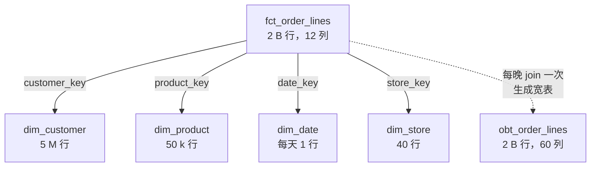

# Modeling for the questions people ask｜按大家要问的问题建模

> 原文：[DataInterview · Data Engineering System Design · Modeling for the questions people ask](https://www.datainterview.com/courses/data-engineering-system-design/concept-data-warehousing)（课程第 2 部分 Building blocks 的第 4 课，原文标注阅读约 22 分钟），抓取于 2026-11-14。

译文说明：

- 段落：英文原文放在引用块里，中文紧跟其后。
- 列表：用「English｜中文」两栏表格逐条对照。多列的大表格只直接展示中文版，英文原表折叠在下方。
- 原页面的交互组件（grain 切换、fan-out 演示、star / OBT 切换、SCD 逐步演示、aggregate 选择）已改写成静态表格；折叠的 hint、参考答案和 strong answer 都已展开；测验用 ✅ 标出正确选项。练习的编辑器里显示的是官方 solution，这里直接作为参考答案。
- 译者自己加的内容（包括一张 Mermaid 图）都标了「译注」。

## 速览（译注）

- 建模顺序：业务过程 → grain → dimension → fact。grain 由要回答的问题决定；一张 fact 表只有一个 grain，每个 measure 都要在这个 grain 上成立。
- fan-out：把粗粒度的 measure（比如按订单收的运费）join 到细粒度（订单行）后再 SUM，会重复计算。要么先聚合再 join，要么在建表时把它分摊到细粒度。
- 在列式 warehouse 上，star schema 和 one big table 扫描的字节数差不多；star 赢在维护和历史，宽表只该作为派生产物。
- SCD type 1 覆盖，type 2 用半开区间 `[valid_from, valid_to)` 保留版本；查版本要用 fact 自己的时间，不能用 `is_current`。
- aggregate 表用「能回答的问题」换成本；distinct count 不可加，余额、库存是半可加。semantic layer 让每个 metric 只定义一次。

---

## 开篇

> Finance reports $4.2 million of revenue from enterprise customers for the quarter; the sales dashboard says $4.6 million for the same quarter. Both queries are correct SQL. One joined order lines to orders and summed a column that lives on the order; the other used each customer’s current segment, so customers who moved up during the quarter took their earlier orders with them. Neither problem is in the pipeline. Both are in the model: what one row of each table means, and how history is kept.

财务报告这个季度 enterprise 客户的收入是 420 万美元；销售 dashboard 说同一季度是 460 万。两条 query 的 SQL 都没写错。一条把订单行 join 到订单上，然后对一个存在订单上的列求和；另一条用的是每个客户当前的 segment，所以季度中途升级的客户把他们之前的订单也一起带走了。两个问题都不在 pipeline 里，而在模型里：每张表的一行代表什么，以及历史怎么保存。

> In a design interview this is the “data model” step, after requirements and before the architecture. In this lesson you’ll declare the grain of a fact table against the questions it must answer, watch a join double count, compare a star schema with one big table on cost and maintenance, step through slowly changing dimensions type 1 and 2, and size an aggregate table for a dashboard. Then you’ll write a point-in-time join and an SCD type 2 load in DuckDB.

在设计面试里，这是「数据模型」这一步，在需求之后、架构之前。这一课会：对照 fact 表要回答的问题声明它的 grain；看一个 join 怎么重复计算；从成本和维护两方面比较 star schema 和 one big table；一步步走过 slowly changing dimension 的 type 1 和 type 2；为一个 dashboard 估算 aggregate 表的大小。然后在 DuckDB 里写一个 point-in-time join 和一个 SCD type 2 的加载。

---

## Grain first｜先定 grain

> Ralph Kimball’s four steps for a dimensional model are still the right order: pick the business process (orders, payments, sessions), declare the grain (what one row of the fact table is), identify the dimensions (the who, what, where and when you group and filter by), and identify the facts (the numbers you add up). The grain decides which questions the table can answer, so choose it from the questions. Try three grains for an online store.

Ralph Kimball 的维度建模四步，顺序到今天依然是对的：

1. 选业务过程（订单、支付、session）；
2. 声明 grain（fact 表的一行是什么）；
3. 确定 dimension（你用来分组和过滤的 who、what、where、when）；
4. 确定 fact（你要加总的数字）。

grain 决定了这张表能回答哪些问题，所以要从问题出发来选 grain。下面给一个网店试三种 grain。

### 声明 grain（原文为交互组件）

一个网店，每年 2,000 万订单（假设值）。三种 grain 的样例行：

**one row per order（每个订单一行）**

```
order_id  customer_key  date_key  items  order_total  shipping
1001      77            20261012  3      100.00       10.00
1002      12            20261012  1       40.00        5.00
```

**one row per order line（每个订单行一行）**

```
order_id  line  product_key  customer_key  date_key  qty  net_amount
1001      1     501          77            20261012  1     20.00
1001      2     733          77            20261012  2     30.00
1001      3     118          77            20261012  1     50.00
```

**one row per product per day（每个商品每天一行）**

```
date_key  product_key  units_sold  revenue  units_on_hand
20261012  501          140         2800.00  1210
20261012  733           65         1950.00   430
```

能回答哪些问题：

| 问题 | 每个订单一行 | 每个订单行一行 | 每个商品每天一行 |
|---|---|---|---|
| 每天的收入 | ✅ | ✅ | ✅ |
| 按商品类目的收入 | ❌ | ✅ | ✅ |
| 平均客单价 | ✅ | ✅ | ❌ |
| 每个商品月底的库存 | ❌ | ❌ | ✅ |
| 一起被买的商品 | ❌ | ✅ | ❌ |
| 每年行数 | 20 M | 50 M | 18 M |
| 能回答的问题 | 2 / 5 | 4 / 5 | 3 / 5 |

> The order grain loses which products were bought; the line grain keeps them and still gives order totals by grouping on order_id; the daily snapshot is the only one that records stock, a level that is measured rather than summed from events.

订单 grain 丢了买了哪些商品；订单行 grain 保留了这些信息，按 `order_id` 分组照样能得到订单总额；只有每日 snapshot 记录了库存，而库存是一个测量出来的水位，不是从 event 加总出来的。

<details>
<summary>交互组件里的英文原文</summary>

- Title: Declare the grain — an online store, 20 M orders a year (assumed)
- Fact table grain: one row per order / one row per order line / one row per product per day

| Question | one row per order | one row per order line | one row per product per day |
|---|---|---|---|
| Revenue per day | answers | answers | answers |
| Revenue by product category | cannot answer | answers | answers |
| Average order value | answers | answers | cannot answer |
| Stock on hand per product at month end | cannot answer | cannot answer | answers |
| Products bought together | cannot answer | answers | cannot answer |
| Rows per year | 20 M | 50 M | 18 M |
| Questions answered | 2 of 5 | 4 of 5 | 3 of 5 |

</details>

> The order-line grain answers 4 of 5 questions at 50 million rows a year; the order grain is smaller and loses the products. The daily snapshot is a different kind of fact table: Kimball distinguishes transaction facts (one row per event), periodic snapshots (one row per thing per period, for levels such as stock or account balances) and accumulating snapshots (one row per process instance, updated as it moves through milestones, such as an order from placed to delivered). Most warehouses need the first two. The rule that keeps them honest: one grain per fact table, and every measure in it true at that grain.

订单行 grain 每年 5,000 万行，能回答 5 个问题中的 4 个；订单 grain 更小，但丢了商品信息。每日 snapshot 是另一种 fact 表。Kimball 区分三种 fact 表：

| 类型 | 一行是什么 | 例子 |
|---|---|---|
| transaction fact | 每个 event 一行 | 订单行、支付 |
| periodic snapshot | 每个东西每个周期一行，记录水位 | 库存、账户余额 |
| accumulating snapshot | 每个流程实例一行，随着它经过各个里程碑而更新 | 一个订单从下单到送达 |

大多数 warehouse 需要前两种。让它们保持正确的规则是：一张 fact 表只有一个 grain，表里每个 measure 都在这个 grain 上成立。

### 测验 1

> An orders fact table has one row per order with order_total. Product managers now want revenue by product category. What is the right change?

一张订单 fact 表每个订单一行，带 `order_total`。产品经理现在想要按商品类目看收入。正确的改法是什么？

| | English | 中文 |
|---|---|---|
| A | Add a category column to the orders table | 给订单表加一个 category 列 |
| B | Store product_ids as an array on the order row | 在订单行上存一个 `product_ids` 数组 |
| C ✅ | Add a fact table at the order line grain, with product_key and the line amount, and keep order-level measures consistent with it | 加一张订单行 grain 的 fact 表，带 `product_key` 和行金额，并让订单级的 measure 和它保持一致 |
| D | Join orders to order_lines and products and sum order_total by category | 把订单 join 到订单行和商品，再按类目对 `order_total` 求和 |

> Right. Category belongs to the product, which exists only on lines. The line grain answers both questions: order totals by grouping lines, categories by joining products. Order-level amounts such as shipping are allocated to lines or kept in the order fact, never summed after a join.

解析：类目属于商品，而商品只存在于订单行上。订单行 grain 两个问题都能回答：按行分组得到订单总额，join 商品得到类目。运费这类订单级金额，要么分摊到行上，要么留在订单 fact 里，绝不能 join 之后再求和。

---

## Fan-out｜Fan-out

> The most common wrong number in a warehouse comes from summing a measure across a join to a finer grain. Shipping is charged per order; lines are per product. Join them and see what SUM(shipping) does.

warehouse 里最常见的错数字，来自 join 到更细的 grain 之后再对 measure 求和。运费按订单收，订单行按商品分。把它们 join 起来，看看 `SUM(shipping)` 会怎样。

### 跨两个 grain 求和（原文为交互组件）

3 个订单，6 个订单行。三种写法：

**写法 1：join，然后 `SUM(shipping)`**

```
order  line  net_amount  shipping
O1     1      20.00       10.00
O1     2      30.00       10.00   <- repeated
O1     3      50.00       10.00   <- repeated
O2     1      40.00        5.00
O3     1      15.00       10.00
O3     2      25.00       10.00   <- repeated
```

> Joining orders (one row per order, with shipping) to order_lines repeats each order’s shipping on every line. SUM(shipping) then counts O1’s fee three times.

把订单（每个订单一行，带运费）join 到订单行，每个订单的运费会在它的每一行上重复。`SUM(shipping)` 就把 O1 的运费算了三次。

**写法 2：先把订单行聚合到订单 grain**

```
order  lines_amount  shipping
O1        100         10.00
O2         40          5.00
O3         40         10.00
```

> Aggregate the lines to the order grain first, then join: every row is one order again and shipping is counted once. You lose the line detail for that query.

先把订单行聚合到订单 grain，再 join：每一行又是一个订单，运费只算一次。代价是这条 query 里丢了行级明细。

**写法 3：把运费分摊到订单行**

```
order  line  net_amount  shipping
O1     1      20.00        2.00
O1     2      30.00        3.00
O1     3      50.00        5.00
O2     1      40.00        5.00
O3     1      15.00        3.75
O3     2      25.00        6.25
```

> Allocate the order-level fee to lines in the fact table, here in proportion to each line’s amount. Now every measure lives at one grain, sums are right, and shipping can be split by product.

在 fact 表里把订单级的运费分摊到行上，这里按每行金额的比例分。现在每个 measure 都在同一个 grain 上，求和是对的，运费还能按商品拆分。

| 读数 | 写法 1 | 写法 2 | 写法 3 |
|---|---|---|---|
| 行收入 | $180.00 | $180.00 | $180.00 |
| 报告的运费 | $55.00 | $25.00 | $25.00 |
| 实收运费 | $25.00 | $25.00 | $25.00 |

> Three orders paid $25 of shipping; the join reports $55, because O1’s $10 appears on 3 lines and O3’s on 2. Either aggregate the finer table to the coarser grain before joining, or allocate the coarser measure to the finer grain when you build the fact table, so it never needs a join. In an interview, saying “shipping is allocated to lines by amount so every measure in the fact is at line grain” is the kind of specific modeling decision that is easy to defend.

三个订单一共付了 $25 运费；join 报出来 $55，因为 O1 的 $10 出现在 3 行上，O3 的出现在 2 行上。两种修法：要么 join 之前先把细表聚合到粗 grain，要么在建 fact 表时就把粗粒度的 measure 分摊到细 grain，这样就永远不需要 join。面试里说一句「运费按金额分摊到订单行，所以 fact 表里每个 measure 都在行 grain 上」，就是那种很具体、很好辩护的建模决策。

---

## Star schema or one big table｜Star schema 还是 one big table

> A star schema keeps facts narrow (keys and measures) and puts descriptive attributes in dimension tables joined by surrogate keys. One big table (OBT) copies the dimension attributes onto every fact row, so queries need no joins. On a columnar warehouse the scan cost is closer than people expect. Switch between them.

star schema 让 fact 表保持很窄（只有 key 和 measure），描述性属性放在 dimension 表里，通过 surrogate key join。one big table（OBT）把 dimension 属性复制到每一行 fact 上，所以 query 不需要 join。在列式 warehouse 上，两者的扫描成本比大家想的接近得多。

译注：按演示里的 star schema 画的结构图。



### Star schema 还是 one big table（原文为交互组件）

列式 warehouse；表大小是假设值。

| 读数 | star schema（fact + 4 个 dim） | one big table（`obt_order_lines`，每晚 join 生成） |
|---|---|---|
| 表 | `fct_order_lines` 2 B 行 12 列；`dim_customer` 5 M 行；`dim_product` 50 k 行；`dim_date` 每天 1 行；`dim_store` 40 行 | 2 B 行，60 列 |
| 「最近 30 天按 segment 的收入」读取量 | 1.7 GB | 1.8 GB |
| 这条 query 里的 join 数 | 1 | 0 |
| 一个客户换 segment 时要重写的行 | 1 行（SCD 1）或新增 1 行（SCD 2） | 他过去所有的订单行，或者一次全量重建 |
| 新增一个客户属性要重写的行 | 5 M（dimension 表） | 2 B（整张表） |

> Scan sizes assume 82 M fact rows in 30 days and that a warehouse reads only the referenced columns: date, customer key and amount (20 bytes a row) plus the customer dimension for the star; date, segment and amount (22 bytes, segment compressed) for the wide table. At BigQuery’s on-demand list price, $6.25 per TiB (read 2026-10-12), either query costs about a cent.

扫描量的假设：30 天 8,200 万行 fact，warehouse 只读被引用的列。star：date、customer key 和 amount（每行 20 字节），再加上 customer dimension；宽表：date、segment 和 amount（每行 22 字节，segment 压缩后）。按 BigQuery on-demand 牌价每 TiB $6.25（2026-10-12 读取），两条 query 都大约一美分。

<details>
<summary>交互组件里的英文原文</summary>

| | star schema | one big table |
|---|---|---|
| Tables | fct_order_lines (2 B rows, 12 columns), dim_customer (5 M rows), dim_product (50 k rows), dim_date (1 row per day), dim_store (40 rows) | obt_order_lines (2 B rows, 60 columns), built by a nightly join from star schema (fact + 4 dims) |
| Read by "revenue by segment, last 30 days" | 1.7 GB | 1.8 GB |
| Joins in that query | 1 | 0 |
| Rows rewritten when a customer changes segment | 1 (SCD 1) or 1 added (SCD 2) | all their past lines, or a full rebuild |
| Rows rewritten to add a customer attribute | 5 M (the dimension) | 2 B (the whole table) |

</details>

> “Revenue by segment for the last 30 days” reads about 1.7 GB from the star and 1.8 GB from the wide table: columnar storage reads only the columns referenced, and a repeated segment name compresses to almost nothing. The difference is in maintenance and correctness. In the star, a customer moving segment is one row in a dimension; in the wide table it is every past row for that customer, or a nightly full rebuild. Adding a customer attribute is 5 million dimension rows against 2 billion fact rows. The usual design keeps the star as the source of truth and builds wide tables from it for specific tools (BI extracts, feature tables), rebuilt on a schedule. The cloud data warehousing course’s star schemas lesson covers keys, conformed dimensions and joins in depth.

「最近 30 天按 segment 的收入」从 star 读约 1.7 GB，从宽表读约 1.8 GB：列式存储只读被引用的列，重复的 segment 名压缩后几乎不占空间。真正的区别在维护和正确性上：

- 在 star 里，一个客户换 segment 只改 dimension 里的一行；在宽表里，要改这个客户过去所有的行，或者每晚全量重建。
- 新增一个客户属性，star 改 500 万行 dimension，宽表改 20 亿行 fact。

常见的设计是：star 作为 source of truth，再从它派生出给特定工具用的宽表（BI extract、feature 表），按计划重建。cloud data warehousing 课程里 star schema 那一课会深入讲 key、conformed dimension 和 join。

---

## Slowly changing dimensions｜Slowly changing dimension

> Dimension attributes change: customers change segment, products change category, stores change region. The slowly changing dimension (SCD) type says what happens to history when they do. Type 1 overwrites. Type 2 closes the current row and adds a new version with its own validity range, so every fact can be reported with the attribute it had at the time. Step through a customer changing segment.

dimension 属性会变：客户换 segment，商品换类目，门店换区域。slowly changing dimension（SCD）的 type 说明属性变了之后历史怎么处理。type 1 直接覆盖。type 2 关闭当前行，再加一个带自己有效区间的新版本，这样每条 fact 都能按它发生时的属性来报告。下面一步步看一个客户换 segment。

### 一个客户换 segment（原文为逐步演示）

type 1 覆盖，type 2 保留版本。

**Step 1｜初始状态**

```
sk  id   segment     valid_from  valid_to    current
1   C42  SMB         2025-01-01  9999-12-31  true

February report (run Mar 1):
  SMB         10,000
```

> Customer C42, Acme, is in the SMB segment and orders $10,000 in February. The February revenue report, run on March 1, shows SMB 10,000.

客户 C42（Acme）属于 SMB segment，2 月下了 $10,000 的订单。3 月 1 日跑的 2 月收入报告显示 SMB 10,000。

**Step 2｜type 1：覆盖**

```
sk  id   segment     valid_from  valid_to    current
1   C42  Enterprise  2025-01-01  9999-12-31  true

February report (rerun Mar 2):
  Enterprise  10,000
  SMB              0
```

> On March 1 sales moves Acme to Enterprise. With type 1 the dimension row is overwritten. Rerun the February report and its $10,000 moves to Enterprise: last month’s numbers changed, and the deck finance presented no longer matches the warehouse.

3 月 1 日销售把 Acme 调到 Enterprise。type 1 直接覆盖 dimension 行。重跑 2 月报告，那 $10,000 跑到了 Enterprise 下面：上个月的数字变了，财务已经讲过的那份 deck 和 warehouse 对不上了。

**Step 3｜type 2：保留版本**

```
sk  id   segment     valid_from  valid_to    current
1   C42  SMB         2025-01-01  2026-03-01  false
2   C42  Enterprise  2026-03-01  9999-12-31  true

February report (rerun Mar 2):
  SMB         10,000
March report:
  Enterprise  15,000
```

> With type 2 the old row is closed (valid_to = 2026-03-01) and a new version opens. Facts join to the version valid at the order time, so February stays SMB and March’s $15,000 is Enterprise. customer_id is the durable key; sk identifies one version.

type 2 会关闭旧行（`valid_to = 2026-03-01`）并开一个新版本。fact join 到下单时有效的那个版本，所以 2 月仍是 SMB，3 月的 $15,000 算 Enterprise。`customer_id` 是 durable key；`sk` 标识一个版本。

**Step 4｜两种取历史的方法**

```
fct_orders: order_id  customer_sk  order_date  amount
           501       1            2026-02-10  10000
           588       2            2026-03-04  15000

Two ways to get history:
  store customer_sk on the fact at load
  or join on customer_id and date
```

> The load can look up the version when it writes the fact and store its surrogate key, so reports use a plain key join. Or keep only customer_id on the fact and join on the date range at query time: the point-in-time join you write in the exercise.

两种方法：加载 fact 时查出版本，把它的 surrogate key 存到 fact 上，报表只需要普通的 key join；或者 fact 上只存 `customer_id`，query 时按日期范围 join，也就是练习里要写的 point-in-time join。

**Step 5｜迟到的 fact**

```
late fact, loaded Mar 3:
  order 563  C42  2026-02-25  4000
version valid on Feb 25: sk 1 (SMB)
current version:         sk 2 (Enterprise)
February report:
  SMB         14,000
```

> A February order arrives late, on March 3. Looking up the current row would label it Enterprise. The lookup must use the order’s own date, which finds version 1, so February becomes SMB 14,000. Late facts are why the lookup is by date, never by is_current.

一笔 2 月的订单 3 月 3 日才到。如果查当前行，它会被标成 Enterprise。查找必须用订单自己的日期，找到的是版本 1，所以 2 月变成 SMB 14,000。正因为有迟到的 fact，查版本才要按日期，绝不能按 `is_current`。

**Step 6｜type 1 仍有用武之地**

```
sk  id   name  segment
2   C42  Acme  Enterprise   (name was "Acme Inc,")

Type 1 still has a place:
  typo fixes, attributes
  nobody reports history by
```

> Not every column needs history. Correcting a misspelt name should overwrite (type 1); tracking a segment or a region that reports group by should version (type 2). Decide per column, and say which in the interview.

不是每一列都需要历史。纠正拼错的名字应该直接覆盖（type 1）；报表要按它分组的 segment 或 region 应该保留版本（type 2）。按列来决定，并在面试里说清楚哪列用哪种。

> The decision is per column and comes from requirements: does any report group past facts by this attribute, and must last month’s numbers stay as they were published? If yes, type 2; if the column is a description or a correction, type 1. Two implementation details matter in every type 2 design: validity ranges are half-open, [valid_from, valid_to), so each instant matches exactly one version, and the lookup for a fact uses the fact’s own timestamp, so late-arriving facts get the version that was valid when they happened. The cloud data warehousing course’s SCD type 2 lesson covers the MERGE that maintains it in each warehouse.

这个决定按列做，依据来自需求：有没有报表按这个属性给过去的 fact 分组？上个月发布过的数字是否必须保持不变？是的话用 type 2；如果这一列只是描述或者是纠错，用 type 1。每个 type 2 设计都有两个实现细节要做对：

1. 有效区间是半开的 `[valid_from, valid_to)`，所以每个时刻只匹配一个版本；
2. 给 fact 查版本时用 fact 自己的时间戳，这样迟到的 fact 拿到的是它发生时有效的版本。

cloud data warehousing 课程里 SCD type 2 那一课会讲各个 warehouse 里维护它的 MERGE 怎么写。

### 测验 2

> A dimension is SCD type 2 on region. An analyst asks for "revenue by the region each customer is in today, for the last 3 years." How do you write it?

一个 dimension 在 region 上是 SCD type 2。分析师要「过去 3 年的收入，按每个客户今天所在的 region 分组」。怎么写？

| | English | 中文 |
|---|---|---|
| A | Convert the dimension to type 1 for this query | 为这条 query 把 dimension 改成 type 1 |
| B ✅ | Join facts to the current version of each customer by the durable key (customer_id with is_current), not by the version key | 用 durable key（`customer_id` 加 `is_current`）把 fact join 到每个客户的当前版本，而不是用版本 key |
| C | Join on customer_sk, the surrogate key stored on each fact | 用每条 fact 上存的 surrogate key `customer_sk` 来 join |
| D | It cannot be answered once the dimension is type 2 | dimension 一旦是 type 2 就没法回答 |

> Right. Type 2 keeps both views. Join on the version (or the date range) for history as it was; join on the durable key to the current row to restate history in today’s regions. Many teams expose both as two views of the dimension.

解析：type 2 两种视角都保留了。按版本（或日期范围）join，得到当时的历史；按 durable key join 到当前行，就是用今天的 region 重述历史。很多团队把这两种做成 dimension 的两个 view 一起提供。

### 当前 segment 还是当时的 segment（原文为可运行的 playground）

> Run both joins on five orders. Joining on the current row puts Acme’s February $10,000 under Enterprise; the point-in-time join keeps February as SMB 12,500.

对 5 个订单跑两种 join。join 当前行，会把 Acme 2 月的 $10,000 放到 Enterprise 下面；point-in-time join 让 2 月保持 SMB 12,500。

<details>
<summary>Playground 代码（DuckDB，4 行的 SCD2 dimension）</summary>

```python
import duckdb
con = duckdb.connect()
con.execute("""
CREATE TABLE dim_customer AS SELECT * FROM (VALUES
  (1, 'C1', 'Acme',    'SMB',        DATE '2025-01-01', DATE '2026-03-01', false),
  (2, 'C1', 'Acme',    'Enterprise', DATE '2026-03-01', DATE '9999-12-31', true),
  (3, 'C2', 'Birch',   'SMB',        DATE '2025-01-01', DATE '9999-12-31', true),
  (4, 'C3', 'Cobalt',  'Mid-market', DATE '2025-06-01', DATE '9999-12-31', true)
) t(customer_sk, customer_id, name, segment, valid_from, valid_to, is_current)""")
con.execute("""
CREATE TABLE fct_orders AS SELECT * FROM (VALUES
  (101, 'C1', DATE '2026-02-10', 10000.0), (102, 'C2', DATE '2026-02-14', 2500.0),
  (103, 'C1', DATE '2026-03-01', 15000.0), (104, 'C3', DATE '2026-03-05', 7000.0),
  (105, 'C2', DATE '2026-03-20', 1800.0)
) t(order_id, customer_id, order_date, amount)""")

print("Revenue by month and CURRENT segment (join on is_current):")
print(con.sql("""
  SELECT strftime(o.order_date, '%Y-%m') AS month, c.segment, sum(o.amount) AS revenue
  FROM fct_orders o JOIN dim_customer c ON c.customer_id = o.customer_id AND c.is_current
  GROUP BY ALL ORDER BY ALL"""))

print("Revenue by month and segment AT THE TIME of the order (point-in-time join):")
print(con.sql("""
  SELECT strftime(o.order_date, '%Y-%m') AS month, c.segment, sum(o.amount) AS revenue
  FROM fct_orders o JOIN dim_customer c
    ON c.customer_id = o.customer_id
   AND o.order_date >= c.valid_from AND o.order_date < c.valid_to
  GROUP BY ALL ORDER BY ALL"""))
# Try: change the join to BETWEEN c.valid_from AND c.valid_to and look at order 103,
# placed on the day Acme changed segment.
```

</details>

### 练习：对 SCD2 dimension 做 point-in-time join

> Complete SQL so that revenue_by_segment(con) returns revenue per month and segment, with each order in the segment the customer had when it ordered. Versions are [valid_from, valid_to); orders before a customer’s first version go to 'unknown'. The starter uses BETWEEN, which includes both ends, and an inner join.

补全 `SQL`，让 `revenue_by_segment(con)` 返回每月每个 segment 的收入，每个订单归到客户下单时所在的 segment。版本区间是 `[valid_from, valid_to)`；早于客户第一个版本的订单归到 `'unknown'`。starter 代码用的是两端都包含的 `BETWEEN`，以及 inner join。

> The checks replay an order at the exact moment a segment changed, an order before the first version, a customer with three versions, and 3,000 random orders whose total must match the fact table.

测试会重放：一个恰好在 segment 变更那一刻下的订单；一个早于第一个版本的订单；一个有三个版本的客户；以及 3,000 个随机订单，它们的总额必须和 fact 表一致。

> Hint: Use LEFT JOIN with o.order_ts >= c.valid_from AND o.order_ts < c.valid_to, and coalesce(c.segment, 'unknown').

提示：用 `LEFT JOIN`，条件是 `o.order_ts >= c.valid_from AND o.order_ts < c.valid_to`，再加 `coalesce(c.segment, 'unknown')`。

参考答案：

```python
import duckdb

SQL = """
SELECT strftime(o.order_ts, '%Y-%m') AS month,
       coalesce(c.segment, 'unknown') AS segment,      -- no version yet: the unknown member
       sum(o.amount) AS revenue
FROM fct_orders o
LEFT JOIN dim_customer c                              -- keep orders with no matching version
  ON c.customer_id = o.customer_id
 AND o.order_ts >= c.valid_from                       -- start inclusive
 AND o.order_ts <  c.valid_to                         -- end exclusive: one version per instant
GROUP BY ALL
ORDER BY month, segment
"""

def revenue_by_segment(con):
    """fct_orders(order_id, customer_id, order_ts, amount) and the SCD type 2 dimension
    dim_customer(customer_sk, customer_id, segment, valid_from, valid_to, is_current),
    valid_from inclusive, valid_to exclusive. Return [(month 'YYYY-MM', segment, revenue)]
    with each order counted once, in the segment the customer had when it ordered;
    orders placed before the customer's first version go to segment 'unknown'."""
    return con.execute(SQL).fetchall()
```

> A type 2 dimension has to be maintained. With full daily snapshots of the source table, each load compares today’s rows with the current versions, closes the ones that changed or disappeared and opens new versions. In Snowflake, BigQuery or Databricks this is a MERGE; DuckDB 1.1.2 has no MERGE, so the exercise does the same with an UPDATE and an INSERT in one transaction. With CDC instead of snapshots, the same logic runs on change events, with the change’s commit time as valid_from.

type 2 dimension 需要维护。如果源表每天给一份全量 snapshot，每次加载就拿今天的行和当前版本比较，关闭变了或消失的，再开新版本。在 Snowflake、BigQuery 或 Databricks 里这是一条 MERGE；DuckDB 1.1.2 没有 MERGE，所以练习里在一个 transaction 里用一条 UPDATE 加一条 INSERT 做同样的事。如果用 CDC 而不是 snapshot，同样的逻辑跑在变更 event 上，用变更的 commit 时间作为 `valid_from`。

### 练习：用每日 snapshot 维护 SCD2 dimension

> Write apply_snapshot(con, snap_date), which applies a full daily snapshot of the source customers table to dim_customer as type 2 on segment and country. DuckDB 1.1.2 has no MERGE, so close changed rows with an UPDATE, then INSERT new versions, in one transaction. The starter inserts every snapshot row as a new version.

写 `apply_snapshot(con, snap_date)`：把源 customers 表的每日全量 snapshot 应用到 `dim_customer`，对 segment 和 country 做 type 2。DuckDB 1.1.2 没有 MERGE，所以在一个 transaction 里先用 UPDATE 关闭变了的行，再 INSERT 新版本。starter 代码把 snapshot 的每一行都当新版本插进去。

> The checks replay a segment change, a rerun of the same day and an unchanged day with a NULL country, a customer deleted at the source who later returns, and 40 days of random changes with retries, checking for overlapping versions and customers with two current rows.

测试会重放：一次 segment 变更；同一天重跑一次，以及一个 country 为 NULL、但没有变化的日子；一个在源头被删、后来又回来的客户；以及 40 天的随机变更加重试。检查版本区间有没有重叠、有没有客户同时有两个当前行。

> Hint: Step 1: UPDATE ... SET valid_to = ?, is_current = false WHERE is_current AND NOT EXISTS (a snapshot row with the same id and IS NOT DISTINCT FROM on both columns). Step 2: insert every snapshot row whose customer has no current row.

提示：第 1 步，`UPDATE ... SET valid_to = ?, is_current = false WHERE is_current AND NOT EXISTS (...)`，括号里是「同一个 id、两列都 `IS NOT DISTINCT FROM` 的 snapshot 行」。第 2 步，把所有「客户没有当前行」的 snapshot 行插进去。

参考答案（译注：有两行被浏览器扩展拦截，按页面文字和截图还原）：

```python
import duckdb

def apply_snapshot(con, snap_date):
    """Apply today's full snapshot of the source table, customers_snapshot(customer_id,
    segment, country), to dim_customer(customer_id, segment, country, valid_from,
    valid_to, is_current) as SCD type 2 on segment and country:
      * a current row whose segment or country changed is closed (valid_to = snap_date,
        is_current = false) and a new current version starts at snap_date;
      * a customer missing from the snapshot (deleted at the source) is closed;
      * a new customer gets its first version;
      * nothing else changes, and applying the same snapshot twice changes nothing.
    Open rows have valid_to = DATE '9999-12-31'. NULLs are values: NULL to NULL is no change."""
    con.execute("BEGIN TRANSACTION")
    # 1. Close current rows that no longer match the snapshot exactly (changed or deleted).
    #    IS NOT DISTINCT FROM treats NULL = NULL as equal; plain = would close them every day.
    con.execute("""
        UPDATE dim_customer SET valid_to = ?, is_current = false
        WHERE is_current AND NOT EXISTS (
            SELECT 1 FROM customers_snapshot s
            WHERE s.customer_id = dim_customer.customer_id
              AND s.segment IS NOT DISTINCT FROM dim_customer.segment
              AND s.country IS NOT DISTINCT FROM dim_customer.country)""", [snap_date])
    # 2. Every snapshot row without a current version gets one: new customers and the
    #    customers just closed in step 1. On a rerun nothing was closed, so nothing is added.
    con.execute("""
        INSERT INTO dim_customer
        SELECT s.customer_id, s.segment, s.country, ?, DATE '9999-12-31', true
        FROM customers_snapshot s
        WHERE NOT EXISTS (SELECT 1 FROM dim_customer d
                          WHERE d.is_current AND d.customer_id = s.customer_id)""", [snap_date])
    con.execute("COMMIT")
```

---

## Aggregate tables and semantic layers｜Aggregate 表和 semantic layer

> A dashboard opened 2,000 times a day should not scan two billion rows each time. An aggregate table stores the fact table rolled up to a coarser grain, rebuilt incrementally when new facts land. The coarser the grain, the cheaper the query and the fewer questions it answers. Pick a grain.

一个每天被打开 2,000 次的 dashboard，不应该每次都扫 20 亿行。aggregate 表把 fact 表上卷到更粗的 grain 存起来，新 fact 到达时增量重建。grain 越粗，query 越便宜，能回答的问题也越少。

### 为 dashboard 预聚合（原文为交互组件）

BigQuery on-demand；dashboard 查询最近 30 天。默认每天 2,000 次 dashboard 查询。

| dashboard 读的表 | 按区域每天收入 | 按商品每天收入 | 按区域每月的去重客户数 | 按区域每月收入 | 表的行数 | 每次计费 | 每月成本 |
|---|---|---|---|---|---|---|---|
| 订单行（不聚合） | ✅ | ✅ | ✅ | ✅ | 2 B | 1.9 GB | $705 |
| day × product × region | ✅ | ✅ | ❌ | ✅ | 44 M | 54 MB | $19 |
| day × region | ✅ | ❌ | ❌ | ✅ | 14,600 | 10 MB | $4 |
| month × region | ❌ | ❌ | ❌ | ✅ | 480 | 10 MB | $4 |

同样的查询直接打在 fact 表上：每月 $705。

> Assumed: 2 years, 20 regions, 10,000 products sold per day, 30% of product-region pairs active. BigQuery bills at least 10 MB per table referenced, so tiny aggregates cost the minimum. $6.25 per TiB list price, read 2026-10-12, free tier ignored. Distinct counts do not add up across days, so only the base table (or a sketch) answers the monthly one.

假设：2 年数据，20 个区域，每天卖出 10,000 种商品，30% 的商品 × 区域组合有销售。BigQuery 每引用一张表至少按 10 MB 计费，所以很小的 aggregate 表按最低价收费。牌价每 TiB $6.25（2026-10-12 读取），不计免费额度。distinct count 不能跨天相加，所以只有基础表（或 sketch）能回答按月的那个问题。

<details>
<summary>交互组件里的英文原文</summary>

| Dashboard reads | Revenue by region per day | Revenue by product per day | Distinct customers by region per month | Revenue by region per month | Rows in the table read | Billed per query | Monthly cost | Same on the fact table |
|---|---|---|---|---|---|---|---|---|
| order lines (no aggregate) | answers | answers | answers | answers | 2 B | 1.9 GB | $705 | $705 |
| day x product x region | answers | answers | cannot answer | answers | 44 M | 54 MB | $19 | $705 |
| day x region | answers | cannot answer | cannot answer | answers | 14,600 | 10 MB | $4 | $705 |
| month x region | cannot answer | cannot answer | cannot answer | answers | 480 | 10 MB | $4 | $705 |

Dashboard queries per day: 2,000.

</details>

> At 2,000 queries a day, reading the fact table costs about $700 a month at BigQuery on-demand list prices; the day by product by region aggregate costs about $19 and answers three of the four questions; day by region costs the 10 MB minimum per query. The fourth question, distinct customers per month, cannot come from any of the aggregates, because distinct counts do not add: a customer active in three days of the month would be counted three times. Kimball calls such measures non-additive, and balances or stock levels, which add across products but not across time, semi-additive. Know which kind every measure in your model is.

每天 2,000 次查询，按 BigQuery on-demand 牌价，直接读 fact 表每月约 $700；day × product × region 的 aggregate 每月约 $19，能回答四个问题中的三个；day × region 每次只收 10 MB 的最低价。第四个问题（每月去重客户数）没有哪个 aggregate 能回答，因为 distinct count 不能相加：一个客户一个月里活跃了三天，就会被算三次。

Kimball 把这种 measure 叫 non-additive（不可加）；余额、库存这类能跨商品相加、但不能跨时间相加的叫 semi-additive（半可加）。要清楚你模型里每个 measure 属于哪一种。

> A semantic layer addresses the other source of disagreement: two teams writing different SQL for “revenue”. Metrics are defined once (name, measure, filters, which dimensions they can be grouped by) and every tool queries them through the layer, which generates the SQL and can route it to an aggregate table when one fits. Examples are the dbt Semantic Layer (powered by MetricFlow), LookML in Looker, and Cube. In an interview it is the answer to “how do you make finance and sales get the same number?”, together with conformed dimensions shared by every fact table.

数字对不上的另一个来源是：两个团队对「收入」写了不同的 SQL。semantic layer 解决的就是这个。metric 只定义一次（名字、measure、过滤条件、能按哪些 dimension 分组），所有工具都通过这一层来查，它负责生成 SQL，有合适的 aggregate 表时还能把 query 路由过去。例子有 dbt Semantic Layer（由 MetricFlow 驱动）、Looker 的 LookML 和 Cube。面试里被问「怎么让财务和销售拿到同一个数？」，答案就是它，再加上所有 fact 表共享的 conformed dimension。

### 测验 3

> A table daily_active_users has one row per day with the number of distinct users that day. Product asks for monthly active users for September. What is the answer?

`daily_active_users` 表每天一行，存当天的去重用户数。产品要 9 月的月活用户数。怎么答？

| | English | 中文 |
|---|---|---|
| A | Sum the 30 daily values | 把 30 天的值加起来 |
| B ✅ | Count distinct users over September from the event-level table (or merge daily sketches such as HyperLogLog); summing the daily values over-counts | 从 event 级的表上对 9 月做 count distinct（或者合并每天的 sketch，比如 HyperLogLog）；把每天的值相加会多算 |
| C | Take the largest daily value | 取每天值里最大的那个 |
| D | Average the daily values and multiply by 30 | 每天的值取平均再乘 30 |

> Right. A user active on 20 days is counted 20 times by the sum. Distinct counts are non-additive. Keep the base table, or store a mergeable sketch per day (BigQuery’s HLL_COUNT.INIT and HLL_COUNT.MERGE) and accept a small approximation error.

解析：一个活跃了 20 天的用户，求和会把他算 20 次。distinct count 不可加。要么保留基础表，要么每天存一个可合并的 sketch（BigQuery 的 `HLL_COUNT.INIT` 和 `HLL_COUNT.MERGE`），接受一点近似误差。

---

## How this comes up in interviews｜实际面试中是什么样

> Every warehouse and analytics prompt has a data model step, and interviewers probe it with specific questions: “what is the grain of this table?”, “how do you handle a customer changing region?”, “why are the two dashboards different?”, “would you denormalise?”, “how would you compute monthly active users?”. A complete answer writes the core tables with grain and keys; puts every measure at its table’s grain (allocating order-level amounts); chooses SCD type per attribute from the reporting requirement and uses half-open ranges with lookups by event time; explains star versus wide table in terms of maintenance rather than scan cost; and names aggregates and a semantic layer for heavy dashboards, with which measures are additive. Draw the model as a short list of tables with their grain; it takes two minutes and anchors the rest of the design.

每道 warehouse 和分析类的题都有数据模型这一步，面试官会用很具体的问题来追：

- 「这张表的 grain 是什么？」
- 「客户换了 region 怎么处理？」
- 「为什么两个 dashboard 的数不一样？」
- 「你会做反范式吗？」
- 「月活怎么算？」

一个完整的回答包括：

1. 写出核心表，带 grain 和 key；
2. 每个 measure 都放在它所在表的 grain 上（订单级金额要分摊）；
3. 按报表需求逐个属性选 SCD type，用半开区间，按 event 时间查版本；
4. 从维护而不是扫描成本的角度解释 star 和宽表的取舍；
5. 为重度使用的 dashboard 提出 aggregate 和 semantic layer，并说明哪些 measure 是可加的。

把模型画成一个简短的表清单，每张表写上 grain；只要两分钟，后面整个设计都有了锚点。

### 面试题：给订阅收入建模

> A SaaS company sells monthly and annual plans with upgrades, downgrades, pauses and cancellations. Finance wants monthly recurring revenue (MRR) by plan and customer segment, and the movement each month: new, expansion, contraction, churn. Declare the fact tables (grain, keys, measures) and the dimensions, and say which attributes need history.

一家 SaaS 公司卖月付和年付套餐，有升级、降级、暂停和取消。财务想要按套餐和客户 segment 看 MRR（monthly recurring revenue），以及每个月的变动：新增、扩张、收缩、流失。声明 fact 表（grain、key、measure）和 dimension，并说明哪些属性需要历史。

**参考答案（strong answer）**

| English | 中文 |
|---|---|
| fct_subscription_events, one row per change: subscription, customer, plan, event type, effective date, MRR before and after. It answers “what happened” and is the source of truth. | **`fct_subscription_events`**：每次变更一行，包括 subscription、客户、套餐、event 类型、生效日期、变更前后的 MRR。它回答「发生了什么」，是 source of truth。 |
| fct_mrr_monthly, a periodic snapshot: one row per active subscription per month-end with MRR (annual price divided by 12), plan key and customer key valid at that month-end. Built from the events, so it can be recomputed for any month. | **`fct_mrr_monthly`**：periodic snapshot，每个有效 subscription 每个月末一行，带 MRR（年付价格除以 12），以及那个月末有效的套餐 key 和客户 key。它从 events 构建，所以任何一个月都能重算。 |
| Movement: per subscription, this month’s MRR against last month’s; new (0 to positive), expansion, contraction, churn (positive to 0), reactivation. Stored as a column or a small fact so finance can sum it. | **变动**：每个 subscription 拿本月 MRR 和上月比；新增（0 变正）、扩张、收缩、流失（正变 0）、重新激活。存成一列或一张小 fact，让财务可以直接求和。 |
| Dimensions: dim_customer type 2 on segment and region, dim_plan type 2 on price, dim_date with month-end flags. Name fixes are type 1. | **Dimension**：`dim_customer` 在 segment 和 region 上用 type 2，`dim_plan` 在价格上用 type 2，`dim_date` 带月末标记。名字修正用 type 1。 |
| MRR at month-end is a level: summing it across customers is right, summing it across months is not; quarterly MRR is the last month of the quarter. | 月末 MRR 是一个水位：跨客户求和是对的，跨月份求和不对；季度 MRR 取季度最后一个月的值。 |

自查清单：

| English | 中文 |
|---|---|
| A transaction fact at one row per subscription change event | 一张 transaction fact，每个 subscription 变更 event 一行 |
| A periodic snapshot at one row per subscription per month with MRR | 一张 periodic snapshot，每个 subscription 每月一行，带 MRR |
| Annual plans normalised to monthly amounts | 年付套餐折算成月度金额 |
| Movement derived by comparing a subscription's MRR with the previous month | 变动通过对比 subscription 本月和上月的 MRR 得出 |
| Customer segment and plan as SCD type 2, joined at the month | 客户 segment 和套餐用 SCD type 2，按月份 join |
| MRR is semi-additive: sum across customers, never across months | MRR 是半可加的：可以跨客户求和，绝不能跨月份求和 |

---

## Common mistakes｜常见错误

| 错误 | 后果 | 怎么改 |
|---|---|---|
| 没有声明 grain，或者一张表里有两个 grain | measure 重复计算，没人说得清一行是什么 | 一张 fact 表一个 grain，写下来；每个 measure 都在这个 grain 上成立 |
| join 订单行之后对订单级 measure 求和 | fan-out：运费、折扣或总额被乘以行数 | 先聚合；或者加载时把 measure 分摊到更细的 grain |
| 历史报表把 fact join 到 dimension 的当前行 | 只要属性一变，过去月份的数字就跟着变 | SCD type 2 加 point-in-time join（或者把版本 key 存在 fact 上） |
| `BETWEEN valid_from AND valid_to` | 恰好落在边界上的 fact 匹配两个版本，被算两次 | 半开区间：`>= valid_from AND < valid_to` |
| SCD 加载时用 `=` 比较属性 | NULL 永远不等于 NULL，所以每天都会生成一个新版本 | 用 `IS NOT DISTINCT FROM`，或者对被追踪的列算 hash |
| 跨时间对 distinct count 或余额求和 | 月活或季度余额被放大 | 从基础表重算、存 sketch，或者取期末值 |
| 只有一张宽表作为唯一的模型 | 每次属性变更或新增都要重写几十亿行 | star schema 作为源头，宽表从它派生 |

<details>
<summary>英文原表</summary>

| MISTAKE | WHAT GOES WRONG | FIX |
|---|---|---|
| No declared grain, or two grains in one table | Measures double count, and nobody can say what a row is | One grain per fact table, written down; every measure true at it |
| Summing an order-level measure after joining lines | Fan-out: shipping, discounts or totals multiplied by line count | Aggregate first, or allocate the measure to the finer grain at load |
| Joining facts to the current dimension row for historical reports | Past months change whenever an attribute changes | SCD type 2 and a point-in-time join (or the version key stored on the fact) |
| BETWEEN valid_from AND valid_to | A fact at a boundary matches two versions and is counted twice | Half-open ranges: >= valid_from AND < valid_to |
| Comparing attributes with = in the SCD load | NULL never equals NULL, so a new version is created every day | IS NOT DISTINCT FROM, or a hash of the tracked columns |
| Summing distinct counts or balances across time | Monthly users or quarterly balances are inflated | Recompute from the base table, store sketches, or take the period-end value |
| A wide table as the only model | Every attribute change or addition rewrites billions of rows | Star schema as the source; wide tables derived from it |

</details>

---

## Recap｜回顾

| English | 中文 |
|---|---|
| Business process, grain, dimensions, facts, in that order. The grain is chosen from the questions. | 业务过程、grain、dimension、fact，按这个顺序。grain 从问题出发来选。 |
| Transaction facts record events; periodic snapshots record levels; accumulating snapshots follow a process. | transaction fact 记录 event；periodic snapshot 记录水位；accumulating snapshot 跟踪一个流程。 |
| Fan-out comes from summing a coarse measure across a finer join. Keep each measure at its table’s grain. | fan-out 来自把粗粒度的 measure 跨更细的 join 求和。让每个 measure 待在它所在表的 grain 上。 |
| On a columnar warehouse, a star and a wide table scan similar bytes. The star wins on maintenance and history; wide tables are derived outputs. | 在列式 warehouse 上，star 和宽表扫描的字节数差不多。star 赢在维护和历史；宽表是派生产物。 |
| SCD type 1 overwrites; type 2 versions with half-open validity ranges. Look up versions by the fact’s time. | SCD type 1 覆盖；type 2 用半开的有效区间保留版本。按 fact 的时间查版本。 |
| Aggregate tables trade questions for cost; distinct counts are non-additive and balances semi-additive. A semantic layer defines each metric once. | aggregate 表用能回答的问题换成本；distinct count 不可加，余额半可加。semantic layer 让每个 metric 只定义一次。 |

> Next up: idempotent pipelines, backfills and reprocessing, which keep these tables right when jobs fail, rerun and receive late data.

下一课：幂等的 pipeline、backfill 和重新处理，讲 job 失败、重跑、收到迟到数据时，怎么让这些表保持正确。
