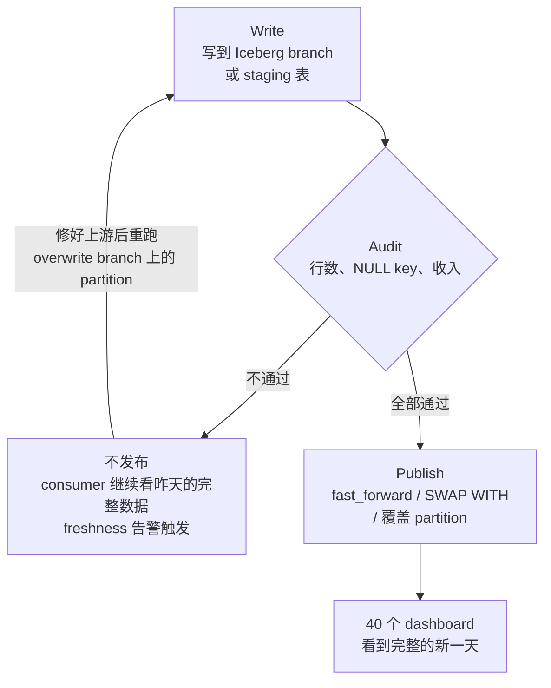

# Idempotent pipelines, backfills and reprocessing｜幂等的 pipeline、backfill 和重新处理

> 原文：[DataInterview · Data Engineering System Design · Idempotent pipelines, backfills and reprocessing](https://www.datainterview.com/courses/data-engineering-system-design/concept-idempotency)（课程第 2 部分 Building blocks 的第 5 课，原文标注阅读约 24 分钟），抓取于 2026-11-14。

译文说明：

- 段落：英文原文放在引用块里，中文紧跟其后。
- 列表：用「English｜中文」两栏表格逐条对照。多列的大表格只直接展示中文版，英文原表折叠在下方。
- 原页面的交互组件（三种写入方式的重跑演示、四种不确定性来源、WAP 逐步演示、四个引擎的代码 tab、backfill 和 lookback 滑块图）已改写成静态表格和代码块；折叠的 hint 和参考答案都已展开；测验用 ✅ 标出正确选项。练习的编辑器里显示的是官方 solution，这里直接作为参考答案。
- 译者自己加的内容（包括一张 Mermaid 图）都标了「译注」。

## 速览（译注）

- 幂等：用同样的输入和参数重跑，输出和只跑一次完全一样。做法是每个 run 拥有一组 partition，并原子地替换它们。
- append 重试就重复；upsert 能扛重试和更新，但处理不了源头的删除；对按时间区间分区的表，partition overwrite 三种情况都能处理。
- 确定性：不读系统时钟、不查「最新」、去重时排序要完整、key 从稳定 ID 派生。
- write-audit-publish 先把输出写到 consumer 看不到的地方，检查通过才原子发布；失败的 run 只会留下旧但正确的数据。
- backfill 要事先算好：partition 数、每个 run 几分钟、并行度、成本、下游重建、通知谁。lookback 窗口吸收迟到数据，让「N 天后数字定稿」成为明确的约定。

---

## 开篇

> On Friday morning the revenue dashboard shows Thursday at twice its usual size. The nightly job had failed at 3 a.m. after inserting half of Thursday’s orders; Airflow retried it at 3:05, and the retry inserted all of them again. Two weeks later a bug in the currency conversion is found that has been wrong for 90 days, and someone has to decide how to recompute three months of data, in what order, at what cost, without breaking the dashboards in the meantime. Both incidents have the same cure: pipelines whose runs can be repeated and replayed safely.

周五早上，收入 dashboard 显示周四的数字是平时的两倍。夜间 job 凌晨 3 点插入了一半周四的订单后失败了；Airflow 在 3:05 重试，重试又把所有订单插了一遍。两周后又发现汇率换算有个 bug，已经错了 90 天，得有人决定怎么重算三个月的数据：按什么顺序、花多少钱、期间怎么不弄坏 dashboard。两个事故的解药是一样的：pipeline 的每个 run 都能安全地重复执行和重放。

> A run is idempotent when running it again with the same inputs and parameters leaves the output exactly as one run would. In this lesson you’ll rerun a day under append, partition overwrite and upsert, find the four usual sources of non-deterministic output, step through write-audit-publish, size a backfill and choose a lookback window for late data. Then you’ll write a daily load that survives retries and crashes, and the lookback and backfill logic on top of it, in DuckDB.

一个 run 是幂等的，意思是用同样的输入和参数再跑一次，输出和只跑一次完全一样。这一课会：分别用 append、partition overwrite 和 upsert 重跑一天；找出输出不确定的四个常见原因；一步步走过 write-audit-publish；估算一次 backfill；为迟到数据选一个 lookback 窗口。然后在 DuckDB 里写一个扛得住重试和崩溃的每日加载，以及在它之上的 lookback 和 backfill 逻辑。

---

## Append, overwrite or upsert｜Append、overwrite 还是 upsert

> There are three ways to write a batch into a table. Append adds the rows. Partition overwrite replaces everything in the partitions the batch covers (a day, usually). Upsert (a MERGE by key) inserts new keys and updates existing ones. Rerun one day with each, then add a late order and a cancellation at the source.

把一个 batch 写进表有三种方式：

| 方式 | 做什么 |
|---|---|
| append | 追加这些行 |
| partition overwrite | 替换 batch 覆盖的 partition（通常是一天）里的所有数据 |
| upsert（按 key MERGE） | 插入新 key，更新已有 key |

下面用每种方式重跑同一天，然后在源头加一笔迟到的订单、取消一笔订单。

### 用三种方式重跑一天（原文为交互组件）

目标表 `fct_orders`，partition 2026-10-03。依次执行四个动作：第一次 run → 重试 → 迟到订单 C 到达后重跑 → 订单 B 被取消后重跑。

每种方式在每个动作后的结果（表里的收入 / 源头的收入 / 表的行数）：

| 动作 | append | overwrite the partition | upsert by order_id | 源头 |
|---|---|---|---|---|
| 1. 第一次 run | $65 / 2 行 | $65 / 2 行 | $65 / 2 行 | $65 |
| 2. 重试 | **$130** / 4 行 | $65 / 2 行 | $65 / 2 行 | $65 |
| 3. 迟到订单 C，重跑 | **$225** / 7 行 | $95 / 3 行 | $95 / 3 行 | $95 |
| 4. 订单 B 取消，重跑 | **$295** / 9 行 | $70 / 2 行 | **$95** / 3 行 | $70 |

最后一步之后各表的内容：

```
append（9 行，A、B 每次 run 都追加一遍）
order_id  order_date  amount  written by run
A         2026-10-03      40  1
B         2026-10-03      25  1
A         2026-10-03      40  2
B         2026-10-03      25  2
A         2026-10-03      40  3
B         2026-10-03      25  3
C         2026-10-03      30  3
A         2026-10-03      40  4
C         2026-10-03      30  4

overwrite the partition（和源头一致）
order_id  order_date  amount  written by run
A         2026-10-03      40  4
C         2026-10-03      30  4

upsert by order_id（B 已在源头取消，但仍留在表里）
order_id  order_date  amount  written by run
A         2026-10-03      40  4
B         2026-10-03      25  3
C         2026-10-03      30  4
```

<details>
<summary>交互组件里的英文原文</summary>

- Title: Rerunning one day, three ways — target table fct_orders, partition 2026-10-03
- Write mode: append / overwrite the partition / upsert by order_id
- Actions: Retry the run / Late order C arrives, rerun / Order B cancelled, rerun / Reset
- Runs so far: 1. run (or retry) 2. run (or retry) 3. late order C 4. B cancelled

| Step | append | overwrite the partition | upsert by order_id | Revenue at the source |
|---|---|---|---|---|
| 1. run | $65, 2 rows | $65, 2 rows | $65, 2 rows | $65 |
| 2. retry | $130, 4 rows | $65, 2 rows | $65, 2 rows | $65 |
| 3. late order C | $225, 7 rows | $95, 3 rows | $95, 3 rows | $95 |
| 4. B cancelled | $295, 9 rows | $70, 2 rows | $95, 3 rows | $70 |

Readouts: Revenue in the table / Revenue at the source / Rows in the table.

</details>

> Append doubles the day on the first retry: $130 for $65 of orders. Upsert survives the retry and the late order, but the cancelled order B stays in the table, because a key that is no longer in the batch is never touched: $95 against $70 at the source. Partition overwrite matches the source after every action, because each run rebuilds the whole day from what the source holds now. That is why the default for batch fact tables is “each run owns a set of partitions and replaces them”: Spark’s INSERT OVERWRITE with partitionOverwriteMode=dynamic, Delta’s replaceWhere, BigQuery’s partition decorator with --replace, or a DELETE and INSERT in one transaction.

- **append**：第一次重试就把这一天翻倍：$65 的订单报成 $130。
- **upsert**：扛住了重试和迟到订单，但被取消的订单 B 还留在表里，因为不在 batch 里的 key 永远不会被碰到：表里 $95，源头 $70。
- **partition overwrite**：每个动作之后都和源头一致，因为每次 run 都按源头当前的数据重建整天。

所以 batch fact 表的默认做法是「每个 run 拥有一组 partition，并替换它们」，具体实现有：Spark 的 `INSERT OVERWRITE` 配 `partitionOverwriteMode=dynamic`、Delta 的 `replaceWhere`、BigQuery 的 partition decorator 加 `--replace`，或者在一个 transaction 里 DELETE 再 INSERT。

> Upserts are the right tool when the output is not partitioned by the run’s interval: a dimension keyed by customer, a CDC replica keyed by primary key, a table updated every few minutes. Then deletes must arrive as data (a status column or CDC delete events) and the MERGE must act on them. Append is safe only when something downstream deduplicates on a reliable key, or when the target itself rejects duplicates.

当输出不是按 run 的时间区间分区时，upsert 才是对的工具：按客户做 key 的 dimension、按主键做 key 的 CDC 副本、每几分钟更新一次的表。这时删除必须作为数据到达（一个 status 列或 CDC 的 delete event），MERGE 也必须处理它们。append 只有在下游会按可靠的 key 去重、或者目标表本身会拒绝重复时，才是安全的。

### 测验 1

> A daily job upserts the day's orders into fct_orders by order_id. Finance reports that cancelled orders still count as revenue. Why, and what fixes it?

一个每日 job 按 `order_id` 把当天的订单 upsert 进 `fct_orders`。财务反馈被取消的订单仍然算进了收入。为什么？怎么修？

| | English | 中文 |
|---|---|---|
| A | The warehouse caches the old rows | warehouse 缓存了旧行 |
| B | Upserts are not atomic | upsert 不是原子的 |
| C ✅ | An upsert only inserts and updates the keys it is given; a row deleted at the source is never touched. Overwrite the partition, or carry deletes (a status or CDC delete events) and delete on them | upsert 只插入和更新它拿到的 key；源头删掉的行永远不会被碰到。要么 overwrite partition，要么把删除带过来（一个 status 或 CDC delete event）并据此删除 |
| D | The job ran twice and appended the orders again | job 跑了两次，又把订单 append 了一遍 |

> Right. Upserts are idempotent for retries and handle late updates, but absence is not an event. Rebuilding the whole partition from the source removes anything the source no longer has; with CDC, apply op = d as a delete in the MERGE.

解析：upsert 对重试是幂等的，也能处理迟到的更新，但「不存在了」不是一个 event。按源头重建整个 partition，会去掉源头已经没有的东西；如果用 CDC，就在 MERGE 里把 `op = d` 当作删除来处理。

译注：这条解析被浏览器扩展拦截，按截图还原。

---

## Deterministic outputs｜确定性的输出

> Replacing partitions makes a rerun safe only if the rerun computes the same thing. Four habits break that, and each has a standard fix.

替换 partition 只有在重跑算出同样结果时才安全。有四个习惯会破坏这一点，每个都有标准的修法。

### 同样的输入，不同的输出（原文为交互组件）

四个常见原因，每个都有「原写法」和「修正后」两种代码。

**原因 1：系统时钟**

```sql
-- as written
SELECT * FROM raw_orders
WHERE order_date = current_date - INTERVAL 1 DAY

-- fixed
SELECT * FROM raw_orders
WHERE order_date = DATE '{{ ds }}'      -- the run's logical date
```

原写法：周一的 run 加载周日，周四的重试却加载周三。修正后：周四重试照样加载周日。

> A query that reads the wall clock answers a different question every time it runs. Parameterise by the run’s data interval: Airflow passes {{ ds }} (the logical date) and data_interval_start / data_interval_end.

读系统时钟的 query 每次跑回答的都是不同的问题。用 run 的数据区间做参数：Airflow 会传入 `{{ ds }}`（logical date）以及 `data_interval_start` / `data_interval_end`。

**原因 2：去重时有并列**

```sql
-- as written
QUALIFY row_number() OVER (PARTITION BY order_id
                          ORDER BY updated_at DESC) = 1

-- fixed
QUALIFY row_number() OVER (PARTITION BY order_id
                          ORDER BY updated_at DESC, event_id DESC) = 1
```

原写法：第一次 run 订单 7 = $55，第二次 = $60。修正后：每次都是 $60。

> Two versions of order 7 share updated_at. Without a tie-breaker the engine may keep either one, and it can choose differently on the next run or with a different number of workers.

订单 7 有两个版本的 `updated_at` 相同。没有 tie-breaker 时引擎可能保留任何一个，下一次 run 或者 worker 数不同时，它可能选另一个。

**原因 3：查「最新」**

```sql
-- as written
JOIN fx_rates r ON r.currency = o.currency
 AND r.rate_date = (SELECT max(rate_date) FROM fx_rates)

-- fixed
JOIN fx_rates r ON r.currency = o.currency
 AND r.rate_date = o.order_date
```

原写法：3 月当时跑用的汇率是 1.08，10 月 backfill 3 月时变成 1.17。修正后：每次跑 3 月都是 1.08。

> A backfill of March that joins today’s exchange rate (or today’s customer segment, or the current price) changes March. Join reference data as of the record’s own date.

backfill 3 月数据时，如果 join 的是今天的汇率（或今天的客户 segment、当前价格），3 月的数字就变了。参考数据要按记录自己的日期来 join。

**原因 4：随机值**

```sql
-- as written
SELECT uuid() AS order_key, *
FROM orders USING SAMPLE 10 PERCENT

-- fixed
SELECT md5(order_id || '|' || order_date) AS order_key, *
FROM orders WHERE hash(user_id) % 100 < 10
```

原写法：第一次 run key 是 `3f2a...`、用户 18 在样本里；第二次 key 变成 `9c01...`、用户 18 不在了。修正后：每次 key 相同、样本用户相同。

> Random surrogate keys break every join to the previous run’s output, and a random sample changes on each rerun. Derive keys from the natural key and sample by a hash of a stable ID.

随机 surrogate key 会让所有和上一次输出的 join 断掉，随机采样每次重跑都会变。key 要从自然 key 派生，采样要按稳定 ID 的 hash 来做。

<details>
<summary>交互组件里的英文原文</summary>

| Cause | Code | Run 1 | Run 2 |
|---|---|---|---|
| the clock | as written | Mon run loads Sun | retry on Thu loads Wed |
| the clock | fixed | Every run: retry on Thu loads Sun | |
| ties in a dedupe | as written | order 7 = $55 | order 7 = $60 |
| ties in a dedupe | fixed | Every run: order 7 = $60 on every run | |
| "latest" lookups | as written | March, run in March: rate 1.08 | March, backfilled in Oct: 1.17 |
| "latest" lookups | fixed | Every run: March: 1.08 in every run | |
| random values | as written | key 3f2a..., user 18 in sample | key 9c01..., user 18 not in |
| random values | fixed | Every run: same key, same users | |

</details>

> The general rule: a run’s output may depend only on its inputs and its parameters. The parameter is the data interval the run is for (Airflow passes it as data_interval_start and data_interval_end, and {{ ds }} for the logical date), never the time the run happens to start. Reference data is joined as of the record’s date. Every dedupe orders by a complete key. Keys and samples are derived from stable IDs. A pipeline built this way can be rerun on any past date and reproduce what it published, which is what makes backfills routine instead of risky.

通用规则：一个 run 的输出只能依赖它的输入和参数。

| English | 中文 |
|---|---|
| The parameter is the data interval the run is for (Airflow passes it as data_interval_start and data_interval_end, and {{ ds }} for the logical date), never the time the run happens to start. | 参数是这个 run 负责的数据区间（Airflow 用 `data_interval_start`、`data_interval_end` 传入，logical date 是 `{{ ds }}`），绝不是 run 碰巧开始的时间。 |
| Reference data is joined as of the record’s date. | 参考数据按记录自己的日期 join。 |
| Every dedupe orders by a complete key. | 每次去重都按一个完整的 key 排序。 |
| Keys and samples are derived from stable IDs. | key 和采样都从稳定 ID 派生。 |

这样建的 pipeline 可以在任何一个过去的日期上重跑，并复现当时发布的结果，backfill 也就成了例行操作而不是冒险。

### Append、overwrite、upsert（原文为可运行的 playground）

> Run the three write modes yourself. The source totals are printed on the last line.

自己跑一遍三种写入方式。源头的总额打印在最后一行。

<details>
<summary>Playground 代码（DuckDB；一天，四个 event）</summary>

译注：有四行被浏览器扩展拦截，按页面文字还原，行尾注释的对齐空格是估计的。

```python
import duckdb
con = duckdb.connect()
con.execute("CREATE TABLE raw_orders (order_id INT, order_date DATE, amount DOUBLE)")

def fresh(with_key=False):
    con.execute("DROP TABLE IF EXISTS fct")
    con.execute(f"CREATE TABLE fct (order_id INT {'PRIMARY KEY' if with_key else ''}, order_date DATE, amount DOUBLE)")

def append(day):
    con.execute("INSERT INTO fct SELECT * FROM raw_orders WHERE order_date = ?", [day])

def overwrite(day):                       # partition overwrite: delete the day, insert the day
    con.execute("BEGIN TRANSACTION")
    con.execute("DELETE FROM fct WHERE order_date = ?", [day])
    con.execute("INSERT INTO fct SELECT * FROM raw_orders WHERE order_date = ?", [day])
    con.execute("COMMIT")

def upsert(day):                          # merge by key
    con.execute("""INSERT INTO fct SELECT * FROM raw_orders WHERE order_date = ?
                   ON CONFLICT (order_id) DO UPDATE SET amount = excluded.amount""", [day])

def total():
    return con.execute("SELECT coalesce(sum(amount), 0) FROM fct WHERE order_date = '2026-10-03'").fetchone()[0]

for name, load in [("append", append), ("overwrite", overwrite), ("upsert", upsert)]:
    con.execute("DELETE FROM raw_orders")
    con.execute("INSERT INTO raw_orders VALUES (1, '2026-10-03', 40), (2, '2026-10-03', 25)")
    fresh(with_key=(name == "upsert"))
    load("2026-10-03"); a = total()
    load("2026-10-03"); b = total()                                    # the scheduler retried
    con.execute("INSERT INTO raw_orders VALUES (3, '2026-10-03', 30)")   # a late order
    load("2026-10-03"); c = total()
    con.execute("DELETE FROM raw_orders WHERE order_id = 2")             # cancelled at the source
    load("2026-10-03"); d = total()
    print(f"{name:9s} first run {a:5.0f}   retry {b:5.0f}   late order {c:5.0f}   after a delete {d:5.0f}")
print("source:   first run    65   retry    65   late order    95   after a delete    70")
```

</details>

### 练习：可以跑两次的每日加载

> Now write the daily load. The checks retry it, crash it in the middle of its insert, and feed it the same events stored in a different order.

现在来写每日加载。测试会重试它、在 insert 中途让它崩溃，并把同样的 event 以不同的存储顺序喂给它。

> Write load_day(con, day), which rebuilds one day of fct_orders from raw_order_events. Raw holds retried duplicates and several versions of some orders: keep the newest updated_at, and the larger event_id on a tie. The starter appends. Overwrite the day inside a transaction (DuckDB 1.1.2 has no MERGE; DELETE plus INSERT is the same partition overwrite) and roll back if anything fails.

写 `load_day(con, day)`，从 `raw_order_events` 重建 `fct_orders` 的一天。raw 里有重试产生的重复，有些订单还有多个版本：保留 `updated_at` 最新的，并列时保留 `event_id` 更大的。starter 代码是 append。要求在 transaction 里 overwrite 这一天（DuckDB 1.1.2 没有 MERGE；DELETE 加 INSERT 就是同样的 partition overwrite），任何一步失败就 rollback。

> The checks rerun a day, add a later version and a late order, kill the run during its insert, load the same events stored in reverse order, and make sure loading one day never touches another.

测试会：重跑一天；加一个更新的版本和一笔迟到的订单；在 insert 过程中杀掉 run；把同样的 event 倒序存放后再加载；并确认加载一天绝不会碰到另一天。

> Hint: BEGIN TRANSACTION; DELETE ... WHERE order_date = ?; INSERT ... QUALIFY row_number() OVER (PARTITION BY order_id ORDER BY updated_at DESC, event_id DESC) = 1; COMMIT, with ROLLBACK in an except.

提示：`BEGIN TRANSACTION`；`DELETE ... WHERE order_date = ?`；`INSERT ... QUALIFY row_number() OVER (PARTITION BY order_id ORDER BY updated_at DESC, event_id DESC) = 1`；`COMMIT`；在 except 里 `ROLLBACK`。

参考答案：

```python
import duckdb

def load_day(con, day):
    """Rebuild one day of fct_orders(order_id, order_date, amount) from
    raw_order_events(event_id, order_id, order_date, amount, updated_at).

    raw holds every event as received: a retried upload repeats an event_id, and an
    order changed later has several events; the newest updated_at wins, and if two
    events of an order share updated_at, the larger event_id wins.
    The load must be safe to rerun, must not leave the day empty or half written if it
    fails part way, and must give the same table whatever order raw rows were stored in."""
    con.execute("BEGIN TRANSACTION")
    try:
        # Overwrite the partition: whatever an earlier run wrote for this day goes.
        con.execute("DELETE FROM fct_orders WHERE order_date = ?", [day])
        # One row per order: the latest version, with a total order on ties so the
        # choice never depends on how the rows happen to be stored.
        con.execute("""
            INSERT INTO fct_orders
            SELECT order_id, order_date, amount FROM raw_order_events
            WHERE order_date = ?
            QUALIFY row_number() OVER (PARTITION BY order_id
                                       ORDER BY updated_at DESC, event_id DESC) = 1""", [day])
        con.execute("COMMIT")
    except Exception:
        con.execute("ROLLBACK")                # the day keeps its previous contents
        raise
```

---

## Write, audit, publish｜Write、audit、publish

> Idempotent writes make a rerun correct; they do not stop a bad run from being seen. If the upstream extract silently returned half of the day, the job overwrites the partition with half a day and every dashboard shows a drop. Write-audit-publish (WAP) separates the three: write the new data where consumers do not read it, run checks on it, and only then make it visible in one atomic step.

幂等写入能保证重跑是对的，但挡不住一次坏的 run 被人看到。如果上游抽取悄悄只返回了半天的数据，job 就会用半天的数据 overwrite 这个 partition，所有 dashboard 都显示下跌。write-audit-publish（WAP）把三件事分开：先把新数据写到 consumer 不读的地方，对它跑检查，通过之后才用一个原子步骤让它可见。

译注：按下面的演示整理的流程。



### Write、audit、publish（原文为逐步演示）

一个每日 partition，三步。每一步列出生产表（consumer 读的）、staged write 和 audit 的状态。

**Step 1｜准备**

生产：`fct_orders` 数据到 Oct 11，40 个 dashboard 在读 · staged write：无 · audit：行数和 7 天中位数比，偏差在 20% 以内；`order_id` 没有 NULL；收入在 3 个标准差以内

> The daily job for Oct 12 is about to write fct_orders. Forty dashboards read it. The audits are written down before the job runs: row count within 20% of the 7-day median (4.8 million), no NULL keys, revenue within three standard deviations of recent days.

Oct 12 的每日 job 准备写 `fct_orders`，有 40 个 dashboard 在读它。audit 在 job 跑之前就写好：行数和 7 天中位数（480 万）相比偏差在 20% 以内，没有 NULL key，收入在最近几天的三个标准差以内。

**Step 2｜Write**

生产：consumer 看到 Oct 11 · staged write：branch `audit_20261012`，Oct 12：3.1 M 行 · audit：等待中

> Write to a place consumers do not read: an Iceberg branch (with write.wap.enabled and spark.wap.branch), or a staging table. The run writes 3.1 million rows for Oct 12.

写到 consumer 不读的地方：一个 Iceberg branch（开启 `write.wap.enabled` 并设置 `spark.wap.branch`），或者一张 staging 表。这次 run 为 Oct 12 写了 310 万行。

**Step 3｜Audit 不通过**

audit：行数 -35% FAIL · NULL `order_id`：0 ok · 收入 -33% FAIL

> Audit the staged data. Row count is 35% below the median: an upstream extract stopped half way. The publish step does not run. Consumers keep yesterday’s complete data, and the freshness alert for fct_orders fires instead of a revenue drop on 40 dashboards.

对 staged 数据做 audit。行数比中位数低 35%：上游抽取中途停了。publish 这一步不执行。consumer 继续看昨天的完整数据；触发的是 `fct_orders` 的 freshness 告警，而不是 40 个 dashboard 上的收入下跌。

**Step 4｜修好后重跑**

staged write：branch `audit_20261012`，Oct 12：4.9 M 行（重跑） · audit：行数 +2% ok · NULL `order_id`：0 ok · 收入 +1% ok

> The extract is fixed and the job reruns. Because the write is an overwrite of the Oct 12 partition on the branch, the rerun replaces the bad 3.1 million rows instead of adding to them. All audits pass.

抽取修好，job 重跑。因为写入是在 branch 上 overwrite Oct 12 的 partition，重跑替换了那 310 万行坏数据，而不是在它们上面追加。所有 audit 通过。

**Step 5｜Publish**

生产：`fct_orders` 数据到 Oct 12，consumer 看到 Oct 12 · staged write：branch 已合并 · audit：09:40 发布

> Publish atomically: fast-forward main to the audit branch (Iceberg’s fast_forward procedure), swap the staging table in (ALTER TABLE ... SWAP WITH in Snowflake), or copy the audited partition over the production one. Readers see all of Oct 12 or none of it.

原子地发布：把 main fast-forward 到 audit branch（Iceberg 的 `fast_forward` procedure），把 staging 表换进来（Snowflake 的 `ALTER TABLE ... SWAP WITH`），或者把审核过的 partition 复制覆盖到生产 partition 上。读者要么看到完整的 Oct 12，要么完全看不到。

> The cost is a few minutes of latency for the audits and some engineering for the staging step; the benefit is that a failed audit produces stale but correct data and an alert, instead of wrong data on 40 dashboards. Table formats make the staging step cheap: an Iceberg branch is metadata only, and Snowflake’s zero-copy clone and SWAP WITH do the same for warehouse tables. The data quality lesson later in this module covers which checks block publishing and which only warn.

代价是 audit 带来几分钟延迟，以及 staging 这一步的一些工程量；好处是 audit 失败时得到的是旧但正确的数据加一个告警，而不是 40 个 dashboard 上的错数据。table format 让 staging 很便宜：Iceberg branch 只是元数据；Snowflake 的 zero-copy clone 和 `SWAP WITH` 对 warehouse 表也能做到同样的事。这个模块后面的数据质量那一课会讲哪些检查要阻止发布、哪些只需告警。

### Overwrite 并发布一个 partition（原文为 tab 切换）

语法是真实的，有简化。译注：多行代码被浏览器扩展拦截，四个 tab 都按截图还原。

**Iceberg (Spark)**

```sql
ALTER TABLE db.fct_orders SET TBLPROPERTIES ('write.wap.enabled' = 'true');
ALTER TABLE db.fct_orders CREATE BRANCH audit_20261012;
SET spark.wap.branch = audit_20261012;
SET spark.sql.sources.partitionOverwriteMode = dynamic;   -- replace only Oct 12
INSERT OVERWRITE db.fct_orders SELECT ... WHERE order_date = DATE '2026-10-12';
-- audits read the branch
SELECT count(*) FROM db.fct_orders VERSION AS OF 'audit_20261012'
  WHERE order_date = DATE '2026-10-12';
CALL catalog.system.fast_forward('db.fct_orders', 'main', 'audit_20261012');
```

**Snowflake**

```sql
CREATE OR REPLACE TABLE fct_orders_stage CLONE fct_orders;   -- zero-copy
DELETE FROM fct_orders_stage WHERE order_date = '2026-10-12';
INSERT INTO fct_orders_stage SELECT ... WHERE order_date = '2026-10-12';
-- audits on fct_orders_stage, then one atomic rename:
ALTER TABLE fct_orders SWAP WITH fct_orders_stage;
```

**BigQuery**

```bash
bq query --use_legacy_sql=false \
  --destination_table='analytics.fct_orders_stage$20261012' --replace \
  'SELECT ... WHERE order_date = "2026-10-12"'
# audits on the staged partition, then overwrite the production partition:
bq cp -f 'analytics.fct_orders_stage$20261012' 'analytics.fct_orders$20261012'
```

**Delta Lake**

```sql
INSERT INTO fct_orders REPLACE WHERE order_date = '2026-10-12'
  SELECT * FROM fct_orders_stage WHERE order_date = '2026-10-12';
-- or from a DataFrame:
df.write.format("delta").mode("overwrite") \
  .option("replaceWhere", "order_date = '2026-10-12'").saveAsTable("fct_orders")
```

> Spark tables, Iceberg ones included, need spark.sql.sources.partitionOverwriteMode=dynamic for INSERT OVERWRITE to replace only the partitions present in the new data; the default, static, deletes every partition that matches the statement’s PARTITION clause, which is the whole table when there is none.

Spark 表（包括 Iceberg 表）需要设 `spark.sql.sources.partitionOverwriteMode=dynamic`，`INSERT OVERWRITE` 才会只替换新数据里出现的 partition；默认的 `static` 会删掉所有匹配语句 `PARTITION` 子句的 partition，如果没写 `PARTITION` 子句，就是整张表。

---

## Backfills｜Backfill

> A backfill is a rerun of many past intervals: to load history for a new table, to apply a bug fix, or to add a column. With idempotent, deterministic runs it is mechanically safe; what remains is planning. How many partitions, how long each takes, how many can run at once before the warehouse or the source becomes the limit, what it costs, and which downstream tables must be rebuilt for the same dates. Plan one.

backfill 就是把很多个过去的区间重跑一遍：给新表加载历史、应用一个 bug 修复、或者加一列。只要 run 是幂等且确定的，机制上就是安全的；剩下的是规划：

- 有多少个 partition，每个要跑多久；
- 在 warehouse 或数据源成为瓶颈之前，能同时跑几个；
- 要花多少钱；
- 哪些下游表需要为同样的日期重建。

### 开始之前先估算 backfill（原文为交互图表）

Airflow 3；成本和耗时是假设值。默认参数：重新处理 90 天，每天（一个 run）12 分钟，4 个 run 并行，每个 run 的 warehouse 成本 $1.50，要重建 6 个下游 model。

```bash
airflow backfill create --dag-id fct_orders \
  --from-date 2026-07-14 --to-date 2026-10-11 \
  --max-active-runs 4 --reprocess-behavior completed
```

| 读数 | 值 |
|---|---|
| run 的波数 | 23 |
| 总耗时（wall-clock） | 4.6 h |
| 成本（含下游） | $338 |
| 如果作为一个 BigQuery job（上限 4,000） | 90 个 partition |

> time = ceil(days / parallel runs) × minutes per run; cost = days × cost per run × (1 + 0.25 per downstream model), an assumption that each downstream model costs a quarter of the main one. More parallel runs shorten the backfill only until the warehouse, the source API or the scheduler’s slots are the limit.

耗时 = ceil(天数 / 并行 run 数) × 每个 run 的分钟数；成本 = 天数 × 每个 run 的成本 × (1 + 0.25 × 下游 model 数)，这里假设每个下游 model 的成本是主表的四分之一。增加并行 run 只在 warehouse、源 API 或 scheduler 的 slot 成为瓶颈之前有用。

<details>
<summary>交互组件里的英文原文</summary>

- Title: Size a backfill before you start it — Airflow 3; costs and durations are assumptions
- Sliders: Days to reprocess 90 · Minutes per day (one run) 12 min · Runs in parallel 4 · Warehouse cost per run $1.50 · Downstream models to rebuild 6
- Readouts: Waves of runs 23 · Wall-clock time 4.6 h · Cost, with downstream $338 · As one BigQuery job (limit 4,000) 90 partitions

</details>

> Ninety days at 12 minutes a run with 4 runs in parallel is 23 waves, about 4.6 hours, and with 6 downstream models about $340 at the assumed $1.50 a run. Quadrupling the parallelism cuts the time to about 1.2 hours only if the warehouse has the capacity; otherwise the runs queue and each one slows down. In Airflow 3, airflow backfill create takes --from-date, --to-date, --max-active-runs and --reprocess-behavior (none, failed or completed, deciding whether dates that already have a run are run again); --run-backwards processes the newest dates first, which suits a fix where recent data matters most. dbt’s microbatch models take --event-time-start and --event-time-end for the same purpose.

90 天、每个 run 12 分钟、4 个并行，是 23 波，约 4.6 小时；加上 6 个下游 model，按假设的每 run $1.50 约 $340。把并行度翻四倍能把时间压到约 1.2 小时，但前提是 warehouse 有这个容量；否则 run 会排队，每个都变慢。

Airflow 3 的 `airflow backfill create` 接受这些参数：

| 参数 | 作用 |
|---|---|
| `--from-date`、`--to-date` | 日期范围 |
| `--max-active-runs` | 并行度 |
| `--reprocess-behavior` | none、failed 或 completed，决定已经有 run 的日期要不要重跑 |
| `--run-backwards` | 先处理最新的日期，适合「最近数据最重要」的修复 |

dbt 的 microbatch model 用 `--event-time-start` 和 `--event-time-end` 达到同样目的。

> A backfill changes numbers people have seen. Say in the design who is told, which dates change, and that downstream models are rebuilt in dependency order for exactly those dates. Running many days in one big statement is sometimes faster, but it has no checkpoint, may hit limits (BigQuery rejects a job that modifies more than 4,000 partitions) and cannot be stopped half way cleanly.

backfill 会改变大家已经看过的数字。设计里要说清楚：通知谁、哪些日期会变、下游 model 会按依赖顺序只为这些日期重建。用一条大语句一次跑很多天有时更快，但它没有 checkpoint，可能撞上限制（BigQuery 会拒绝修改超过 4,000 个 partition 的 job），也没法干净地中途停下。

### 测验 2

> A bug in the currency conversion is found; 180 days of fct_payments are wrong. Six dbt models and two dashboards' extracts read fct_payments. What is the plan?

汇率换算发现了一个 bug；`fct_payments` 有 180 天的数据是错的。有 6 个 dbt model 和两个 dashboard 的 extract 读 `fct_payments`。计划是什么？

| | English | 中文 |
|---|---|---|
| A ✅ | Fix and deploy, backfill the 180 partitions with a bounded number of parallel runs, rebuild the downstream models for the same dates, refresh the extracts, then tell consumers which dates changed | 修复并部署，用有上限的并行 run 数 backfill 这 180 个 partition，为同样的日期重建下游 model，刷新 extract，然后告诉 consumer 哪些日期变了 |
| B | Fix the code and let the daily runs correct the data over time | 修好代码，让每日 run 慢慢把数据改过来 |
| C | Run one job that recomputes all of fct_payments from scratch | 跑一个 job 把整个 `fct_payments` 从头重算 |
| D | Patch the downstream dashboards with a correction factor | 给下游 dashboard 打一个修正系数的补丁 |

> Right. A backfill is a release: it changes published numbers. Size it first (180 runs, minutes each, parallelism the warehouse can take), rebuild downstream in dependency order for exactly those dates, and announce it. With idempotent partition overwrites the whole thing can be stopped and restarted safely.

解析：backfill 就是一次发布：它会改变已经发布的数字。先估算（180 个 run、每个几分钟、warehouse 能承受的并行度），按依赖顺序只为这些日期重建下游，并对外公告。有了幂等的 partition overwrite，整件事可以安全地停下再重启。

---

## Late data and lookback windows｜迟到数据和 lookback 窗口

> Data for a day keeps arriving after the day: offline phones, late CDC from a lagging replica, a vendor that restates yesterday. A daily run that processes only yesterday misses all of it. The usual answer is a lookback window: each run reprocesses the last N days as well, overwriting their partitions, so late arrivals are absorbed until a day is N days old. dbt’s microbatch strategy has this built in as lookback (1 batch by default). Choose N from your own arrival curve.

某一天的数据在那天过去之后还会继续到达：离线的手机、落后的副本发来的迟到 CDC、vendor 重述了昨天的数据。只处理昨天的每日 run 会全部漏掉。常见做法是 lookback 窗口：每次 run 把最近 N 天也重新处理一遍，overwrite 它们的 partition，这样一天在 N 天之内迟到的数据都能被吸收。dbt 的 microbatch 策略内置了这个，叫 `lookback`（默认 1 个 batch）。N 要按你自己的到达曲线来选。

### 每次 run 往回处理多远（原文为交互图表）

到达曲线是假设的，请测你自己的。默认 lookback = 3（今天之前重新处理 3 天）。图中横轴是 event 那天之后的天数（0 到 14），纵轴是已到达的比例（90% 到 100%）；lookback 3 天处已到达 99.5%。

| 读数 | 值 |
|---|---|
| 一天停止变化时，表里已有的 event | 99.5% |
| 只能靠 backfill 补进来的 event | 0.50% |
| 每次 run 处理的天数（计算量） | 4x |

<details>
<summary>交互组件里的英文原文</summary>

- Title: How far back each run reprocesses — arrival curve is an assumption; measure yours
- Slider: Lookback (days reprocessed before today) 3
- Chart: arrived (90% to 100%) vs days after the event day (0 to 14); 99.5% at the lookback
- Readouts: Events in the table when a day stops changing 99.5% · Events that only a backfill will add 0.50% · Days processed per run (compute) 4x

</details>

> On the assumed curve, 92% of a day’s events have arrived when the day ends, 99.5% after 3 days, 99.9% after a week. A 3-day lookback reprocesses 4 days per run (4 times the compute of a single day) and leaves 0.5% of events to a periodic backfill or to be accepted as missing. Stating the window turns “the numbers changed” into a documented property: “a day’s figures are final after 3 days.” The streaming course’s lesson on watermarks is the streaming version of the same trade between completeness and latency, and the warehousing course covers late data and backfills in warehouse SQL.

按假设的曲线，一天结束时已到达 92% 的 event，3 天后 99.5%，一周后 99.9%。3 天的 lookback 每次 run 处理 4 天（单日计算量的 4 倍），剩下 0.5% 的 event 留给定期 backfill，或者接受它们缺失。把窗口说出来，就把「数字变了」变成了一条有文档的约定：「每天的数字 3 天后定稿」。streaming 课程里讲 watermark 的那一课，是同一个「完整性 vs 延迟」取舍的 streaming 版本；warehousing 课程会讲 warehouse SQL 里的迟到数据和 backfill。

### 练习：lookback run 和 backfill

> load_day and refresh_agg are given and correct. Write daily_run(con, day, lookback=3), which reprocesses day and the lookback days before it and then refreshes the aggregate for the same days, and backfill(con, start, end), which does the same for every day from start to end, both included. The starter loads one day without the aggregate, and its backfill stops a day early.

`load_day` 和 `refresh_agg` 已给出且正确。要写两个函数：

- `daily_run(con, day, lookback=3)`：重新处理 `day` 以及它之前的 `lookback` 天，然后为同样这些天刷新 aggregate；
- `backfill(con, start, end)`：对从 `start` 到 `end`（两端都包含）的每一天做同样的事。

starter 代码只加载一天、不刷新 aggregate，它的 backfill 还少跑最后一天。

> The checks deliver late events three days after their day, compare the aggregate with the fact table, repair a bad deploy that multiplied amounts by 100 for Oct 5 to Oct 12 without touching other days, and run a backfill twice.

测试会：在 event 那天之后三天才送来迟到的 event；比较 aggregate 和 fact 表；修复一次把 Oct 5 到 Oct 12 的金额乘了 100 的错误部署，且不碰其他日期；以及把一次 backfill 跑两遍。

> Hint: Build the list of days with range((end - start).days + 1); call load_day for each, then refresh_agg(con, days) once.

提示：用 `range((end - start).days + 1)` 生成日期列表；对每一天调 `load_day`，最后调一次 `refresh_agg(con, days)`。

参考答案：

```python
import duckdb
from datetime import timedelta

def load_day(con, day):
    """Given, and correct: overwrite one day of fct_orders from raw_order_events."""
    con.execute("BEGIN TRANSACTION")
    con.execute("DELETE FROM fct_orders WHERE order_date = ?", [day])
    con.execute("""INSERT INTO fct_orders SELECT order_id, order_date, amount FROM raw_order_events
                   WHERE order_date = ? QUALIFY row_number() OVER (PARTITION BY order_id
                   ORDER BY updated_at DESC, event_id DESC) = 1""", [day])
    con.execute("COMMIT")

def refresh_agg(con, days):
    """Given, and correct: overwrite those days of agg_daily_revenue from fct_orders."""
    con.execute("BEGIN TRANSACTION")
    for day in days:
        con.execute("DELETE FROM agg_daily_revenue WHERE order_date = ?", [day])
        con.execute("""INSERT INTO agg_daily_revenue SELECT order_date, count(*), sum(amount)
                       FROM fct_orders WHERE order_date = ? GROUP BY 1""", [day])
    con.execute("COMMIT")


def _days(start, end):
    return [start + timedelta(days=k) for k in range((end - start).days + 1)]   # end included

def daily_run(con, day, lookback=3):
    """The scheduled run for `day`: reprocess `day` and the `lookback` days before it
    (late events land there), then bring the aggregate up to date for the same days."""
    days = _days(day - timedelta(days=lookback), day)
    for d in days:
        load_day(con, d)
    refresh_agg(con, days)               # downstream follows every day that was rewritten

def backfill(con, start, end):
    """Reprocess every day from start to end, both included, fact first, then aggregate."""
    days = _days(start, end)
    for d in days:
        load_day(con, d)
    refresh_agg(con, days)
```

---

## How this comes up in interviews｜实际面试中是什么样

> Expect “what happens if this job fails half way and is retried?”, “how would you reprocess the last six months after a bug?”, “how do you handle data that arrives three days late?” and “how do you stop bad data reaching the dashboard?” after any batch design. A complete answer says that each run owns a set of partitions and replaces them atomically; that outputs depend only on inputs and the run’s data interval (no wall clock, no “latest” lookups, total ordering in dedupes); that late data is absorbed by a stated lookback window; that backfills are sized (partitions, minutes each, parallelism, cost) and rebuild downstream models for the same dates; and that write-audit-publish keeps a failed run invisible. Mention what upserts cannot do (deletes) if you use them.

任何 batch 设计之后，都要准备这些追问：

- 「这个 job 跑到一半失败、被重试，会怎样？」
- 「发现 bug 后，你怎么重新处理过去六个月？」
- 「晚三天到的数据怎么处理？」
- 「怎么不让坏数据进到 dashboard？」

一个完整的回答包括：

1. 每个 run 拥有一组 partition，并原子地替换它们；
2. 输出只依赖输入和 run 的数据区间（不读系统时钟、不查「最新」、去重排序完整）；
3. 迟到数据由一个明确的 lookback 窗口吸收；
4. backfill 事先估算（partition 数、每个几分钟、并行度、成本），并为同样的日期重建下游 model；
5. write-audit-publish 让失败的 run 对外不可见。

如果用了 upsert，要说出它做不到什么（删除）。

### 测验 3

> Interview: "Your nightly job failed at 3 a.m. after writing half of its output. What happens when it is retried at 7 a.m.?" Which answer shows the pipeline is idempotent?

面试题：「你的夜间 job 凌晨 3 点写了一半输出后失败了。7 点重试时会发生什么？」哪个回答能说明 pipeline 是幂等的？

| | English | 中文 |
|---|---|---|
| A | An engineer deletes the partial output by hand before the retry | 重试前由工程师手动删掉写了一半的输出 |
| B | The retry skips the rows that were already written | 重试时跳过已经写过的行 |
| C ✅ | The retry rebuilds the same partitions from the same inputs (parameterised by the run date) and replaces them atomically, so the half-written output is discarded and the result equals a clean run | 重试用同样的输入（以 run 日期为参数）重建同样的 partition，并原子地替换它们，所以写了一半的输出被丢弃，结果和一次干净的 run 相同 |
| D | The retry appends, and a dedupe job runs afterwards | 重试时 append，之后再跑一个去重 job |

> Right. That is idempotency in one sentence: same inputs and parameters, same output, written by replacement rather than addition, committed atomically (a transaction, a partition overwrite, or a write-audit-publish swap). Mention that consumers never saw the half-written state if the output was published only on success.

解析：这就是一句话版本的幂等：同样的输入和参数、同样的输出，靠替换而不是追加来写，原子地提交（一个 transaction、一次 partition overwrite，或一次 write-audit-publish 的 swap）。如果输出只在成功时才发布，还可以补一句：consumer 从来没看到过写了一半的状态。

---

## Common mistakes｜常见错误

| 错误 | 后果 | 怎么改 |
|---|---|---|
| 会被重试的 job 用 append | 一次重试就把这个区间翻倍 | overwrite run 自己的 partition，或者按可靠的 key upsert |
| DELETE 再 INSERT，但不在一个 transaction 里 | 两步之间崩溃，这一天就空了 | 放进一个 transaction，或用引擎级的原子 overwrite |
| 用 upsert，却指望删除会消失 | 取消的订单留在表里 | partition overwrite，或者把删除作为数据带过来并在 MERGE 里应用 |
| 转换里读 `current_date` 或「最新」 | 重跑和 backfill 算出来的和原来那次 run 不一样 | 用数据区间做参数；参考数据按记录日期 join |
| 去重时按非唯一的列排序 | 并列每次 run 的结果都可能不同 | 加一个 tie-breaker，让排序完整 |
| 只处理昨天 | 迟到的 event 永远进不了表 | 按到达曲线选 lookback 窗口，再加定期 backfill |
| backfill 了一张表，却没重建读它的东西 | 下游 aggregate 和修好的表对不上 | 按依赖顺序，为同样的日期重建下游 model |
| 先发布再检查 | 一次只抽到一半的抽取，表现为收入下跌 | write-audit-publish，配上会阻止发布的检查 |

<details>
<summary>英文原表</summary>

| MISTAKE | WHAT GOES WRONG | FIX |
|---|---|---|
| Appending in a job that can be retried | A retry doubles the interval | Overwrite the run’s partitions, or upsert by a reliable key |
| DELETE then INSERT without a transaction | A crash between them leaves the day empty | One transaction, or an engine-level atomic overwrite |
| Using upsert and expecting deletes to disappear | Cancelled orders stay in the table | Partition overwrite, or deletes carried as data and applied in the MERGE |
| Reading current_date or “latest” in a transformation | Reruns and backfills compute something different from the original run | Parameterise by the data interval; join reference data as of the record’s date |
| Dedupe ordered by a non-unique column | Ties resolve differently on each run | Add a tie-breaker that makes the order total |
| Processing only yesterday | Late events never enter the table | A lookback window chosen from the arrival curve, plus periodic backfills |
| Backfilling a table but not what reads it | Downstream aggregates disagree with the fixed table | Rebuild downstream models for the same dates, in dependency order |
| Publishing before checking | A half-empty extract shows up as a revenue drop | Write-audit-publish with blocking checks |

</details>

---

## Recap｜回顾

| English | 中文 |
|---|---|
| Idempotent: rerunning with the same inputs and parameters gives the same output. Build it from atomic replacement of the partitions a run owns. | 幂等：用同样的输入和参数重跑，得到同样的输出。靠原子地替换 run 拥有的 partition 来实现。 |
| Append duplicates on retry; upsert handles retries and updates but not deletes; partition overwrite handles all three for interval-partitioned tables. | append 重试就重复；upsert 能处理重试和更新，但处理不了删除；对按区间分区的表，partition overwrite 三者都能处理。 |
| Deterministic: no wall clock, no “latest” lookups, total ordering in dedupes, keys from stable IDs. | 确定性：不读系统时钟，不查「最新」，去重排序完整，key 从稳定 ID 派生。 |
| Write-audit-publish stages output, checks it and publishes atomically, so failed runs leave correct but stale data. | write-audit-publish 先暂存输出、检查、再原子发布，所以失败的 run 留下的是正确但旧的数据。 |
| Backfills are planned: partitions, minutes per run, parallelism, cost, downstream rebuilds, and who is told. | backfill 要规划：partition 数、每个 run 几分钟、并行度、成本、下游重建，以及通知谁。 |
| A lookback window absorbs late data and makes “final after N days” an explicit property. | lookback 窗口吸收迟到数据，把「N 天后定稿」变成一条明确的约定。 |

> Next up: orchestration and dependencies, which schedule these runs, retry them and decide what runs after what.

下一课：编排和依赖，讲怎么调度这些 run、怎么重试，以及决定谁在谁之后跑。
