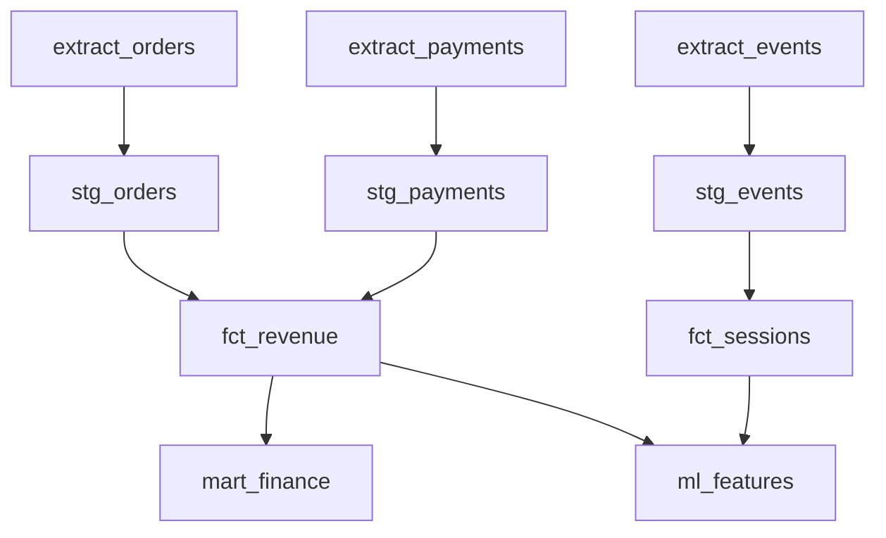

# Orchestration and dependencies｜编排和依赖

> 原文：[DataInterview · Data Engineering System Design · Orchestration and dependencies](https://www.datainterview.com/courses/data-engineering-system-design/concept-orchestration)（课程第 2 部分 Building blocks 的第 6 课，原文标注阅读约 23 分钟），抓取于 2026-11-14。

译文说明：

- 段落：英文原文放在引用块里，中文紧跟其后。
- 列表：用「English｜中文」两栏表格逐条对照。多列的大表格只直接展示中文版，英文原表折叠在下方。
- 原页面的交互组件（失败传播 DAG、data interval 逐步演示、三种触发方式图表、重试时间线、三个工具的代码 tab）已改写成静态表格和代码块；折叠的 hint、参考答案和 strong answer 都已展开；测验用 ✅ 标出正确选项。练习的编辑器里显示的是官方 solution，这里直接作为参考答案。
- 译者自己加的内容（包括一张 Mermaid 图）都标了「译注」。

## 速览（译注）

- DAG 决定先后顺序，trigger rule 决定失败后谁还跑：默认 `all_success` 会挡住失败 task 的所有下游；cleanup 用 `all_done`。
- 每个定时 run 处理一个 data interval，interval 结束后才开始；logical date 是 interval 的起点。task 要读 interval，不能读时钟。
- `catchup`（Airflow 3 默认关）、`max_active_runs`、`depends_on_past` 控制哪些 run 存在、怎么重叠。
- 由数据触发下游：自己平台内用 asset trigger，外部输入用 reschedule 模式、带 timeout 的 sensor。
- retries、backoff、execution_timeout 要一起对照 deadline 算；Deadline Alert 和 freshness 检查在错过之前报警。业务数据默认 ELT（dbt 在 warehouse 里跑）。

---

## 开篇

> “The finance dashboard must be up to date by 6 a.m. It depends on 200 dbt models and 40 ingestion jobs owned by three teams, and last week it was late twice.” Nothing in that prompt is about a single transformation. It is about what runs after what, what happens when one piece fails or is late, how a run knows which day it is processing, and how anyone finds out before finance does. That is the job of the orchestrator, and interviewers probe it after almost every batch design: “how is this scheduled?”, “what if the upstream is late?”, “what happens when this task fails?”.

「财务 dashboard 必须在早上 6 点前更新好。它依赖 200 个 dbt model 和 40 个 ingestion job，分属三个团队，上周迟了两次。」这道题里没有一句是关于某个具体转换的。它问的是：谁在谁之后跑，某一块失败或迟到了怎么办，一个 run 怎么知道自己在处理哪一天，以及怎么在财务发现之前就有人知道。这是 orchestrator 的工作；几乎每个 batch 设计之后，面试官都会追问：「这个怎么调度？」「上游迟了怎么办？」「这个 task 失败了会怎样？」

> In this lesson you’ll fail a task in a DAG and see what does not run, step through data intervals, catchup and a rerun, compare a fixed schedule, a sensor and a data-driven trigger on 60 days of landing times, and size retries and timeouts against a deadline. You’ll see the same pipeline in Airflow, Dagster and dbt, decide where transformations run, and then compute run order and blast radius in Python.

这一课会：让 DAG 里一个 task 失败，看哪些不会跑；一步步走过 data interval、catchup 和重跑；用 60 天的数据到达时间比较固定调度、sensor 和数据驱动触发；对照 deadline 估算 retries 和 timeout。还会看同一条 pipeline 在 Airflow、Dagster 和 dbt 里的写法，决定转换在哪里跑，最后用 Python 算执行顺序和 blast radius。

---

## DAGs and what a failure blocks｜DAG，以及失败会挡住什么

> An orchestrator runs a DAG, a directed acyclic graph of tasks where an edge means “runs after”. Each task instance ends in a state (in Airflow: success, failed, upstream_failed, skipped and a few others), and a task’s trigger rule decides whether it runs given its upstreams’ states. The default, all_success, runs a task only when every upstream succeeded. Fail a task and change the rule of the cleanup task.

orchestrator 跑的是 DAG：由 task 组成的有向无环图，一条边表示「在之后跑」。每个 task instance 最终处于某个状态（Airflow 里有 success、failed、upstream_failed、skipped 等），task 的 trigger rule 根据上游的状态决定它跑不跑。默认的 `all_success` 只有在所有上游都成功时才跑。下面让一个 task 失败，再改一下 cleanup task 的规则。

译注：演示里的 DAG（依赖关系取自后面 playground 的 `dag` 定义；演示里最后还有一个 cleanup task `cleanup_tmp`，图里没画）。



### 一个 task 失败，哪些不会跑（原文为交互组件）

Airflow 的 trigger rule。`cleanup_tmp` 的 trigger_rule 默认是 `all_success`。

| 失败的 task | 失败 | 被挡住（upstream_failed） | 成功 | 被挡住的 task |
|---|---|---|---|---|
| none | 0 | 0 | 11 | — |
| extract_events | 1 | 4 | 6 | stg_events、fct_sessions、ml_features、cleanup_tmp |
| stg_payments | 1 | 4 | 6 | fct_revenue、mart_finance、ml_features、cleanup_tmp |
| fct_revenue | 1 | 3 | 7 | mart_finance、ml_features、cleanup_tmp |

把 `cleanup_tmp` 的 trigger_rule 改成 `all_done` 后，它在每种情况下都会跑并成功，被挡住的 task 数相应少 1（4 → 3，3 → 2）。

> The outlined box failed after its retries. Dashed boxes are upstream_failed: with the default rule, all_success, a task runs only if every upstream succeeded. all_done runs once upstreams have finished in any state, which is what a cleanup task needs.

带边框的方块是重试完仍然失败的 task。虚线方块是 upstream_failed：在默认规则 `all_success` 下，只有所有上游都成功，task 才会跑。`all_done` 在上游都结束后就跑，不管它们是什么状态，cleanup task 需要的正是这个。

<details>
<summary>交互组件里的英文原文</summary>

| Task that fails | cleanup_tmp trigger_rule | Tasks that failed | Tasks blocked (upstream_failed) | Tasks that ran and succeeded |
|---|---|---|---|---|
| none | all_success / all_done | 0 | 0 | 11 |
| extract_events | all_success | 1 | 4 | 6 |
| extract_events | all_done | 1 | 3 | 7 |
| stg_payments | all_success | 1 | 4 | 6 |
| stg_payments | all_done | 1 | 3 | 7 |
| fct_revenue | all_success | 1 | 3 | 7 |
| fct_revenue | all_done | 1 | 2 | 8 |

</details>

> When stg_payments fails, fct_revenue, mart_finance and ml_features become upstream_failed and never start, while the events branch completes; the blast radius is the failed task’s descendants. That is the behaviour you want for data: a model built on a missing input would publish wrong numbers. Cleanup and notification tasks are the exception, and use all_done (run when upstreams finished in any state). Airflow also has one_failed, none_failed and others for branching patterns. Design DAGs so that independent outputs are on independent branches, and a failure in one source does not stop unrelated tables.

`stg_payments` 失败时，`fct_revenue`、`mart_finance` 和 `ml_features` 变成 upstream_failed，根本不会启动，而 events 那一支照常完成；blast radius 就是失败 task 的所有下游。对数据来说这正是想要的行为：基于缺失输入构建的 model 会发布错误的数字。cleanup 和通知类 task 是例外，用 `all_done`（上游都结束了就跑，不管什么状态）。Airflow 还有 `one_failed`、`none_failed` 等规则，用于分支模式。设计 DAG 时，让彼此独立的输出处在独立的分支上，这样一个数据源失败不会挡住不相关的表。

---

## Schedules and data intervals｜调度和 data interval

> A scheduled run in Airflow is defined by the slice of time it processes, its data interval, not by when it happens to start. A daily DAG’s run for Oct 11 covers Oct 11 00:00 to Oct 12 00:00, has the logical date Oct 11 (the start of the interval), and starts after the interval ends. That is the behaviour of a data-interval timetable. In Airflow 3 a bare cron string such as "@daily" gets a trigger timetable instead, whose runs have no interval (the logical date is the run time), unless [scheduler] create_cron_data_intervals is set to True; pass CronDataIntervalTimetable as the schedule when tasks process a period (timetables). start_date is the start of the first interval. catchup decides whether intervals missed since start_date get runs when the DAG is unpaused. Step through a DAG’s first week.

Airflow 里一个定时 run 由它处理的那段时间，也就是 data interval 来定义，而不是由它碰巧什么时候开始来定义。一个每日 DAG 的 Oct 11 run 覆盖 Oct 11 00:00 到 Oct 12 00:00，logical date 是 Oct 11（interval 的起点），在 interval 结束后才开始。

这是 data-interval timetable 的行为。Airflow 3 里，像 `"@daily"` 这样的裸 cron 字符串得到的是 trigger timetable，它的 run 没有 interval（logical date 就是运行时间），除非把 `[scheduler] create_cron_data_intervals` 设成 True。task 处理的是一段时间时，要把 `CronDataIntervalTimetable` 作为 schedule 传进去。

- `start_date` 是第一个 interval 的起点。
- `catchup` 决定 DAG unpause 时，从 `start_date` 以来错过的 interval 要不要补跑。

下面一步步看一个 DAG 的第一周。

### Data interval、catchup 和重跑（原文为逐步演示）

每日 data-interval DAG，`start_date` 是 Oct 1，Oct 5 10:00 unpause。时间轴 Oct 1 到 Oct 9；阴影条是 run 覆盖的 data interval，圆点是 run 执行的时间（绿色完成、蓝色运行中、红色失败）。

**Step 1｜部署**

> A DAG on a daily CronDataIntervalTimetable (a bare "@daily" in Airflow 3 has no data interval) with start_date Oct 1 is deployed and unpaused on Oct 5 at 10:00. Each run has a data interval, here one day from midnight to midnight, and its logical date is the start of that interval.

一个用每日 `CronDataIntervalTimetable`（Airflow 3 里裸的 `"@daily"` 没有 data interval）、`start_date` 为 Oct 1 的 DAG，在 Oct 5 10:00 部署并 unpause。每个 run 有一个 data interval，这里是从午夜到午夜的一天，logical date 是这个 interval 的起点。

**Step 2｜catchup=False：logical date Oct 4**

> With catchup=False (the default in Airflow 3) the scheduler creates one run, for the latest complete interval: Oct 4 00:00 to Oct 5 00:00, logical date Oct 4. Tasks read {{ ds }} as 2026-10-04. Oct 1 to Oct 3 are never run unless you backfill them.

`catchup=False`（Airflow 3 的默认值）时，scheduler 只为最近一个完整的 interval 创建一个 run：Oct 4 00:00 到 Oct 5 00:00，logical date Oct 4。task 读到的 `{{ ds }}` 是 2026-10-04。Oct 1 到 Oct 3 永远不会跑，除非你 backfill。

**Step 3｜如果 catchup=True**

> With catchup=True the scheduler creates a run for every interval since start_date that has not run: Oct 1, 2, 3 and 4, all at once, up to max_active_runs (16 by default). Four days of extracts hit the source together, which is how a forgotten catchup=True on a two-year-old start_date takes down a database.

`catchup=True` 时，scheduler 为 `start_date` 以来每个没跑过的 interval 都创建 run：Oct 1、2、3、4，同时开跑，上限是 `max_active_runs`（默认 16）。四天的抽取一起打到数据源上；一个忘了关的 `catchup=True` 加上两年前的 `start_date`，就是这样把数据库打挂的。

**Step 4｜Oct 5 的 run 在 Oct 6 00:00 开始**

> Back to catchup=False. The run for Oct 5 starts at Oct 6 00:00, when its interval has ended, so it can see the whole day. A run is always scheduled one interval after the period it covers.

回到 `catchup=False`。Oct 5 的 run 在 Oct 6 00:00 开始，这时它的 interval 已经结束，能看到完整的一天。run 总是在它覆盖的时间段之后一个 interval 才被调度。

**Step 5｜Oct 6 的 run 重试用尽后失败**

> The Oct 6 run fails after its retries. The Oct 7 run still starts on time: runs are independent unless a task sets depends_on_past=True, which makes each run wait for the same task in the previous run to succeed. Use it when a run builds on yesterday’s output (a running total), not by default.

Oct 6 的 run 重试完仍然失败。Oct 7 的 run 照样按时开始：各个 run 互相独立，除非某个 task 设了 `depends_on_past=True`，那样每个 run 要等上一个 run 里同一个 task 成功。只有当 run 要基于昨天的输出构建时（比如累计值）才用它，不要默认开。

**Step 6｜Oct 8 清除后重跑**

> The source is fixed and the failed tasks are cleared on Oct 8 at 14:00. The rerun keeps its own data interval: {{ ds }} is still 2026-10-06, so it recomputes Oct 6 and nothing else. That is why tasks must be written against the data interval and never against the time they run.

数据源修好了，Oct 8 14:00 清除失败的 task。重跑保留它自己的 data interval：`{{ ds }}` 仍是 2026-10-06，所以它重算 Oct 6，别的都不碰。这就是为什么 task 必须按 data interval 来写，绝不能按它运行的时间来写。

> Three settings carry most of the risk. catchup defaults to False in Airflow 3 (the config [scheduler] catchup_by_default); in Airflow 2 the default was True, which is why an old start_date plus a new DAG used to start hundreds of runs at once. max_active_runs (16 by default) caps concurrent runs of a DAG, including catchup. depends_on_past serialises runs of a task, for outputs built from the previous run’s output. For deliberate reprocessing there are backfills, covered in the previous lesson; in Airflow 3 they are created with airflow backfill create and respect their own --max-active-runs.

大部分风险集中在三个设置上：

| 设置 | 说明 |
|---|---|
| `catchup` | Airflow 3 默认 False（配置项 `[scheduler] catchup_by_default`）；Airflow 2 默认 True，所以以前一个旧 `start_date` 加一个新 DAG 会一下子启动几百个 run |
| `max_active_runs` | 默认 16，限制一个 DAG 的并发 run 数，包括 catchup |
| `depends_on_past` | 让一个 task 的各个 run 串行，用于基于上一次输出构建的输出 |

有意的重新处理用 backfill，上一课讲过；Airflow 3 里用 `airflow backfill create` 创建，它有自己的 `--max-active-runs`。

### 测验 1

> An Airflow DAG with schedule=CronDataIntervalTimetable("0 0 * * *", timezone="UTC") runs at 2026-10-12 00:00 UTC. What are its logical date and data interval, and which day should its SQL load?

一个 `schedule=CronDataIntervalTimetable("0 0 * * *", timezone="UTC")` 的 Airflow DAG 在 2026-10-12 00:00 UTC 运行。它的 logical date 和 data interval 是什么？SQL 应该加载哪一天？

| | English | 中文 |
|---|---|---|
| A ✅ | Logical date 2026-10-11, interval Oct 11 00:00 to Oct 12 00:00: it loads Oct 11 | logical date 2026-10-11，interval 是 Oct 11 00:00 到 Oct 12 00:00：加载 Oct 11 |
| B | Logical date 2026-10-12, and it loads the previous 24 hours from now() | logical date 2026-10-12，加载 `now()` 往前 24 小时 |
| C | Logical date 2026-10-12: it loads Oct 12 | logical date 2026-10-12：加载 Oct 12 |
| D | It depends on catchup | 取决于 catchup |

> Right. A run starts after its interval ends, so the run at midnight on Oct 12 covers Oct 11. The logical date is the start of the interval. Templating the SQL with {{ ds }} or data_interval_start makes a rerun next week load Oct 11 again. A bare "@daily" in Airflow 3 would instead give a trigger timetable: logical date Oct 12 and no interval, so {{ ds }} would be the wrong day.

解析：run 在它的 interval 结束后开始，所以 Oct 12 午夜的 run 覆盖的是 Oct 11。logical date 是 interval 的起点。SQL 用 `{{ ds }}` 或 `data_interval_start` 模板化后，下周重跑时仍会加载 Oct 11。如果在 Airflow 3 里用裸的 `"@daily"`，得到的是 trigger timetable：logical date 是 Oct 12、没有 interval，`{{ ds }}` 就是错的那天。

---

## Time-based or data-driven triggers｜按时间触发还是由数据触发

> A schedule says when to start; it knows nothing about whether the input is there. Three ways to start the dashboard’s job: at a fixed time, with a sensor that starts checking for the input at a fixed time, or with a data-driven trigger that starts it when the upstream producer reports an update (Airflow assets, called datasets in Airflow 2; Dagster’s automation conditions). The upstream extract lands between 01:30 and about 04:10; the job takes 2 hours and the dashboard is due at 06:00.

调度只说什么时候开始，对输入到没到一无所知。启动 dashboard 的 job 有三种方式：

1. 固定时间启动；
2. 用 sensor，从固定时间开始检查输入；
3. 数据驱动触发：上游生产者报告更新时启动（Airflow 的 asset，Airflow 2 里叫 dataset；Dagster 的 automation condition）。

上游抽取的到达时间在 01:30 到约 04:10 之间；job 要跑 2 小时，dashboard 要求 06:00 前好。

### job 什么时候开始（原文为交互图表）

60 天的上游到达时间（假设值）。图上每个点是一天里上游数据到达的时间，06:00 有一条「dashboard due」线。默认参数下三种触发方式的读数：

| 读数 | 固定时间调度（03:00） | sensor（03:00 开始检查） | 上游 asset 更新时触发 |
|---|---|---|---|
| 用不完整数据跑的天数 | 5 | 0 | 0 |
| 数据到达后的平均等待 | 43 min | 43 min | 1 min |
| 06:00 dashboard 迟到的天数 | 0 | 0 | 0 |
| 每天占用 worker slot 的分钟数（sensor） | 0 | 0 | 0 |

> The job takes 2 hours. A sensor checks every 5 minutes; in reschedule mode it is assumed to hold a slot for 30 seconds per check. The asset trigger starts the job within a minute of the upstream task’s update.

job 跑 2 小时。sensor 每 5 分钟检查一次；假设 reschedule 模式下每次检查占用 slot 30 秒。asset trigger 在上游 task 更新后一分钟内启动 job。

<details>
<summary>交互组件里的英文原文</summary>

- Title: When should the job start? — 60 days of upstream landing times (assumed)
- Trigger: schedule at a fixed time / sensor from a fixed time / when the upstream asset updates; Schedule time (or Sensor starts at) 03:00

| | schedule at a fixed time | sensor from a fixed time | when the upstream asset updates |
|---|---|---|---|
| Days the job ran on incomplete data | 5 | 0 | 0 |
| Average wait after data lands | 43 min | 43 min | 1 min |
| Days the 06:00 dashboard was late | 0 | 0 | 0 |
| Worker-slot minutes per day (sensor) | 0 | 0 | 0 |

</details>

> A fixed 03:00 start runs on incomplete data on 5 of the 60 days, silently, and waits 43 minutes on average after the data is there. Moving it to 03:30 avoids those days in this sample and wastes 71 minutes a day; at 04:15 it is safe from late data and misses the deadline every day. A sensor from 01:30 starts within minutes of the data, but in poke mode it holds a worker slot for about 49 minutes a night; reschedule mode (or a deferrable sensor) releases the slot between checks. When the producer is another pipeline you run, an asset trigger is simplest: the producing task declares the asset in its outlets, and the consumer DAG uses the asset as its schedule, running within a minute of the update. A DAG scheduled on several assets runs once all of them have updated since its last run.

| 方式 | 结果 |
|---|---|
| 固定 03:00 启动 | 60 天里有 5 天悄悄地用不完整的数据跑了；数据到了之后平均还要等 43 分钟 |
| 改到 03:30 | 这个样本里避开了那几天，但每天浪费 71 分钟 |
| 改到 04:15 | 不怕迟到数据了，但每天都错过 deadline |
| sensor 从 01:30 开始 | 数据到了几分钟内就启动；但 poke 模式下每晚占着一个 worker slot 约 49 分钟。reschedule 模式（或 deferrable sensor）在两次检查之间会释放 slot |
| asset trigger | 生产者是你自己跑的另一条 pipeline 时最简单：生产 task 在 `outlets` 里声明 asset，消费 DAG 把这个 asset 作为 schedule，更新后一分钟内就跑 |

一个以多个 asset 作为 schedule 的 DAG，会在所有 asset 自它上次运行以来都更新过之后才跑。

> Across DAGs owned by different teams, prefer these data dependencies to clock times. Airflow’s ExternalTaskSensor waits for a task in another DAG for the matching logical date; assets express the same dependency in terms of data and need no agreement on schedules.

不同团队的 DAG 之间，优先用这种数据依赖，而不是钟点时间。Airflow 的 `ExternalTaskSensor` 等待另一个 DAG 里对应 logical date 的某个 task；asset 用数据来表达同样的依赖，不需要双方约定调度时间。

### 测验 2

> A DAG must start only after a partner drops a file, which usually arrives between 01:00 and 04:00. Which setup is right?

一个 DAG 必须在合作方放下一个文件后才能开始，文件通常在 01:00 到 04:00 之间到达。哪种设置是对的？

| | English | 中文 |
|---|---|---|
| A | Retry the DAG every 5 minutes until the file is there | 每 5 分钟重试一次 DAG，直到文件出现 |
| B | A sensor in poke mode with no timeout | poke 模式的 sensor，不设 timeout |
| C ✅ | A sensor in reschedule mode (or deferrable) with poke_interval of a few minutes and a timeout before the deadline, alerting when it times out | reschedule 模式（或 deferrable）的 sensor，`poke_interval` 几分钟，timeout 设在 deadline 之前，超时就告警 |
| D | Schedule the DAG at 04:30, after the file usually arrives | 把 DAG 调度在 04:30，通常文件已到之后 |

> Right. Reschedule mode frees the worker slot between checks; a poking sensor holds a slot for up to three hours every night. The timeout turns “the file never came” into an alert in time to act, instead of a silent wait. If the producer is your own pipeline, an asset trigger is simpler than a sensor.

解析：reschedule 模式在两次检查之间释放 worker slot；poke 的 sensor 每晚最多会占一个 slot 三个小时。timeout 把「文件一直没来」变成一个来得及处理的告警，而不是无声的等待。如果生产者是你自己的 pipeline，asset trigger 比 sensor 更简单。

---

## Retries, timeouts and deadlines｜重试、timeout 和 deadline

> Every task should have retries (Airflow’s default is 0), a retry_delay (default 300 seconds), usually exponential backoff, and an execution_timeout. Retries cover transient failures: a dropped connection, a 429 from an API, a warehouse queue. The timeout covers the failure retries cannot: a task that hangs. Size them together against the deadline.

每个 task 都应该有 `retries`（Airflow 默认 0）、`retry_delay`（默认 300 秒）、通常还要指数退避，以及 `execution_timeout`。retries 覆盖暂时性故障：连接断了、API 返回 429、warehouse 排队。timeout 覆盖 retries 处理不了的故障：task 卡住不动。这几个要一起对照 deadline 来定。

### 重试直到最后一次（原文为交互图表）

task 02:00 开始；除了最后一次，每次尝试都失败。默认参数：`retries` 3，`retry_delay` 5 min，`retry_exponential_backoff` ×2，`execution_timeout` 60 min。

| 读数 | 每次 25 分钟后失败 | 每次卡住直到被 kill |
|---|---|---|
| 总时长 | 135 分钟 | 275 分钟 |
| 尝试次数 | 4 | 4 |
| 两次尝试之间的等待 | 5 + 10 + 20 min | 5 + 10 + 20 min |
| 最后一次尝试结束 | 04:15 | 06:35 |
| 06:00 deadline | 赶上 | 错过 |

<details>
<summary>交互组件里的英文原文</summary>

- Title: Retries until the last attempt — task starts 02:00; every attempt fails but the last
- Controls: retries 3 · retry_delay 5 min · retry_exponential_backoff x2 · execution_timeout 60 min · Failure: fails after 25 min / hangs until killed
- fails after 25 min: 135 minutes · Attempts 4 · Waits between them 5 + 10 + 20 min · Last attempt ends 04:15 · 06:00 deadline met
- hangs until killed: 275 minutes · Attempts 4 · Waits between them 5 + 10 + 20 min · Last attempt ends 06:35 · 06:00 deadline missed

</details>

> A task that starts at 02:00 and fails fast on its first three attempts, with 3 retries, 5 minutes of delay and backoff doubling it, finishes its last attempt at 04:15. If instead each attempt hangs until the 60-minute timeout kills it, the same settings end at 06:35, past the deadline. Since Airflow 3.2, retry_exponential_backoff is a multiplier (2.0 doubles the delay each time; earlier versions take True to double it) and max_retry_delay caps it. Without an execution_timeout, a hung task never fails and its retries never start. Sensors have their own timeout, measured from the first attempt.

一个 02:00 开始的 task，前三次尝试很快失败，配 3 次 retries、5 分钟延迟、退避每次翻倍，最后一次尝试在 04:15 结束。如果每次尝试都卡住、直到 60 分钟 timeout 把它 kill 掉，同样的设置要到 06:35 才结束，过了 deadline。

- 从 Airflow 3.2 起，`retry_exponential_backoff` 是一个乘数（2.0 表示每次延迟翻倍；更早的版本传 True 表示翻倍），`max_retry_delay` 给它设上限。
- 没有 `execution_timeout`，卡住的 task 永远不会失败，它的 retries 也永远不会开始。
- sensor 有自己的 timeout，从第一次尝试开始算。

> The deadline itself needs monitoring. Airflow 2’s sla was removed in Airflow 3.0 and replaced in 3.1 by Deadline Alerts (experimental in 3.1): a reference time (such as when the run was queued, or its logical date), an interval, and a callback such as a Slack notifier, fired if the run has not finished by then. Put the alert early enough to act, for example at 05:00 for a 06:00 dashboard, and pair it with freshness checks on the inputs (dbt source freshness fails a run whose raw data is older than error_after).

deadline 本身也需要监控。Airflow 2 的 `sla` 在 Airflow 3.0 被移除，3.1 用 Deadline Alerts 取代（3.1 中是实验性的）：一个参考时间（比如 run 进入队列的时间，或它的 logical date）、一个时间间隔，加一个 callback（比如 Slack notifier），到那时 run 还没完成就触发。告警要设得足够早、来得及处理，比如 06:00 的 dashboard 设在 05:00；再配上输入的 freshness 检查（dbt source freshness 会在原始数据比 `error_after` 还旧时让 run 失败）。

---

## ETL, ELT and where transformations run｜ETL、ELT，以及转换在哪里跑

> In ETL a processing engine (Spark, a custom service) transforms data before loading it into the warehouse. In ELT raw data is loaded first and transformed inside the warehouse with SQL, usually with dbt, which turns ref() and source() calls into a dependency graph and runs models and tests in order. ELT is the common default for business data: one engine, SQL that analysts can read, and raw data kept for reprocessing. Spark or Flink earns its place for large or semi-structured data where warehouse compute would cost more, for logic that SQL expresses badly, and for streaming. Either way the orchestrator owns the order; dbt does not schedule itself.

- **ETL**：处理引擎（Spark、自建服务）先转换数据，再加载进 warehouse。
- **ELT**：先加载原始数据，再在 warehouse 里用 SQL 转换，通常用 dbt；dbt 把 `ref()` 和 `source()` 调用变成依赖图，按顺序跑 model 和测试。

业务数据的常见默认是 ELT：一个引擎、分析师看得懂的 SQL、原始数据保留下来可以重新处理。Spark 或 Flink 适合这些场景：数据量大或半结构化、在 warehouse 里算会更贵；SQL 很难表达的逻辑；以及 streaming。不管哪种，顺序都由 orchestrator 负责；dbt 不会自己调度自己。

### 一条 pipeline，三个工具（原文为 tab 切换）

真实 API，有简化。

**Airflow 3**

```python
from datetime import datetime, timedelta
from airflow.sdk import DAG, Asset
from airflow.providers.standard.operators.bash import BashOperator
from airflow.timetables.interval import CronDataIntervalTimetable

# Airflow 3.2+ (retry_exponential_backoff as a multiplier)
with DAG(dag_id="fct_revenue",
         schedule=CronDataIntervalTimetable("0 2 * * *", timezone="UTC"),
         start_date=datetime(2026, 1, 1), catchup=False, max_active_runs=4,
         default_args={"retries": 3, "retry_delay": timedelta(minutes=5),
                       "retry_exponential_backoff": 2.0,
                       "execution_timeout": timedelta(minutes=60)}):
    BashOperator(task_id="dbt_build",
        bash_command="dbt build --select +fct_revenue --vars '{day: {{ ds }}}'",
        outlets=[Asset("warehouse://analytics/fct_revenue")])

# another team's DAG runs whenever fct_revenue is updated
with DAG(dag_id="finance_mart", start_date=datetime(2026, 1, 1),
         schedule=[Asset("warehouse://analytics/fct_revenue")]):
    ...
```

> Task-centric: you schedule DAGs of tasks. Assets (called datasets in Airflow 2) add data-driven triggers between DAGs; a DAG scheduled on several assets runs when all of them have updated since its last run.

以 task 为中心：你调度由 task 组成的 DAG。asset（Airflow 2 里叫 dataset）在 DAG 之间加上数据驱动的触发；以多个 asset 为 schedule 的 DAG，会在所有 asset 自它上次运行以来都更新过之后才跑。

> Sensors (mode="reschedule", timeout) wait on external conditions; ExternalTaskSensor waits on a task in another DAG for the same logical date.

sensor（`mode="reschedule"`、`timeout`）等待外部条件；`ExternalTaskSensor` 等待另一个 DAG 里同一 logical date 的某个 task。

**Dagster**

```python
import dagster as dg

daily = dg.DailyPartitionsDefinition(start_date="2026-01-01")

@dg.asset(partitions_def=daily)
def stg_orders(context: dg.AssetExecutionContext) -> None:
    load_day(context.partition_key)

@dg.asset(partitions_def=daily, deps=[stg_orders],
          automation_condition=dg.AutomationCondition.eager())
def fct_revenue(context: dg.AssetExecutionContext) -> None:
    build_day(context.partition_key)
```

> Asset-centric: you declare tables and their dependencies; runs are how assets get materialised. A daily partition plays the role of Airflow’s data interval, and a backfill is a selection of partitions.

以 asset 为中心：你声明表和它们之间的依赖；run 只是 asset 被物化的方式。每日 partition 扮演 Airflow 里 data interval 的角色，backfill 就是选一批 partition。

> AutomationCondition.eager() materialises an asset when its upstreams update; on_cron("@hourly") runs on a schedule after upstreams have updated.

`AutomationCondition.eager()` 在上游更新时物化 asset；`on_cron("@hourly")` 在上游更新之后按调度跑。

**dbt**

```yaml
# models/sources.yml
sources:
  - name: shop
    config:
      freshness:
        warn_after: {count: 2, period: hour}
        error_after: {count: 6, period: hour}
      loaded_at_field: _loaded_at
    tables:
      - name: orders

# models/fct_revenue.sql
{{ config(materialized='incremental', incremental_strategy='microbatch',
          event_time='order_ts', begin='2026-01-01', batch_size='day', lookback=3) }}
select ... from {{ ref('stg_orders') }}

# in the orchestrator: dbt source freshness && dbt build --select +fct_revenue
```

> dbt builds the dependency graph inside the warehouse from ref() and source(); it does not schedule itself. An orchestrator runs dbt build (models and tests in dependency order) on a schedule or trigger.

dbt 根据 `ref()` 和 `source()` 在 warehouse 里构建依赖图；它不会自己调度。由 orchestrator 按调度或触发来跑 `dbt build`（按依赖顺序跑 model 和测试）。

> dbt source freshness fails the run when raw data is older than error_after, so models are not rebuilt from stale inputs. --select state:modified+ rebuilds only changed models and their descendants.

`dbt source freshness` 在原始数据比 `error_after` 还旧时让 run 失败，这样 model 不会用过期的输入重建。`--select state:modified+` 只重建改过的 model 及其下游。

译注：Airflow tab 的第二条说明被浏览器扩展拦截，取自页面文字。

> The tools differ in what they model. Airflow schedules tasks and adds data-awareness through assets. Dagster models the tables (assets) and their partitions, and derives runs from them, so “rebuild these 30 days of this table and everything downstream” is a first-class operation. dbt models the SQL graph inside the warehouse. A common stack runs dbt from Airflow or Dagster, with ingestion and Spark jobs as other tasks or assets in the same graph.

三个工具建模的对象不同：

| 工具 | 建模的是什么 |
|---|---|
| Airflow | 调度 task，通过 asset 加上对数据的感知 |
| Dagster | 建模表（asset）和它们的 partition，再从中推导出 run，所以「重建这张表这 30 天以及所有下游」是一等操作 |
| dbt | 建模 warehouse 内部的 SQL 依赖图 |

常见的组合是从 Airflow 或 Dagster 里跑 dbt，ingestion 和 Spark job 作为同一张图里的其他 task 或 asset。

### 练习：转换应该在哪里跑？

> A company loads 40 sources into Snowflake with a managed ingestion tool. Analytics engineers write SQL; there is one data engineer. A new requirement adds 3 TB a day of clickstream that must be sessionised and joined with orders. Decide where each transformation runs (dbt in the warehouse, Spark, or something else), and how it is orchestrated.

一家公司用托管的 ingestion 工具把 40 个数据源加载进 Snowflake。analytics engineer 写 SQL；只有一个 data engineer。新需求要加每天 3 TB 的 clickstream，需要做 sessionisation 并和订单 join。决定每个转换在哪里跑（warehouse 里的 dbt、Spark，还是别的），以及怎么编排。

**参考答案（strong answer）**

| English | 中文 |
|---|---|
| ELT for business data: raw tables land in Snowflake and dbt models transform them there. The team already writes SQL, the data is modest, and dbt gives dependency order, tests and docs from ref(). | **业务数据用 ELT**：原始表落进 Snowflake，在那里用 dbt model 转换。团队本来就写 SQL，数据量不大，dbt 通过 `ref()` 提供依赖顺序、测试和文档。 |
| Clickstream: 3 TB a day of semi-structured events with a sessionisation (window over each user’s events). Estimate it both ways: as a dbt incremental model on a warehouse sized for it, and as a Spark job writing Parquet or Iceberg that Snowflake reads. Choose the warehouse if the cost is acceptable, because one engine is simpler for a team of one; choose Spark if the warehouse cost per day dominates the budget. | **Clickstream**：每天 3 TB 的半结构化 event，要做 sessionisation（对每个用户的 event 开窗）。两种方式都估算一下：在一个为它配好规格的 warehouse 上做 dbt incremental model；或者用 Spark job 写 Parquet 或 Iceberg，让 Snowflake 去读。成本能接受就选 warehouse，因为只有一个人的团队用一个引擎更简单；如果 warehouse 每天的成本占了预算的大头，就选 Spark。 |
| Orchestration: Airflow or Dagster triggers dbt source freshness and dbt build when ingestion finishes, runs the Spark job, and triggers the dbt models that join sessions with orders when both inputs have updated. | **编排**：Airflow 或 Dagster 在 ingestion 完成时触发 `dbt source freshness` 和 `dbt build`，跑 Spark job，并在两个输入都更新后，触发把 session 和订单 join 起来的 dbt model。 |
| Safety: dbt tests in dbt build block downstream models; a deadline alert covers the morning dashboards. | **安全**：`dbt build` 里的 dbt 测试会挡住下游 model；一个 deadline alert 盯着早上的 dashboard。 |

自查清单：

| English | 中文 |
|---|---|
| ELT: load raw, transform in the warehouse with dbt for the 40 business sources | ELT：40 个业务数据源先加载原始数据，再在 warehouse 里用 dbt 转换 |
| The clickstream sessionisation sized against warehouse cost versus a Spark job | clickstream 的 sessionisation 对比了 warehouse 成本和 Spark job |
| One orchestrator owns ingestion triggers, dbt runs and the Spark job | 一个 orchestrator 统一负责 ingestion 触发、dbt 运行和 Spark job |
| Dependencies by data (source freshness, assets), not by clock times | 依赖按数据（source freshness、asset），不按钟点 |
| Tests run as part of the build and block publishing | 测试作为 build 的一部分运行，并会阻止发布 |

---

## Compute it｜算一算

> The playground builds a nightly DAG with networkx, prints the waves of tasks that can run in parallel, finds the critical path from task durations, and lists what a failure blocks.

下面的 playground 用 networkx 构建一个夜间 DAG，打印可以并行跑的 task 波次，按 task 耗时找出关键路径，并列出一次失败会挡住什么。

### 波次、关键路径和 blast radius（原文为可运行的 playground）

<details>
<summary>Playground 代码（networkx；耗时是编的）</summary>

译注：前 16 行（`dag` 字典）的对齐空格按页面文字还原。

```python
import networkx as nx

# A nightly warehouse DAG: task -> (minutes, upstream tasks)
dag = {
    "extract_orders": (20, []),
    "extract_payments": (35, []),
    "extract_events": (50, []),
    "stg_orders": (8, ["extract_orders"]),
    "stg_payments": (6, ["extract_payments"]),
    "stg_events": (25, ["extract_events"]),
    "fct_revenue": (15, ["stg_orders", "stg_payments"]),
    "fct_sessions": (30, ["stg_events"]),
    "mart_finance": (10, ["fct_revenue"]),
    "ml_features": (20, ["fct_revenue", "fct_sessions"]),
    "refresh_dashboard": (5, ["mart_finance"]),
}
g = nx.DiGraph()
for task, (minutes, ups) in dag.items():
    g.add_node(task, minutes=minutes)
    g.add_edges_from((u, task) for u in ups)

print("Waves of tasks that can run in parallel:")
for k, wave in enumerate(nx.topological_generations(g)):
    print(f"  {k}: {sorted(wave)}")

# Earliest finish of each task with unlimited workers, starting at 02:00
finish = {}
for t in nx.topological_sort(g):
    start = max((finish[u] for u in g.predecessors(t)), default=0)
    finish[t] = start + g.nodes[t]["minutes"]
end = max(finish, key=finish.get)
path = [end]
while list(g.predecessors(path[-1])):
    path.append(max(g.predecessors(path[-1]), key=finish.get))
print(f"\nLast task: {end} at 02:00 + {finish[end]} min")
print("Critical path:", " -> ".join(reversed(path)))
print(f"refresh_dashboard done at 02:00 + {finish['refresh_dashboard']} min")

failed = "stg_payments"
print(f"\nIf {failed} fails, these do not run:", sorted(nx.descendants(g, failed)))
# Try: make extract_payments take 90 minutes. Which path becomes critical,
# and does the dashboard still make a 04:00 deadline?
```

</details>

> The critical path runs through the events branch (extract, staging, sessions, features) and ends at 02:00 plus 125 minutes, while the dashboard is ready at 02:00 plus 71 minutes. Making the payments extract take 90 minutes moves the critical path to the payments branch and the dashboard to 02:00 plus 126 minutes, still inside a 04:00 deadline. The critical path is what to shorten when a deadline is at risk; speeding up any other task changes nothing.

关键路径走 events 这一支（extract、staging、sessions、features），在 02:00 + 125 分钟结束；dashboard 在 02:00 + 71 分钟就绪。把 payments 抽取改成 90 分钟，关键路径就移到 payments 这一支，dashboard 变成 02:00 + 126 分钟，仍然在 04:00 deadline 以内。deadline 有风险时要缩短的是关键路径；加速其他任何 task 都没用。

### 练习：尽可能并行的执行顺序

> Write run_waves(deps): given {task: [upstream tasks]}, return waves of tasks that can run together, each task as early as its upstreams allow, and raise ValueError on a cycle. A task may appear only as someone else’s upstream. The starter puts every task without upstreams first and everything else second.

写 `run_waves(deps)`：给定 `{task: [上游 task]}`，返回可以一起跑的 task 波次，每个 task 在上游允许的范围内尽量早；遇到环就抛 `ValueError`。一个 task 可能只作为别人的上游出现。starter 代码把所有没有上游的 task 放第一波，其余全放第二波。

> The checks run a diamond, a chain of four with an independent task, a cycle, and 40 random tasks compared with networkx’s topological_generations.

测试会跑：一个菱形；一条四个 task 的链加一个独立 task；一个环；以及 40 个随机 task，结果和 networkx 的 `topological_generations` 对比。

> Hint: Repeat: the next wave is every task not yet done whose upstreams are all done. If no task is ready but some are left, they form a cycle.

提示：循环：下一波是所有还没完成、且上游全部完成的 task。如果没有 task 就绪、但还有剩下的，它们构成了环。

参考答案：

```python
def run_waves(deps):
    """deps: {task: [upstream tasks]}. A task may appear only as someone's upstream.
    Return a list of waves (each a sorted list of tasks): every task comes in a later
    wave than all of its upstreams, and as early as possible. Raise ValueError if the
    dependencies contain a cycle."""
    tasks = set(deps) | {u for ups in deps.values() for u in ups}
    waiting = {t: set(deps.get(t, [])) for t in tasks}     # upstreams not yet done
    waves, done = [], set()
    while len(done) < len(tasks):
        ready = sorted(t for t in tasks if t not in done and waiting[t] <= done)
        if not ready:                                       # nothing can start: a cycle
            stuck = sorted(t for t in tasks if t not in done)
            raise ValueError(f"cycle among {stuck}")
        waves.append(ready)
        done |= set(ready)
    return waves
```

### 练习：一个失败 task 的 blast radius

> Write simulate(deps, failing, rules), which returns the state of every task after a DAG run in which the tasks in failing fail. Follow Airflow’s rules: with all_success (the default) a task whose upstream is failed or upstream_failed becomes upstream_failed without running; with all_done it runs anyway. The starter only blocks the direct children of a failed task.

写 `simulate(deps, failing, rules)`：在 `failing` 里的 task 都失败的一次 DAG run 之后，返回每个 task 的状态。遵循 Airflow 的规则：`all_success`（默认）下，上游是 failed 或 upstream_failed 的 task 不运行、直接变成 upstream_failed；`all_done` 下照样运行。starter 代码只挡住失败 task 的直接子节点。

> The checks fail a task in a chain, run a cleanup task with all_done, fail one branch of a diamond, and compare the blocked tasks on a 40-task DAG with the failures’ descendants.

测试会：让一条链中的一个 task 失败；用 `all_done` 跑一个 cleanup task；让菱形的一支失败；并在一个 40 个 task 的 DAG 上，把被挡住的 task 和失败 task 的所有下游做对比。

> Hint: Decide tasks in dependency order: a task can be decided once all its upstreams are. With all_success, any upstream state other than success makes it upstream_failed.

提示：按依赖顺序决定 task 状态：一个 task 的所有上游都确定后，它才能确定。`all_success` 下，只要有任何上游不是 success，它就是 upstream_failed。

参考答案：

```python
def simulate(deps, failing, rules=None):
    """Run a DAG run where every task in `failing` fails (after its retries) and the
    others succeed when they run. deps: {task: [upstream tasks]}; rules: {task:
    trigger rule}, "all_success" (the default) or "all_done".
      all_success: runs if every upstream succeeded; if any upstream is "failed" or
                   "upstream_failed", the task becomes "upstream_failed" without running.
      all_done:    runs once every upstream has finished, whatever its state.
    Return {task: "success" | "failed" | "upstream_failed"} for every task."""
    rules = rules or {}
    tasks = set(deps) | {u for ups in deps.values() for u in ups}
    state = {}
    while len(state) < len(tasks):
        progressed = False
        for t in sorted(tasks):
            ups = deps.get(t, [])
            if t in state or any(u not in state for u in ups):
                continue                                # already decided, or upstreams not done
            rule = rules.get(t, "all_success")
            blocked = any(state[u] != "success" for u in ups)
            if rule == "all_success" and blocked:
                state[t] = "upstream_failed"            # propagates: its children see it too
            else:
                state[t] = "failed" if t in failing else "success"
            progressed = True
        if not progressed:
            raise ValueError("cycle")
    return state
```

---

## How this comes up in interviews｜实际面试中是什么样

> Orchestration questions come after the architecture: “how is this scheduled?”, “the upstream team is late, what happens?”, “how do you rerun last Tuesday?”, “how do you know the dashboard will be ready?”, “dbt or Spark for this?”. A complete answer draws the DAG with its owners; triggers downstream work from data (assets, sensors in reschedule mode with timeouts, freshness checks) rather than guessed times; parameterises every task by its data interval so reruns and backfills are exact; sets retries with backoff and execution timeouts whose worst case fits the deadline; alerts before the deadline rather than after; uses all_success so failures stop downstream models and all_done for cleanup; and says where transformations run and why. Mention catchup and max_active_runs when a DAG has an old start_date.

编排的问题在架构之后出现：

- 「这个怎么调度？」
- 「上游团队迟了，会怎样？」
- 「上周二的数据怎么重跑？」
- 「你怎么知道 dashboard 能按时好？」
- 「这里用 dbt 还是 Spark？」

一个完整的回答包括：

1. 画出 DAG，标上 owner；
2. 下游由数据触发（asset、reschedule 模式带 timeout 的 sensor、freshness 检查），而不是靠猜的时间；
3. 每个 task 都以 data interval 为参数，重跑和 backfill 才精确；
4. retries 配退避、配 execution timeout，最坏情况也要在 deadline 以内；
5. 在 deadline 之前告警，而不是之后；
6. 用 `all_success` 让失败挡住下游 model，cleanup 用 `all_done`；
7. 说明转换在哪里跑、为什么。

DAG 的 `start_date` 很早时，要提一下 `catchup` 和 `max_active_runs`。

### 测验 3

> Interview: "The finance dashboard must be ready by 06:00. It depends on 40 upstream tasks owned by three teams." What do you put in the design?

面试题：「财务 dashboard 必须在 06:00 前就绪。它依赖三个团队的 40 个上游 task。」你的设计里放什么？

| | English | 中文 |
|---|---|---|
| A | Schedule every upstream DAG at 00:00 and the dashboard at 05:00 | 所有上游 DAG 都调度在 00:00，dashboard 调度在 05:00 |
| B | Set retries to 10 on every task | 每个 task 的 retries 都设成 10 |
| C ✅ | Data-driven triggers between teams' DAGs, retries with backoff and execution timeouts sized to the deadline, a deadline alert well before 06:00, and freshness checks on the inputs | 团队 DAG 之间用数据驱动触发；retries 配退避、execution timeout 按 deadline 来定；在 06:00 之前很早就设 deadline alert；输入上加 freshness 检查 |
| D | One giant DAG with all 40 tasks | 把 40 个 task 全放进一个巨大的 DAG |

> Right. Dependencies across teams should follow the data (assets or sensors), not guessed clock times. Worst-case retry time must fit in the window. In Airflow 3 the SLA feature is gone; Deadline Alerts (3.1) fire when a run is not finished by a reference time plus an interval, so someone hears at 05:00 rather than from finance at 09:00.

解析：跨团队的依赖应该跟着数据走（asset 或 sensor），而不是靠猜的钟点。重试的最坏耗时必须落在时间窗口内。Airflow 3 里 SLA 功能没了；Deadline Alerts（3.1）在 run 到「参考时间 + 间隔」还没完成时触发，这样 05:00 就有人知道，而不是 09:00 从财务那里听说。

---

## Common mistakes｜常见错误

| 错误 | 后果 | 怎么改 |
|---|---|---|
| 用钟点时间串联各团队的 DAG | 上游一迟到，下游就用不完整的数据跑，还不报错 | DAG 之间用 asset trigger，或者带 timeout 的 sensor |
| task 读 `now()` 而不是 data interval | 重跑和 backfill 处理的是错误的那天 | 用 `{{ ds }}` 或 `data_interval_start` / `data_interval_end` 模板化 |
| `catchup=True` 加一个很早的 `start_date` | 几百个 run 同时启动，把数据源压垮 | `catchup=False`，再做一次明确的、估算过的 backfill |
| 没有 `execution_timeout` | 卡住的 task 永远不会失败，retries 和告警都不会触发 | 按正常耗时给每个 task 设 timeout |
| 对有 rate limit 的 API 重试却不退避 | 重试立刻又撞上限制 | `retry_exponential_backoff` 配 `max_retry_delay` |
| poke 模式的 sensor 一等几个小时 | worker slot 被等待中的 task 占着，其他 DAG 排队 | `mode="reschedule"` 或 deferrable sensor |
| 从业务方那里才知道错过了 deadline | 有人行动之前已经过去好几个小时 | 在到期前设 Deadline Alerts（Airflow 3.1），再加输入的 freshness 检查 |
| cleanup task 用默认的 trigger rule | 每次失败的 run 后临时表都会堆积 | cleanup 用 `trigger_rule="all_done"` |

<details>
<summary>英文原表</summary>

| MISTAKE | WHAT GOES WRONG | FIX |
|---|---|---|
| Chaining teams’ DAGs by clock times | A late upstream means a downstream run on incomplete data, with no error | Asset triggers, or sensors with timeouts, between DAGs |
| Tasks that read now() instead of the data interval | Reruns and backfills process the wrong day | Template with {{ ds }} or data_interval_start / data_interval_end |
| catchup=True with an old start_date | Hundreds of runs start at once and overload sources | catchup=False and an explicit, sized backfill |
| No execution_timeout | A hung task never fails, so retries and alerts never fire | A timeout per task sized from its normal duration |
| Retries without backoff against a rate-limited API | Retries hit the limit again immediately | retry_exponential_backoff with max_retry_delay |
| Sensors in poke mode for hours | Worker slots are held by waiting tasks; other DAGs queue | mode="reschedule" or deferrable sensors |
| Learning about a missed deadline from the business | Hours lost before anyone acts | Deadline Alerts (Airflow 3.1) before the due time, plus input freshness checks |
| Cleanup tasks with the default trigger rule | Temporary tables pile up after every failed run | trigger_rule="all_done" for cleanup |

</details>

---

## Recap｜回顾

| English | 中文 |
|---|---|
| A DAG orders tasks; trigger rules decide what runs after a failure. all_success blocks every descendant of a failed task; all_done is for cleanup. | DAG 给 task 排序；trigger rule 决定失败后谁还跑。`all_success` 挡住失败 task 的所有下游；`all_done` 用于 cleanup。 |
| Each scheduled run processes a data interval and starts after it ends; the logical date is the interval’s start. Tasks must read the interval, not the clock. | 每个定时 run 处理一个 data interval，在它结束后开始；logical date 是 interval 的起点。task 必须读 interval，而不是时钟。 |
| catchup (off by default in Airflow 3), max_active_runs and depends_on_past control which runs exist and how they overlap. | `catchup`（Airflow 3 默认关）、`max_active_runs` 和 `depends_on_past` 控制哪些 run 存在、怎么重叠。 |
| Start work from data: asset triggers inside your platform, sensors in reschedule mode with timeouts for external inputs. | 由数据启动工作：平台内部用 asset trigger，外部输入用 reschedule 模式、带 timeout 的 sensor。 |
| Retries, backoff and execution timeouts are sized together against the deadline; Deadline Alerts and freshness checks warn before it is missed. | retries、退避和 execution timeout 要一起对照 deadline 来定；Deadline Alerts 和 freshness 检查在错过之前预警。 |
| ELT with dbt in the warehouse is the default for business data; Spark or Flink for large, semi-structured or streaming work. The orchestrator owns the order either way. | 业务数据默认在 warehouse 里用 dbt 做 ELT；大数据量、半结构化或 streaming 用 Spark 或 Flink。不管哪种，顺序都由 orchestrator 负责。 |

> Next up: data quality and observability, the checks that decide whether a run’s output is fit to publish.

下一课：数据质量和可观测性，讲决定一个 run 的输出能不能发布的那些检查。
