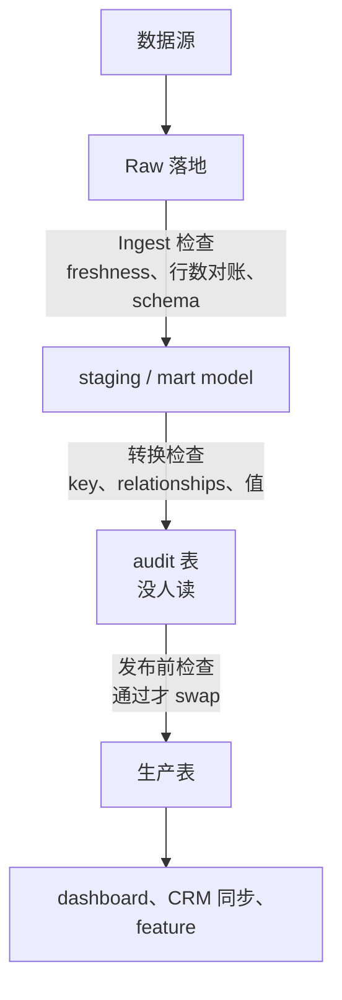

# Data quality and observability｜数据质量和可观测性

> 原文：[DataInterview · Data Engineering System Design · Data quality and observability](https://www.datainterview.com/courses/data-engineering-system-design/concept-data-quality)（课程第 2 部分 Building blocks 的第 7 课，原文标注阅读约 22 分钟），抓取于 2026-11-14。

译文说明：

- 段落：英文原文放在引用块里，中文紧跟其后。
- 列表：用「English｜中文」两栏表格逐条对照。多列的大表格只直接展示中文版，英文原表折叠在下方。
- 原页面的交互组件（故障与测试对照、三个工具的代码 tab、重复 batch 拦截点、行数监控图表、incident 逐步演示）已改写成静态表格和代码块；折叠的 hint、参考答案和 strong answer 都已展开；测验用 ✅ 标出正确选项。练习的参考答案取自页面上的官方 solution。
- 译者自己加的内容（包括一张 Mermaid 图）都标了「译注」。

## 速览（译注）

- 数据的故障是安静的：迟到、重复、值不对、关联断了、schema 变了。每种都有对应的测试类型，而行级测试看不到「少了的行」。
- 检查放在三处：ingest、转换、发布前。错数字比晚数字更糟时就阻断，否则只告警。
- 数据源能给出行数时就和它对账；给不了就和「同一个星期几」的历史比较，并把异常日排除出 baseline。
- 分布 profile 能抓住所有规则都放过的变化，比如金额改成了「分」。
- data contract 让生产方对 schema、含义和 freshness 负责，在 CI 和 ingest 时强制执行。出事时用 lineage 往上找原因、往下找 blast radius，先止损，再幂等地重跑 partition，最后补上本该抓住它的那个检查。

---

## 开篇

> On a Monday morning finance asks why Saturday’s revenue in the executive dashboard is 31% below every other Saturday this quarter. Nothing failed over the weekend: the 02:00 load, the dbt run and the dashboard refresh all finished green. The cause was a file. The EU order export, which usually lands at 01:00, arrived at 13:20 on Sunday, after the 02:00 load had run, so Saturday was built from the other regions only. Every row in the table was valid. The day was simply missing a third of its rows, and the first person to notice was the CFO.

周一早上，财务问为什么高管 dashboard 上周六的收入比这个季度其他每个周六都低 31%。周末什么都没失败：02:00 的加载、dbt run、dashboard 刷新全是绿的。原因是一个文件。EU 的订单导出通常 01:00 到，这次周日 13:20 才到，晚于 02:00 的加载，所以周六只用其他区域的数据构建。表里每一行都是有效的，只是这一天少了三分之一的行，而第一个发现的人是 CFO。

> A design interview reaches this point with “how would you know the data is right?” This lesson answers it the way a design should: which faults happen to data and which test type catches each, where checks run and which ones may stop a pipeline, how to monitor row counts when the data has a weekly rhythm, and what happens from the alert to the fix, using lineage. You will write dbt-style tests as DuckDB queries that catch a double load and orphan keys, and build a row-count monitor that does not cry wolf every weekend.

设计面试走到这里会问：「你怎么知道数据是对的？」这一课按设计应有的方式来回答：数据会出哪些故障、每种由哪类测试抓住；检查放在哪里跑、哪些可以让 pipeline 停下；数据有周节奏时怎么监控行数；以及从告警到修复，借助 lineage 走一遍。你会把 dbt 风格的测试写成 DuckDB query，抓住重复加载和孤儿 key，再做一个不会每个周末都乱报警的行数监控。

---

## What goes wrong with data｜数据会出什么问题

> Jobs fail loudly; data fails quietly. A job that crashes pages someone. A job that succeeds on bad input publishes bad output, and the people who notice are its consumers. Most quiet failures fall into a few kinds:

job 的失败很吵，数据的失败很安静。job 崩了会呼叫某个人；job 在坏输入上成功了，就会发布坏输出，最先发现的是它的 consumer。大多数安静的失败可以归为几类：

| English | 中文 |
|---|---|
| Late or missing data: a file, partition or API page did not arrive before the job ran. | **迟到或缺失**：某个文件、partition 或 API 页面没有在 job 跑之前到达。 |
| Duplicates: a retried task appended a batch twice, or a source sent an event twice. | **重复**：重试的 task 把一个 batch append 了两次，或者数据源把一个 event 发了两次。 |
| Bad values: NULLs where there were none, a new enum value, a unit change (dollars to cents), a timezone shift. | **值不对**：原本没有 NULL 的地方出现 NULL、新的枚举值、单位变化（美元变成分）、时区偏移。 |
| Broken relationships: facts whose dimension row has not loaded yet, so joins drop or NULL them. | **关联断了**：fact 对应的 dimension 行还没加载，join 时这些 fact 被丢掉或变成 NULL。 |
| Schema changes: a renamed, removed or retyped column upstream. | **Schema 变化**：上游某列被改名、删除或改了类型。 |

> Each kind has a test type built for it. Pick a fault and see which tests fail on that day’s partition.

每一类都有专门对付它的测试类型。下面选一个故障，看那天的 partition 上哪些测试会失败。

### 哪个测试抓哪个故障（原文为交互组件）

`fct_orders` 的一个每日 partition。✅ 表示测试通过，❌ 表示失败：

| 故障 | schema | not null | unique | accepted values | relationships | freshness | volume | distribution |
|---|---|---|---|---|---|---|---|---|
| 上游文件迟到 | ✅ | ✅ | ✅ | ✅ | ✅ | ❌ | ❌ | ✅ |
| 重试 append 了两次 | ✅ | ✅ | ❌ | ✅ | ✅ | ✅ | ❌ | ✅ |
| NULL 激增 | ✅ | ❌ | ✅ | ✅ | ✅ | ✅ | ✅ | ❌ |
| amount 改成了分 | ✅ | ✅ | ✅ | ✅ | ✅ | ✅ | ✅ | ❌ |
| 孤儿 customer key | ✅ | ✅ | ✅ | ✅ | ❌ | ✅ | ✅ | ✅ |
| 上游列被改名 | ❌ | ❌ | ✅ | ✅ | ✅ | ✅ | ✅ | ✅ |
| 新的 status 值 | ✅ | ✅ | ✅ | ❌ | ✅ | ✅ | ✅ | ✅ |

每个故障的说明：

| 故障 | 说明 |
|---|---|
| 上游文件迟到 | 周六的 EU 导出周日 13:20 才到，而不是 01:00，晚于 02:00 的加载。周六的 partition 只有其他区域：4,180 行，预期约 6,050。每一行都有效，所以行级测试都通过。数据源导出上的 freshness 检查最先失败；partition 上的 volume 监控也能抓住。 |
| 重试 append 了两次 | load task 写完后超时，Airflow 重试了它，而 task 是 append 的。6,050 个订单变成 12,100 行。`unique(order_id)` 在 6,050 个 id 上失败，行数翻倍。收入会显示成真实值的两倍。 |
| NULL 激增 | 一次结账服务的发布让 Android 不再发送 country。18% 的行 country 为 NULL。country 上的 not_null 测试失败；没有这个测试的话，null 占比的监控（从 0.1% 到 18%）也能看到。 |
| amount 改成了分 | 支付团队把 amount 改成整数「分」。这一列仍是数字、也从不为 NULL，所以 schema 和行级测试都通过。只有分布检查看得到：均值从 47.6 跳到约 4,600。`amount between 0 and 10000` 这样的范围测试也能抓住大部分。 |
| 孤儿 customer key | customers 同步在 orders 加载之后才跑，所以 212 个新客户有订单、但在 `dim_customers` 里没有行。join 到 dimension 时这些订单被丢掉或变成 NULL。relationships 失败，212 行。 |
| 上游列被改名 | 数据源把 country 改名成 country_code。schema 检查（或 model contract）让 build 失败。按列名匹配的 loader 会把 country 加载成全 NULL，这会被 not_null 抓住。 |
| 新的 status 值 | 产品加了 `partially_refunded` 状态。只扣减 `refunded` 的收入逻辑会多算这些订单的收入。accepted_values 失败，340 行；这提示你该更新 model，而不是删掉这些行。 |

> In this example every load job finished without an error. Row counts and incident details are made up.

这个例子里每个加载 job 都没报错就结束了。行数和事故细节是编的。

<details>
<summary>交互组件里的英文原文</summary>

| What went wrong | schema | not null | unique | accepted values | relationships | freshness | volume | distribution |
|---|---|---|---|---|---|---|---|---|
| late upstream file | passes | passes | passes | passes | passes | fails | fails | passes |
| retry appended twice | passes | passes | fails | passes | passes | passes | fails | passes |
| NULL spike | passes | fails | passes | passes | passes | passes | passes | fails |
| amount now in cents | passes | passes | passes | passes | passes | passes | passes | fails |
| orphan customer keys | passes | passes | passes | passes | fails | passes | passes | passes |
| column renamed upstream | fails | fails | passes | passes | passes | passes | passes | passes |
| new status value | passes | passes | passes | fails | passes | passes | passes | passes |

- late upstream file: The EU export for Saturday landed at 13:20 on Sunday instead of 01:00, after the 02:00 load. Saturday’s partition holds only the other regions: 4,180 rows against about 6,050 expected. Every row is valid, so row-level tests pass. A source freshness check on the export fails first; a volume monitor on the partition catches it too.
- retry appended twice: The load task timed out after writing, Airflow retried it, and the task appends. 6,050 orders became 12,100 rows. unique(order_id) fails on 6,050 ids and the row count doubles. Revenue would show twice the real number.
- NULL spike: A checkout release stopped sending country for Android. 18% of rows have NULL country. A not_null test on country fails; without one, a monitor on the null share (0.1% to 18%) still sees it.
- amount now in cents: The payments team switched amount to integer cents. The column is still a number, never NULL, so schema and row tests pass. Only a distribution check sees it: the mean jumps from 47.6 to about 4,600. A range test such as amount between 0 and 10000 would also catch most of it.
- orphan customer keys: The customers sync ran after the orders load, so 212 new customers have orders but no row in dim_customers. Joins to the dimension drop or NULL those orders. relationships fails with 212 rows.
- column renamed upstream: The source renamed country to country_code. A schema check (or a model contract) fails the build. A loader that matches columns by name would load country as all NULL instead, which not_null catches.
- new status value: Product added a partially_refunded status. Revenue logic that subtracts only refunded now overstates revenue for those orders. accepted_values fails with 340 rows, which is the cue to update the model, not to delete the rows.

</details>

> Two patterns are worth saying out loud in an interview. Row-level tests (not null, unique, accepted values, relationships) look at one row or key at a time, so they cannot see missing rows: the late-file day passes all of them. Table-level checks (freshness, volume, distribution) look at the batch as a whole and catch what row tests cannot, but they need a notion of “normal”, which is where false alarms come from. And one fault, the switch to cents, passes everything except a distribution check or a range on the value. A design that lists only “not null and unique tests” misses four of the seven faults above.

面试里有两个规律值得明确说出来：

1. **行级测试**（not null、unique、accepted values、relationships）一次看一行或一个 key，所以看不到缺失的行：文件迟到那天它们全部通过。**表级检查**（freshness、volume、distribution）把整个 batch 当整体看，能抓住行级测试抓不到的东西，但它们需要一个「正常」的概念，误报就是从这里来的。
2. 有一个故障，改成「分」，除了分布检查或对值的范围检查之外，能通过所有检查。只列了「not null 和 unique 测试」的设计，会漏掉上面七个故障中的四个。

---

## The test types｜测试类型

| 测试 | 回答的问题 | 典型规则 | 运行成本 |
|---|---|---|---|
| Schema | 列和类型是 consumer 预期的吗？ | 列集合和类型与声明的 contract 一致 | 只读元数据 |
| Not null | 必填字段存在吗？ | key 和必填列零 NULL | 扫一遍这一列 |
| Unique | grain 是我们以为的那样吗？ | 没有 key 出现两次 | 对 key 做一次 group-by |
| Accepted values、范围 | 值在预期的取值范围内吗？ | status 在一个列表里；amount 在 0 和某个最大值之间 | 扫一遍 |
| Relationships | 每个外键都有父记录吗？ | 每个 `customer_id` 都存在于 `dim_customers` | 一次 join |
| Freshness | 最新的数据够新吗？ | 最新的 `loaded_at` 在 N 小时以内 | 一个 max，或读元数据 |
| Volume | 到达的行数大致对吗？ | 行数在 baseline 附近的一个区间内，或等于数据源的行数 | 一次 count，或读元数据 |
| Distribution | 值看起来和平常一样吗？ | null 占比、均值、distinct 数、各类别占比接近历史 | 每个被 profile 的列扫一遍 |

<details>
<summary>英文原表</summary>

| TEST | QUESTION IT ANSWERS | TYPICAL RULE | COST TO RUN |
|---|---|---|---|
| Schema | Are the columns and types what consumers expect? | Column set and types equal a declared contract | Metadata only |
| Not null | Is a required field present? | Zero NULLs in keys and required columns | One scan of the column |
| Unique | Is the grain what we think it is? | No key appears twice | A group-by on the key |
| Accepted values, ranges | Are values in the expected domain? | Status in a list; amount between 0 and a maximum | One scan |
| Relationships | Does every foreign key have a parent? | Every customer_id exists in dim_customers | A join |
| Freshness | Is the newest data recent enough? | Newest loaded_at within N hours | A max, or metadata |
| Volume | Did about the right number of rows arrive? | Row count within a band around a baseline, or equal to the source’s count | A count, or metadata |
| Distribution | Do the values look like they usually do? | Null share, mean, distinct count, category shares near their history | One scan per profiled column |

</details>

> Run row-level tests on the new partition, not the whole table, when the table is large: unique over three years of orders is a full group-by on every run. dbt’s where config on a test does this. The exception is uniqueness across partitions (an order loaded on Monday and again on Tuesday), which needs a lookback over a few days or a check at merge time.

表很大时，行级测试只跑在新的 partition 上，而不是整张表：对三年的订单做 unique，每次 run 都是一次全表 group-by。dbt 测试上的 `where` 配置就是干这个的。例外是跨 partition 的唯一性（一个订单周一加载了、周二又加载一次），这需要往回看几天，或者在 merge 时检查。

> The common tools express the same checks in different places. dbt keeps them in YAML next to the models and runs them in the warehouse as part of dbt build. Great Expectations defines expectations in Python and runs them against a batch through a Checkpoint. Soda writes checks in YAML (SodaCL) and runs them as SQL. Observability products such as Monte Carlo add monitors that learn baselines for freshness, volume and schema from warehouse metadata without anyone writing a rule; describe them in an interview by what they monitor, not by brand.

常见工具把同样的检查放在不同的地方：

| 工具 | 怎么表达、怎么跑 |
|---|---|
| dbt | 写在 model 旁边的 YAML 里，作为 `dbt build` 的一部分在 warehouse 里跑 |
| Great Expectations | 用 Python 定义 expectation，通过 Checkpoint 对一个 batch 运行 |
| Soda | 用 YAML（SodaCL）写检查，以 SQL 形式运行 |
| Monte Carlo 等可观测性产品 | 从 warehouse 元数据里学习 freshness、volume 和 schema 的 baseline，不需要任何人写规则 |

面试里描述这类产品时，讲它们监控什么，而不是讲品牌。

### 同样的检查，三个工具（原文为 tab 切换）

语法取自各工具的文档。

**dbt**

```yaml
# models/marts/schema.yml  (dbt 1.10.5+ nests test inputs under arguments)
models:
  - name: fct_orders
    columns:
      - name: order_id
        data_tests: [unique, not_null]
      - name: customer_id
        data_tests:
          - relationships:
              arguments: {to: ref('dim_customers'), field: customer_id}
      - name: status
        data_tests:
          - accepted_values:
              arguments: {values: [placed, shipped, delivered, refunded]}
              config: {severity: warn}
# models/sources.yml
sources:
  - name: shop
    config:
      loaded_at_field: _loaded_at
      freshness:
        warn_after: {count: 6, period: hour}
        error_after: {count: 12, period: hour}
    tables: [{name: orders}]
```

**Great Expectations**

```python
import great_expectations as gx

suite = gx.ExpectationSuite(name="fct_orders")
suite.add_expectation(gx.expectations.ExpectColumnValuesToBeUnique(column="order_id"))
suite.add_expectation(gx.expectations.ExpectColumnValuesToNotBeNull(column="customer_id"))
suite.add_expectation(gx.expectations.ExpectColumnValuesToBeInSet(
    column="status", value_set=["placed", "shipped", "delivered", "refunded"]))
suite.add_expectation(gx.expectations.ExpectTableRowCountToBeBetween(
    min_value=4000, max_value=9000))
# A Checkpoint runs the suite against a batch and then its actions (alerts, docs).
```

**Soda**

```yaml
# checks.yml (SodaCL)
checks for fct_orders:
  - row_count > 0
  - duplicate_count(order_id) = 0
  - missing_count(customer_id) = 0
  - invalid_count(status) = 0:
      valid values: [placed, shipped, delivered, refunded]
  - freshness(_loaded_at) < 6h
```

> dbt compiles each test into a query that selects failing rows and passes when it returns none. Great Expectations runs expectations from Python against a batch. Soda reads YAML checks and runs them as SQL in the warehouse.

dbt 把每个测试编译成一条选出失败行的 query，返回零行就算通过。Great Expectations 从 Python 对一个 batch 运行 expectation。Soda 读取 YAML 检查，在 warehouse 里以 SQL 运行。

> dbt’s model is the one to remember: a test is a query that selects the rows breaking the rule, and it passes when the query returns no rows. That makes any check expressible in SQL, and it means the failing rows can be stored for debugging (store_failures). Write four of them.

要记住的是 dbt 的模型：测试就是一条选出违反规则的行的 query，query 返回零行就通过。这让任何检查都能用 SQL 表达，失败的行也能存下来方便排查（`store_failures`）。下面写四个。

### 练习：把测试写成 query

> dbt turns each test into a query that selects the rows breaking the rule; the test passes when the query returns nothing. Write the queries for orders and customers in DuckDB: unique_order_id returns one row per duplicated id, relationships_customer_id returns orders whose customer is missing from customers, and freshness_sql(max_hours) returns a row when the newest load is older than max_hours before run_info.now.

dbt 把每个测试变成一条选出违规行的 query；query 什么都不返回时测试通过。在 DuckDB 里为 orders 和 customers 写这些 query：`unique_order_id` 对每个重复的 id 返回一行；`relationships_customer_id` 返回 customer 在 customers 里不存在的订单；`freshness_sql(max_hours)` 在最新一次加载比 `run_info.now` 早 `max_hours` 以上时返回一行。

> The starter has a hole and two bugs that look reasonable. The checks replay a retry that appended a batch twice, orders for customers the dimension has not loaded, NULL keys, a new status value, a stale load and an empty table.

starter 代码有一个空缺和两个看起来很合理的 bug。测试会重放：重试把一个 batch append 了两次；订单的客户在 dimension 里还没加载；NULL key；新的 status 值；过期的加载；以及空表。

> Hint: For orphans, a LEFT JOIN keeps orders with no match, and c.customer_id IS NULL picks them. Freshness is about the newest row, so use max(loaded_at), and wrap it in coalesce so an empty table compares as very old instead of NULL.

提示：找孤儿时，`LEFT JOIN` 会保留没有匹配的订单，再用 `c.customer_id IS NULL` 把它们挑出来。freshness 关心的是最新的行，所以用 `max(loaded_at)`，并且包一层 `coalesce`，让空表被当成很旧，而不是 NULL。

参考答案：

```python
import duckdb

# Each test is a query that returns the rows breaking a rule, the way dbt compiles its tests:
# zero rows means the test passes. The tables are orders(order_id, customer_id, status, loaded_at)
# and customers(customer_id).
TESTS = {
    # one row per order_id that appears more than once
    "unique_order_id": """
        SELECT order_id, count(*) AS n FROM orders
        WHERE order_id IS NOT NULL
        GROUP BY order_id HAVING count(*) > 1
    """,
    "not_null_customer_id": """
        SELECT * FROM orders WHERE customer_id IS NULL
    """,
    # orders whose customer_id has no row in customers (a NULL customer_id is not_null's job)
    "relationships_customer_id": """
        SELECT o.* FROM orders o
        LEFT JOIN customers c ON o.customer_id = c.customer_id
        WHERE o.customer_id IS NOT NULL AND c.customer_id IS NULL
    """,
    "accepted_values_status": """
        SELECT * FROM orders WHERE status NOT IN ('placed', 'shipped', 'delivered', 'refunded')
    """,
}

def freshness_sql(max_hours):
    """A query returning one row when the newest load in orders is more than max_hours older than
    run_info.now (a one-row table), and no rows when the data is fresh. An empty table is stale."""
    # max, not min: freshness is about the newest data. coalesce: an empty table has no max and
    # must count as stale, not slip through as NULL.
    return f"""
        SELECT max(loaded_at) FROM orders
        HAVING coalesce(max(loaded_at), TIMESTAMP '1970-01-01')
               < (SELECT now FROM run_info) - INTERVAL {max_hours} HOUR
    """

def run_tests(con, max_hours=6):
    results = {name: len(con.execute(sql).fetchall()) for name, sql in TESTS.items()}
    results["freshness"] = len(con.execute(freshness_sql(max_hours)).fetchall())
    return results


# A small sample to try your queries on; the checks build their own tables.
con = duckdb.connect()
con.execute("CREATE TABLE customers (customer_id VARCHAR)")
con.execute("INSERT INTO customers VALUES ('c1'), ('c2')")
con.execute("CREATE TABLE orders (order_id VARCHAR, customer_id VARCHAR, status VARCHAR, loaded_at TIMESTAMP)")
con.execute("""INSERT INTO orders VALUES
    ('o1', 'c1', 'placed',   TIMESTAMP '2026-10-01 01:00'),
    ('o2', 'c2', 'shipped',  TIMESTAMP '2026-10-02 01:00'),
    ('o2', 'c2', 'shipped',  TIMESTAMP '2026-10-02 01:00'),
    ('o3', 'c9', 'placed',   TIMESTAMP '2026-10-02 01:00')""")
con.execute("CREATE TABLE run_info AS SELECT TIMESTAMP '2026-10-02 05:00' AS now")
print(run_tests(con))
```

译注：前半段的空行位置按页面文字推断。

> The starter’s two bugs are the ones that reach production. An inner join to the dimension returns the orders that have a customer, the opposite of what the test needs, so it fails on every healthy day and gets switched off. And a freshness check on min(loaded_at) measures the oldest row, which is days old in any table with history. dbt’s own relationships test leaves NULL foreign keys alone, as your query does, because a NULL is not_null’s job; keeping each failure in one test makes the alert say exactly what broke.

starter 里的两个 bug 正是会进生产的那种：

1. 对 dimension 做 inner join，返回的是**有**客户的订单，和测试需要的正好相反，所以它在每个正常的日子都失败，最后被关掉。
2. 对 `min(loaded_at)` 做 freshness 检查，测的是最旧的行；任何有历史的表里，最旧的行都是好几天前的。

dbt 自带的 relationships 测试和你的 query 一样，不管 NULL 外键，因为 NULL 是 not_null 的事；让每种失败只由一个测试负责，告警才能准确说出哪里坏了。

---

## Where checks run, and which ones block｜检查在哪里跑，哪些要阻断

> Checks belong at three points, and each catches something the others cannot:

检查应该放在三个位置，每个位置都能抓住其他位置抓不到的东西：

| English | 中文 |
|---|---|
| At ingest, on the raw landing: freshness of the source, row counts against the source’s own count, schema against what was agreed. A failure here stops the run before anything downstream is built on half the data. | **Ingest 时，在原始落地数据上**：数据源的 freshness、和数据源自己的行数对账、对照约定检查 schema。这里失败，run 会在下游用一半数据构建任何东西之前停下。 |
| On transforms: keys, relationships and values on staging and mart models. These catch duplicates and logic errors introduced by your own code, such as a join that fans out. | **转换时**：在 staging 和 mart model 上检查 key、关联和值。它们抓住你自己代码引入的重复和逻辑错误，比如一个 fan-out 的 join。 |
| Before publish: the last gate before consumers read. Write the new data somewhere nobody reads, run the checks there, and swap it in only if they pass. This is write-audit-publish; the idempotency lesson shows how to build it with staging tables or table format branches. | **发布前**：consumer 读之前的最后一道闸。把新数据写到没人读的地方，在那里跑检查，通过了才换进去。这就是 write-audit-publish；幂等那一课讲了怎么用 staging 表或 table format 的 branch 来搭。 |

译注：三个检查点在 pipeline 上的位置。



> The second decision is severity. A blocking check stops the pipeline and leaves consumers on yesterday’s data; a warning lets the data through and tells someone. In dbt, a test’s severity is error by default or warn, with error_if and warn_if thresholds on the number of failing rows, and dbt build skips every node downstream of a test that errors. Choose per consumer: block when a wrong number is worse than a late one (finance close, billing, anything synced to customers or to a CRM, ML training sets), and warn when a late number is worse (an operations dashboard people watch all day, which can carry a banner). Follow a duplicated batch through four choices.

第二个决定是严重级别。阻断型检查让 pipeline 停下，consumer 继续看昨天的数据；告警型检查让数据通过、通知某个人。dbt 里测试的 severity 默认是 error，也可以设成 warn，再用 `error_if` 和 `warn_if` 按失败行数设阈值；`dbt build` 会跳过报 error 的测试下游的所有节点。

按 consumer 来选：

- **阻断**：错数字比晚数字更糟时（财务月结、计费、任何同步给客户或 CRM 的东西、ML 训练集）。
- **告警**：晚数字比错数字更糟时（大家整天盯着的运营 dashboard，可以挂一个 banner）。

下面跟着一个重复的 batch 走过四种选择。

### 重复 batch 停在哪里（原文为交互组件）

链路：Orders DB（数据源）→ Raw zone（重试：batch ×2）→ `stg_orders`（dbt model）→ Audit 表 → `fct_orders` → Exec dashboard、CRM sync、Churn features。

| 检查方式 | 读到错数字 | 停在旧数据上 | 谁发现、怎么发现的 |
|---|---|---|---|
| no checks | 3 / 3 | 0 / 3 | CFO，两天后。没有检查，每个 consumer 都读到两倍的真实订单，直到有人注意到数字不对。 |
| warning after publish | 3 / 3 | 0 / 3 | on-call，在 consumer 读过之后。告警通知了人，但 dashboard、CRM 同步和 feature job 已经读到了翻倍的订单。 |
| blocking at staging | 0 / 3 | 3 / 3 | on-call，在任何人读之前。build 停在 `stg_orders`：`dbt build` 跳过失败测试下游的所有 model，所以 consumer 保持昨天的数据，没有错误流出去。 |
| audit before publish | 0 / 3 | 3 / 3 | on-call，在任何人读之前。write-audit-publish：新数据落进没人读的表，测试在那里跑，只有通过的 batch 才会换进去。 |

<details>
<summary>交互组件里的英文原文</summary>

| Checks | Read wrong numbers | Left on stale data | Who finds out |
|---|---|---|---|
| no checks | 3 of 3 | 0 of 3 | the CFO, two days later. With no checks, every consumer reads twice the real orders until someone notices the numbers. |
| warning after publish | 3 of 3 | 0 of 3 | on-call, after consumers read it. A warning tells someone, but the dashboard, the CRM sync and the feature job have already read the doubled orders. |
| blocking at staging | 0 of 3 | 3 of 3 | on-call, before anyone reads it. The build stops at stg_orders: dbt build skips every model downstream of a failing test, so consumers keep yesterday’s data and nothing wrong goes out. |
| audit before publish | 0 of 3 | 3 of 3 | on-call, before anyone reads it. Write, audit, publish: the new data lands in a table nobody reads, the tests run there, and only a passing batch is swapped in. |

</details>

> A warning that fires after publish is still worth having, but it is an alert, not protection: by the time someone reads it, the CRM has the doubled counts. Blocking costs freshness, and a noisy blocking check costs it every day, which is how teams end up turning tests off. Keep the blocking set small and precise (keys, relationships, freshness, volume against the source) and let the noisy statistical checks warn.

发布后才触发的告警仍然值得有，但它只是告警，不是保护：等有人看到时，CRM 里已经是翻倍的数字了。阻断的代价是 freshness；一个嘈杂的阻断检查每天都在付这个代价，团队最后就会把测试关掉。阻断的集合要小而精确（key、relationships、freshness、和数据源对账的 volume），嘈杂的统计类检查只告警。

### 测验 1

> A not_null test on orders.coupon_code fails on 0.4% of yesterday's rows. Finance reads total revenue from this table at 09:00. Should the test block the publish?

`orders.coupon_code` 上的 not_null 测试在昨天 0.4% 的行上失败。财务 09:00 从这张表读总收入。这个测试应该阻断发布吗？

| | English | 中文 |
|---|---|---|
| A | Yes, and delete the rows with NULL coupons before publishing | 应该，并且发布前删掉 coupon 为 NULL 的行 |
| B ✅ | No: make it a warning, because a NULL coupon does not change revenue and blocking would make finance wait for nothing | 不应该：改成告警，因为 NULL coupon 不影响收入，阻断只会让财务白等 |
| C | Yes: every failed test should block, or tests stop meaning anything | 应该：所有失败的测试都该阻断，否则测试就没意义了 |
| D | No: remove the test, since it fails every day anyway | 不应该：删掉这个测试，反正它每天都失败 |

> Right. Severity follows the consequence. A missing coupon code affects a marketing breakdown, not the revenue finance reads, so blocking trades a correct total for a late one. In dbt that is severity: warn, or warn_if/error_if thresholds such as error only above 5%. Keep unique(order_id) and the amount checks blocking.

解析：严重级别跟着后果走。缺失的 coupon code 影响的是营销维度的拆分，而不是财务读的收入，所以阻断只是把一个正确的总数换成一个迟到的总数。在 dbt 里就是 `severity: warn`，或者用 `warn_if` / `error_if` 设阈值，比如超过 5% 才报 error。`unique(order_id)` 和 amount 相关的检查保持阻断。

---

## Volume and distribution monitors｜Volume 和分布监控

> The late-file Saturday passed every row test. What catches it is a volume check, and the simplest version is a reconciliation: the source says it had 6,020 orders on Saturday, the lake has 4,180. When the source can give a count (a database query, a vendor’s daily total, a manifest file listing row counts), compare against it; it is exact and never needs tuning. When it cannot, compare against history, and history has shape. Most business data has a weekly cycle, holidays and growth. Try three baselines on 70 days of a table whose weekends are 30 to 36% lower than weekdays.

文件迟到的那个周六通过了所有行级测试。抓住它的是 volume 检查，最简单的形式是对账：数据源说周六有 6,020 个订单，lake 里只有 4,180。数据源能给出行数时（一条数据库 query、vendor 的每日总数、列着行数的 manifest 文件），就和它比；这是精确的，永远不需要调参。给不了时，就和历史比，而历史是有形状的：大多数业务数据有周周期、节假日和增长。下面在一张周末比工作日低 30% 到 36% 的表上，用 70 天数据试三种 baseline。

### 有周末的表上的行数监控（原文为交互图表）

70 天，2 次真实事故。默认带宽 k = 3.0。

| baseline | 参数 | 抓到的真实事故 | 70 天内的误报 |
|---|---|---|---|
| 和昨天比的变化 | 变化超过 30% 就告警 | 1 / 2 | 20 |
| 最近 28 天 | k = 3.0 | 1 / 2 | 0 |
| 同一个星期几，4 周 | k = 3.0 | 2 / 2 | 0 |

> The series is simulated: about 6,000 rows on weekdays, 30 to 36% fewer on weekends, slow growth, 2% noise. Day 52 (a Thursday) lost 35% of its rows; day 61 (a Saturday) was loaded twice. Dots mark alerts.

序列是模拟的：工作日约 6,000 行，周末少 30% 到 36%，缓慢增长，2% 噪声。第 52 天（周四）丢了 35% 的行；第 61 天（周六）被加载了两次。图上的点标出告警。

<details>
<summary>交互组件里的英文原文</summary>

| Baseline | Setting | Real incidents caught | False alarms in 70 days |
|---|---|---|---|
| change vs yesterday | Alert when the change exceeds 30% | 1 of 2 | 20 |
| trailing 28 days | Band width, k × spread: k = 3.0 | 1 of 2 | 0 |
| same weekday, 4 weeks | Band width, k × spread: k = 3.0 | 2 of 2 | 0 |

</details>

> A day-over-day rule at 30% fires 21 times in 70 days, mostly on every Saturday and Monday, and still misses the double load on day 61, which was only 30% above the Friday before it. The trailing 28-day band at k = 3 catches the double load but not the Thursday that lost 35% of its rows: the weekends inflate the spread until 4,238 rows looks normal, because a Saturday really is about that size. Narrowing it to k = 1.5 catches the Thursday at the price of 7 false alarms. The same-weekday baseline compares Thursdays with Thursdays and catches both incidents with no false alarms at every k from 2 to 5.

| baseline | 表现 |
|---|---|
| 环比 30% 的规则 | 70 天里触发 21 次，几乎每个周六和周一都报；还漏掉了第 61 天的重复加载，因为它只比前一个周五高 30% |
| 最近 28 天、k = 3 | 抓住了重复加载，但没抓住丢了 35% 行的那个周四：周末把 spread 撑得太大，4,238 行看起来也正常，因为周六本来就是这个量级。把 k 缩到 1.5 能抓住那个周四，代价是 7 次误报 |
| 同一个星期几 | 周四和周四比，在 k 从 2 到 5 的每个取值上都抓住了两次事故，且没有误报 |

译注：环比规则的误报数，原文正文写的是 21 次，交互组件读数是 20 次。

> Two details make a seasonal monitor usable. Keep flagged days out of later baselines, or one double load sits in next week’s history and widens the band enough to hide a repeat. And give the spread a floor (5% of the baseline here): a perfectly steady history has a standard deviation near zero, and a band of zero width alerts on noise. Production monitors add a growth trend and a holiday calendar; the same-weekday mean is the version to describe in an interview, because you can explain every alert it raises.

让季节性监控可用的两个细节：

1. 被标记的日子不要进入之后的 baseline，否则一次重复加载会留在下周的历史里，把带宽撑大到足以掩盖下一次重复。
2. 给 spread 设一个下限（这里是 baseline 的 5%）：一段完全平稳的历史，标准差接近零，零宽度的带子会对噪声报警。

生产环境的监控还会加上增长趋势和节假日日历；面试里讲「同一个星期几的均值」这个版本就够了，因为它报的每个警你都解释得清楚。

### 练习：知道有周末的行数监控

> Write alerts(counts, k, weeks) for daily row counts that start on a Monday. Compare each day with the same weekday over the previous weeks weeks: baseline is their mean, spread is the larger of their standard deviation and 5% of the baseline, and a day is an alert when it is more than k spreads away. Leave flagged days out of later baselines.

为从周一开始的每日行数写 `alerts(counts, k, weeks)`。每一天和之前 `weeks` 周里同一个星期几比较：baseline 是它们的均值，spread 取它们的标准差和 baseline 的 5% 中较大的那个，偏离超过 k 个 spread 就告警。被标记的日子不进入之后的 baseline。

> The starter compares each day with the previous seven, which mixes weekdays and weekends. The checks run ten normal weeks, a weekday that lost half its rows, a double load that happens again a week later, and a perfectly flat history.

starter 代码拿每一天和前七天比，把工作日和周末混在了一起。测试会跑：十个正常的周；一个丢了一半行的工作日；一次重复加载，一周后又发生一次；以及一段完全平坦的历史。

> Hint: The history for day i is counts[j] for j = i-7, i-14, ... down to i - 7*weeks, skipping negative j and days in a set of flagged days. Without that set, the first double load sits in the baseline and widens the band enough to hide the second.

提示：第 i 天的历史是 `counts[j]`，j = i-7、i-14……一直到 i - 7*weeks，跳过负数的 j 和已标记集合里的日子。没有这个集合，第一次重复加载会留在 baseline 里，把带宽撑大到足以掩盖第二次。

参考答案：

```python
import statistics

def alerts(counts, k=3.0, weeks=4):
    """counts[i] is the number of rows loaded on day i; day 0 is a Monday. Return the sorted list of
    days whose count is outside baseline +/- k * spread, where
      baseline = mean of the same weekday in the previous `weeks` weeks (days i-7, i-14, ...),
                 skipping days already flagged
      spread   = max(population stdev of those same days, 0.05 * baseline)
    A day with fewer than 2 usable earlier values is not judged."""
    flagged = []
    bad = set()
    for i in range(len(counts)):
        # Same weekday only, so a Saturday is compared with Saturdays. Flagged days stay out of the
        # baseline, so one bad load does not widen the band and hide the next one.
        history = [counts[j] for j in range(i - 7, i - 7 * weeks - 1, -7) if j >= 0 and j not in bad]
        if len(history) < 2:
            continue
        baseline = statistics.mean(history)
        spread = max(statistics.pstdev(history), 0.05 * baseline)
        if abs(counts[i] - baseline) > k * spread:
            flagged.append(i)
            bad.add(i)
    return flagged


# Ten weeks of daily row counts, day 0 a Monday, weekends lower. Day 52 lost half its rows.
import random
r = random.Random(3)
shape = [1.0, 1.02, 1.03, 1.0, 1.08, 0.70, 0.64]
counts = [round(6000 * shape[d % 7] * (1 + 0.002 * d) * (1 + r.gauss(0, 0.02))) for d in range(70)]
counts[52] = counts[52] // 2
print(alerts(counts))
```

> Distribution checks work the same way on column profiles: the share of NULLs, the mean and percentiles of numeric columns, the number of distinct values, the share of each category. They catch the faults that pass every rule, like the switch to cents. Profile two batches and compare.

分布检查在列的 profile 上用同样的方法：NULL 占比、数值列的均值和分位数、distinct 值的数量、每个类别的占比。它们能抓住通过了所有规则的故障，比如改成「分」。下面对两个 batch 做 profile 并比较。

### 对两个 batch 做 profile 并比较（原文为可运行的 playground）

<details>
<summary>Playground 代码（浏览器里的 DuckDB）</summary>

```python
import duckdb, random
import pandas as pd

# Two daily batches of an orders table. Yesterday's is normal. Today's came from a new release of
# the checkout service. Nothing failed: the load job finished green. Profile both and compare.
rnd = random.Random(11)
def batch(day, n, cents=False, null_country=0.0):
    rows = []
    for i in range(n):
        amount = round(rnd.lognormvariate(3.6, 0.7), 2)
        country = None if rnd.random() < null_country else rnd.choice(["US", "US", "US", "DE", "FR", "GB", "BR"])
        rows.append((f"{day}-{i}", f"c{rnd.randint(1, 900)}", amount * 100 if cents else amount,
                     country, rnd.choice(["placed", "shipped", "delivered"])))
    return rows

con = duckdb.connect()
cols = ["order_id", "customer_id", "amount", "country", "status"]
yesterday = pd.DataFrame(batch("d1", 6000), columns=cols)
today = pd.DataFrame(batch("d2", 5900, cents=True, null_country=0.18), columns=cols)
con.execute("CREATE TABLE yesterday AS SELECT * FROM yesterday")      # DuckDB reads the DataFrames by name
con.execute("CREATE TABLE today AS SELECT * FROM today")

def profile(table):
    """One row per column: null share, distinct values, and the mean for numeric columns."""
    out = {}
    for col, typ in con.execute(f"SELECT column_name, data_type FROM information_schema.columns WHERE table_name = '{table}'").fetchall():
        nulls, distinct = con.execute(f"SELECT avg(CASE WHEN {col} IS NULL THEN 1 ELSE 0 END), count(DISTINCT {col}) FROM {table}").fetchone()
        mean = con.execute(f"SELECT avg({col}) FROM {table}").fetchone()[0] if typ == "DOUBLE" else None
        out[col] = (nulls, distinct, mean)
    return out

old, new = profile("yesterday"), profile("today")
rows = con.execute("SELECT (SELECT count(*) FROM yesterday), (SELECT count(*) FROM today)").fetchone()
print(f"rows: {rows[0]} -> {rows[1]} ({100 * (rows[1] / rows[0] - 1):+.1f}%)")
print(f"{'column':12} {'null share':>17} {'distinct':>15} {'mean':>19}  flag")
for col in old:
    (n0, d0, m0), (n1, d1, m1) = old[col], new[col]
    flags = []
    if n1 - n0 > 0.02:
        flags.append("null share up")
    if m0 and m1 and not 0.5 < m1 / m0 < 2:
        flags.append(f"mean x{m1 / m0:.0f}")
    mean = f"{m0:8.2f} -> {m1:8.2f}" if m0 else ""
    print(f"{col:12} {n0:7.1%} -> {n1:7.1%} {d0:6} -> {d1:6} {mean:>19}  {', '.join(flags)}")
# Try: change the flag thresholds, or add a check on the share of each status value.
```

</details>

> The cents change shows up as a mean 97 times higher, and the Android release as a NULL share going from 0% to 18%, while the row count moved 1.7%. A profile like this, stored per partition, also gives the baseline for the next day’s comparison.

改成「分」表现为均值高了 97 倍，Android 那次发布表现为 NULL 占比从 0% 变成 18%，而行数只变了 1.7%。像这样的 profile 按 partition 存下来，也就成了第二天比较时的 baseline。

### 测验 2

> A volume monitor on a B2B product compares each day with the mean of the previous 28 days, plus or minus 3 standard deviations. Traffic on weekends is 70% lower. What goes wrong?

一个 B2B 产品上的 volume 监控，拿每天和前 28 天的均值 ±3 个标准差比较。周末流量低 70%。会出什么问题？

| | English | 中文 |
|---|---|---|
| A | Nothing: 28 days is enough history for any seasonality | 没问题：28 天的历史足够应付任何季节性 |
| B ✅ | The weekend dip inflates the standard deviation so much that the band is wide enough to miss a weekday that lost a third of its rows | 周末的低谷把标准差撑得很大，带子宽到足以漏掉一个丢了三分之一行的工作日 |
| C | Every weekend becomes an alert | 每个周末都会告警 |
| D | It alerts on growth, because the mean lags behind | 它会对增长报警，因为均值滞后 |

> Right. Mixing weekdays and weekends gives a big spread, and 3 of those spreads covers almost any drop. The fix compares like with like: the same weekday over previous weeks, or a model with a weekly term, and keeps flagged days out of the baseline.

解析：把工作日和周末混在一起，spread 就很大，3 个 spread 几乎能覆盖任何下跌。修法是同类相比：和前几周同一个星期几比，或者用带周项的模型，并且把标记过的日子排除出 baseline。

---

## Data contracts: moving checks to the producer｜Data contract：把检查前移到生产方

> Most of the faults above were caused upstream by a team that did not know the data team depended on the field. A data contract is the agreement that makes the dependency visible: the producer of a table or event stream commits to a schema, the meaning of each field (units, time zone, allowed values), the key and grain, freshness and volume expectations, an owner to page, which fields are personal data, and how changes are announced. At design level, say three things about it. It is enforced in code, not in a wiki: the producer’s CI checks the schema against the registered one before deploy, the ingest layer validates records against it, and dbt’s model contracts (contract: {enforced: true}) check column names and types when a model is built. It has an owner on the producing side. And it says how breaking changes roll out, which is the subject of the schema evolution lesson: compatibility modes, versioned topics and rollout order live there.

上面大部分故障都是上游某个团队造成的，他们不知道数据团队依赖那个字段。data contract 就是让这种依赖变得可见的约定：一张表或一个 event 流的生产方承诺以下内容：

- schema；
- 每个字段的含义（单位、时区、允许的值）；
- key 和 grain；
- freshness 和 volume 的预期；
- 出事时呼叫的 owner；
- 哪些字段是个人数据；
- 变更如何通知。

在设计层面，关于它要说三件事：

1. **它在代码里强制执行，而不是写在 wiki 上**：生产方的 CI 在部署前拿 schema 和注册的版本比对；ingest 层按它校验记录；dbt 的 model contract（`contract: {enforced: true}`）在构建 model 时检查列名和类型。
2. **它在生产方有一个 owner。**
3. **它说明破坏性变更怎么上线**，这是 schema evolution 那一课的主题：兼容模式、带版本的 topic 和上线顺序都在那里讲。

### 练习：为一条订单 pipeline 设计检查

> Orders from a Postgres database land in the lake every night at 02:00 and feed three things: finance’s daily revenue report (read at 09:00, used for the monthly close), an operations dashboard (read all day), and a nightly sync of order counts into the CRM. What checks do you put where, which ones block, and who gets paged?

订单从一个 Postgres 数据库每晚 02:00 落进 lake，供给三样东西：财务的每日收入报告（09:00 读，用于月结）、一个运营 dashboard（整天都有人看），以及每晚把订单数同步进 CRM。你在哪里放什么检查？哪些阻断？呼叫谁？

**参考答案（strong answer）**

> Start from the consumers, because they decide what may block.

从 consumer 出发，因为由它们决定什么可以阻断。

| English | 中文 |
|---|---|
| At ingest: freshness of the landed files (error after 4 hours, since the 02:00 run must finish by 09:00) and a row count against the source’s own count for the day. Both block the transform run: running on half a day produces a confident wrong number. | **Ingest 时**：落地文件的 freshness（4 小时后报 error，因为 02:00 的 run 必须在 09:00 前完成），以及和数据源当天自己的行数对账。两者都阻断转换 run：用半天的数据跑，只会得到一个很笃定的错数字。 |
| On stg_orders and fct_orders: unique and not_null on order_id, relationships to dim_customers, accepted_values on status, and amount between 0 and a sane maximum. Errors block dbt build, which skips everything downstream. | **在 `stg_orders` 和 `fct_orders` 上**：`order_id` 的 unique 和 not_null、到 `dim_customers` 的 relationships、status 的 accepted_values，以及 amount 在 0 和一个合理最大值之间。报 error 会阻断 `dbt build`，下游全部跳过。 |
| Before publish: build the day into an audit table, run the checks, then swap it in. Finance and the CRM sync read only published data, so a failed check leaves them on yesterday’s data. | **发布前**：把这一天构建进 audit 表，跑检查，再换进去。财务和 CRM 同步只读已发布的数据，所以检查失败时它们停在昨天的数据上。 |
| Monitors that do not block: row count against the same weekday, null share and mean of amount, and the share of each status. They page the data on-call during business hours. | **不阻断的监控**：和同一个星期几比的行数、amount 的 null 占比和均值、各 status 的占比。它们在工作时间呼叫数据 on-call。 |
| The ops dashboard can show a partial day with a banner; finance cannot. So the same failure blocks one path and warns on the other. | 运营 dashboard 可以挂 banner 显示不完整的一天；财务不行。所以同一个失败在一条路径上阻断，在另一条上只告警。 |
| Every check has an owner, and the alert says which table, which date and which consumers are affected, from lineage. | 每个检查都有 owner；告警里写明哪张表、哪个日期，以及（从 lineage 得到的）哪些 consumer 受影响。 |

自查清单：

| English | 中文 |
|---|---|
| Source freshness and row count on the landing, before transforms run | 转换跑之前，在落地数据上检查数据源 freshness 和行数 |
| Primary key unique and not null; relationships to customers | 主键 unique 和 not null；到 customers 的 relationships |
| Accepted values on status, a range on amount | status 的 accepted values，amount 的范围 |
| A blocking gate (or write-audit-publish) before finance and the CRM read | 财务和 CRM 读之前有一道阻断闸（或 write-audit-publish） |
| Volume and distribution monitors with a weekly baseline | 带周 baseline 的 volume 和分布监控 |
| Severity per consumer: block for finance and CRM, warn for the ops dashboard | 按 consumer 定严重级别：财务和 CRM 阻断，运营 dashboard 告警 |
| Owner and alert route per check; runbook for rerunning a day | 每个检查都有 owner 和告警路由；有重跑一天的 runbook |

---

## Lineage and the incident｜Lineage 和事故处理

> When a check fires, two questions follow: where did it start, and what else is wrong? Lineage, the graph of which tables and jobs read which others, answers both. Upstream from the failing table it lists the candidates for the cause, so you check counts along the path instead of guessing. Downstream it lists the blast radius with owners: every model, dashboard, sync and feature that read the bad partition. dbt builds table-level lineage from ref() and source(); catalogs such as DataHub and OpenMetadata collect it across tools, and column-level lineage from SQL parsing narrows the blast radius to the consumers of the affected column. Walk the Saturday incident from alert to postmortem.

检查一触发，接着就是两个问题：从哪里开始的？还有什么也是错的？lineage，也就是「哪些表和 job 读了哪些」的图，两个问题都能回答：

- 从失败的表往**上游**，它列出可能的原因，你沿着路径检查行数，而不是靠猜。
- 往**下游**，它列出 blast radius 和 owner：每个读了坏 partition 的 model、dashboard、同步和 feature。

dbt 从 `ref()` 和 `source()` 构建表级 lineage；DataHub、OpenMetadata 这样的 catalog 跨工具收集 lineage；通过解析 SQL 得到的列级 lineage，能把 blast radius 缩小到受影响那一列的 consumer。下面把周六那次事故从告警走到复盘。

### 沿着 lineage 走一遍事故（原文为逐步演示）

时间和数字是编的。lineage：EU export（数据源）→ `raw.orders`（落地）→ `stg_orders` → `fct_orders` → `fct_revenue_daily` → Exec dashboard、CRM sync、Churn features。

**1. Alert｜告警**

> Sunday 07:10. The volume monitor on fct_revenue_daily fires: Saturday has 4,180 orders against a same-weekday baseline of 6,050 (31% low). Every job in the DAG succeeded. The alert names the table and links to its lineage.

周日 07:10。`fct_revenue_daily` 上的 volume 监控触发：周六 4,180 个订单，同一个星期几的 baseline 是 6,050（低 31%）。DAG 里每个 job 都成功了。告警写明了表名，并链接到它的 lineage。

**2. Triage upstream｜往上游排查**

> Walk the lineage upward and check each table’s Saturday count: fct_orders 4,180, stg_orders 4,180, the raw orders landing 4,180. The drop is already in the raw zone, so no transform caused it. Raw files by source: the EU export has none for Saturday. Its file, due at 01:00, has not arrived yet.

沿 lineage 往上走，检查每张表周六的行数：`fct_orders` 4,180，`stg_orders` 4,180，原始订单落地 4,180。下跌在 raw zone 里就已经有了，所以不是哪个转换造成的。按数据源看原始文件：EU 导出周六没有文件。它应该 01:00 到，到现在还没来。

**3. Impact downstream｜评估下游影响**

> Now walk downward from the raw orders: 2 marts, the exec dashboard, the nightly CRM sync and the churn feature table read Saturday. That is the blast radius, and lineage gives it with owners in seconds instead of a Slack thread. Each owner gets one message: what is wrong, which dates, when it will be fixed.

现在从原始订单往下走：2 个 mart、高管 dashboard、每晚的 CRM 同步和 churn feature 表都读了周六。这就是 blast radius；lineage 几秒钟就连同 owner 一起给出来，不用在 Slack 里拉一长串。每个 owner 收到一条消息：哪里错了、哪些日期、什么时候修好。

**4. Contain｜止损**

> Stop wrong data from spreading further: pause the CRM sync (it would push low order counts into account records) and the feature materialization. Put a banner on the dashboard: “Saturday is incomplete; a fix will follow when the EU file arrives.” Analysts can wait for one day’s numbers; a customer-facing system should not get them.

阻止错误数据继续扩散：暂停 CRM 同步（它会把偏低的订单数推进客户账户记录）和 feature 物化。在 dashboard 上挂 banner：「周六数据不完整；EU 文件到达后会修复。」分析师可以等一天的数字；面向客户的系统不应该拿到错的。

**5. Fix and rerun｜修复并重跑**

> The EU export lands at 13:20. Load it, then rerun Saturday only for stg_orders, fct_orders and fct_revenue_daily. Each job overwrites its partition, so rerunning is safe; an append would now double the other regions. Saturday has 6,020 orders, within 1% of the baseline and equal to the source’s count.

EU 导出 13:20 到了。加载它，然后只为周六重跑 `stg_orders`、`fct_orders` 和 `fct_revenue_daily`。每个 job 都 overwrite 自己的 partition，所以重跑是安全的；如果是 append，现在其他区域的数据就会翻倍。周六变成 6,020 个订单，和 baseline 相差 1% 以内，并且等于数据源的行数。

**6. Close｜收尾**

> Resume the CRM sync and the features, which pick up the corrected day, and remove the banner. The postmortem adds the check that would have caught it at the source: freshness on the EU export with error_after 4 hours, blocking the 02:00 load. Detection took about 5 hours, from the 02:00 load to the 07:10 alert; next time the load would wait for the file instead.

恢复 CRM 同步和 feature，它们会拿到修正后的那一天；撤掉 banner。复盘时加上本可以在源头抓住它的检查：EU 导出上的 freshness，`error_after` 4 小时，阻断 02:00 的加载。这次发现用了约 5 小时，从 02:00 的加载到 07:10 的告警；下次加载会等文件到了再跑。

> The order matters: contain before you fix. Pausing the CRM sync costs one day of freshness for one system; letting it run writes wrong numbers into customer records that someone then has to repair. The fix depends on the pipeline being safe to rerun for one partition, so idempotent loads are part of data quality, not a separate topic. And every incident ends with a check that would have caught it earlier, ideally at the source, with an owner.

顺序很重要：先止损，再修复。暂停 CRM 同步，代价是一个系统少一天的 freshness；让它继续跑，就会把错数字写进客户记录，之后还得有人去修。修复依赖于 pipeline 能安全地重跑单个 partition，所以幂等加载是数据质量的一部分，而不是另一个话题。每次事故都要以一个「本可以更早抓住它」的检查收尾，最好在源头，并且有 owner。

> Measure the program the way you would any SLO: the share of incidents caught by a check before a consumer reported them, the time from the fault to detection (about 5 hours in this story, from the 02:00 load to the 07:10 alert), and the time from detection to repair. Those numbers say whether the checks are in the right places better than a count of tests does.

像衡量任何 SLO 一样衡量这套机制：

- consumer 报告之前就被检查抓住的事故占比；
- 从故障发生到发现的时间（这个故事里约 5 小时，从 02:00 的加载到 07:10 的告警）；
- 从发现到修复的时间。

这几个数字比测试的数量更能说明检查放的位置对不对。

---

## How this comes up in interviews｜实际面试中是什么样

> Data quality rarely gets its own question; it arrives as a follow-up to any pipeline design: “how do you know it’s correct?”, “what if the upstream team changes a field?”, “the numbers look off, what do you do?” A complete answer names checks by type and place (freshness and volume against the source at ingest; keys, relationships and values on models; a gate before publish), gives severity per consumer with a reason, mentions a monitor with a seasonal baseline for what rules cannot catch, says who owns each check and where the alert goes, and describes the incident flow through lineage with containment and an idempotent rerun. Interviewers also probe cost: tests on new partitions rather than whole tables, and monitors on metadata where the warehouse exposes row counts.

数据质量很少单独成题，而是作为任何 pipeline 设计的追问出现：「你怎么知道它是对的？」「上游团队改了一个字段怎么办？」「数字看起来不对，你怎么做？」

一个完整的回答包括：

1. 按类型和位置说出检查（ingest 时和数据源对 freshness、volume；model 上检查 key、relationships 和值；发布前一道闸）；
2. 按 consumer 给出严重级别，并说明理由；
3. 对规则抓不到的东西，提一个带季节性 baseline 的监控；
4. 说明每个检查归谁、告警发到哪里；
5. 描述借助 lineage 的事故流程，包括止损和幂等重跑。

面试官还会问成本：测试只跑新 partition 而不是整张表；warehouse 暴露行数元数据的地方，监控直接读元数据。

### 测验 3

> The interviewer asks: "Your pipeline ran successfully but the dashboard is wrong. How would your design have caught it, and how do you find what else is affected?" Which answer is most complete?

面试官问：「你的 pipeline 跑成功了，但 dashboard 是错的。你的设计本该怎么抓住它？你怎么找出还有什么受影响？」哪个回答最完整？

| | English | 中文 |
|---|---|---|
| A | Add more unit tests to the transformation code | 给转换代码加更多单元测试 |
| B ✅ | Checks at ingest (freshness, volume against the source) and on models (keys, relationships, values), blocking before publish for critical consumers; anomaly monitors with seasonal baselines; then lineage to find the root upstream and every affected asset downstream, pause the risky consumers, rerun the partitions idempotently, and add the missing check | ingest 时检查（freshness、和数据源对 volume），model 上检查（key、relationships、值），对关键 consumer 在发布前阻断；用带季节性 baseline 的异常监控；然后用 lineage 往上找根因、往下找所有受影响的资产，暂停有风险的 consumer，幂等地重跑 partition，并补上缺失的检查 |
| C | Compare the dashboard with the source system every morning by hand | 每天早上手动对比 dashboard 和源系统 |
| D | Rerun the whole pipeline from scratch to be safe | 保险起见从头重跑整条 pipeline |

> Right. It separates detection (tests and monitors, with severity per consumer) from response (lineage up for the cause, down for the blast radius, containment, an idempotent rerun, a postmortem check). Mention who owns each check and what the alert says.

解析：它把发现（测试和监控，按 consumer 定严重级别）和响应（lineage 往上找原因、往下找 blast radius，止损，幂等重跑，复盘时补检查）分开了。还要提到每个检查归谁、告警里写什么。

---

## Common mistakes｜常见错误

| 错误 | 后果 | 怎么改 |
|---|---|---|
| 把 job 变绿当成数据正确 | 迟到的文件、重复加载、单位变化都在不报错的情况下发布了 | 对数据本身做 freshness、volume 和分布检查，而不是看 job 状态 |
| 只有行级测试 | 少了三分之一行的一天通过所有测试 | 加上和数据源对账的 volume，或季节性 baseline |
| 每个测试都阻断 | 数据因为没人在乎的原因迟到，测试被关掉 | 只阻断守护 consumer 数字的检查；其余告警 |
| 只在发布后检查 | consumer 在任何人看到告警之前就读了坏 batch | 用 write-audit-publish 在发布前设闸 |
| baseline 忽略周季节性 | 每个周末都报警，或者带子宽到漏掉真正的下跌 | 和同一个星期几比；标记的日子不进 baseline |
| 每次 run 都跑全表测试 | 测试时间和 warehouse 成本随历史增长 | 只测新 partition，跨天的 key 往回看一小段 |
| 先修复再止损 | 修复期间坏数据继续流进同步和 feature | 先用 lineage 暂停有风险的 consumer，再重跑 partition |

<details>
<summary>英文原表</summary>

| MISTAKE | WHAT GOES WRONG | FIX |
|---|---|---|
| Treating a green job as correct data | Late files, double loads and unit changes publish without an error | Freshness, volume and distribution checks on the data, not the job status |
| Only row-level tests | A day missing a third of its rows passes every test | Add volume against the source or a seasonal baseline |
| Every test blocks | Data is late for reasons nobody cares about, and tests get disabled | Block what guards a consumer’s numbers; warn on the rest |
| Checks only after publish | Consumers read the bad batch before anyone sees the alert | Gate before publish with write-audit-publish |
| A baseline that ignores weekly seasonality | Alerts every weekend, or a band so wide it misses real drops | Compare with the same weekday; keep flagged days out of the baseline |
| Full-table tests on every run | Test time and warehouse cost grow with history | Test new partitions, with a short lookback for cross-day keys |
| Fixing before containing | Bad data keeps flowing into syncs and features during the fix | Use lineage to pause risky consumers first, then rerun partitions |

</details>

---

## Recap｜回顾

| English | 中文 |
|---|---|
| Data fails quietly: late, duplicated, wrong values, broken relationships, changed schemas. Each has a test type, and row tests cannot see missing rows. | 数据的失败很安静：迟到、重复、值不对、关联断了、schema 变了。每种都有对应的测试类型，而行级测试看不到缺失的行。 |
| Check at ingest, on transforms and before publish; block when a wrong number is worse than a late one, and warn otherwise. | 在 ingest、转换和发布前检查；错数字比晚数字更糟时阻断，否则告警。 |
| Reconcile volume against the source when it can give a count; otherwise compare with the same weekday and keep anomalies out of the baseline. | 数据源能给行数时就对账；否则和同一个星期几比，并把异常排除出 baseline。 |
| Profile distributions to catch changes that pass every rule, like a switch to cents. | 对分布做 profile，抓住通过所有规则的变化，比如改成「分」。 |
| Contracts put the producer on the hook for schema, meaning and freshness, enforced in CI and at ingest. | contract 让生产方对 schema、含义和 freshness 负责，在 CI 和 ingest 时强制执行。 |
| In an incident, use lineage upstream for the cause and downstream for the blast radius, contain, rerun partitions idempotently, and add the check that would have caught it. | 出事时，用 lineage 往上找原因、往下找 blast radius，先止损，幂等地重跑 partition，再补上本该抓住它的检查。 |

> Next up: schema evolution and data contracts, where you will work out which changes a producer can make without breaking anyone and in what order to roll them out.

下一课：schema evolution 和 data contract，讲生产方做哪些变更不会破坏任何人，以及按什么顺序上线。
