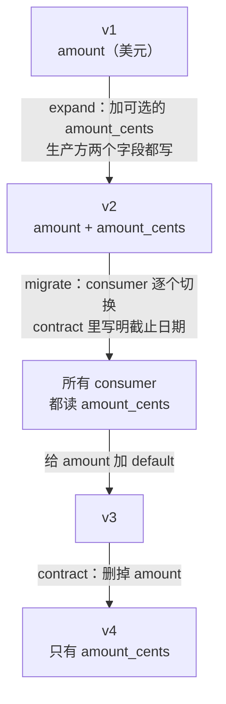

# Schema evolution and data contracts｜Schema evolution 和 data contract

> 原文：[DataInterview · Data Engineering System Design · Schema evolution and data contracts](https://www.datainterview.com/courses/data-engineering-system-design/concept-schema-evolution)（课程第 2 部分 Building blocks 的第 8 课，原文标注阅读约 22 分钟），抓取于 2026-11-14。

译文说明：

- 段落：英文原文放在引用块里，中文紧跟其后。
- 列表：用「English｜中文」两栏表格逐条对照。多列的大表格只直接展示中文版，英文原表折叠在下方。
- 原页面的交互组件（七种 schema 变更、上线顺序逐步演示、表的列匹配方式、坏记录处理策略）已改写成静态表格；折叠的 hint、参考答案和 strong answer 都已展开；测验用 ✅ 标出正确选项。练习的参考答案取自页面上的官方 solution。
- 译者自己加的内容（包括一张 Mermaid 图）都标了「译注」。

## 速览（译注）

- backward：新 reader 能读旧数据；forward：旧 reader 能读新数据。带 default 的加字段、删字段两个方向都安全；放宽类型只在一个方向安全；含义变了（比如美元改成分）任何 schema 检查都发现不了。
- registry 在注册时检查每个版本（失败返回 409），生产方的 CI 应该调用它的兼容性检查接口。Confluent 默认 BACKWARD，意味着 consumer 先部署。
- transitive 模式对照所有历史版本检查；retention 很长、consumer 会重放的 topic 需要它。
- 表需要列 id（Iceberg）或 column mapping（Delta），否则改名和删列会把历史弄乱。
- contract 承载含义、owner 和变更策略；破坏性变更走 expand → migrate → contract，或者开一个带版本号的新 topic。仍然解析不了的记录进 dead-letter queue，配上告警和幂等的重放。

---

## 开篇

> At 03:00 the lake loader for the order_placed topic stops. The checkout team shipped a release an hour earlier that renamed price to price_cents and made it an integer. The loader’s deserializer has never heard of price_cents, finds no price, and throws on every new record. By morning the topic has 4 hours of orders the lake does not have. The other outcome is worse: a loader that tolerates missing fields keeps running, writes price as NULL for every new order, and the revenue dashboard drops to zero for the new rows without a single error.

凌晨 3 点，`order_placed` topic 的 lake loader 停了。结账团队一小时前发了一个版本，把 `price` 改名成 `price_cents`，还改成了整数。loader 的反序列化器从没见过 `price_cents`，又找不到 `price`，于是对每条新记录都抛异常。到早上，topic 里有 4 小时的订单 lake 里没有。另一种结果更糟：一个容忍缺失字段的 loader 继续跑，把每个新订单的 `price` 写成 NULL，收入 dashboard 上新行的收入跌到零，一个错误都没报。

> Schemas change all the time; the design question is which changes are safe, who has to deploy first, and what the pipeline does with the records that still do not fit. In this lesson you will see what each kind of change does to old and new readers, step through a rollout in the right and the wrong order, write the compatibility check a schema registry runs, see why table formats track columns by id, plan a breaking change with a contract, and build a consumer that parks bad records in a dead-letter queue instead of stopping. The streaming course covers wire formats and serializers in its lesson on schemas; here the focus is the design decisions.

schema 一直在变；设计上的问题是：哪些变更是安全的，谁必须先部署，以及 pipeline 怎么处理仍然对不上的记录。这一课会：看每种变更对新旧 reader 的影响；分别按正确和错误的顺序走一遍上线；写一个 schema registry 会跑的兼容性检查；看 table format 为什么按 id 追踪列；用 contract 规划一次破坏性变更；做一个把坏记录停放到 dead-letter queue、而不是整个停下来的 consumer。streaming 课程讲 schema 的那一课会讲 wire format 和 serializer；这里关注的是设计决策。

---

## Two directions of compatibility｜兼容性的两个方向

> Every schema change has two readers to worry about. A new reader (a consumer already deployed with the new schema) may meet old data: records written before the change, still in the topic or the table. An old reader (a consumer not yet upgraded) may meet new data. A change is backward compatible if new readers can read old data, and forward compatible if old readers can read new data. Avro, the most common format for events in Kafka, decides both with its schema resolution rules: a field the reader expects but the writer did not write takes the reader’s default, or fails if there is none; a field the writer wrote but the reader does not know is ignored; and some types promote on read (int to long, float or double; long to float or double; float to double; string and bytes to each other). Pick a change.

每次 schema 变更都要考虑两种 reader：

- **新 reader**（已经用新 schema 部署的 consumer）可能会碰到旧数据：变更之前写的、仍留在 topic 或表里的记录。
- **旧 reader**（还没升级的 consumer）可能会碰到新数据。

新 reader 能读旧数据，叫 backward compatible；旧 reader 能读新数据，叫 forward compatible。Kafka 里最常见的 event 格式 Avro，用它的 schema resolution 规则决定这两个方向：

| 情况 | Avro 的处理 |
|---|---|
| reader 期望、但 writer 没写的字段 | 取 reader 的 default；没有 default 就失败 |
| writer 写了、但 reader 不认识的字段 | 忽略 |
| 类型提升 | 读的时候可以提升：int → long、float 或 double；long → float 或 double；float → double；string 和 bytes 互相转换 |

### 一次 schema 变更对 reader 的影响（原文为交互组件）

按 registry 检查时用的 Avro 规则。

| 变更 | schema diff | 新 reader 读旧数据 | 旧 reader 读新数据 | 被哪些模式接受 | 谁先部署 |
|---|---|---|---|---|---|
| 加一个带 default 的字段 | `+ "currency": string, default "USD"` | 能读 | 能读 | BACKWARD、FORWARD、FULL | 哪边都行 |
| 加一个必填字段 | `+ "currency": string (no default)` | 失败 | 能读 | FORWARD | 生产方 |
| 删一个带 default 的字段 | `- "coupon": string, default null` | 能读 | 能读 | BACKWARD、FORWARD、FULL | 哪边都行 |
| 删一个必填字段 | `- "amount": double` | 能读 | 失败 | BACKWARD | consumer |
| amount 改名为 amount_usd | `- "amount": double` `+ "amount_usd": double` | 失败 | 失败 | 只有 NONE | 没有安全的顺序 |
| 放宽 amount_minor：int → long | `- "amount_minor": int` `+ "amount_minor": long` | 能读 | 失败 | BACKWARD | consumer |
| 类型不变，amount 改成了分 | `- "amount": double (dollars)` `+ "amount": double (cents)` | 能读 | 能读 | BACKWARD、FORWARD、FULL | 哪边都行 |

每种变更的说明：

| 变更 | 说明 |
|---|---|
| 加一个带 default 的字段 | 旧数据里没有 currency 时，新 reader 填入 "USD"；旧 reader 跳过它不认识的字段。各个方向都安全，这也是为什么「加可选字段」是扩展 schema 的默认方式。 |
| 加一个必填字段 | 旧 reader 忽略新字段，所以生产方可以先切。但用新 schema 的 consumer 读到旧记录时，找不到 currency、也没东西可填，于是失败。在 BACKWARD 下，registry 会拒绝这个版本。 |
| 删一个带 default 的字段 | 新 reader 忽略旧数据里的 coupon；旧 reader 用 default 填补缺失的 coupon。两个方向都安全。下线一个字段的方法就是：先在一个版本里给它 default，再在之后的版本里删掉。 |
| 删一个必填字段 | 新 reader 不需要 amount，但旧 reader 还需要，没有它的记录在旧 reader 那里会失败。BACKWARD 允许这样做，所以必须先升级 consumer，生产方才能开始写新版本。 |
| amount 改名为 amount_usd | 对 Avro 来说，改名就是删一个字段加一个字段，这里两个都是必填，所以两个方向都坏。Avro 可以在 reader 端用 alias 映射旧名字，Iceberg 按列 id 改名；但在 event contract 里要把改名当作破坏性变更：加新字段、两个都写、迁移 reader，再删掉旧的。 |
| 放宽 amount_minor：int → long | Avro 读的时候会把写入的 int 提升成 long，所以新 reader 能处理旧数据。期望 int 的旧 reader 接不住 long。只有一个方向：BACKWARD 允许，FORWARD 和 FULL 不允许。 |
| 类型不变，amount 改成了分 | 所有模式都接受，因为 schema 没变。但每个 consumer 报出来的收入都高了 100 倍。没有哪个 registry 看得到含义的变化；只有写明单位的 contract、对生产方变更的 review，以及下游的分布检查能发现。 |

<details>
<summary>交互组件里的英文原文</summary>

| Change | New readers, old data | Old readers, new data | Accepted under | Deploy first |
|---|---|---|---|---|
| add a field with a default | reads | reads | BACKWARD, FORWARD, FULL | either side |
| add a required field | fails | reads | FORWARD | producers |
| remove a field that has a default | reads | reads | BACKWARD, FORWARD, FULL | either side |
| remove a required field | reads | fails | BACKWARD | consumers |
| rename amount to amount_usd | fails | fails | NONE only | no safe order |
| widen amount_minor: int to long | reads | fails | BACKWARD | consumers |
| same type, amount now in cents | reads | reads | BACKWARD, FORWARD, FULL | either side |

- add a field with a default: New readers fill currency with “USD” when old data lacks it; old readers skip the field they do not know. Safe in every direction, which is why “add optional fields” is the default way to grow a schema.
- add a required field: Old readers ignore the new field, so producers can switch first. But a consumer on the new schema that reads an old record finds no currency and nothing to fill it with, and fails. Under BACKWARD, the registry rejects this version.
- remove a field that has a default: New readers ignore the coupon in old data; old readers fill the missing coupon with its default. Safe both ways. This is how to retire a field: give it a default in one release, remove it in a later one.
- remove a required field: New readers do not need amount. Old readers still do, and records without it fail for them. Allowed under BACKWARD, so the consumers must be upgraded before the producer starts writing the new version.
- rename amount to amount_usd: To Avro a rename is a removal plus an addition, and here both are required fields, so it breaks both directions. A reader-side alias can map an old name in Avro, and Iceberg renames by column id, but in an event contract treat a rename as breaking: add the new field, write both, migrate readers, then remove the old one.
- widen amount_minor: int to long: Avro promotes a written int to a long on read, so new readers handle old data. An old reader expecting an int cannot take a long. One direction only: BACKWARD allows it, FORWARD and FULL do not.
- same type, amount now in cents: Every mode accepts it, because the schema did not change. Every consumer now reports revenue 100 times too high. No registry can see a change of meaning; only a contract that documents units, review of producer changes, and distribution checks downstream can.

</details>

> Three rules fall out. Adding or removing a field is safe in both directions only when the field has a default. Widening a type is safe in one direction. And the most damaging change, a change of meaning with the same type, is invisible to every check, which is why contracts document units and why the data quality lesson profiles distributions.

由此得出三条规则：

1. 加字段或删字段，只有在字段有 default 时才两个方向都安全。
2. 放宽类型只在一个方向安全。
3. 破坏性最大的变更是类型不变、含义变了，它对所有检查都不可见。这就是为什么 contract 要写明单位，以及数据质量那一课要对分布做 profile。

> Protobuf reaches the same place by different rules: fields are identified by number, unknown fields are skipped, and removed field numbers must never be reused (mark them reserved). JSON without a schema has no rules at all, which is the main argument for putting a schema on events from the start.

Protobuf 用不同的规则达到同样的效果：字段按编号识别，不认识的字段被跳过，删掉的字段编号绝不能再用（标成 `reserved`）。没有 schema 的 JSON 根本没有规则，这也是从一开始就给 event 加 schema 的主要理由。

---

## Schema registries and compatibility modes｜Schema registry 和兼容模式

> A schema registry stores every version of each schema under a subject (by default, with the TopicNameStrategy, <topic>-value and <topic>-key) and checks each new version before it accepts it. Producers register or look up the schema and put its id in each record; consumers fetch the writer’s schema by id and resolve it against their own. Confluent Schema Registry’s compatibility types:

schema registry 把每个 schema 的每个版本存在一个 subject 下（默认用 TopicNameStrategy，subject 名是 `<topic>-value` 和 `<topic>-key`），接受新版本之前先做检查。生产方注册或查找 schema，并把 schema id 放进每条记录；consumer 按 id 取回 writer 的 schema，再和自己的 schema 做 resolution。Confluent Schema Registry 的兼容类型：

| 模式 | 新版本必须 | 对照检查 | 允许的变更（Avro） | 谁先部署 |
|---|---|---|---|---|
| BACKWARD（默认） | 能读旧版本写的数据 | 上一个版本 | 删字段、加可选字段 | consumer |
| FORWARD | 能被旧版本读 | 上一个版本 | 加字段、删可选字段 | 生产方 |
| FULL | 两者都要 | 上一个版本 | 加或删可选字段 | 哪边都行 |
| `*_TRANSITIVE` | 同上 | 之前的每一个版本 | 同上 | 同上 |
| NONE | 无要求 | 不检查 | 任何变更 | 人工协调 |

<details>
<summary>英文原表</summary>

| MODE | NEW VERSION MUST | CHECKED AGAINST | CHANGES ALLOWED (AVRO) | DEPLOY FIRST |
|---|---|---|---|---|
| BACKWARD (default) | Read data written with the old version | The last version | Delete fields, add optional fields | Consumers |
| FORWARD | Be readable by the old version | The last version | Add fields, delete optional fields | Producers |
| FULL | Both | The last version | Add or delete optional fields | Either |
| *_TRANSITIVE | The same | Every earlier version | The same | The same |
| NONE | Nothing | Nothing | Anything | Coordinate by hand |

</details>

> A version that fails the check is rejected at registration with HTTP 409 Conflict, and the registry also has an endpoint to test a schema without registering it (POST /compatibility/subjects/{subject}/versions/latest). Call it from the producer’s CI and an incompatible change fails a pull request instead of a 3 a.m. load.

没通过检查的版本在注册时被拒绝，返回 HTTP 409 Conflict。registry 还有一个只测试、不注册的接口（`POST /compatibility/subjects/{subject}/versions/latest`）。在生产方的 CI 里调用它，不兼容的变更就会让一个 pull request 失败，而不是让凌晨 3 点的加载失败。

### 测验 1

> A subject uses BACKWARD compatibility. The producer team registers a version that adds a field with no default. What happens?

一个 subject 用 BACKWARD 兼容。生产方团队注册了一个新版本，加了一个没有 default 的字段。会怎样？

| | English | 中文 |
|---|---|---|
| A | It is accepted, because old consumers simply ignore fields they do not know | 被接受，因为旧 consumer 直接忽略不认识的字段 |
| B ✅ | The registry rejects it with 409 Conflict, because a consumer on the new schema could not read old records that lack the field | registry 用 409 Conflict 拒绝它，因为用新 schema 的 consumer 读不了缺这个字段的旧记录 |
| C | It is accepted, but consumers crash at runtime | 被接受，但 consumer 运行时崩溃 |
| D | It is accepted, and the registry adds a null default automatically | 被接受，registry 自动加一个 null default |

> Right. BACKWARD means the new schema must read data written with the last one. Old records have no value for the field and the schema gives no default. Adding the field with a default would pass.

解析：BACKWARD 意味着新 schema 必须能读上一个版本写的数据。旧记录里这个字段没有值，schema 也没给 default。加字段时带上 default 就能通过。

> “Deploy first” is the part candidates skip. Choose a change and an order and step through the rollout. Each cell is one consumer reading one kind of record in the topic.

「谁先部署」是候选人经常跳过的部分。选一种变更和一个顺序，一步步走一遍上线。每个格子是一个 consumer 读 topic 里某一种记录的结果。

### 上线一次 schema 变更（原文为逐步演示）

2 个 consumer（analytics、fraud），1 个生产方，topic 保留 7 天。表格是每一步之后「reader × 记录版本」的结果（· 表示 topic 里没有这种记录）。

**变更 A：删除必填字段 promo_code（BACKWARD）**

consumer 先部署（正确顺序）：

| 步骤 | analytics 读 v1 / v2 | fraud 读 v1 / v2 | 生产方写 | 失败的组合 |
|---|---|---|---|---|
| 1. Day 0，全部 v1 | v1 reader：ok / · | v1 reader：ok / · | v1 | 0 |
| 2. analytics 先部署 v2 reader | v2 reader：ok / · | v1 reader：ok / · | v1 | 0 |
| 3. fraud 部署 v2 reader | v2 reader：ok / · | v2 reader：ok / · | v1 | 0 |
| 4. 生产方切到 v2 | v2 reader：ok / ok | v2 reader：ok / ok | v2 | 0 |
| 5. 7 天后 v1 记录过期 | v2 reader：· / ok | v2 reader：· / ok | v2 | 0 |

生产方先部署（错误顺序）：

| 步骤 | analytics 读 v1 / v2 | fraud 读 v1 / v2 | 生产方写 | 失败的组合 |
|---|---|---|---|---|
| 1. Day 0，全部 v1 | v1 reader：ok / · | v1 reader：ok / · | v1 | 0 |
| 2. 生产方先切到 v2 | v1 reader：ok / **失败** | v1 reader：ok / **失败** | v2 | 2 |
| 3. analytics 部署 v2 reader | v2 reader：ok / ok | v1 reader：ok / **失败** | v2 | 1 |
| 4. fraud 部署 v2 reader | v2 reader：ok / ok | v2 reader：ok / ok | v2 | 0 |
| 5. 7 天后 v1 记录过期 | v2 reader：· / ok | v2 reader：· / ok | v2 | 0 |

失败原因：v1 reader 需要 promo_code，而 v2 记录里没有它，所以每条新记录都会失败。

**变更 B：新增必填字段 currency（FORWARD）**

生产方先部署（这个变更的正确顺序）：

| 步骤 | analytics 读 v1 / v2 | fraud 读 v1 / v2 | 生产方写 | 失败的组合 |
|---|---|---|---|---|
| 1. Day 0，全部 v1 | v1 reader：ok / · | v1 reader：ok / · | v1 | 0 |
| 2. 生产方先切到 v2 | v1 reader：ok / ok | v1 reader：ok / ok | v2 | 0 |
| 3. analytics 部署 v2 reader，此时 topic 里还有 v1 记录（它落后了，或在重放某一天） | v2 reader：**失败** / ok | v1 reader：ok / ok | v2 | 1 |
| 4. fraud 部署 v2 reader | v2 reader：**失败** / ok | v2 reader：**失败** / ok | v2 | 2 |
| 5. 7 天后 v1 记录过期 | v2 reader：· / ok | v2 reader：· / ok | v2 | 0 |

consumer 先部署：

| 步骤 | analytics 读 v1 / v2 | fraud 读 v1 / v2 | 生产方写 | 失败的组合 |
|---|---|---|---|---|
| 1. Day 0，全部 v1 | v1 reader：ok / · | v1 reader：ok / · | v1 | 0 |
| 2. analytics 先部署 v2 reader | v2 reader：**失败** / · | v1 reader：ok / · | v1 | 1 |
| 3. fraud 部署 v2 reader | v2 reader：**失败** / · | v2 reader：**失败** / · | v1 | 2 |
| 4. 生产方切到 v2 | v2 reader：**失败** / ok | v2 reader：**失败** / ok | v2 | 2 |
| 5. 7 天后 v1 记录过期 | v2 reader：· / ok | v2 reader：· / ok | v2 | 0 |

失败原因：v2 reader 需要 currency，而 v1 记录里没有，所以 v2 reader 在 topic 里残留的旧记录上失败。

<details>
<summary>交互组件里的英文原文（每一步的说明）</summary>

- Day 0. Everything writes and reads v1. The topic keeps 7 days of records.
- The analytics job deploys the v2 reader first. It reads the v1 records already in the topic.
- The fraud service deploys the v2 reader. Both consumers now use v2 and still see only v1 records.
- The producer switches to v2. The topic now holds both versions until the v1 records age out.
- Seven days later retention has removed the last v1 record. Only v2 remains.
- The producer switches to v2 first. Both consumers still read with v1, and the topic holds both versions.
- The analytics job deploys the v2 reader while v1 records are still in the topic (it lags, or replays a day).
- The fraud service deploys the v2 reader. Any v1 record either consumer reads from now on goes through the v2 reader.
- Seven days later the v1 records are gone. Only v2 remains.
- (remove required promo_code) A v1 reader needs promo_code, which v2 records do not have: it fails on every new record.
- (add required currency) A v2 reader needs currency, which v1 records do not have: it fails on the old records still in the topic.

</details>

> Removing a required field is a BACKWARD change: with consumers first, nothing fails at any step; with the producer first, both consumers fail on every new record until they deploy. Adding a required field is a FORWARD change, and it has a trap even in the right order. The producer can go first, because old readers ignore the new field. But a consumer that deploys the new reader while v1 records are still in the topic (it is lagging, or it replays a day) fails on them. So a FORWARD change finishes when every consumer has read past the last old record, or when retention has removed it. FULL compatibility avoids the ordering question entirely, which is why many teams use FULL or FULL_TRANSITIVE for shared topics and give every field a default.

- **删必填字段**是 BACKWARD 变更：consumer 先部署，每一步都不会失败；生产方先部署，两个 consumer 在部署之前对每条新记录都失败。
- **加必填字段**是 FORWARD 变更，即使顺序对了也有陷阱。生产方可以先切，因为旧 reader 会忽略新字段；但如果某个 consumer 部署新 reader 时 topic 里还有 v1 记录（它落后了，或在重放某一天），它会在这些记录上失败。所以 FORWARD 变更要等到每个 consumer 都读过了最后一条旧记录、或者 retention 把它删掉，才算完成。

FULL 兼容完全避开了顺序问题，所以很多团队对共享 topic 用 FULL 或 FULL_TRANSITIVE，并给每个字段都设 default。

### 练习：写 registry 的兼容性检查

> Schemas are dicts from field name to {"type": ..., "default": ...}. Write can_read(reader, writer) with Avro’s rules, then compatible(new, history, mode) for BACKWARD, FORWARD, FULL, their _TRANSITIVE forms and NONE, the way Confluent Schema Registry decides whether to accept a new version.

schema 是从字段名到 `{"type": ..., "default": ...}` 的 dict。按 Avro 的规则写 `can_read(reader, writer)`，再像 Confluent Schema Registry 决定是否接受新版本那样，为 BACKWARD、FORWARD、FULL、它们的 `_TRANSITIVE` 形式和 NONE 写 `compatible(new, history, mode)`。

> The starter accepts everything a registry should reject. The checks add a required field, remove one, widen and narrow a type, and register a third version that is compatible with the second but not with the first.

starter 代码会接受所有 registry 本该拒绝的东西。测试会：加一个必填字段、删一个必填字段、放宽和收窄一个类型，以及注册一个和第二版兼容、但和第一版不兼容的第三版。

> Hint: A reader field missing from the writer is fine only with a default. A present field is fine if the types match or the writer’s type is in PROMOTE[writer_type]. For transitive modes loop over all of history, otherwise over history[-1:].

提示：writer 里缺少的 reader 字段，只有带 default 才行。存在的字段，类型相同、或者 reader 的类型在 `PROMOTE[writer_type]` 里就行。transitive 模式遍历整个 history，否则只看 `history[-1:]`。

参考答案：

```python
# A schema is a dict: field name -> {"type": ..., "default": ... (optional)}.
# Avro's resolution rules: a writer's int can be read as long, float or double; long as float or
# double; float as double; string and bytes as each other.
PROMOTE = {"int": {"long", "float", "double"}, "long": {"float", "double"},
           "float": {"double"}, "string": {"bytes"}, "bytes": {"string"}}

def can_read(reader, writer):
    """True if data written with `writer` can be read by code using `reader`.
    Every reader field must be in the writer with the same type or a type the writer's type
    promotes to, or else have a default. Writer fields the reader lacks are ignored."""
    for name, spec in reader.items():
        if name not in writer:
            if "default" not in spec:          # nothing in the data and nothing to fill it with
                return False
            continue
        wtype, rtype = writer[name]["type"], spec["type"]
        if wtype != rtype and rtype not in PROMOTE.get(wtype, set()):
            return False                       # e.g. a long written, an int expected
    return True

def compatible(new, history, mode):
    """Would a registry accept `new` given the earlier versions in `history` (oldest first)?
    BACKWARD: new readers read the last version's data. FORWARD: last version's readers read new
    data. FULL: both. *_TRANSITIVE: the same against every earlier version. NONE: always."""
    if mode == "NONE":
        return True
    against = history if mode.endswith("_TRANSITIVE") else history[-1:]
    for old in against:
        if mode.startswith("BACKWARD") and not can_read(new, old):
            return False
        if mode.startswith("FORWARD") and not can_read(old, new):
            return False
        if mode.startswith("FULL") and not (can_read(new, old) and can_read(old, new)):
            return False
    return True


v1 = {"order_id": {"type": "long"}, "amount": {"type": "int"}}
v2 = {"order_id": {"type": "long"}, "amount": {"type": "long"}, "currency": {"type": "string", "default": "USD"}}
print("v2 reads v1 data:", can_read(v2, v1), " v1 reads v2 data:", can_read(v1, v2))
print({m: compatible(v2, [v1], m) for m in ["BACKWARD", "FORWARD", "FULL"]})
```

> The last check is the case for transitive modes. Version 2 added country with a default, version 3 dropped the default; each step passes BACKWARD, but version 3 cannot read version 1 records, which a consumer replaying the topic from the start will meet. Confluent’s documentation recommends BACKWARD_TRANSITIVE for Protobuf for a related reason: adding new message types is not forward compatible.

最后一个测试就是 transitive 模式存在的理由。第 2 版加了带 default 的 country，第 3 版去掉了 default；每一步都能通过 BACKWARD，但第 3 版读不了第 1 版的记录，而从头重放 topic 的 consumer 就会碰到它们。Confluent 的文档出于类似的原因推荐 Protobuf 用 BACKWARD_TRANSITIVE：新增 message type 不是 forward compatible 的。

### 测验 2

> A topic keeps 30 days of events, and consumers sometimes replay from the beginning. Why use BACKWARD_TRANSITIVE instead of BACKWARD?

一个 topic 保留 30 天的 event，consumer 有时会从头重放。为什么用 BACKWARD_TRANSITIVE 而不是 BACKWARD？

| | English | 中文 |
|---|---|---|
| A | Transitive modes allow more kinds of changes | transitive 模式允许更多种变更 |
| B ✅ | BACKWARD only checks the new schema against the last version; a replaying consumer on the newest schema also reads records written with every older version still in the topic | BACKWARD 只拿新 schema 和上一个版本比；用最新 schema 重放的 consumer，还会读到 topic 里所有更旧版本写的记录 |
| C | BACKWARD does not check field types, only names | BACKWARD 不检查字段类型，只检查名字 |
| D | Transitive modes rewrite old records to the new schema | transitive 模式会把旧记录改写成新 schema |

> Right. Three versions can each be compatible with the one before and still leave the newest unable to read the oldest, for example when a default is added in v2 and removed in v3. Transitive modes check against all registered versions, which is what a replay needs.

解析：三个版本可以各自和前一个兼容，但最新的仍然读不了最旧的，比如 v2 加了 default、v3 又去掉了。transitive 模式对照所有已注册的版本检查，这正是重放需要的。

---

## Schema evolution in tables｜表的 schema evolution

> Events are read once and age out; tables keep every old file and are read for years. A change to a table must keep old files readable under the new schema, and the question is how the engine matches a column in an old file to a column in the current schema. Plain Parquet tables (and Hive-style tables) match by name. Iceberg gives every column a permanent field id, writes the ids into each data file, and keeps the id-to-name mapping in table metadata. Compare them.

event 读一次就过期；表保留每一个旧文件，一读就是好几年。对表的变更必须让旧文件在新 schema 下仍然可读，问题在于引擎怎么把旧文件里的列对应到当前 schema 的列：

- **普通 Parquet 表（以及 Hive 风格的表）**：按名字匹配。
- **Iceberg**：给每一列一个永久的 field id，把 id 写进每个数据文件，id 到名字的映射存在表的元数据里。

### 一次表变更，跨新旧文件读取（原文为交互组件）

2 个旧文件，2 个新文件。

| 变更 | 按名字匹配（普通 Parquet 表） | 按 field id 匹配（Iceberg） |
|---|---|---|
| country 改名为 country_code | 旧文件里的订单 1、2 读成 NULL；新文件里的 3、4 是 FR、BR | 1、2、3、4 分别是 US、DE、FR、BR |
| 删掉 country，再加一个新的 country | 旧文件里的订单 1、2 又读出了 US、DE；新文件里是 fr-FR、pt-BR | 旧文件里的订单 1、2 读成 NULL；新文件里是 fr-FR、pt-BR |
| 加一列 region | 旧文件的 region 是 NULL；新文件是 EU、LATAM | 旧文件的 region 是 NULL；新文件是 EU、LATAM |

说明：

| 情况 | 说明 |
|---|---|
| 按名字 / 改名 | 旧文件里这一列仍叫 country。按名字匹配时它们没有 country_code，所以前两个订单读成 NULL：数据看起来像被删了。 |
| 按名字 / 删了再加同名列 | country 被删了，后来又加了一个也叫 country 的新列（存 locale 代码）。旧文件里仍然有叫 country 的列，所以它们的旧值又出现在新列下面。 |
| 按名字 / 加列 | 加列不管哪种方式都安全：旧文件里没有 region，所以读成 NULL。 |
| 按 id / 改名 | 每个文件存的是列 id 2；表元数据现在把 id 2 叫做 country_code。新旧文件读的是同一列。改名没有碰任何数据文件。 |
| 按 id / 删了再加同名列 | 新的 country 列拿到了新 id 5。旧文件里没有 id 5，所以它们的行读成 NULL，这正是新列该有的样子。删掉的数据就是删掉了。 |
| 按 id / 加列 | 加列不管哪种方式都安全：旧文件里没有这个新 id 的列，所以读成 NULL。 |

> Delta Lake gets the same behavior from column mapping (delta.columnMapping.mode = 'name'), which stores a physical name per column so renames and drops are metadata changes.

Delta Lake 通过 column mapping（`delta.columnMapping.mode = 'name'`）得到同样的行为：它为每列存一个物理名，所以改名和删列都只是元数据变更。

<details>
<summary>交互组件里的英文原文</summary>

| Matched by / Change | order 1 (old file) | order 2 (old file) | order 3 (new file) | order 4 (new file) |
|---|---|---|---|---|
| name / rename country → country_code | NULL | NULL | FR | BR |
| field id / rename country → country_code | US | DE | FR | BR |
| name / drop country, add a new country | US | DE | fr-FR | pt-BR |
| field id / drop country, add a new country | NULL | NULL | fr-FR | pt-BR |
| name or field id / add region | NULL | NULL | EU | LATAM |

- name / rename: Old files still call the column country. Matched by name, they have no country_code, so the first two orders read as NULL: the data looks deleted.
- name / drop and re-add: country was dropped, and later a new column named country (holding locale codes) was added. Old files still have a column called country, so their old values come back under the new column.
- name / add region: Adding a column is safe either way: old files have no region, so it reads NULL.
- field id / rename: Each file stores column id 2; the table metadata now names id 2 country_code. Old and new files read the same column. The rename touched no data file.
- field id / drop and re-add: The new country column got a new id, 5. Old files have no id 5, so their rows read NULL, which is what a new column should do. Dropped data stays dropped.
- field id / add region: Adding a column is safe either way: old files have no column with the new id, so it reads NULL.

</details>

> Matching by name gets two common changes wrong. A rename makes history look deleted, and dropping a column then adding a new one with the same name brings the dropped values back. Iceberg’s documentation states the guarantees that ids give: added columns never read existing values from another column, and renames, drops, reorders and type widening are metadata changes that rewrite no data files. In format versions 1 and 2, Iceberg allows widening int to long, float to double, and a decimal’s precision (not its scale); version 3 adds date to timestamp. Delta Lake reaches the same place with column mapping (delta.columnMapping.mode set to name or id, which needs reader version 2 and writer version 5), and without it cannot rename or drop columns. For appends with new columns, Delta’s writer takes mergeSchema. BigQuery lets you add NULLABLE or REPEATED columns, relax REQUIRED to NULLABLE, rename and drop columns, and change a type only along a few widening paths such as INT64 to NUMERIC, BIGNUMERIC or FLOAT64. The warehousing course goes through compaction and schema evolution in table formats in more depth.

按名字匹配会把两种常见变更弄错：改名让历史看起来被删了；删一列再加一个同名的新列，会让删掉的值又回来。

各引擎的情况：

| 引擎 | schema evolution 能力 |
|---|---|
| Iceberg | 文档写明了 id 带来的保证：新加的列永远不会读到另一列已有的值；改名、删列、调整顺序和放宽类型都是不重写数据文件的元数据变更。format version 1 和 2 允许 int → long、float → double，以及放宽 decimal 的 precision（不能改 scale）；version 3 增加了 date → timestamp。 |
| Delta Lake | 用 column mapping 达到同样效果（`delta.columnMapping.mode` 设为 name 或 id，需要 reader version 2 和 writer version 5）；没有它就不能改名或删列。带新列的 append，Delta writer 用 `mergeSchema`。 |
| BigQuery | 可以加 NULLABLE 或 REPEATED 列，把 REQUIRED 放宽成 NULLABLE，改名和删列；改类型只能沿几条放宽路径，比如 INT64 → NUMERIC、BIGNUMERIC 或 FLOAT64。 |

warehousing 课程会更深入地讲 table format 里的 compaction 和 schema evolution。

### 跨 Parquet 文件的改名（原文为可运行的 playground）

<details>
<summary>Playground 代码（浏览器里的 DuckDB）</summary>

```python
import duckdb

# Two Parquet files of the same table, before and after a column rename. Engines that match
# Parquet columns by NAME (plain Parquet tables, Hive-style tables) cannot tell a rename from
# "an old column disappeared and a new one appeared".
con = duckdb.connect()
con.execute("""COPY (SELECT * FROM (VALUES (1, 'US'), (2, 'DE')) t(order_id, country))
               TO '/tmp/orders_1.parquet' (FORMAT parquet)""")
con.execute("""COPY (SELECT * FROM (VALUES (3, 'FR'), (4, 'BR')) t(order_id, country_code))
               TO '/tmp/orders_2.parquet' (FORMAT parquet)""")

print("Matched by name after the rename:")
for row in con.execute("""SELECT order_id, country_code FROM read_parquet(
        ['/tmp/orders_1.parquet', '/tmp/orders_2.parquet'], union_by_name = true) ORDER BY order_id""").fetchall():
    print("  ", row)

# Table formats such as Iceberg give every column a permanent id and write it into each data file.
# The table's metadata maps ids to current names, so a rename is a metadata change only.
# Here is that idea by hand: id 2 was called "country" when file 1 was written, "country_code" now.
names_when_written = {"/tmp/orders_1.parquet": {"order_id": 1, "country": 2},
                      "/tmp/orders_2.parquet": {"order_id": 1, "country_code": 2}}
current = {1: "order_id", 2: "country_code"}
print("Matched by column id:")
for path, ids in names_when_written.items():
    cols = ", ".join(f'"{old}" AS {current[i]}' for old, i in ids.items())
    for row in con.execute(f"SELECT {cols} FROM read_parquet('{path}') ORDER BY order_id").fetchall():
        print("  ", row)
# Try: drop "country" and later add a new column also called "country". Which files' old values
# come back under each approach?
```

</details>

> A table schema should change when its sources do, but on your terms. A loader that adds every new source column automatically (Delta’s mergeSchema, Snowflake’s schema evolution for loads) keeps ingestion running, which suits the raw zone. Curated tables that analysts and dashboards depend on should change only through a reviewed model change; dbt’s model contracts fail the build if a model’s columns or types differ from the declared ones.

表的 schema 应该随数据源变化，但要按你的规矩来。自动加上每个新源列的 loader（Delta 的 `mergeSchema`、Snowflake 加载时的 schema evolution）能让 ingestion 一直跑，这适合 raw zone。分析师和 dashboard 依赖的 curated 表，只应该通过经过 review 的 model 变更来改；如果 model 的列或类型和声明的不一致，dbt 的 model contract 会让 build 失败。

---

## Contracts between producers and the data team｜生产方和数据团队之间的 contract

> A registry enforces structure. A data contract covers what a registry cannot: what each field means (units, time zone, allowed values), the key and grain, freshness and volume expectations, which fields are personal data, who owns it, and the change policy: which changes are allowed without notice (adding optional fields), which need an announcement and a migration window, and who must sign off. The contract lives in the producer’s repository, next to the code that emits the data, and CI runs the compatibility check against it. Formats vary; the Open Data Contract Standard is one, a YAML file with the schema, quality rules and SLAs.

registry 强制的是结构。data contract 覆盖 registry 管不到的东西：

- 每个字段的含义（单位、时区、允许的值）；
- key 和 grain；
- freshness 和 volume 的预期；
- 哪些字段是个人数据；
- 谁是 owner；
- 变更策略：哪些变更不用通知就可以做（加可选字段）、哪些需要公告和迁移窗口、谁必须签字。

contract 放在生产方的仓库里，挨着产生数据的代码，CI 对照它跑兼容性检查。格式各不相同；Open Data Contract Standard 是其中一种，是一个包含 schema、质量规则和 SLA 的 YAML 文件。

> Breaking changes still happen, and the contract says how: expand, migrate, contract. Add the new field alongside the old one, write both, move consumers over with a deadline, and only then remove the old field. When the change is too big for one schema (a new key, a different grain), publish a new versioned topic and run both for the migration window.

破坏性变更仍然会发生，contract 规定了怎么做：expand（扩展）、migrate（迁移）、contract（收缩）。在旧字段旁边加上新字段，两个都写，给 consumer 一个截止日期迁过去，最后才删掉旧字段。如果变更大到一个 schema 装不下（新的 key、不同的 grain），就发布一个带版本号的新 topic，迁移窗口内两个都跑。

### 练习：规划一次破坏性变更

> The checkout team wants to replace amount (a double, in dollars) with amount_cents (a long) in the order_placed event. Six teams consume the topic: two streaming jobs, the lake loader, a fraud model, and two services. The subject is BACKWARD. How do you roll this out without breaking anyone or losing history?

结账团队想把 `order_placed` event 里的 `amount`（double，单位美元）换成 `amount_cents`（long）。有六个团队消费这个 topic：两个 streaming job、lake loader、一个反欺诈模型和两个服务。subject 是 BACKWARD。怎么上线才能不破坏任何人、也不丢历史？

**参考答案（strong answer）**

> Expand, migrate, contract, with the contract saying who must move by when.

expand、migrate、contract，由 contract 写明谁必须在什么时候迁移完。

| English | 中文 |
|---|---|
| It is breaking twice: a rename (remove plus add) and a change of meaning. The registry would catch the first and never the second, so the contract’s field description and a reviewed change request carry the unit. | 它在两个方面是破坏性的：改名（删加各一）和含义变化。registry 能抓住第一个，但永远抓不住第二个，所以单位要靠 contract 里的字段描述和一个经过 review 的变更申请来传达。 |
| Version 2 adds amount_cents as an optional long (in Avro, a union of null and long with default null), which BACKWARD accepts. The producer writes both fields, with amount_cents = round(amount * 100). | 第 2 版把 `amount_cents` 加成可选的 long（在 Avro 里是 null 和 long 的 union，default 为 null），BACKWARD 会接受。生产方两个字段都写，`amount_cents = round(amount * 100)`。 |
| Each consumer switches to amount_cents on its own schedule. A list of consumer groups and a deadline (say 60 days) lives in the contract; lineage and consumer group lag show who still reads the topic. | 每个 consumer 按自己的节奏切到 `amount_cents`。consumer group 列表和截止日期（比如 60 天）写在 contract 里；lineage 和 consumer group lag 能看出谁还在读这个 topic。 |
| Version 3 gives amount a default, version 4 removes it, once every consumer has switched. Under BACKWARD the consumers must be on the new reader before the producer stops writing the field. | 所有 consumer 都切换后，第 3 版给 `amount` 一个 default，第 4 版删掉它。在 BACKWARD 下，生产方停止写这个字段之前，consumer 必须已经用上新 reader。 |
| In the lake and warehouse, keep a single amount_cents column: backfill it for history from amount, so analysts never have to know which day the unit changed. | 在 lake 和 warehouse 里只保留一个 `amount_cents` 列：用 `amount` 给历史数据 backfill，这样分析师永远不需要知道单位是哪天变的。 |
| If the change were larger (a new key, a different grain), publish a new topic orders.v2 in parallel and move consumers over, instead of stretching one schema. | 如果变更更大（新的 key、不同的 grain），就并行发布一个新 topic `orders.v2`，把 consumer 迁过去，而不是硬撑一个 schema。 |

译注：按参考答案画的版本演进。



自查清单：

| English | 中文 |
|---|---|
| Recognizes a rename plus a unit change as breaking | 认出「改名 + 单位变化」是破坏性的 |
| Adds amount_cents as an optional field next to amount (compatible) | 在 `amount` 旁边把 `amount_cents` 加成可选字段（兼容） |
| Producer writes both fields for a migration window | 迁移窗口内生产方两个字段都写 |
| Consumers migrate one by one; usage of amount is tracked | consumer 逐个迁移；跟踪 `amount` 的使用情况 |
| Removes amount (after it has a default) only after every consumer moved | 所有 consumer 都迁走之后，才（在它有了 default 之后）删除 `amount` |
| Warehouse keeps one column with a known unit; history converted or labeled | warehouse 只保留一个单位明确的列；历史数据已转换或已标注 |
| Or: a new versioned topic with dual publishing, if the change is larger | 或者：如果变更更大，用带版本号的新 topic 双写 |

---

## Records that still do not fit｜仍然对不上的记录

> Compatibility checks stop incompatible schemas, not bad records. A producer can still send a string where a number belongs inside a JSON payload, a value outside the contract, or a record from a client that bypassed the registry. The consumer has three choices, and the default in most tools is the one that stops the pipeline.

兼容性检查拦的是不兼容的 schema，不是坏记录。生产方仍然可能在 JSON payload 里本该是数字的地方发一个字符串、发一个超出 contract 的值，或者发来一条绕过了 registry 的客户端记录。consumer 有三种选择，而大多数工具的默认选择就是让 pipeline 停下的那个。

### consumer 解码不了的记录（原文为交互组件）

一次有问题的生产方部署，0.3% 的记录无法解码。链路：Checkout service → orders topic → Loader → orders table，旁路是 orders.dlq 和日志。

| 策略 | Loader | orders 表 | orders.dlq | 日志 | partition | 丢失的数据 | Kafka Connect 对应配置 |
|---|---|---|---|---|---|---|---|
| fail fast | 停了 | 过期 | 无 | 不用 | 卡在坏记录上 | 无 | Kafka Connect 默认，`errors.tolerance=none` |
| skip and log | 运行中 | 新鲜 | 无 | 记录丢了 | 继续 | 0.3% 的订单，悄无声息 | `errors.tolerance=all`，不设 DLQ topic |
| dead-letter topic | 运行中 | 新鲜 | 记录 + 错误信息 | 不用 | 继续 | 无：停放着等重放 | `errors.tolerance=all` + `errors.deadletterqueue.topic.name` |

> Connect’s dead letter queue applies to sink connectors only.

Connect 的 dead letter queue 只适用于 sink connector。

<details>
<summary>交互组件里的英文原文</summary>

| Policy | Loader | orders table | orders.dlq | Log line | Partition | Data lost | In Kafka Connect terms |
|---|---|---|---|---|---|---|---|
| fail fast | stopped | stale | none | unused | stops at the bad record | none | Kafka Connect default, errors.tolerance=none |
| skip and log | running | fresh | none | record lost | keeps going | 0.3% of orders, silently | errors.tolerance=all, no DLQ topic |
| dead-letter topic | running | fresh | record + error info | unused | keeps going | none: parked for replay | errors.tolerance=all + errors.deadletterqueue.topic.name |

</details>

> Failing fast is right when any bad record means the data is wrong, such as a billing ledger. For analytics, one bad record in 300 should not stop the other 299. Skipping keeps the data fresh but loses records nobody will ever find. A dead-letter queue (DLQ) keeps both: the consumer writes the record with the error to a separate topic and moves on. In Kafka Connect that is errors.tolerance=all with errors.deadletterqueue.topic.name, and errors.deadletterqueue.context.headers.enable=true adds headers saying why each record failed. A DLQ needs three things to be more than a bin: an alert on its rate (a deploy that breaks 0.3% of records should page someone within minutes), an owner, and a replay path that is idempotent, so records fixed and replayed, or redelivered, are written once.

- **fail fast**：适合任何一条坏记录都意味着数据是错的场景，比如计费账本。
- **skip**：对分析场景，300 条里有 1 条坏的，不应该让另外 299 条停下。跳过能保持数据新鲜，但丢掉的记录永远没人找得到。
- **dead-letter queue（DLQ）**：两者兼得：consumer 把记录连同错误写到另一个 topic，然后继续往下走。在 Kafka Connect 里就是 `errors.tolerance=all` 加 `errors.deadletterqueue.topic.name`；`errors.deadletterqueue.context.headers.enable=true` 会加上说明每条记录为什么失败的 header。

DLQ 要做到三件事才不只是个垃圾桶：

1. 对它的速率告警（一次让 0.3% 记录坏掉的部署，几分钟内就该呼叫到人）；
2. 有一个 owner；
3. 有一条幂等的重放路径，这样修好后重放的、或者重复投递的记录都只写一次。

### 练习：扛得住坏记录的 consumer

> resolve(record) decodes a record into the reader schema, filling defaults and promoting types, and raises ValueError when it cannot. Finish consume(records, table, dlq): write each resolved row into table by event_id, send records that fail to dlq with the error, and keep going.

`resolve(record)` 把一条记录解码成 reader schema，填充 default、提升类型，做不到时抛 `ValueError`。补完 `consume(records, table, dlq)`：把每个解出来的行按 `event_id` 写进 `table`，失败的记录连同错误送进 `dlq`，然后继续。

> The checks feed records from three schema versions with two bad ones in the middle, then fix the bad ones and replay them together with a redelivery of records already loaded.

测试会喂入来自三个 schema 版本的记录，中间夹着两条坏的；然后修好坏记录，把它们和已加载记录的一次重复投递一起重放。

> Hint: Wrap resolve in try/except ValueError, append {"record": record, "error": str(error)} to dlq, and continue. Writing table[row["event_id"]] = row makes replays harmless.

提示：用 `try/except ValueError` 包住 `resolve`，把 `{"record": record, "error": str(error)}` 追加到 `dlq`，然后 `continue`。写 `table[row["event_id"]] = row` 能让重放无害。

参考答案：

```python
# The consumer reads order events from a topic that has held three schema versions, and writes
# them to a table keyed by event_id. It decodes every record into the reader schema below.
READER = {
    "event_id": {"type": "string"},
    "order_id": {"type": "long"},
    "amount":   {"type": "double"},
    "currency": {"type": "string", "default": "USD"},     # added in v2 with a default
}
PROMOTE = {"int": {"long", "float", "double"}, "long": {"float", "double"}, "float": {"double"}}
TYPE_OF = {bool: "boolean", int: "long", float: "double", str: "string"}

def resolve(record):
    """Decode one record into the reader schema, Avro style: fill defaults for missing fields,
    drop fields the reader does not know, promote ints to doubles. Raises ValueError otherwise."""
    out = {}
    for name, spec in READER.items():
        if name not in record:
            if "default" not in spec:
                raise ValueError(f"missing required field {name}")
            out[name] = spec["default"]
            continue
        value, want = record[name], spec["type"]
        have = TYPE_OF.get(type(value))
        if have == "long" and want == "double":
            value, have = float(value), "double"
        if have != want:
            raise ValueError(f"{name} is {have}, expected {want}")
        out[name] = value
    return out

def consume(records, table, dlq):
    """Write every record that resolves into `table` ({event_id: row}). A record that does not
    resolve goes to `dlq` as {"record": record, "error": message}, and the consumer keeps going.
    Replays (the same event_id again) must not double anything."""
    for record in records:
        try:
            row = resolve(record)
        except ValueError as error:
            # One bad record must not stop the partition: park it with the reason, alert on the
            # DLQ rate, and replay it once the producer is fixed.
            dlq.append({"record": record, "error": str(error)})
            continue
        table[row["event_id"]] = row               # upsert by event id: a replay overwrites


table, dlq = {}, []
consume([{"event_id": "e1", "order_id": 1, "amount": 12},
         {"event_id": "e2", "order_id": 2, "amount": "12.50", "currency": "EUR"},
         {"event_id": "e3", "order_id": 3, "amount": 8.5, "currency": "EUR", "coupon": "FALL"}], table, dlq)
print(table)
print(dlq)
```

---

## How this comes up in interviews｜实际面试中是什么样

> Schema evolution appears in nearly every pipeline design as “what if the upstream schema changes?” A complete answer names the format and the registry, picks a compatibility mode with a reason (FULL_TRANSITIVE for widely shared topics with long retention; BACKWARD where consumers can always deploy first), says which side deploys first, describes expand-migrate-contract for breaking changes, explains how the lake handles renames (field ids in Iceberg, column mapping in Delta), and ends with what happens to records that still fail: a DLQ with an alert and an idempotent replay. Follow-ups test the details: why a change of units passes every check, why a consumer replaying old data needs transitive checks, and how you find out which consumers still read a deprecated field (consumer groups on the topic, query logs and lineage on the table).

几乎每个 pipeline 设计里都会出现「上游 schema 变了怎么办？」一个完整的回答包括：

1. 说出格式和 registry；
2. 选一个兼容模式并说明理由（被广泛共享、retention 很长的 topic 用 FULL_TRANSITIVE；consumer 总能先部署的地方用 BACKWARD）；
3. 说明哪一方先部署；
4. 描述破坏性变更的 expand-migrate-contract；
5. 解释 lake 怎么处理改名（Iceberg 的 field id、Delta 的 column mapping）；
6. 最后说仍然失败的记录怎么办：DLQ，加告警和幂等重放。

追问会考细节：为什么单位变化能通过所有检查；为什么重放旧数据的 consumer 需要 transitive 检查；以及你怎么知道哪些 consumer 还在读一个已废弃的字段（topic 上的 consumer group，表上的查询日志和 lineage）。

### 测验 3

> "An upstream team changed a field and our pipeline broke at 3 a.m. How would you design so this does not happen again?" Which answer is most complete?

「一个上游团队改了一个字段，我们的 pipeline 凌晨 3 点挂了。你会怎么设计，让这种事不再发生？」哪个回答最完整？

| | English | 中文 |
|---|---|---|
| A | Make the consumer read everything as strings so nothing fails to parse | 让 consumer 把所有东西都按字符串读，这样就不会解析失败 |
| B | Set the registry to NONE so producers are never blocked | 把 registry 设成 NONE，生产方就永远不会被拦 |
| C | Ask the upstream team to tell us before they change anything | 让上游团队改任何东西之前先告诉我们 |
| D ✅ | A contract per dataset with schema, meaning and owner; a schema registry with a compatibility mode checked in the producer's CI; expand-migrate-contract rollouts with the right deploy order; tables in a format that tracks columns by id; and a dead-letter path plus a DLQ-rate alert for records that still fail | 每个数据集一份 contract，包含 schema、含义和 owner；schema registry 配兼容模式，并在生产方 CI 里检查；按正确的部署顺序做 expand-migrate-contract 上线；表用按 id 追踪列的格式；仍然失败的记录走 dead-letter 路径，并对 DLQ 速率告警 |

> Right. It stops incompatible schemas before deploy, gives a safe process for the changes that must break, keeps table history readable after renames, and turns the remaining failures into parked records instead of a stopped pipeline. It also says who owns the contract.

解析：它在部署前拦住不兼容的 schema，为必须破坏的变更提供一个安全的流程，让表的历史在改名后仍然可读，并把剩下的失败变成停放着的记录，而不是一条停掉的 pipeline。它还说明了 contract 归谁。

---

## Common mistakes｜常见错误

| 错误 | 后果 | 怎么改 |
|---|---|---|
| 加一个必填字段 | 新 consumer 在 topic 或表里残留的旧记录上失败 | 加字段时带 default |
| 在 BACKWARD 下先部署生产方 | 旧 consumer 对每条新记录都失败 | BACKWARD：consumer 先；FORWARD：生产方先；FULL：哪边都行 |
| 只对照上一个版本检查 | 从头重放的 consumer 在最旧的记录上失败 | retention 长或会重放的 topic 用 transitive 模式 |
| 在按名字匹配的表里改列名 | 历史读成 NULL；删掉的名字再加回来会把旧值带回来 | Iceberg field id 或 Delta column mapping；event 用 expand 和 migrate |
| 原地改变单位或含义 | 每个检查都通过，每份报表都是错的 | 用一个新字段承载新含义；单位写进 contract；做分布检查 |
| 跳过解码失败的记录 | 记录悄无声息地消失 | DLQ，带原因、速率告警和幂等重放 |
| contract 写在 wiki 里 | 部署前没人检查 | contract 放在生产方仓库里，CI 对照 registry 检查 |

<details>
<summary>英文原表</summary>

| MISTAKE | WHAT GOES WRONG | FIX |
|---|---|---|
| Adding a required field | New consumers fail on old records still in the topic or table | Add fields with defaults |
| Deploying the producer first under BACKWARD | Old consumers fail on every new record | BACKWARD: consumers first; FORWARD: producers first; FULL: either |
| Checking only against the last version | A consumer replaying from the start fails on the oldest records | Transitive modes for topics with long retention or replays |
| Renaming a column in a table matched by name | History reads as NULL; a dropped name re-added brings old values back | Iceberg field ids or Delta column mapping; expand and migrate for events |
| Changing units or meaning in place | Every check passes and every report is wrong | A new field with the new meaning; units in the contract; distribution checks |
| Skipping undecodable records | Records vanish silently | A DLQ with reasons, a rate alert and an idempotent replay |
| Contracts in a wiki | Nobody checks them before deploy | Contract in the producer’s repo, checked in CI against the registry |

</details>

---

## Recap｜回顾

| English | 中文 |
|---|---|
| Backward: new readers read old data. Forward: old readers read new data. Defaults make adds and removes safe both ways; widening is one way; a change of meaning is never caught by a schema check. | backward：新 reader 读旧数据。forward：旧 reader 读新数据。default 让加字段和删字段两个方向都安全；放宽类型只有一个方向；含义的变化永远不会被 schema 检查抓住。 |
| A registry checks each version at registration (409 on failure); call its compatibility endpoint in CI. BACKWARD is Confluent’s default and means consumers deploy first. | registry 在注册时检查每个版本（失败返回 409）；在 CI 里调用它的兼容性接口。BACKWARD 是 Confluent 的默认值，意味着 consumer 先部署。 |
| Transitive modes check every earlier version, which consumers replaying long retention need. | transitive 模式检查之前的每个版本，重放长 retention 数据的 consumer 需要它。 |
| Tables need column ids (Iceberg) or column mapping (Delta) so renames and drops do not corrupt history. | 表需要列 id（Iceberg）或 column mapping（Delta），改名和删列才不会弄坏历史。 |
| Contracts carry meaning, ownership and the change policy; breaking changes go expand, migrate, contract, or to a new versioned topic. | contract 承载含义、owner 和变更策略；破坏性变更走 expand、migrate、contract，或者换一个带版本号的新 topic。 |
| Records that still fail go to a dead-letter queue with an alert and an idempotent replay. | 仍然失败的记录进 dead-letter queue，配告警和幂等重放。 |

> Next up: serving layers, where you will size the store behind a dashboard or an API from its queries per second and latency budget.

下一课：serving 层，讲怎么根据 QPS 和延迟预算，为 dashboard 或 API 背后的存储估算规模。
