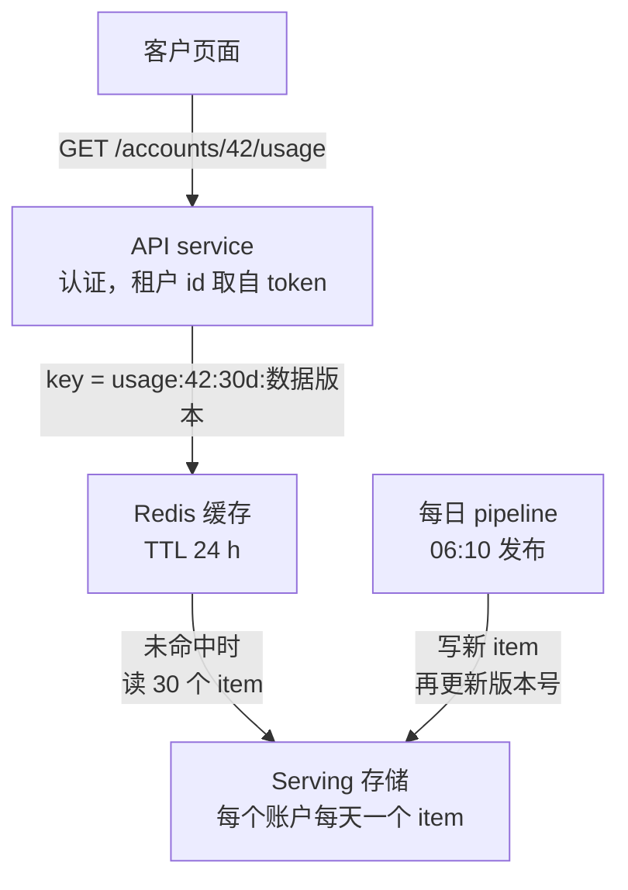

# Serving layers: OLAP stores, caches and APIs｜Serving 层：OLAP 存储、缓存和 API

> 原文：[DataInterview · Data Engineering System Design · Serving layers: OLAP stores, caches and APIs](https://www.datainterview.com/courses/data-engineering-system-design/concept-serving)（课程第 2 部分 Building blocks 的第 9 课，原文标注阅读约 22 分钟），抓取于 2026-11-14。

译文说明：

- 段落：英文原文放在引用块里，中文紧跟其后。
- 列表：用「English｜中文」两栏表格逐条对照。多列的大表格只直接展示中文版，英文原表折叠在下方。
- 原页面的交互组件（四种 serving 路径、QPS 计算器、预聚合 grain 选择、缓存逐步演示）已改写成静态表格；折叠的 hint、参考答案和 strong answer 都已展开；测验用 ✅ 标出正确选项。练习的参考答案取自页面上的官方 solution。
- 译者自己加的内容（包括一张 Mermaid 图）都标了「译注」。

## 速览（译注）

- 按查询模式选路径：ad hoc 分析用 warehouse；高并发、可筛选的新鲜数据用实时 OLAP；按 key 的固定视图用 key-value 存储；重复请求用缓存；对外的一切前面都放一个 API。
- 峰值 QPS = 每天查询数 ÷ 忙碌时段的秒数 × 峰值系数；并发 = QPS × 每次查询的秒数（Little's law）。拿它和存储的上限比，并留余量，因为接近 100% 时队列会急剧增长。
- 按查询的 grain 预聚合，存可加的 measure，distinct count 用 sketch；接近原始 grain 的 rollup 什么也省不了。
- freshness 沿路径累加；用带版本号的 key 把缓存和发布绑在一起。
- reverse ETL 在 rate limit 内只同步变化的行，按 external id upsert；API 暴露固定的查询，并做租户隔离。

---

## 开篇

> A SaaS company has a usage dashboard that its analysts love, built in the warehouse on top of a clean fct_usage table. Product decides to put the same charts inside the app for all 20,000 customer accounts. The first version points the app at the warehouse. On launch Monday at 09:00, page loads take 40 seconds, the warehouse queue is hundreds of queries deep, the internal BI dashboards stall behind it, and that week’s compute bill is three times the usual. Nothing was wrong with the data. The store was built for a few hundred analysts, not for thousands of page views a minute with a latency budget.

一家 SaaS 公司有一个分析师很喜欢的用量 dashboard，建在 warehouse 里一张干净的 `fct_usage` 表上。产品决定把同样的图表放进 app，给全部 20,000 个客户账户用。第一版直接让 app 查 warehouse。上线那个周一的 09:00，页面加载要 40 秒，warehouse 队列排了几百条 query，内部的 BI dashboard 也被堵在后面，那周的计算账单是平时的三倍。数据本身没有任何问题，问题是这个存储是为几百个分析师建的，不是为每分钟几千次、还有延迟预算的页面访问建的。

> The interview version is short: “how will users query this?” This lesson is about the last box in most designs, the serving layer. You will compare the main ways to serve the same numbers, turn traffic into queries per second and concurrency with Little’s law, watch a queue form in a simulated warehouse, choose the grain of a pre-aggregated table, follow a request through a cache and a daily publish, and look at reverse ETL and APIs over data. Then you will size a serving layer and build a rollup that answers three dashboard queries correctly.

面试里的版本很短：「用户怎么查这个？」这一课讲大多数设计里的最后一个方框：serving 层。你会：比较提供同一组数字的几种主要方式；用 Little's law 把流量换算成 QPS 和并发；看一个模拟的 warehouse 里队列怎么形成；为预聚合表选 grain；跟着一个请求穿过缓存和每日发布；再看 reverse ETL 和数据之上的 API。然后为一个 serving 层估算规模，并做一个能正确回答三个 dashboard 查询的 rollup。

---

## The options｜有哪些选择

> The same numbers can reach a user along several paths, and each trades flexibility for speed and cost:

同一组数字可以沿几条路径到达用户，每条都在灵活性和速度、成本之间做取舍：

| 路径 | 适合 | 延迟 | freshness | 限制 |
|---|---|---|---|---|
| warehouse 查明细表 | ad hoc 分析，几十个用户的 BI | 秒级 | 上一次加载 | 每个集群的并发查询数；按查询付费 |
| warehouse 里的 aggregate 表、结果缓存 | 标准 dashboard、semantic layer 的 metric | 亚秒到秒级 | 上一次 model run | 同样的并发；只能查 rollup 里有的维度 |
| 实时 OLAP（Pinot、Druid、ClickHouse） | 很多用户对新鲜数据做筛选和分组 | 几十毫秒 | 落后 stream 几秒 | 要运维一个集群；要设计索引和 rollup |
| key-value 存储（DynamoDB、Cassandra、Redis） | 按 key 的固定视图：个人资料、账户页、推荐列表 | 毫秒级 | 上一次导出 | 只有你预先算好的 key |
| 任何一种前面加缓存 | 重复的相同请求 | 命中时约 1 毫秒 | 取决于 key 设计和 TTL | 未命中仍然打到存储 |

<details>
<summary>英文原表</summary>

| PATH | GOOD FOR | LATENCY | FRESHNESS | LIMITS |
|---|---|---|---|---|
| Warehouse on detailed tables | Ad hoc analysis, BI with dozens of users | Seconds | Last load | Concurrent queries per cluster; cost per query |
| Aggregate tables in the warehouse, result cache | Standard dashboards, semantic layer metrics | Sub-second to seconds | Last model run | Same concurrency; only the rollup’s dimensions |
| Real-time OLAP (Pinot, Druid, ClickHouse) | Many users filtering and grouping fresh data | Tens of milliseconds | Seconds behind a stream | Cluster to run; indexes and rollups to design |
| Key-value store (DynamoDB, Cassandra, Redis) | Fixed views per key: a profile, an account page, a recommendation list | Milliseconds | Last export | Only the keys you precomputed |
| Cache in front of any of them | Repeated identical requests | About a millisecond on a hit | Its key scheme and TTL | Misses still hit the store |

</details>

> For anything outside the company, an API service sits in front: it authenticates, applies the tenant filter, limits rates and shapes responses, so no customer ever sends SQL to a shared store. Switch between paths and see what changes.

对公司外部的任何东西，前面都要有一个 API 服务：它负责认证、加租户过滤、限流、整理响应格式，这样任何客户都不会直接向共享存储发 SQL。下面切换几条路径，看看有什么变化。

### 提供同一组数字的四种方式（原文为交互组件）

典型的数量级，不是 benchmark。每条路径的终点都是 API service（认证、租户过滤）→ 客户页面（p95 < 300 ms）。

| 读取来源 | 数据链路 | 查询延迟 | freshness | 能回答的问题 | 并发受限于 |
|---|---|---|---|---|---|
| warehouse，明细表 | Raw events（lake / Kafka）→ 每小时加载 → warehouse fact 表 | 秒级 | 上一次加载 | 任意 SQL | 每个集群的查询数 |
| aggregate 表 | Raw events → 每次加载后跑 dbt model → warehouse 每日 rollup | 亚秒到秒级 | 上一次 model run | rollup 的那些维度 | 每个集群的查询数 |
| 实时 OLAP | Raw events → stream + batch，落后几秒 → Pinot / Druid / ClickHouse（列式、带索引） | 几十毫秒 | 秒级 | 筛选、group by | 服务器和 segment |
| key-value 存储 | Raw events → 每日批量导出 → DynamoDB / Cassandra（每个 key 一个 item） | 个位数毫秒 | 上一次导出 | 只能按 key 查 | 每个 partition 的吞吐 |

各路径的说明：

| 读取来源 | 说明 |
|---|---|
| warehouse，明细表 | 每个 dashboard 图块都扫一遍 fact 表。几百个内部分析师用没问题；到了面向客户的流量，每次页面访问都是几条 warehouse query，彼此排队，而且每条都要付计算费。 |
| aggregate 表 | 预聚合表和 warehouse 的结果缓存（Snowflake 在数据没变时会复用一个结果 24 小时；BigQuery 的 BI Engine 把热数据缓存在内存里）让每条 query 更便宜。但并发仍然是 warehouse 的并发，所以更适合内部 BI，而不是产品页面。 |
| 实时 OLAP | 为大量同时进行的小型分析查询而生：数据从 Kafka 和批量文件摄入、建索引，并在摄入时预聚合（Druid 的 rollup、Pinot 的 star-tree index）。用户仍然可以按任何建了索引的维度筛选和分组。 |
| key-value 存储 | pipeline 把每个页面要展示的内容精确地预先算好，按 key 写入，比如每个账户每天一个 item。读取在任何流量下都又便宜又快；但每加一个新的筛选或拆分，都是一次 pipeline 变更、一个新 key。 |

<details>
<summary>交互组件里的英文原文</summary>

| Serve from | Path | Query latency | Freshness | Questions it answers | Concurrency limited by |
|---|---|---|---|---|---|
| warehouse, raw tables | Raw events (lake / Kafka) → Loads (hourly) → Warehouse (fact tables) → API service (auth, tenant filter) → Customer page (p95 < 300 ms) | seconds | last load | any SQL | queries per cluster |
| aggregate tables | Raw events → dbt models (after each load) → Warehouse (daily rollups) → API → page | sub-second to seconds | last model run | the rollup’s dimensions | queries per cluster |
| real-time OLAP | Raw events → Stream + batch (seconds behind) → Pinot / Druid / ClickHouse (columnar, indexed) → API → page | tens of ms | seconds | filters, group-bys | servers and segments |
| key-value store | Raw events → Batch export (daily) → DynamoDB / Cassandra (one item per key) → API → page | single-digit ms | last export | lookups by key only | throughput per partition |

- warehouse, raw tables: Every dashboard tile scans the fact table. Fine for a few hundred internal analysts; at customer-facing traffic each page view is several warehouse queries that queue behind each other, and you pay compute for every one.
- aggregate tables: Pre-aggregated tables and the warehouse’s result cache (Snowflake reuses a result for 24 hours if the data has not changed; BigQuery’s BI Engine caches hot data in memory) make each query cheaper. Concurrency is still the warehouse’s, so this suits internal BI better than a product page.
- real-time OLAP: Built for many small analytical queries at once: data is ingested from Kafka and batch files, indexed, and pre-aggregated at ingestion (Druid’s rollup, Pinot’s star-tree index). Users can still filter and group by any indexed dimension.
- key-value store: The pipeline precomputes exactly what each page shows and writes it by key, such as one item per account and day. Reads are cheap and fast at any traffic; every new filter or breakdown is a pipeline change and a new key.

</details>

> The streaming course designs a real-time OLAP path end to end in its real-time dashboard case, and the warehousing course covers materialized views and caching inside the warehouse. Here the question is which path, and the numbers that decide it.

streaming 课程在实时 dashboard 那个案例里端到端地设计了一条实时 OLAP 路径；warehousing 课程讲 warehouse 内部的物化视图和缓存。这里的问题是：选哪条路径，以及由哪些数字来决定。

---

## Queries per second, concurrency and the warehouse｜QPS、并发和 warehouse

> Turn traffic into load with two steps. First, peak queries per second: queries per day, divided by the hours when people actually use the product (not 24), times the peak-hour factor. Second, concurrency, from Little’s law: the average number of requests in a system equals the arrival rate times the time each spends in it. Sixteen queries a second that each take 2 seconds means 32 queries running at once. That number is what you compare with the store’s limit. A Snowflake warehouse cluster runs up to MAX_CONCURRENCY_LEVEL queries at once, 8 by default, and queues the rest; a multi-cluster warehouse (Enterprise Edition) adds clusters when the queue builds. BigQuery decides concurrency dynamically per project or reservation and queues interactive queries beyond it.

把流量换算成负载分两步：

1. **峰值 QPS**：每天的查询数，除以用户真正在用产品的小时数（不是 24），再乘以峰值小时系数。
2. **并发**，来自 Little's law：系统里平均的请求数 = 到达速率 × 每个请求在系统里停留的时间。每秒 16 条 query、每条 2 秒，就是同时有 32 条在跑。

拿这个数字去和存储的上限比。Snowflake 的一个 warehouse 集群最多同时跑 `MAX_CONCURRENCY_LEVEL` 条 query，默认 8，其余排队；multi-cluster warehouse（Enterprise Edition）在队列积压时会加集群。BigQuery 按 project 或 reservation 动态决定并发，超出的交互式查询会排队。

### 多少查询，同时多少（原文为交互组件）

Little's law：同时在跑的数量 = 速率 × 时间。默认参数：

| 参数 | 默认值 |
|---|---|
| 客户账户数 | 20 k |
| 每天打开页面的账户比例 | 30% |
| 每个活跃账户的访问次数 | 3 |
| 每次访问的查询数（图块） | 8 |
| 每天的忙碌小时数 | 10 h |
| 峰值小时 ÷ 忙碌时段平均 | 4.0× |
| 每条查询在存储里的耗时 | 2.00 s |
| 缓存命中率 | 0% |

| 读数 | 值 |
|---|---|
| 每天查询数 | 144 k |
| 到达存储的峰值 QPS | 16.0 |
| 同时在跑的查询 | 32.0 |
| warehouse 集群数（每个同时 8 条） | 4 |
| warehouse，每天 | $240 |
| key-value 读取，每天 | $0.018 |

> The arithmetic: queries per day ÷ (busy hours × 3,600) × peak factor × (1 − hit rate) = peak QPS; peak QPS × seconds per query = queries running at once; ÷ 8 per cluster, rounded up. Costs assume Snowflake Small clusters (2 credits an hour) running the busy hours at $3.00 per credit (Enterprise, AWS US East, on demand), and DynamoDB on-demand reads at $0.125 per million read request units (US East, N. Virginia): list prices read on 2026-10-12, which change. A real cluster’s concurrency depends on query size; MAX_CONCURRENCY_LEVEL (default 8) is a cap, not a guarantee.

算法：每天查询数 ÷ (忙碌小时数 × 3,600) × 峰值系数 × (1 − 命中率) = 峰值 QPS；峰值 QPS × 每条查询的秒数 = 同时在跑的查询数；除以每集群 8 条，向上取整。成本假设：Snowflake Small 集群（每小时 2 credit）在忙碌时段运行，每 credit $3.00（Enterprise，AWS US East，按需）；DynamoDB 按需读取每百万 read request unit $0.125（US East，N. Virginia）。牌价于 2026-10-12 读取，会变。真实集群的并发取决于查询大小；`MAX_CONCURRENCY_LEVEL`（默认 8）是上限，不是保证。

<details>
<summary>交互组件里的英文原文</summary>

- Title: How many queries, how many at once — Little's law: running = rate × time
- Sliders: Customer accounts 20 k · Accounts opening the page per day 30% · Visits per active account 3 · Queries per visit (tiles) 8 · Busy hours per day 10 h · Peak hour ÷ busy-hour average 4.0× · Time per query in the store 2.00 s · Cache hit rate 0%
- Readouts: Queries per day 144 k · Peak QPS reaching the store 16.0 · Queries running at once 32.0 · Warehouse clusters (8 at once each) 4 · Warehouse, per day $240 · Key-value reads, per day $0.018

</details>

> With the defaults, 20,000 accounts, 30% of them visiting 3 times a day with 8 charts per visit, make 144,000 queries a day: 4 a second over 10 busy hours, 16 a second at peak. At 2 seconds a query, 32 run at once, which takes 4 clusters at the peak. If those 4 clusters run through the 10 busy hours, that is about $240 a day at Small size and Enterprise list price, and the chart still takes 2 seconds. The same reads from a key-value store cost about 2 cents a day at DynamoDB’s on-demand list price and take milliseconds. Move the latency slider to 50 ms, as for a pre-aggregated store, and concurrency drops below one. That is why the usual fix for a slow customer-facing page is a smaller, cheaper query per chart, served from a pre-aggregated or key-value store; more clusters only add concurrency.

默认参数下：20,000 个账户，其中 30% 每天访问 3 次，每次 8 张图，一天 144,000 条查询；按 10 个忙碌小时算是每秒 4 条，峰值每秒 16 条。每条 2 秒，同时就有 32 条在跑，峰值需要 4 个集群。如果这 4 个集群在 10 个忙碌小时里一直开着，按 Small 规格和 Enterprise 牌价约每天 $240，而图表仍然要 2 秒。同样的读取放在 key-value 存储上，按 DynamoDB 按需牌价每天约 2 美分，只要几毫秒。把延迟滑块拉到 50 ms（预聚合存储的水平），并发就降到 1 以下。

所以面向客户的慢页面，常规修法是让每张图的查询更小、更便宜，从预聚合存储或 key-value 存储提供；加集群只是增加并发。

> A queue does not grow gently. Run the simulation: a cluster with 8 slots and queries of about 1.7 seconds finishes about 4.7 queries a second.

队列不是平缓增长的。跑一下模拟：一个 8 个 slot 的集群、每条查询约 1.7 秒，每秒大约能完成 4.7 条。

### 一个 8 slot 的 warehouse 里的排队（原文为可运行的 playground）

<details>
<summary>Playground 代码（是模拟，不是 benchmark）</summary>

```python
import numpy as np

# A warehouse cluster that runs at most 8 queries at once (Snowflake's MAX_CONCURRENCY_LEVEL default)
# serving dashboard queries. Queries arrive at random (Poisson) and each takes about 1.5 s
# (lognormal). Queries beyond 8 wait in a queue. What does the user see as traffic grows?
rng = np.random.default_rng(4)

def simulate(qps, slots=8, n=20000, median_s=1.5):
    arrivals = np.cumsum(rng.exponential(1 / qps, n))
    service = rng.lognormal(np.log(median_s), 0.5, n)
    free_at = np.zeros(slots)                     # when each slot is next free
    latency = np.empty(n)
    for i in range(n):
        k = free_at.argmin()
        start = max(arrivals[i], free_at[k])
        free_at[k] = start + service[i]
        latency[i] = free_at[k] - arrivals[i]     # waiting + running
    return np.percentile(latency, 50), np.percentile(latency, 95)

mean_s = 1.5 * np.exp(0.5 ** 2 / 2)                # mean of the lognormal
print(f"one query takes {mean_s:.2f} s on average, so 8 slots finish about {8 / mean_s:.1f} queries a second")
print(" qps   busy slots (Little)    p50      p95")
for qps in [1, 2, 3, 4, 4.5, 5, 5.2]:
    p50, p95 = simulate(qps)
    print(f"{qps:4}   {qps * mean_s:5.1f} of 8          {p50:5.1f} s  {p95:6.1f} s")
# Try: slots=16 (a second cluster), or median_s=0.2 (a pre-aggregated table).
```

</details>

> Up to 4 queries a second the median stays near a query’s own 1.5 seconds and p95 stays under about 4.5 seconds. At 4.5 (95% busy) p95 is 10 seconds. At 5, more than the cluster can finish, the queue grows without limit and waits reach minutes, which is the launch-Monday story. Size for the peak with headroom, so that utilization at peak stays well below 100%; averages hide the queue.

| QPS | 结果 |
|---|---|
| 不超过 4 | 中位数保持在单条查询自身的 1.5 秒左右，p95 在 4.5 秒左右以内 |
| 4.5（95% 繁忙） | p95 是 10 秒 |
| 5（超过集群能完成的量） | 队列无限增长，等待时间达到几分钟，这就是上线周一的情况 |

按峰值留余量来定规模，让峰值时的利用率远低于 100%；平均值会把队列藏起来。

### 练习：估算查询层的规模

> Write size(...) for the customer-facing dashboard: queries reaching the store per second at peak, how many run at once, and how many clusters of slots_per_cluster that takes. Traffic happens in busy_hours, the peak runs peak_factor times the busy-hour average, latency is in milliseconds, and cache hits never reach the store.

为面向客户的 dashboard 写 `size(...)`：算出峰值时每秒到达存储的查询数、同时在跑多少条，以及需要几个 `slots_per_cluster` 规格的集群。流量发生在 `busy_hours` 内，峰值是忙碌时段平均的 `peak_factor` 倍，延迟单位是毫秒，缓存命中的请求不会到达存储。

> The starter has the four mistakes that make estimates wrong by orders of magnitude: averaging over 24 hours, forgetting the peak, mixing milliseconds and seconds, and rounding clusters to the nearest whole number.

starter 代码里有四个会让估算错好几个数量级的错误：按 24 小时平均、忘了峰值、混用毫秒和秒，以及把集群数四舍五入到最近的整数。

> Hint: Busy-hour QPS is queries per day ÷ (busy_hours × 3600). Multiply by the peak factor and by (1 − hit rate). Concurrency is QPS × latency in seconds. Clusters: math.ceil.

提示：忙碌时段的 QPS = 每天查询数 ÷ (`busy_hours` × 3600)。再乘以峰值系数和 (1 − 命中率)。并发 = QPS × 以秒为单位的延迟。集群数用 `math.ceil`。

参考答案：

```python
import math

def size(accounts, active_share, visits_per_day, queries_per_visit, busy_hours, peak_factor,
         latency_ms, slots_per_cluster, cache_hit_rate=0.0):
    """Size the query layer behind a customer-facing dashboard.

    Traffic happens during busy_hours each day; the peak hour runs peak_factor times the busy-hour
    average. A share cache_hit_rate of queries is answered by a cache and never reaches the store.
    Return {"peak_qps": queries per second reaching the store at peak,
            "concurrent": queries running at once at peak (Little's law: rate x time in system),
            "clusters": clusters needed if each runs slots_per_cluster queries at once}."""
    per_day = accounts * active_share * visits_per_day * queries_per_visit
    busy_qps = per_day / (busy_hours * 3600)       # the day's queries happen in business hours
    peak_qps = busy_qps * peak_factor * (1 - cache_hit_rate)   # only misses reach the store
    concurrent = peak_qps * latency_ms / 1000       # Little's law needs seconds, not ms
    clusters = math.ceil(concurrent / slots_per_cluster)       # a partial cluster is a whole one
    return {"peak_qps": peak_qps, "concurrent": concurrent, "clusters": clusters}


print(size(accounts=20000, active_share=0.3, visits_per_day=3, queries_per_visit=8,
           busy_hours=10, peak_factor=4, latency_ms=2000, slots_per_cluster=8))
```

---

## Pre-aggregation and its grain｜预聚合和它的 grain

> Most dashboards ask the same few questions over and over, so compute the answers ahead of time into a table at a coarser grain than the events. The grain has to include every dimension a query filters or groups by, and every finer dimension you add multiplies the possible rows. Choose dimensions and see which of six dashboard queries the rollup can answer and how big it gets.

大多数 dashboard 反复问的就是那几个问题，所以提前把答案算好，放进一张比 event 更粗 grain 的表里。grain 必须包含查询用来筛选或分组的每一个维度，而每加一个更细的维度，可能的行数就成倍增加。下面选几个维度，看 rollup 能回答六个 dashboard 查询中的哪些、会有多大。

### 选择预聚合表的 grain（原文为交互组件）

20 k 个账户 × 每个账户每天 400 个订单。可选：时间 grain（day / hour），维度 country (40)、device (3)、plan (4)、product (2.0 k)，以及「+ distinct-count sketch」。默认选的是 day + country。

| 组合 | 按天收入（近 90 天） | 今天按小时收入 | 本月按国家的订单 | 每周按设备的订单 | 收入前 10 商品 | 每月去重客户 | 每天行数 | 每订单行数 | 每年存储 | 能回答 |
|---|---|---|---|---|---|---|---|---|---|---|
| day + country（默认） | ✅ | ❌ | ✅ | ❌ | ❌ | ❌ | 800 k | 0.10 | 11.7 GB | 2 / 6 |
| day + country + device | ✅ | ❌ | ✅ | ✅ | ❌ | ❌ | 2.3 M | 0.29 | 33.8 GB | 3 / 6 |
| day + country + product | ✅ | ❌ | ✅ | ❌ | ✅ | ❌ | 8.0 M | 1.00 | 116.5 GB | 3 / 6 |
| hour + country | ✅ | ✅ | ✅ | ❌ | ❌ | ❌ | 6.5 M | 0.82 | 95.5 GB | 3 / 6 |
| day + country + sketch | ✅ | ❌ | ✅ | ❌ | ❌ | ✅ | 800 k | 0.10 | 30.4 GB | 3 / 6 |

> Assume orders fall at random across the dimension values, so a day with 400 orders fills at most 400 cells per account, and about 40 bytes per row compressed (plus 64 for a sketch). Once rows per order nears 1, the rollup is as large as the raw table and saves nothing.

假设订单随机落在各维度取值上，所以一个有 400 个订单的日子，每个账户最多填满 400 个格子；每行压缩后约 40 字节（加 sketch 再多 64 字节）。每订单行数接近 1 时，rollup 就和原始表一样大，什么也省不了。

<details>
<summary>交互组件里的英文原文</summary>

| Grain | Revenue per day, last 90 days | Revenue per hour, today | Orders by country, this month | Orders by device, per week | Top 10 products by revenue | Distinct customers per month | Rows per day | Rows per order | Storage per year | Queries answered |
|---|---|---|---|---|---|---|---|---|---|---|
| day, country (default) | yes | no | yes | no | no | no | 800 k | 0.10 | 11.7 GB | 2 of 6 |
| day, country, device | yes | no | yes | yes | no | no | 2.3 M | 0.29 | 33.8 GB | 3 of 6 |
| day, country, product | yes | no | yes | no | yes | no | 8.0 M | 1.00 | 116.5 GB | 3 of 6 |
| hour, country | yes | yes | yes | no | no | no | 6.5 M | 0.82 | 95.5 GB | 3 of 6 |
| day, country, + distinct-count sketch | yes | no | yes | no | no | yes | 800 k | 0.10 | 30.4 GB | 3 of 6 |

</details>

> Daily rows per account and country: 800,000 rows a day, a tenth of a row per order, and two of the six queries answered. Add product and the table has nearly one row per order, so it is no smaller than the raw data and saves nothing; the top-products query is better served by its own small rollup (product and day, without country). Hourly grain makes the rollup 8 times larger for one chart about today, which could read the raw events for one day instead. And distinct customers per month cannot be added up from daily distinct counts at any grain, because a customer active on 10 days would count 10 times. Store a sketch instead: HyperLogLog states that merge across rows (BigQuery’s HLL_COUNT functions, Snowflake’s HLL_ACCUMULATE and HLL_COMBINE, Druid and Pinot sketch columns) and give approximate distinct counts for any range.

- **按账户和国家每天一行**：每天 800,000 行，每个订单十分之一行，能回答六个查询中的两个。
- **加上 product**：表几乎每个订单一行，不比原始数据小，什么也省不了；「前几名商品」这个查询最好用一张单独的小 rollup（product 和 day，不带 country）。
- **按小时的 grain**：为了一张关于今天的图，rollup 变大 8 倍；这张图其实可以直接读一天的原始 event。
- **每月去重客户**：在任何 grain 下都不能由每天的 distinct count 加出来，因为一个活跃了 10 天的客户会被算 10 次。改为存 sketch：可以跨行合并的 HyperLogLog 状态（BigQuery 的 `HLL_COUNT` 函数，Snowflake 的 `HLL_ACCUMULATE` 和 `HLL_COMBINE`，Druid 和 Pinot 的 sketch 列），能给出任意范围的近似去重数。

> The same rule applies to averages and ratios: store their parts. A rollup keeps sum(amount) and count(*) and computes the average at query time; an average of daily averages gives a day with 2 orders the same weight as a day with 200.

同样的规则适用于平均值和比率：存它们的组成部分。rollup 存 `sum(amount)` 和 `count(*)`，查询时再算平均；对每天的平均值再求平均，会让只有 2 个订单的日子和有 200 个订单的日子权重一样。

### 练习：一个 rollup 回答三个 dashboard 查询

> Write ROLLUP_SQL, which builds a pre-aggregated table agg from orders, and the three dashboard queries against agg: revenue per month (Q1), average order value per month and country (Q2), and orders per day and device (Q3). Each query takes the account id as a parameter.

写 `ROLLUP_SQL`，从 orders 构建预聚合表 `agg`；再写三个查 `agg` 的 dashboard 查询：每月收入（Q1）、每月每国家的平均客单价（Q2）、每天每设备的订单数（Q3）。每个查询以账户 id 为参数。

> The checks compare your answers with the same queries on the raw orders for three accounts. The starter stores a daily average and leaves out a dimension, the two most common rollup bugs.

测试会对三个账户，把你的结果和直接在原始 orders 上跑同样查询的结果对比。starter 代码存了每日平均值，还漏了一个维度，这是 rollup 最常见的两个 bug。

> Hint: Group by every dimension a query filters or groups on: account, day, country and device. Store measures that add up, sum(amount) and count(*), and compute the average in the query as sum(revenue) / sum(orders). An average of daily averages weights a day with 2 orders the same as a day with 200.

提示：按查询会筛选或分组的每个维度 group by：account、day、country 和 device。存可加的 measure，`sum(amount)` 和 `count(*)`，在查询里用 `sum(revenue) / sum(orders)` 算平均。对每天的平均再求平均，会让 2 个订单的日子和 200 个订单的日子权重一样。

参考答案：

```python
import duckdb, random
import pandas as pd

# Raw orders for 20 accounts over August and September. The dashboard must answer three queries
# per account:
#   Q1  revenue per month
#   Q2  average order value per month and country
#   Q3  orders per day and device
def make_orders(con, n=20000, seed=1):
    r = random.Random(seed)
    days = pd.date_range("2026-08-01", "2026-09-30")
    df = pd.DataFrame({
        "account_id": [f"a{r.randint(1, 20)}" for _ in range(n)],
        "day": [days[r.randint(0, len(days) - 1)].date() for _ in range(n)],
        "country": [r.choice(["US", "US", "DE", "FR", "GB", "BR", "IN"]) for _ in range(n)],
        "device": [r.choice(["ios", "android", "web"]) for _ in range(n)],
        "amount": [round(r.lognormvariate(3.5, 0.8), 2) for _ in range(n)],
    })
    con.execute("CREATE OR REPLACE TABLE orders AS SELECT * FROM df")

# Build one pre-aggregated table, agg, that all three queries read instead of orders.
# The grain is every dimension a query filters or groups by (account, day, country, device), and
# the measures are ones that add up: sums and counts. An average is derived at query time.
ROLLUP_SQL = """
CREATE OR REPLACE TABLE agg AS
SELECT account_id, day, country, device,
       sum(amount) AS revenue,
       count(*)    AS orders
FROM orders
GROUP BY account_id, day, country, device
"""

# Each query takes the account id as its one parameter (?). Return the columns in this order:
# Q1: month, revenue    Q2: month, country, aov    Q3: day, device, orders
Q1 = """
SELECT date_trunc('month', day) AS month, sum(revenue) FROM agg WHERE account_id = ?
GROUP BY 1 ORDER BY 1
"""
Q2 = """
SELECT date_trunc('month', day) AS month, country, sum(revenue) / sum(orders) FROM agg WHERE account_id = ?
GROUP BY 1, 2 ORDER BY 1, 2
"""
Q3 = """
SELECT day, device, sum(orders) FROM agg WHERE account_id = ?
GROUP BY 1, 2 ORDER BY 1, 2
"""


con = duckdb.connect()
make_orders(con, n=5000)
con.execute(ROLLUP_SQL)
print(con.execute("SELECT count(*) FROM orders").fetchone()[0], "orders ->",
      con.execute("SELECT count(*) FROM agg").fetchone()[0], "rollup rows")
for name, sql in [("Q1", Q1), ("Q2", Q2), ("Q3", Q3)]:
    print(name, con.execute(sql, ["a7"]).fetchall()[:3])
```

---

## Caches and freshness｜缓存和 freshness

> Every serving path has its own freshness, and the user sees the sum along the path: the pipeline’s interval and run time, plus any delay in loading the serving store, plus whatever the cache adds. A cache with a time-to-live (TTL) bounds how stale an entry can get, but it does not know when new data was published. Two ways to tie them together: delete the affected keys when the pipeline publishes, or put the data version in the key, so a publish makes every old key unreachable at once. Follow a request.

每条 serving 路径都有自己的 freshness，用户看到的是整条路径上的累加：pipeline 的间隔和运行时间，加上加载 serving 存储的延迟，再加上缓存带来的那部分。带 TTL（time-to-live）的缓存能限制一个条目最多旧到什么程度，但它不知道新数据什么时候发布了。把两者绑在一起有两种方法：pipeline 发布时删掉受影响的 key；或者把数据版本放进 key 里，这样一次发布就让所有旧 key 一下子都访问不到了。下面跟着一个请求走一遍。

译注：演示里请求经过的组件。



### 一个请求、一个缓存和一次每日发布（原文为逐步演示）

延迟是假设值。链路：客户页面 → API service（认证、租户）→ Redis 缓存（TTL 24 h）→ Serving 存储（每个账户每天一个 item）；每日 pipeline 06:10 发布。

| 步骤 | 这一跳 | 累计 | 页面显示的数据截止到 |
|---|---|---|---|
| 1. API 认证 | 4 ms | 4 ms | — |
| 2. 查缓存，未命中 | 1 ms | 5 ms | — |
| 3. 从存储读 30 个 item | 18 ms | 23 ms | Oct 11 |
| 4. 写缓存并返回 | 1 ms | 24 ms | Oct 11 |
| 5. 第二天 06:10 发布新版本 | — | — | Oct 12 |
| 6. 09:00 早高峰 | 23 ms | 23 ms | Oct 12 |

**Step 1**

> 09:02. Account 42 opens its usage page: GET /accounts/42/usage?range=30d. The API checks the token, and takes the account id from the token, never from the URL alone, so one customer cannot read another’s rows. 4 ms.

09:02，账户 42 打开它的用量页面：`GET /accounts/42/usage?range=30d`。API 校验 token，并从 token 里取账户 id，绝不只依赖 URL，这样一个客户读不到另一个客户的行。4 ms。

**Step 2**

> It looks up the cache key usage:42:30d:2026-10-11. The last part is the data version, the newest day the pipeline has published. Nobody has asked for this key yet today: a miss. 1 ms.

它查缓存 key `usage:42:30d:2026-10-11`。最后一段是数据版本，也就是 pipeline 发布过的最新一天。今天还没人请求过这个 key：未命中。1 ms。

**Step 3**

> The API reads 30 items for account 42 from the serving store (one item per account and day). 18 ms. The page shows data up to October 11.

API 从 serving 存储读账户 42 的 30 个 item（每个账户每天一个 item）。18 ms。页面显示截至 10 月 11 日的数据。

**Step 4**

> It writes the result to the cache with a 24-hour TTL and returns. The next 40 visits from account 42 today are hits: about 6 ms each, and they never touch the store.

它把结果写进缓存，TTL 24 小时，然后返回。账户 42 今天接下来的 40 次访问都是命中：每次约 6 ms，完全不碰存储。

**Step 5**

> 06:10 the next morning. The pipeline finishes October 12, writes the new items, and then sets the version key to 2026-10-12. Old cache entries are not deleted; nobody asks for them any more, and they expire.

第二天早上 06:10。pipeline 完成 10 月 12 日的数据，写入新 item，然后把版本 key 设成 2026-10-12。旧的缓存条目不删除；之后没人再请求它们，它们会自然过期。

**Step 6**

> 09:00. Three thousand accounts open the page within a minute. Each first request misses and goes to the store, about 50 a second. When 50 people at one large account open the page together, coalesce the identical requests per key (single flight) so one of them goes to the store and the rest wait for its answer.

09:00，三千个账户在一分钟内打开页面。每个账户的第一次请求都未命中、打到存储，大约每秒 50 次。当一个大账户的 50 个人同时打开页面时，按 key 合并相同的请求（single flight），只让其中一个去存储，其余的等它的结果。

> The misses after a publish arrive together, because the morning traffic arrives together. Spread them out: warm the cache for the largest accounts right after the publish, coalesce identical requests per key so 50 people at one account opening the same chart make one store call, and size the store for the miss rate of the first hour, not the day’s average hit rate.

发布之后的未命中会一起到来，因为早上的流量是一起到来的。把它们摊开：

- 发布后立刻为最大的那些账户预热缓存；
- 按 key 合并相同的请求，一个账户 50 个人打开同一张图只产生一次存储调用；
- 按第一个小时的未命中率来定存储规模，而不是按全天的平均命中率。

### 测验 1

> A customer dashboard reads from a key-value store behind a cache with a 6-hour TTL. The pipeline publishes yesterday's data at 06:00. A customer opens the page at 05:50 and again at 07:00. What do they see at 07:00, and how do you fix it?

一个客户 dashboard 从一个 key-value 存储读数据，前面有一个 6 小时 TTL 的缓存。pipeline 在 06:00 发布昨天的数据。一个客户 05:50 打开了页面，07:00 又打开一次。07:00 他看到什么？怎么修？

| | English | 中文 |
|---|---|---|
| A | Fix it by lowering the TTL to 1 minute | 把 TTL 降到 1 分钟 |
| B ✅ | Still the day before yesterday, because the 05:50 entry lives until 11:50; key the cache by the published data version so the 06:00 publish makes old entries unreachable | 仍然是前天的数据，因为 05:50 的条目会活到 11:50；按已发布的数据版本做缓存 key，这样 06:00 的发布就让旧条目访问不到了 |
| C | Nothing: the cache is invalid once the store changes | 什么都看不到：存储一变缓存就失效了 |
| D | Yesterday’s data, because the store was updated at 06:00 | 昨天的数据，因为存储在 06:00 更新了 |

> Right. A TTL bounds staleness but does not know about publishes, so freshness becomes the pipeline delay plus up to 6 hours. Putting the data version in the key (or deleting keys on publish) ties the cache to the pipeline: the first request after 06:00 misses and reads the new data.

解析：TTL 限制了数据最多旧多久，但它不知道发布这回事，所以 freshness 变成了 pipeline 延迟再加最多 6 小时。把数据版本放进 key（或者发布时删 key）就把缓存和 pipeline 绑在一起了：06:00 之后的第一次请求未命中，读到新数据。

---

## Real-time OLAP and key-value stores｜实时 OLAP 和 key-value 存储

> Use a real-time OLAP store when users choose filters and groupings over recent data. They store columns, index every dimension, and pre-aggregate where told: Druid rolls up rows with the same timestamp and dimensions at ingestion (on by default), Pinot’s star-tree index stores pre-aggregated results for chosen dimension combinations, and ClickHouse’s ReplacingMergeTree deduplicates rows by key, but only when parts merge, so correct reads need FINAL or a query that tolerates duplicates. Pinot can upsert rows by primary key, which suits counts that are corrected after they first appear. The price is a cluster to run and a schema designed around the queries.

用户要对近期数据自己选筛选和分组时，用实时 OLAP 存储。它们按列存储，给每个维度建索引，并在指定的地方预聚合：

| 存储 | 相关能力 |
|---|---|
| Druid | 摄入时把时间戳和维度相同的行 roll up（默认开启） |
| Pinot | star-tree index 为选定的维度组合存预聚合结果；可以按主键 upsert 行，适合第一次出现后还会被修正的计数 |
| ClickHouse | ReplacingMergeTree 按 key 去重，但只在 part 合并时才去重，所以要读到正确结果，需要 `FINAL`，或者 query 本身能容忍重复 |

代价是要运维一个集群，以及一套围绕查询设计的 schema。

> Use a key-value store when the page is a fixed view of one key. Design the item to be exactly what the page renders. Watch the per-key limits: a DynamoDB item is at most 400 KB, and one partition serves up to 3,000 read units and 1,000 write units a second, so a single huge account read by everyone is a hot key that needs a cache or a split. Writing a full day of items is a batch job: write by key with idempotent puts, and publish the new version only after the whole batch is in, so a page never mixes two days.

页面是某一个 key 的固定视图时，用 key-value 存储。把 item 设计成正好是页面要渲染的内容。注意每个 key 的限制：DynamoDB 的一个 item 最大 400 KB，一个 partition 每秒最多 3,000 个读单位、1,000 个写单位，所以一个被所有人读的超大账户就是一个 hot key，需要缓存或拆分。写一整天的 item 是一个批处理 job：按 key 做幂等的 put，等整批都写完才发布新版本，这样页面永远不会混着两天的数据。

---

## Reverse ETL and APIs over data｜Reverse ETL 和数据之上的 API

> Some consumers are other systems. Reverse ETL pushes warehouse results into operational tools: lead scores into a CRM, segments into an email tool, usage into a billing system. It is a serving path with the constraints of the receiving API: rate limits, batch sizes, and objects identified by their own ids. Sync only rows that changed since the last run, upsert by an external id so retries and reruns are harmless, decide what a deleted row in the warehouse means in the tool, and alert on rejected records. Products such as Hightouch and Census do this as a service.

有些 consumer 是别的系统。reverse ETL 把 warehouse 的结果推进业务工具：把 lead 打分推进 CRM，把用户分群推进邮件工具，把用量推进计费系统。它是一条 serving 路径，受接收方 API 的约束：rate limit、batch 大小，以及用对方自己的 id 标识对象。要点：

- 只同步上次运行以来变化的行；
- 按 external id upsert，让重试和重跑无害；
- 决定 warehouse 里被删的行在工具里意味着什么；
- 对被拒绝的记录告警。

Hightouch、Census 这类产品把这件事做成了服务。

### 测验 2

> Sales wants each account's product usage score in the CRM, updated daily from the warehouse. The CRM's API allows 100,000 calls a day and you have 2 million accounts. What design works?

销售想在 CRM 里看到每个账户的产品使用打分，每天从 warehouse 更新。CRM 的 API 每天允许 100,000 次调用，而你有 200 万个账户。什么设计行得通？

| | English | 中文 |
|---|---|---|
| A | Give the CRM read access to the warehouse | 给 CRM 开 warehouse 的读权限 |
| B | Push all 2 million rows every night, one call per account | 每晚推全部 200 万行，每个账户一次调用 |
| C | Insert new CRM records each day so history is kept | 每天插入新的 CRM 记录，以保留历史 |
| D ✅ | Compute the scores in the warehouse, diff against what was last synced, and upsert only changed rows by the CRM’s external id in batches, with retries that are safe to repeat | 在 warehouse 里算打分，和上次同步的结果做 diff，只把变化的行按 CRM 的 external id 分批 upsert，重试可以安全重复 |

> Right. Reverse ETL is a serving path with a rate limit. Syncing only the rows that changed (often a few percent a day) and using batch endpoints fits the quota; upserting by an external id makes retries and reruns idempotent. Tools such as Hightouch and Census do exactly this diffing.

解析：reverse ETL 是一条带 rate limit 的 serving 路径。只同步变化的行（通常每天只有百分之几）、使用批量接口，就能落在配额以内；按 external id upsert 让重试和重跑是幂等的。Hightouch、Census 这类工具做的正是这种 diff。

> An API over data serves your own product or customers. It never takes free-form SQL from outside: it exposes a fixed set of endpoints that map to known queries, applies the tenant filter from the caller’s credentials, paginates with cursors, sets timeouts and per-tenant rate limits, and versions its response format so the data team can change tables behind it. Those endpoints are also the list of queries the serving store has to answer, which closes the loop with the grain above.

数据之上的 API 服务于你自己的产品或客户。它从不接受外部传来的自由 SQL：

- 暴露一组固定的 endpoint，每个对应一个已知的查询；
- 根据调用方的凭证加租户过滤；
- 用 cursor 分页；
- 设置 timeout 和按租户的 rate limit；
- 给响应格式加版本，让数据团队可以在它背后改表。

这些 endpoint 也就是 serving 存储必须回答的查询清单，正好和上面讲的 grain 形成闭环。

### 练习：选 serving 层

> Choose a serving layer for each, with the numbers that decide it:
>
> (a) 150 analysts exploring sales data in a BI tool during the day. (b) A usage page inside the product for 20,000 customer accounts, 8 charts per page, p95 under 300 ms, data up to yesterday. (c) An ops view of orders per city per minute, refreshed every 10 seconds by 300 internal users, any city or product category as a filter.

为下面每一个选一个 serving 层，并给出起决定作用的数字：

- (a) 150 个分析师白天在 BI 工具里探索销售数据。
- (b) 产品里给 20,000 个客户账户用的用量页面，每页 8 张图，p95 低于 300 ms，数据截至昨天。
- (c) 一个运营视图：每个城市每分钟的订单数，300 个内部用户每 10 秒刷新一次，可以按任意城市或商品类目筛选。

**参考答案（strong answer）**

> Each one follows from who queries, how often, and how fresh.

每一个都由「谁来查、多频繁、要多新鲜」推出来。

| English | 中文 |
|---|---|
| (a) 150 analysts run perhaps a few thousand queries a day, a handful at once. The warehouse handles that; add aggregate tables or a semantic layer for the common metrics and let the result cache absorb repeats. Moving this to a separate store adds a copy to keep correct and buys nothing. | **(a)** 150 个分析师一天大概跑几千条查询，同时只有几条。warehouse 应付得了；为常用 metric 加 aggregate 表或 semantic layer，让结果缓存吸收重复查询。挪到另一个存储只会多一份要维护正确性的拷贝，什么也换不来。 |
| (b) At 16 queries a second at peak and 2 s per warehouse query, the warehouse needs 4 clusters in the peak hour and still misses 300 ms. The questions are fixed, so precompute them: a daily job writes one item per account and day (about 20,000 items a day) to DynamoDB or Cassandra, an API reads 30 items by key in tens of milliseconds, and a cache keyed by the data version absorbs repeat visits. The API enforces that a token can read only its own account. | **(b)** 峰值每秒 16 条查询、每条 warehouse 查询 2 秒，warehouse 峰值小时需要 4 个集群，而且仍然达不到 300 ms。问题是固定的，所以预先算好：每日 job 给每个账户每天写一个 item（每天约 20,000 个）到 DynamoDB 或 Cassandra，API 按 key 读 30 个 item，几十毫秒；再加一个按数据版本做 key 的缓存吸收重复访问。API 保证一个 token 只能读它自己的账户。 |
| (c) Filters chosen by the user over fresh data need an OLAP store that ingests from Kafka: Pinot, Druid or ClickHouse, with rows pre-aggregated per city, category and minute. 300 users refreshing every 10 seconds is 30 queries a second, comfortable for one of these clusters. | **(c)** 用户在新鲜数据上自选筛选条件，需要一个从 Kafka 摄入的 OLAP 存储：Pinot、Druid 或 ClickHouse，按城市、类目和分钟预聚合。300 个用户每 10 秒刷新一次，就是每秒 30 条查询，这类集群一个就能轻松应付。 |
| State freshness for each: (a) and (b) up to the last daily load, (c) seconds behind the stream. | 说出每个的 freshness：(a) 和 (b) 截至上一次每日加载，(c) 落后 stream 几秒。 |

自查清单：

| English | 中文 |
|---|---|
| Starts from the query pattern, latency budget and QPS of each | 从每个场景的查询模式、延迟预算和 QPS 出发 |
| (a) warehouse with aggregate tables or a semantic layer; concurrency is low | (a) warehouse 加 aggregate 表或 semantic layer；并发低 |
| (b) precomputed per-account items in a key-value store behind an API with a cache | (b) 在 key-value 存储里预算好每个账户的 item，前面是带缓存的 API |
| (c) real-time OLAP ingesting from Kafka, pre-aggregated per minute | (c) 从 Kafka 摄入、按分钟预聚合的实时 OLAP |
| Tenant isolation enforced in the API for (b) | (b) 在 API 里强制租户隔离 |
| Freshness of each path stated (daily, daily, seconds) | 说出每条路径的 freshness（每日、每日、秒级） |

---

## How this comes up in interviews｜实际面试中是什么样

> Serving is where interviewers test whether a design survives its users. Expect “how many queries per second does this get?”, “what is the p95 latency?”, “what happens on Monday at 9?”, “how fresh is it?” and “how do you stop one customer seeing another’s data?” A complete answer computes peak QPS and concurrency out loud, compares them with the store’s limits, picks the path from the query pattern (ad hoc, filtered and fresh, or fixed per key), chooses the pre-aggregation grain from the queries and keeps additive measures, puts a cache with version-keyed invalidation in front, states the freshness of each path, and enforces tenant isolation in the API. For a senior answer, add the cost per day of the alternatives and what happens to the store in the first hour after a publish.

serving 是面试官检验一个设计能不能扛住用户的地方。要准备的问题：

- 「这个每秒有多少查询？」
- 「p95 延迟是多少？」
- 「周一 9 点会怎样？」
- 「它有多新鲜？」
- 「你怎么防止一个客户看到另一个客户的数据？」

一个完整的回答包括：

1. 当场算出峰值 QPS 和并发，和存储的上限比较；
2. 按查询模式选路径（ad hoc、可筛选且新鲜、按 key 固定）；
3. 按查询选预聚合的 grain，并保留可加的 measure；
4. 前面放一个按版本 key 失效的缓存；
5. 说明每条路径的 freshness；
6. 在 API 里强制租户隔离。

要答出 senior 水平，再加上各种方案每天的成本，以及发布后第一个小时存储会怎样。

### 测验 3

> "Your design serves this dashboard straight from the warehouse. What happens when we launch it to all customers?" Which answer shows the most?

「你的设计直接从 warehouse 给这个 dashboard 提供数据。我们对所有客户上线时会怎样？」哪个回答展示得最多？

| | English | 中文 |
|---|---|---|
| A | Add a cache and it will be fine | 加个缓存就行了 |
| B ✅ | Estimate peak QPS and concurrency, compare with the warehouse’s per-cluster limit and the latency budget, and if it does not fit, precompute to the dashboard’s grain and serve from a key-value or OLAP store behind an API with a version-keyed cache, stating the freshness of each path | 估算峰值 QPS 和并发，和 warehouse 每个集群的上限以及延迟预算比较；如果装不下，就按 dashboard 的 grain 预计算，从 key-value 或 OLAP 存储提供，前面是带版本 key 缓存的 API，并说明每条路径的 freshness |
| C | Move everything to a real-time OLAP store to be safe | 保险起见全部挪到实时 OLAP 存储 |
| D | The warehouse scales automatically, so nothing changes | warehouse 会自动扩容，所以什么都不会变 |

> Right. It turns the question into numbers (QPS × latency = concurrency; clusters; cost per day), then chooses the store from the query pattern, keeps tenant isolation in the API, and says what freshness the users get.

解析：它把问题变成了数字（QPS × 延迟 = 并发；集群数；每天的成本），再按查询模式选存储，在 API 里保持租户隔离，并说明用户拿到的 freshness。

译注：这条解析被浏览器扩展拦截，按截图还原。

---

## Common mistakes｜常见错误

| 错误 | 后果 | 怎么改 |
|---|---|---|
| 面向客户的页面直接查 warehouse | 峰值时排队，每张图要几秒，每次页面访问都要付费 | 按页面的 grain 预计算；从 key-value 或 OLAP 存储提供 |
| 按 24 小时的平均 QPS 定规模 | 存储在忙碌时段饱和，延迟爆炸 | 用忙碌小时数、峰值系数和 Little's law，并留余量 |
| 在 rollup 里存平均值或 distinct count | 从每日行算出来的月度数字是错的 | 存 sum 和 count；distinct count 用 sketch |
| rollup 的 grain 几乎和原始数据一样 | 和源表一样大，也不更快 | 每类查询各做一个小 rollup |
| TTL 缓存和发布没有关联 | 新数据落地后，用户还要看好几个小时旧数据 | 给缓存 key 加版本号，或在发布时删 key |
| 租户过滤放在客户端或 URL 里 | 一个客户可以请求另一个客户的数据 | 在 API 里从凭证推出租户 |
| reverse ETL 每天推所有行 | 撞 rate limit、产生重复记录、同步永远跑不完 | diff、按 external id upsert、分批 |

<details>
<summary>英文原表</summary>

| MISTAKE | WHAT GOES WRONG | FIX |
|---|---|---|
| Serving a customer-facing page from the warehouse | Queues at peak, seconds per chart, cost per page view | Precompute to the page’s grain; serve from a key-value or OLAP store |
| Sizing for average QPS over 24 hours | The store saturates in the busy hour and latency explodes | Busy hours, a peak factor and Little’s law, with headroom |
| Storing averages or distinct counts in a rollup | Monthly numbers computed from daily rows are wrong | Store sums and counts; use sketches for distinct counts |
| A rollup at nearly the raw grain | As large as the source and no faster | Separate small rollups per query family |
| A TTL cache with no link to publishes | Users see old data for hours after new data lands | Version the cache key or delete keys on publish |
| Tenant filter in the client or the URL | One customer can request another’s data | Derive the tenant from credentials in the API |
| Reverse ETL that pushes every row daily | Rate limits, duplicate records, a sync that never finishes | Diff, upsert by external id, batch |

</details>

---

## Recap｜回顾

| English | 中文 |
|---|---|
| Choose the path from the queries: warehouse for ad hoc analysis, real-time OLAP for filtered fresh data at high concurrency, key-value for fixed views by key, a cache for repeats, an API in front of anything external. | 按查询选路径：ad hoc 分析用 warehouse；高并发、可筛选的新鲜数据用实时 OLAP；按 key 的固定视图用 key-value；重复请求用缓存；对外的一切前面都放 API。 |
| Peak QPS = queries per day ÷ busy seconds × peak factor; concurrency = QPS × seconds per query; compare with the store’s limit and keep headroom, because queues grow sharply near 100%. | 峰值 QPS = 每天查询数 ÷ 忙碌秒数 × 峰值系数；并发 = QPS × 每条查询的秒数；和存储的上限比较并留余量，因为接近 100% 时队列会急剧增长。 |
| Pre-aggregate at the grain of the queries, with additive measures and sketches for distinct counts; a rollup near the raw grain saves nothing. | 按查询的 grain 预聚合，用可加的 measure，distinct count 用 sketch；接近原始 grain 的 rollup 什么也省不了。 |
| Freshness adds up along the path; tie caches to publishes with versioned keys. | freshness 沿路径累加；用带版本号的 key 把缓存和发布绑在一起。 |
| Reverse ETL syncs changed rows by external id within rate limits; APIs expose fixed queries with tenant isolation. | reverse ETL 在 rate limit 内按 external id 同步变化的行；API 暴露固定的查询并做租户隔离。 |

> Next up: privacy, deletion and access control, where you will decide where personal data may live in this pipeline and how it is protected and removed.

下一课：隐私、删除和访问控制，讲个人数据在这条 pipeline 里可以放在哪里，以及怎么保护和删除它。
