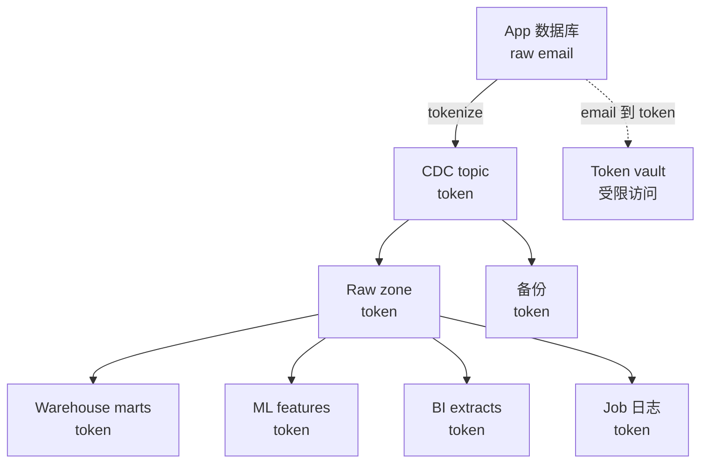

# Privacy, deletion and access control｜隐私、删除和访问控制

> 原文：[DataInterview · Data Engineering System Design · Privacy, deletion and access control](https://www.datainterview.com/courses/data-engineering-system-design/concept-privacy)（课程第 2 部分 Building blocks 的第 10 课，原文标注阅读约 24 分钟），抓取于 2026-11-14。

译文说明：

- 段落：英文原文放在引用块里，中文紧跟其后。
- 列表：用「English｜中文」两栏表格逐条对照。多列的大表格只直接展示中文版，英文原表折叠在下方。
- 原页面的交互组件（raw email 落在哪里、六种存储方式、三个平台的策略代码 tab、crypto-shredding 逐步演示）已改写成静态表格和代码块；折叠的 hint、参考答案和 strong answer 都已展开；测验用 ✅ 标出正确选项。练习的参考答案取自页面上的官方 solution。
- 译者自己加的内容（包括一张 Mermaid 图）都标了「译注」。

## 速览（译注）

- 先分类：直接标识符、准标识符、敏感数据、自由文本；把分类记成 tag，由它驱动策略、保留期和删除。
- 让 raw 标识符只待在少数地方：下游用 id 或 keyed token，raw 值只放在一个受限的服务里。
- hash 只是假名化；邮箱、电话的普通 hash 靠猜就能反推。密钥或 vault 能挡住外人，挡不住法律上的认定：它仍然是个人数据。
- 表上的 masking 和 row access policy 让每个读者对同一份数据看到合适的视图；保留期按 zone、按存储设置，要把 time travel 和 fail-safe 窗口算进去。
- 文件里的删除 = 重写或标记，再 vacuum 或 expire；备份要么保留期短于删除期限，要么用可删除的按用户密钥（crypto-shredding）。审计日志证明访问和删除，自己也不能泄露数据。

---

## 开篇

> A marketing analyst sends an ad partner a file of 2 million customers for audience matching. The emails are “anonymized”: each is replaced by its SHA-256 hash. A week later a customer asks the company to delete everything it holds about her. The privacy team asks the data team where her data is. The answer takes three weeks to assemble: the app database, a CDC topic, two raw zones, eleven warehouse tables, a feature store, nightly backups, job logs that print sample rows, a BI extract on someone’s laptop, and the file sent to the partner, which was never anonymous, because anyone holding a list of emails can hash it and match.

一个营销分析师把 200 万客户的文件发给广告合作方做受众匹配。邮箱是「匿名化」过的：每个都换成了它的 SHA-256 hash。一周后，一位客户要求公司删除关于她的一切数据。隐私团队问数据团队她的数据在哪里。光是把答案拼出来就花了三周：app 数据库、一个 CDC topic、两个 raw zone、十一张 warehouse 表、一个 feature store、每晚的备份、会打印样例行的 job 日志、某人笔记本上的一个 BI extract，还有发给合作方的那个文件。那个文件从来就不是匿名的，因为任何手上有一份邮箱列表的人都能 hash 一遍然后匹配。

> Privacy questions in a design interview come as follow-ups (“where does PII live?”, “how do you delete a user?”, “who can see the email column?”), and the strong answers are concrete design decisions. This lesson covers them at building-block level: classifying and tagging personal data, keeping it out of most of the platform, what hashing, keyed hashing, tokenization and encryption each protect against, masking and row policies, retention, what deletion means in immutable files and backups, and audit logs. You will reverse hashed emails in your browser, pseudonymize events properly, and erase a user from a backup without touching it. The full deletion pipeline is its own case later in the course, Design user data deletion.

设计面试里的隐私问题通常是追问：「PII 放在哪里？」「怎么删除一个用户？」「谁能看到 email 这一列？」好的回答是具体的设计决策。这一课在 building block 层面讲这些：

- 给个人数据分类和打 tag；
- 让它远离平台的大部分地方；
- hash、keyed hash、tokenization 和加密各自防的是什么；
- masking 和行级策略；
- 保留期；
- 在不可变文件和备份里，删除意味着什么；
- 审计日志。

你会在浏览器里反推 hash 过的邮箱，正确地对 event 做假名化，并在不碰备份的情况下把一个用户从备份里抹掉。完整的删除 pipeline 是课程后面单独的一个案例：Design user data deletion。

---

## Find it: classification and tags｜找到它：分类和 tag

> You cannot protect or delete what you have not found. Personal data comes in three kinds that a design should name. Direct identifiers point at one person: name, email, phone, government id, account id, device id. Quasi-identifiers are harmless alone and identifying together: Latanya Sweeney estimated in 2000 that about 87% of the US population was likely unique on 5-digit ZIP code, gender and date of birth. Sensitive data needs extra care whoever it identifies: health, precise location, financial details, and the special categories in GDPR’s Article 9. And free text (support messages, notes, search queries) contains all three without a column name to warn you.

没找到的东西，你没法保护也没法删除。设计里应该点名的个人数据有三类，外加自由文本：

| 类别 | 说明 | 例子 |
|---|---|---|
| 直接标识符 | 直接指向某一个人 | 姓名、邮箱、电话、政府证件号、账户 id、设备 id |
| 准标识符 | 单独无害，组合起来就能识别人 | Latanya Sweeney 在 2000 年估计，约 87% 的美国人口可以由 5 位邮编、性别和出生日期唯一确定 |
| 敏感数据 | 不管识别的是谁，都需要额外小心 | 健康、精确位置、财务信息，以及 GDPR 第 9 条里的特殊类别 |
| 自由文本 | 上面三类都可能有，而且没有列名提醒你 | 客服消息、备注、搜索词 |

> Record the classification where tools can act on it: as tags on columns in the warehouse and catalog (pii = email, pii = phone, sensitivity = high). Tags drive three things later in this lesson: masking policies attached to tags rather than to each column, retention rules per class, and the inventory a deletion request starts from. Classification can be partly automated: Snowflake’s sensitive data classification (SYSTEM$CLASSIFY, or automatic classification of a whole database) suggests categories and can set its SEMANTIC_CATEGORY and PRIVACY_CATEGORY tags, and catalogs can propagate tags along lineage. Automatic classifiers miss free text and renamed columns, so the producer’s data contract should declare which fields are personal data, and ingestion should check it.

把分类记录在工具能据此行动的地方：作为 warehouse 和 catalog 里列上的 tag（`pii = email`、`pii = phone`、`sensitivity = high`）。tag 驱动本课后面的三件事：

1. masking policy 挂在 tag 上，而不是挂在每一列上；
2. 按类别设定保留规则；
3. 删除请求从这份清单开始。

分类可以部分自动化：Snowflake 的敏感数据分类（`SYSTEM$CLASSIFY`，或对整个数据库自动分类）会建议类别，并能设置它的 `SEMANTIC_CATEGORY` 和 `PRIVACY_CATEGORY` tag；catalog 可以沿 lineage 传播 tag。自动分类器会漏掉自由文本和改过名的列，所以生产方的 data contract 应该声明哪些字段是个人数据，ingestion 时要检查。

---

## Reduce it: keep raw identifiers in few places｜减少它：raw 标识符只放在少数地方

> Every copy of an email is a system that needs access control, a retention rule, and a path for deleting it. The cheapest protection is to make fewer copies. Compare a platform that copies the email everywhere with one that replaces it with a token at ingestion.

每多一份邮箱拷贝，就多一个需要访问控制、保留规则和删除路径的系统。最便宜的保护就是少做拷贝。下面比较一个到处复制邮箱的平台，和一个在 ingestion 时把它换成 token 的平台。

### Raw email 最后落在哪里（原文为交互组件）

| 位置 | 到处复制邮箱 | ingestion 时 tokenize |
|---|---|---|
| App 数据库 | raw email | raw email |
| Token vault | 不用 | email 到 token 的映射 |
| CDC topic | raw email | token |
| Raw zone | raw email | token |
| Warehouse marts | raw email | token |
| ML features | raw email | token |
| BI extracts | raw email | token |
| Job 日志 | raw email | token |
| 备份 | raw email | token |
| **存 raw email 的地方** | 9 个里 8 个 | 9 个里 2 个 |
| **删除时要搜的地方** | 全部 8 份拷贝 | app DB、vault |

| 设计 | 说明 |
|---|---|
| 到处复制邮箱 | 每份拷贝都是一个需要访问控制、保留规则和删除路径的地方。日志和备份是大家最容易忘的拷贝。 |
| ingestion 时 tokenize | CDC connector（或第一个读源头的 job）把邮箱换成 token。下游系统按 token join；邮箱本身只留在两个严格控制访问的地方。以 token 为 key 的行在删除时仍要处理，但要切断的只有一个链接，而不是要找八份拷贝。 |

译注：「ingestion 时 tokenize」这种设计的数据流，按演示整理。



<details>
<summary>交互组件里的英文原文</summary>

- copy the email everywhere: App database, CDC topic, Raw zone, Warehouse marts, ML features, BI extracts, Job logs, Backups all hold raw email; Token vault not used. Hold raw emails 8 of 9; Deletion searches all 8 copies. Each copy is a place that needs access control, a retention rule and a deletion path. Logs and backups are the copies people forget.
- tokenize at ingestion: App database raw email; Token vault email to token; CDC topic, Raw zone, Warehouse marts, ML features, BI extracts, Job logs, Backups hold token. Hold raw emails 2 of 9; Deletion searches app DB, vault. The CDC connector (or the first job that reads the source) swaps the email for a token. Downstream systems join on the token; the email itself stays in two places with strict access. Token-keyed rows still have to be handled on deletion, but there is one link to cut instead of eight copies to find.

</details>

译注：「tokenize at ingestion」这一状态的读数被浏览器扩展拦截，按截图还原。

> Most analysis does not need to know who someone is, only that two events came from the same person. So the first job that reads a source replaces direct identifiers with a stable id or token, and everything downstream joins on that. The raw identifier stays in the source and in one restricted service. This is data minimization in practice, and it turns “find every copy” into “cut one link and delete by id”.

大多数分析不需要知道某人是谁，只需要知道两个 event 来自同一个人。所以第一个读数据源的 job 把直接标识符换成一个稳定的 id 或 token，下游全部按它 join。raw 标识符只留在数据源和一个受限的服务里。这就是落到实处的数据最小化，它把「找到每一份拷贝」变成了「切断一个链接，再按 id 删除」。

---

## Hashing, tokens and encryption｜Hash、token 和加密

> Teams reach for different techniques under the word “anonymize”, and they protect against different things. Pick one and see what it does to two spellings of the same address.

各个团队在「匿名化」这个词下用的是不同的技术，而它们防的东西各不相同。下面选一种，看它怎么处理同一个地址的两种写法。

### 一个邮箱，六种存法（原文为交互组件）

两个输入是同一个地址的两种写法：`'alice@example.com'` 和 `'Alice@Example.com '`（大写、末尾有空格）。值做了截断。

| 存法 | `alice@example.com` → | `Alice@Example.com ` → | 能跨表 join | 谁能还原邮箱 | 字典攻击 |
|---|---|---|---|---|---|
| raw | `alice@example.com` | `Alice@Example.com` | 能，规范化之后 | 没什么要还原的 | 不需要 |
| masked on read | `a****@example.com` | `A****@Example.com` | 不能（对被 mask 的读者） | policy 允许看的任何人 | 不适用 |
| SHA-256 | `ff8d9819fc0e12bf...` | `9723fb3bea379ff1...` | 只有先规范化才能 | 任何手上有邮箱列表的人 | 几秒就能反推 |
| keyed hash（HMAC） | `b146aa72bb6eb5ad...` | `b146aa72bb6eb5ad...` | 能，同一个密钥和规范化方式 | 持有密钥的人 | 没有密钥就会失败 |
| vault 发的 token | `tok_8f2k1x` | `tok_8f2k1x` | 能，通过 vault | vault 服务，并留有审计记录 | 没有可攻击的东西 |
| 加密，按用户的密钥 | `8c1f...e09a`（密文） | `41d7...b2c3`（密文） | 不能 | 持有该用户密钥的人 | 没有可攻击的东西 |

每种存法的说明：

| 存法 | 说明 |
|---|---|
| raw | app 存下来的原值。每个持有这一列的系统都持有这个人的邮箱，必须像源头一样保护，并且在这个人要求删除时都要搜一遍。 |
| masked on read | masking policy 改变的是读者看到什么；存储的值仍然是 raw 邮箱。它控制访问，但不减少存储的内容，有权限的读者做出来的拷贝带的仍是 raw 值。 |
| SHA-256 | 确定性、无密钥：任何人都能把一份候选邮箱列表 hash 一遍再去查。监管机构把它视为假名化而不是匿名化，FTC 在 2024 年也写过 hash 不会让数据变匿名。还要注意，同一个地址的两种写法得到了两个不同的 hash。 |
| keyed hash（HMAC） | 在规范化（去空格、转小写）之后，用一个存在 KMS 里的密钥做 HMAC-SHA256。结果稳定，所以表仍然能 join；字典攻击需要密钥。仍然是个人数据：持有密钥的人可以把它关联回去。 |
| vault 发的 token | 由 tokenization 服务发出的随机 token，该服务保存 token 到邮箱的映射。分析侧永远只看到 token；删除一个人的映射，就切断了所有以 token 为 key 的行和这个人之间的联系。 |
| 加密，按用户的密钥 | 每个用户的字段用他自己的数据密钥加密，数据密钥再由 KMS 主密钥包裹。不能 join，所以适合只为展示给用户本人而保存的字段。删除密钥会让所有拷贝都不可读：crypto-shredding。 |

<details>
<summary>交互组件里的英文原文</summary>

| Stored as | Joinable across tables | Who can recover the email | Dictionary attack |
|---|---|---|---|
| raw | yes, after normalizing | nothing to reverse | not needed |
| masked on read | no (masked readers) | anyone the policy lets see it | n/a |
| SHA-256 | only if normalized first | anyone with a list of emails | reverses it in seconds |
| keyed hash (HMAC) | yes, same key and normalization | whoever holds the key | fails without the key |
| token from a vault | yes, through the vault | the vault service, with an audit trail | nothing to attack |
| encrypted, per-user key | no | holders of that user’s key | nothing to attack |

- raw: The value as the app stored it. Every system that holds this column holds the person’s email, must be protected like the source, and must be searched when they ask to be deleted.
- masked on read: A masking policy changes what a reader sees; the stored value is still the raw email. It controls access, it does not reduce what is stored, and copies made by privileged readers carry the raw value.
- SHA-256: Deterministic and unkeyed: anyone can hash a list of candidate emails and look the results up. Regulators treat it as pseudonymisation, not anonymisation, and the FTC wrote in 2024 that hashing does not make data anonymous. Note also that the two spellings of one address got two hashes.
- keyed hash (HMAC): HMAC-SHA256 with a secret key held in a KMS, applied after normalizing (trim, lower case). Stable, so tables still join; a dictionary attack needs the key. Still personal data: the key holder can link it back.
- token from a vault: A random token issued by a tokenization service that keeps the token to email mapping. Analytics only ever sees tokens; deleting a person’s mapping cuts the link from every token-keyed row at once.
- encrypted, per-user key: Each user’s fields encrypted with their own data key, wrapped by a KMS master key. Not joinable, so it suits fields kept only to show back to the user. Deleting the key makes every copy unreadable: crypto-shredding.

</details>

译注：「token from a vault」这一状态的读数被浏览器扩展拦截，按截图还原。

> None of these makes data anonymous in the legal sense. GDPR defines pseudonymisation (Article 4(5)) as processing so that data can no longer be attributed to a person without additional information kept separately, and Recital 26 says pseudonymised data is still personal data. Hashing an email is pseudonymisation at best, and plain SHA-256 is weak even at that, because the input space is small enough to enumerate. Try it.

这些方法没有一种能让数据在法律意义上变得匿名。GDPR 第 4(5) 条把假名化（pseudonymisation）定义为：经过处理后，没有单独保存的额外信息，数据就无法再归属到某个人；Recital 26 说假名化的数据仍然是个人数据。hash 邮箱充其量是假名化，而普通 SHA-256 连假名化都做得很弱，因为输入空间小到可以穷举。试一下。

### 反推 hash 过的邮箱（原文为可运行的 playground）

<details>
<summary>Playground 代码（名字是编的）</summary>

```python
import hashlib, hmac, random, time

# A partner shares "anonymized" data: emails replaced by their SHA-256. An attacker (or the
# partner) has a list of plausible emails: first names x last names x common domains.
first = ["anna", "ben", "carla", "dev", "elif", "farid", "grace", "hiro", "ines", "jon", "kofi", "lena",
         "mateo", "nora", "omar", "priya", "quinn", "rosa", "sam", "tara", "uma", "victor", "wen", "yara"]
last = ["smith", "garcia", "chen", "kumar", "nguyen", "silva", "mueller", "rossi", "kim", "ali",
        "jones", "brown", "lopez", "khan", "sato", "novak", "haddad", "okafor", "berg", "costa"]
domains = ["gmail.com", "yahoo.com", "outlook.com", "icloud.com"]
patterns = ["{f}.{l}", "{f}{l}", "{f}_{l}", "{f[0]}{l}", "{f}.{l}{n}"]
candidates = [p.format(f=f, l=l, n=n) + "@" + d
              for f in first for l in last for p in patterns for d in domains for n in ([""] if "{n}" not in p else ["1", "7", "88"])]
print(f"{len(candidates):,} candidate emails")

r = random.Random(2)
customers = r.sample(candidates, 300)
shared = [hashlib.sha256(e.encode()).hexdigest() for e in customers]       # the "anonymized" column

t = time.time()
lookup = {hashlib.sha256(e.encode()).hexdigest(): e for e in candidates}    # hash every guess once
recovered = [lookup.get(h) for h in shared]
print(f"plain SHA-256: re-identified {sum(x is not None for x in recovered)} of {len(shared)} in {time.time() - t:.2f} s")
print("  e.g.", shared[0][:16], "->", recovered[0])

# A keyed hash (HMAC) with a secret the recipient does not have: the same guesses find nothing.
key = b"kept-in-a-kms-never-shared"
shared_keyed = [hmac.new(key, e.encode(), hashlib.sha256).hexdigest() for e in customers]
print(f"HMAC with a secret key: re-identified {sum(h in lookup for h in shared_keyed)} of {len(shared_keyed)}")
# Still pseudonymous, not anonymous: whoever holds the key can run the same attack.
# Try: add a salt that is shared with the data, e.g. sha256(b"salt" + email). Does it help?
```

</details>

> 13,440 guesses from common name patterns recover all 300 customers in about a hundredth of a second. Phone numbers are worse: a joint paper by the Spanish data protection authority and the EDPS (2019) showed that the hashes of every number in one operator’s range can be computed in under 20 seconds. A secret key changes the attacker’s position (they cannot compute HMACs without it), which is why a keyed hash or a token from a vault is the right join key for analytics. It does not change the legal position: the key holder can still link the data to people, so it stays personal data with all the duties that come with it.

按常见名字模式生成的 13,440 个猜测，大约百分之一秒就还原了全部 300 个客户。电话号码更糟：西班牙数据保护机构和 EDPS 在 2019 年的一篇联合文章表明，一个运营商号段里所有号码的 hash 不到 20 秒就能算完。

秘密密钥改变的是攻击者的处境（没有密钥就算不出 HMAC），所以 keyed hash 或 vault 发的 token 才是分析侧正确的 join key。但它不改变法律上的处境：持有密钥的人仍然能把数据关联到人，所以它仍然是个人数据，相应的义务一样都不少。

### 测验 1

> A partner offers to share their customer list with you for ad matching, 'anonymized' with SHA-256 of each email. Is that anonymous data under GDPR?

一个合作方提出把他们的客户名单分享给你做广告匹配，每个邮箱都用 SHA-256「匿名化」过。按 GDPR 这算匿名数据吗？

| | English | 中文 |
|---|---|---|
| A | Yes: SHA-256 is a one-way function and cannot be reversed | 算：SHA-256 是单向函数，无法反推 |
| B ✅ | No: it is pseudonymised personal data, because anyone with a list of emails can hash them and match, and you will match it against your own customers | 不算：这是假名化的个人数据，因为任何手上有邮箱列表的人都能 hash 后匹配，而你正要拿它和自己的客户匹配 |
| C | Yes, as long as a salt is added | 算，只要加了 salt |
| D | It depends on the length of the hash | 取决于 hash 的长度 |

> Right. GDPR Recital 26 says pseudonymised data that can be attributed to a person with additional information is still personal data. Emails are guessable, and the purpose here is to link records to people. The Article 29 Working Party’s 2014 opinion on anonymisation lists hashing as pseudonymisation, and the FTC said the same in 2024.

解析：GDPR Recital 26 说，借助额外信息可以归属到某个人的假名化数据，仍然是个人数据。邮箱是可以猜的，而这里的目的恰恰就是把记录关联到人。第 29 条工作组 2014 年关于匿名化的意见把 hash 列为假名化，FTC 在 2024 年也说过同样的话。

> Normalization matters as much as the key: Alice@Example.com and alice@example.com are one person, and a token that differs for them splits the person in two in every join.

规范化和密钥同样重要：`Alice@Example.com` 和 `alice@example.com` 是同一个人，如果它们的 token 不同，这个人在每次 join 里都会被拆成两个。

### 练习：为分析 zone 对 event 做假名化

> Write pseudonymize(events, key): replace user_email with user_token, an HMAC-SHA256 of the normalized email under a secret key, and scrub email addresses out of every other text field. The token must be the same for one person however the email was typed, so tables still join.

写 `pseudonymize(events, key)`：把 `user_email` 换成 `user_token`，即用秘密密钥对规范化后的邮箱做 HMAC-SHA256；并把其他所有文本字段里的邮箱地址清掉。不管邮箱是怎么输入的，同一个人的 token 必须一样，这样表才能 join。

> The starter uses plain SHA-256 and leaves free text alone. The checks write one email two ways, try a dictionary of hashed emails against your tokens, change the key, and look for an @ anywhere in the output.

starter 代码用的是普通 SHA-256，也不管自由文本。测试会：用两种写法写同一个邮箱；拿一本 hash 过的邮箱字典去撞你的 token；换密钥；以及在输出里到处找 `@`。

> Hint: Normalize with .strip().lower(), then hmac.new(key, email.encode(), hashlib.sha256).hexdigest(). For free text, loop over the row’s string fields and apply EMAIL.sub("[email]", value).

提示：用 `.strip().lower()` 规范化，再 `hmac.new(key, email.encode(), hashlib.sha256).hexdigest()`。对于自由文本，遍历这一行的字符串字段，应用 `EMAIL.sub("[email]", value)`。

参考答案：

```python
import hashlib, hmac, re

EMAIL = re.compile(r"[\w.+-]+@[\w-]+\.[\w.-]+")

def pseudonymize(events, key):
    """Return copies of the events for the analytics zone:
      - user_email is replaced by user_token, a hex HMAC-SHA256 of the normalized email (stripped,
        lower case) under `key`, so the same person gets the same token in every table
      - no email address remains anywhere: emails inside free-text fields become "[email]"
      - every other field is kept as it is"""
    out = []
    for e in events:
        row = dict(e)
        email = row.pop("user_email").strip().lower()      # one person, one token
        # Keyed, so nobody without the key can hash a list of guesses and match them.
        row["user_token"] = hmac.new(key, email.encode(), hashlib.sha256).hexdigest()
        for field, value in row.items():                    # PII hides in free text too
            if isinstance(value, str) and field != "user_token":
                row[field] = EMAIL.sub("[email]", value)
        out.append(row)
    return out


events = [
    {"user_email": "Ana.Silva@gmail.com", "city": "Lisbon", "note": "asked to send invoice to ana.silva@gmail.com"},
    {"user_email": "ana.silva@gmail.com ", "city": "Lisbon", "note": "repeat order"},
]
for row in pseudonymize(events, b"demo-key"):
    print(row)
```

> Encryption comes at three levels, and only the last one changes who can read a column. Encryption at rest is now the default: S3 has encrypted every new object with SSE-S3 since January 5, 2023, and the major warehouses encrypt their storage. Encryption in transit is TLS between every hop. Neither stops an analyst who can query the table. Field-level encryption encrypts the value itself with a data key, and the data key is encrypted under a master key in a KMS (envelope encryption), so reading the field needs permission to use that key. Use it for fields that must be stored but are rarely read, such as a phone number kept for account recovery.

加密分三个层次，只有最后一个会改变谁能读某一列：

| 层次 | 说明 |
|---|---|
| 静态加密 | 现在已是默认：S3 从 2023 年 1 月 5 日起对每个新对象都用 SSE-S3 加密，主流 warehouse 也都加密存储 |
| 传输加密 | 每一跳之间用 TLS |
| 字段级加密 | 用一个数据密钥加密值本身，数据密钥再由 KMS 里的主密钥加密（envelope encryption），所以读这个字段需要有使用那个密钥的权限 |

前两种都挡不住能查这张表的分析师。字段级加密适合必须存、但很少读的字段，比如为账户找回而保存的电话号码。

---

## Control who sees it｜控制谁能看到

> Some people need raw values: support needs the email, fraud needs the card fingerprint. Give them access with policies on the table, not with copies. A masking policy decides per column what each role sees (the value, a masked form, a hash, NULL). A row access policy decides per row whether the current user sees it at all. Both are evaluated on every query, so every view, BI tool and notebook gets the same rule, and attaching masking to tags means a new column tagged pii = email is masked the day it appears. The warehousing course’s lesson on access control walks through how roles, row policies and masking combine on one query.

有些人需要 raw 值：客服需要邮箱，反欺诈需要卡指纹。用表上的策略给他们访问权限，而不是给他们拷贝：

- **masking policy**：按列决定每个角色看到什么（原值、mask 后的形式、hash、NULL）。
- **row access policy**：按行决定当前用户能不能看到这一行。

两者在每次查询时都会计算，所以每个 view、BI 工具和 notebook 都遵循同样的规则；把 masking 挂在 tag 上，意味着一个新加的、打了 `pii = email` tag 的列，从出现那天起就被 mask。warehousing 课程里讲访问控制的那一课，会讲角色、行级策略和 masking 怎么在一条查询上组合起作用。

### 列 masking 和行过滤（原文为 tab 切换）

语法取自各平台的文档。译注：多行代码被浏览器扩展拦截，按截图还原；Databricks 第二个函数里 `region = 'EU'` 的引号内容被鼠标挡住了一部分，按函数名 `eu_only` 推断为 `'EU'`。

**Snowflake**

```sql
CREATE MASKING POLICY email_mask AS (val STRING) RETURNS STRING ->
  CASE WHEN IS_ROLE_IN_SESSION('PII_READER') THEN val ELSE '***' END;
CREATE TAG governance.pii ALLOWED_VALUES 'email', 'phone';
ALTER TAG governance.pii SET MASKING POLICY email_mask;      -- every column with the tag
ALTER TABLE customers MODIFY COLUMN email SET TAG governance.pii = 'email';

CREATE ROW ACCESS POLICY region_rows AS (row_region STRING) RETURNS BOOLEAN ->
  EXISTS (SELECT 1 FROM security.region_map m
          WHERE m.region = row_region AND IS_ROLE_IN_SESSION(m.role_name));
ALTER TABLE customers ADD ROW ACCESS POLICY region_rows ON (region);
```

**BigQuery**

```sql
-- Columns: tag email with a policy tag from a taxonomy, then attach a data policy
-- (masking rule such as SHA256 or NULLIFY) for principals with the Masked Reader role.
-- Readers who need raw values get the Fine-Grained Reader role on the policy tag.

CREATE ROW ACCESS POLICY eu_rows ON shop.customers
  GRANT TO ('group:eu-analysts@example.com')
  FILTER USING (region = 'EU');
```

**Databricks**

```sql
CREATE FUNCTION mask_email(email STRING) RETURN
  CASE WHEN is_account_group_member('pii_readers') THEN email ELSE '***' END;
ALTER TABLE customers ALTER COLUMN email SET MASK mask_email;

CREATE FUNCTION eu_only(region STRING) RETURN
  is_account_group_member('admins') OR region = 'EU';
ALTER TABLE customers SET ROW FILTER eu_only ON (region);
```

> Snowflake masking and row access policies need Enterprise Edition or higher. Databricks row filters and column masks need Unity Catalog. In all three, the policy sits on the table, so every query, view and tool that reads it gets the same rule.

Snowflake 的 masking 和 row access policy 需要 Enterprise Edition 或更高版本。Databricks 的行过滤和列 mask 需要 Unity Catalog。三者的策略都挂在表上，所以每一条读它的查询、view 和工具都遵循同样的规则。

---

## Keep it only as long as needed｜只保留必要的时长

> Retention is deletion that happens without a request. Set it per zone and per class of data, and write the numbers into the design, because each store has its own clock:

保留期就是不需要请求也会发生的删除。按 zone、按数据类别设置，并把具体数字写进设计里，因为每个存储都有自己的时钟：

| 存储 | 设置 | 默认 | 删除的数据还能恢复多久 |
|---|---|---|---|
| Kafka topic | `retention.ms` | 7 天 | 直到包含它的 segment 被删除 |
| S3 bucket | lifecycle 过期规则；带版本的 bucket 用 `NoncurrentVersionExpiration` | 不过期 | 带版本的 bucket 里的旧版本，直到过期 |
| BigQuery 表 | `partition_expiration_days` | partition 不过期 | time travel（默认 7 天，可设 2 到 7 天）加 7 天 fail-safe |
| Snowflake 表 | Time Travel 的 `DATA_RETENTION_TIME_IN_DAYS` | 1 天（Enterprise 最多 90 天） | 永久表是 Time Travel 加 7 天 Fail-safe |
| Delta / Iceberg 表 | `VACUUM`、`expire_snapshots` | 有人跑时，删除超过 7 天的文件（Delta）或超过 5 天的 snapshot（Iceberg） | 旧文件一直在，直到被 vacuum 或 expire |

<details>
<summary>英文原表</summary>

| STORE | SETTING | DEFAULT | DELETED DATA RECOVERABLE FOR |
|---|---|---|---|
| Kafka topic | retention.ms | 7 days | Until the segment holding it is deleted |
| S3 bucket | Lifecycle expiration rules; NoncurrentVersionExpiration for versioned buckets | No expiration | Old versions in versioned buckets, until they expire |
| BigQuery table | partition_expiration_days | Partitions do not expire | Time travel (7 days by default, 2 to 7) plus a 7-day fail-safe |
| Snowflake table | DATA_RETENTION_TIME_IN_DAYS for Time Travel | 1 day (up to 90 on Enterprise) | Time Travel plus 7 days of Fail-safe for permanent tables |
| Delta / Iceberg table | VACUUM, expire_snapshots | Removes files older than 7 days (Delta) or snapshots older than 5 days (Iceberg), when someone runs it | Old files until they are vacuumed or expired |

</details>

> The last column is the one interviewers ask about: after a delete, how long can the data still be recovered by someone with access? On BigQuery the answer is up to 14 days, on Snowflake up to the Time Travel window plus 7 days. Raw zones that hold identifiers should have the shortest retention the business can accept (30 days is common), because they are the hardest to clean on request.

面试官问的就是最后一列：删除之后，有权限的人还能把数据恢复回来多久？BigQuery 最多 14 天，Snowflake 最多是 Time Travel 窗口再加 7 天。存着标识符的 raw zone 应该用业务能接受的最短保留期（常见是 30 天），因为它们是按请求清理时最难处理的地方。

---

## Erasure in immutable files｜不可变文件里的擦除

> GDPR’s Article 17 gives people the right to have their data erased, with exceptions such as a legal obligation to keep it (invoices for tax law, for example), and Article 12(3) requires the controller to act on a request “without undue delay and in any event within one month”, extendable by two months for complex cases. Deleting a row from a database is easy. A data platform stores data in files that are never edited in place, and that changes what “delete” means:

GDPR 第 17 条赋予人们要求删除自己数据的权利，例外情况包括有法定义务必须保留（比如税法要求的发票）；第 12(3) 条要求控制者对请求「不得无故拖延，且无论如何在一个月内」处理，复杂情况可以再延长两个月。从数据库里删一行很容易。数据平台把数据存在从不原地修改的文件里，这改变了「删除」的含义：

| English | 中文 |
|---|---|
| Copy-on-write: rewrite every file that contains the user’s rows without them. Reads stay fast; a delete that touches many files rewrites many files. This is the default for Iceberg’s write.delete.mode and for Delta without deletion vectors. | **copy-on-write**：把每个包含该用户行的文件重写一遍，去掉这些行。读仍然快；一次涉及很多文件的删除要重写很多文件。这是 Iceberg `write.delete.mode` 的默认值，也是没开 deletion vector 的 Delta 的行为。 |
| Merge-on-read: write a small delete file or deletion vector that marks the rows, and filter them out at read time. Deletes are cheap; the bytes stay in the data files until compaction rewrites them. | **merge-on-read**：写一个小的 delete 文件或 deletion vector 来标记这些行，读的时候过滤掉。删除很便宜；但这些字节一直留在数据文件里，直到 compaction 重写它们。 |
| Physical removal needs one more step either way: old files remain for time travel until they are vacuumed (Delta) or their snapshots expire and orphan files are removed (Iceberg). | **物理删除**不管哪种都还要多一步：旧文件为了 time travel 会一直保留，直到被 vacuum（Delta），或者它们的 snapshot 过期、孤儿文件被清理（Iceberg）。 |

### 测验 2

> A Delta table has deletion vectors enabled. You run DELETE FROM events WHERE user_id = 'u-8812'. When are u-8812's rows physically gone from storage?

一张 Delta 表开启了 deletion vector。你执行 `DELETE FROM events WHERE user_id = 'u-8812'`。u-8812 的行什么时候才从存储里物理消失？

| | English | 中文 |
|---|---|---|
| A | Immediately, when the DELETE commits | 立刻，DELETE 提交的时候 |
| B | Never: Delta tables are append-only | 永远不会：Delta 表是只追加的 |
| C | After the next OPTIMIZE | 下一次 OPTIMIZE 之后 |
| D ✅ | Only after the files are rewritten without them (REORG TABLE ... APPLY (PURGE)) and VACUUM removes the old files once they are past the retention threshold, 7 days by default | 只有在文件被重写、去掉这些行（`REORG TABLE ... APPLY (PURGE)`），并且 VACUUM 在旧文件超过保留阈值（默认 7 天）后删除它们之后 |

> Right. With deletion vectors, DELETE only marks rows as deleted; the Parquet files still contain them. Rewriting the files removes them from the current version, and the old files stay for time travel until VACUUM deletes them after delta.deletedFileRetentionDuration (7 days by default). Databricks’ GDPR guidance describes exactly this sequence.

解析：有 deletion vector 时，DELETE 只是把行标记为已删除；Parquet 文件里仍然有它们。重写文件把它们从当前版本里去掉，而旧文件为了 time travel 还会保留，直到 VACUUM 在 `delta.deletedFileRetentionDuration`（默认 7 天）之后删除它们。Databricks 的 GDPR 指南描述的正是这个顺序。

> Backups are the hard copy: they are immutable on purpose. Two answers work. Keep backup retention shorter than the deadline, so every backup holding the user expires in time. Or crypto-shred: encrypt personal fields with a per-user key and delete the key, which makes every copy unreadable at once. Google’s Cloud KMS documentation uses the term directly: data encrypted with a destroyed key is considered crypto-shredded. Note the waiting periods on managed key deletion: AWS KMS waits 7 to 30 days (30 by default) and Cloud KMS 30 days by default before a key is destroyed, which counts against the deadline when each user has a KMS key. Most designs keep per-user data keys in their own key table, wrapped by one KMS key, and delete rows there.

备份是最难处理的拷贝：它们是故意做成不可变的。有两种答法：

1. 让备份的保留期短于删除期限，这样每个包含该用户的备份都会及时过期。
2. **crypto-shred**：用按用户的密钥加密个人字段，然后删掉这个密钥，所有拷贝一下子都不可读了。Google Cloud KMS 的文档直接用了这个词：用已销毁的密钥加密的数据被视为已 crypto-shredded。

注意托管密钥删除的等待期：AWS KMS 在销毁密钥前要等 7 到 30 天（默认 30），Cloud KMS 默认 30 天；如果每个用户一个 KMS 密钥，这段时间要算进删除期限。大多数设计把按用户的数据密钥存在自己的密钥表里，由一个 KMS 密钥包裹，删除时删的是那张表里的行。

### 对一个用户做 crypto-shredding（原文为逐步演示）

行数和文件数是编的。组件：Sign-up service、Key service、Event topic、Lake tables、Warehouse、Backups（保留 30 天）。

| 步骤 | Key service | Event topic | Lake 表 | Warehouse | 备份（30 天） | u-8812 的邮箱在哪些拷贝里可读 | 为擦除而重写的字节 |
|---|---|---|---|---|---|---|---|
| 1. 注册 | u-8812：1 个密钥 | 邮箱已加密 | 邮箱已加密 | 解密 view | 不可变 | 每一份 | — |
| 2. event 带着加密邮箱 | u-8812：1 个密钥 | 邮箱已加密 | 邮箱已加密 | 解密 view | 不可变 | 每一份 | — |
| 3. 备份和解密 view | u-8812：1 个密钥 | 邮箱已加密 | 邮箱已加密 | 解密 view | 不可变 | 每一份 | — |
| 4. 删除请求第 0 天 | u-8812：已删除 | 邮箱已加密 | 只剩密文 | 无法解密 | 不可读 | 没有 | 0（删了一个密钥） |
| 5. 仍然删除 live 行 | u-8812：已删除 | 邮箱已加密 | 只剩密文 | 无法解密 | 不可读 | 没有 | 0（删了一个密钥） |

**Step 1**

> User u-8812 signs up. The key service creates a random 256-bit data key for u-8812 and stores it encrypted under a KMS master key (envelope encryption). The plaintext key exists only in memory while it is used.

用户 u-8812 注册。key service 为 u-8812 生成一个随机的 256 位数据密钥，用 KMS 主密钥加密后存起来（envelope encryption）。明文密钥只在使用时存在于内存里。

**Step 2**

> Every event carries u-8812’s email and phone encrypted with that key. The user id stays in clear so jobs can group and join. Over two years the events land in the topic, 3 lake tables and the warehouse: about 41,000 rows across thousands of Parquet files.

每个 event 都带着用这个密钥加密的 u-8812 的邮箱和电话。user id 保持明文，这样 job 可以分组和 join。两年下来，这些 event 落进 topic、3 张 lake 表和 warehouse：大约 41,000 行，分散在几千个 Parquet 文件里。

**Step 3**

> Nightly backups copy the lake and the warehouse; they are immutable and kept 30 days. Analysts query the warehouse; a view decrypts the email only for roles allowed to see it, by asking the key service for u-8812’s key.

每晚的备份复制 lake 和 warehouse；备份不可变，保留 30 天。分析师查询 warehouse；一个 view 只对允许看的角色解密邮箱，方法是向 key service 要 u-8812 的密钥。

**Step 4**

> Day 0 of a deletion request. The key service deletes u-8812’s data key, and the key table’s own backups expire within 7 days. From then on every ciphertext of that email, in every table, file and backup, is random bytes. Nothing else had to be rewritten.

删除请求的第 0 天。key service 删掉 u-8812 的数据密钥，密钥表自己的备份 7 天内过期。从此，这个邮箱在每张表、每个文件、每个备份里的每一份密文都只是随机字节。其他什么都不用重写。

**Step 5**

> The pipeline still deletes u-8812’s rows from the live tables on its normal weekly run, because the clear user id and behaviour linked to it may still be personal data. Crypto-shredding made the deadline easy to meet for the sensitive fields and for backups, which are the copies hardest to edit.

pipeline 仍然会在每周的常规运行中，把 u-8812 的行从 live 表里删掉，因为明文的 user id 以及和它关联的行为数据，可能仍然是个人数据。crypto-shredding 让敏感字段和备份（最难修改的拷贝）很容易赶上删除期限。

> Crypto-shredding has limits worth saying out loud. The key store becomes the most important table in the company: losing it loses everyone’s data, and its own backups must expire within the deadline. Fields you need to join or aggregate on cannot be encrypted per user. And whatever stays in clear (a user id, a city, a click history) may still be personal data, so live tables still get a delete; crypto-shredding takes care of the copies that are hard to edit.

crypto-shredding 有几个值得说出来的局限：

- 密钥库变成公司里最重要的一张表：丢了它就丢了所有人的数据，而它自己的备份也必须在期限内过期。
- 需要 join 或聚合的字段不能按用户加密。
- 留在明文里的东西（user id、城市、点击历史）可能仍然是个人数据，所以 live 表还是要做删除；crypto-shredding 处理的是那些难以修改的拷贝。

### 练习：从改不了的拷贝里擦除一个用户

> Every event stores the user’s email encrypted under that user’s key from Vault. Finish Vault.forget and erase(user_id, vault, live) so the user’s email is unreadable in the live table, last night’s backup and a derived copy some job made, without modifying the backup.

每个 event 都存着用 Vault 里该用户密钥加密的邮箱。补完 `Vault.forget` 和 `erase(user_id, vault, live)`，让这个用户的邮箱在 live 表、昨晚的备份、以及某个 job 做出来的派生拷贝里都不可读，同时不能修改备份。

> The starter deletes the user’s rows from the live table, which is what a deletion job usually does first. The checks read every copy, compare the backup byte for byte, and let the same user id sign up again.

starter 代码从 live 表里删掉该用户的行，这通常是删除 job 做的第一件事。测试会读每一份拷贝，逐字节比较备份，并让同一个 user id 重新注册。

> Hint: forget removes the user’s key from self.keys. erase calls it and then removes the live rows. A new sign-up gets a new random key, which cannot decrypt the old ciphertext.

提示：`forget` 从 `self.keys` 里删掉该用户的密钥。`erase` 调用它，然后删掉 live 行。新注册会拿到一个新的随机密钥，它解不开旧的密文。

参考答案：

```python
import hashlib, hmac, os

# A teaching cipher: HMAC-SHA256 as a keystream, plus a tag so a wrong key is detected.
# Production: AES-GCM, with each data key wrapped by a KMS master key.
def encrypt(key, data):
    nonce = os.urandom(12)
    stream = b"".join(hmac.new(key, nonce + i.to_bytes(4, "big"), hashlib.sha256).digest() for i in range(len(data) // 32 + 1))
    ct = bytes(a ^ b for a, b in zip(data, stream))
    return nonce + ct + hmac.new(key, nonce + ct, hashlib.sha256).digest()[:16]

def decrypt(key, blob):
    nonce, ct, tag = blob[:12], blob[12:-16], blob[-16:]
    if not hmac.compare_digest(tag, hmac.new(key, nonce + ct, hashlib.sha256).digest()[:16]):
        raise ValueError("wrong key")
    stream = b"".join(hmac.new(key, nonce + i.to_bytes(4, "big"), hashlib.sha256).digest() for i in range(len(ct) // 32 + 1))
    return bytes(a ^ b for a, b in zip(ct, stream))

def store_event(table, vault, user_id, email, city):
    """Every copy of the data keeps the email only in encrypted form, under the user's own key."""
    table.append({"user_id": user_id, "email_enc": encrypt(vault.key_for(user_id), email.encode()), "city": city})

def read_email(vault, row):
    key = vault.get(row["user_id"])
    if key is None:
        return None
    try:
        return decrypt(key, row["email_enc"]).decode()
    except ValueError:
        return None

class Vault:
    """One random 32-byte data key per user. In production the keys live in a key table or
    service, wrapped by a KMS master key, with backups of their own kept shorter than the
    deletion deadline."""
    def __init__(self):
        self.keys = {}

    def key_for(self, user_id):
        """The user's key, created on first use."""
        if user_id not in self.keys:
            self.keys[user_id] = os.urandom(32)
        return self.keys[user_id]

    def get(self, user_id):
        return self.keys.get(user_id)

    def forget(self, user_id):
        self.keys.pop(user_id, None)          # without the key, every copy of the ciphertext is noise

def erase(user_id, vault, live):
    """Erase the user's personal data everywhere: the live table, last night's backup and every
    other copy. Backups are immutable, so they must not be modified."""
    vault.forget(user_id)                     # one small delete reaches every copy, backups included
    live[:] = [r for r in live if r["user_id"] != user_id]   # and the live rows go too


vault, live = Vault(), []
store_event(live, vault, "u1", "ana@example.com", "Lisbon")
store_event(live, vault, "u2", "ben@example.com", "Porto")
backup = [dict(r) for r in live]             # last night's backup: immutable
erase("u1", vault, live)
print("live:", [(r["user_id"], read_email(vault, r)) for r in live])
print("backup:", [(r["user_id"], read_email(vault, r)) for r in backup])
```

---

## Audit: who touched what｜审计：谁碰了什么

> A privacy design needs proof as well as controls: who read the email column last month, which jobs wrote to a table, whether a deletion ran everywhere. Turn on the platform’s logs and keep them somewhere the people being audited cannot edit. Snowflake records the columns each query read and wrote in ACCOUNT_USAGE.ACCESS_HISTORY (Enterprise Edition, up to 3 hours behind). BigQuery writes Data Access audit logs to Cloud Logging, and those for BigQuery cannot be disabled. Databricks writes Unity Catalog activity to the system.access.audit table. On S3, CloudTrail does not log object-level reads (data events) unless you enable them, at extra cost. One trap: query text is logged, and a query with WHERE email = 'ana@...' puts the email into the audit log, so access to the logs needs the same care as the data.

隐私设计既需要控制，也需要证据：上个月谁读了 email 列、哪些 job 写了某张表、一次删除有没有在所有地方都执行。打开平台的日志，并把它们存在被审计的人改不了的地方：

| 平台 | 审计日志 |
|---|---|
| Snowflake | 在 `ACCOUNT_USAGE.ACCESS_HISTORY` 里记录每条查询读写了哪些列（Enterprise Edition，最多延迟 3 小时） |
| BigQuery | Data Access 审计日志写进 Cloud Logging，BigQuery 的这类日志不能关闭 |
| Databricks | Unity Catalog 的活动写进 `system.access.audit` 表 |
| S3 | CloudTrail 默认不记录对象级读取（data events），要另外开启并额外付费 |

一个陷阱：查询文本会被记录，一条 `WHERE email = 'ana@...'` 的查询会把邮箱写进审计日志，所以对日志的访问要和数据本身一样小心。

### 练习：把客服工单和产品 event join 起来

> The support tool exports tickets with the customer’s email and free-text messages. Product events carry a user id. Analysts want ticket volume by product feature and plan, joined per user. Design the data flow so analysts can do this without seeing emails, and so a user’s deletion request can be met in a month.

客服工具导出的工单带着客户邮箱和自由文本消息。产品 event 带的是 user id。分析师想按产品功能和套餐看工单量，按用户 join。设计数据流，让分析师不看到邮箱就能做到这一点，并且能在一个月内满足用户的删除请求。

**参考答案（strong answer）**

> Resolve identity once, in a small restricted place, and let everything else use the id.

在一个小而受限的地方解析一次身份，其他所有地方都用 id。

| English | 中文 |
|---|---|
| Land the raw export in a restricted raw zone that only the ingestion service reads, with 30-day retention. The ingestion job looks up each ticket’s email in the users table (or a keyed HMAC of it) to get user_id, and drops the email. | 把原始导出落在一个受限的 raw zone 里，只有 ingestion 服务能读，保留 30 天。ingestion job 拿每张工单的邮箱（或它的 keyed HMAC）去 users 表里查出 `user_id`，然后丢掉邮箱。 |
| Ticket text is the riskiest field: people paste emails, phone numbers and card numbers into it. Scrub patterns at ingestion, keep only what analysis needs (category, product area, sentiment from a classifier), and keep the full text in the restricted zone or not at all. | 工单文本是风险最大的字段：人们会把邮箱、电话、卡号粘进去。在 ingestion 时按模式清洗，只保留分析需要的东西（类别、产品领域、分类器给出的情绪），完整文本要么留在受限 zone，要么干脆不留。 |
| The analytics table has user_id, ticket category and timestamps, joined to events by user_id. Columns that remain sensitive carry a PII tag, and a tag-based masking policy shows them only to the support analytics role. | 分析表里有 `user_id`、工单类别和时间戳，按 `user_id` 和 event join。仍然敏感的列打上 PII tag，基于 tag 的 masking policy 只对客服分析角色展示它们。 |
| A deletion request deletes the user’s rows by user_id in the analytics tables, and the raw export ages out within the 30-day retention, inside the one-month deadline. | 删除请求按 `user_id` 删除分析表里该用户的行；原始导出在 30 天保留期内自然过期，在一个月的期限之内。 |
| Every read of the restricted zone and every decrypt or detokenize call is logged with who, what and why. | 每次读受限 zone、每次解密或 detokenize 调用，都记录下是谁、读了什么、为什么。 |

自查清单：

| English | 中文 |
|---|---|
| Map email to user id (or a keyed token) at ingestion, in a restricted zone | 在 ingestion 时、在受限 zone 里，把邮箱映射成 user id（或 keyed token） |
| Drop or encrypt the email before the analytics zone | 进入分析 zone 之前丢掉或加密邮箱 |
| Scrub or classify free text, which carries names, emails and phone numbers | 清洗或分类自由文本，里面有姓名、邮箱和电话 |
| Tag PII columns; masking policies for the few who need raw values | 给 PII 列打 tag；对少数需要 raw 值的人用 masking policy |
| Retention on the raw export; deletion through the user id or token | 原始导出设保留期；通过 user id 或 token 删除 |
| Access to the mapping is logged and limited to a service | 对映射的访问有日志，并且只限一个服务 |

---

## How this comes up in interviews｜实际面试中是什么样

> Expect privacy as a follow-up to any design with user data, and more directly at companies in regulated industries. The questions: where does PII live, who can see it, how long is it kept, how do you delete one user, and how do you prove it. A complete answer classifies and tags personal data at ingestion; replaces identifiers with ids or keyed tokens before the analytics zone and keeps the raw values in one restricted place; says hashing emails is pseudonymisation, not anonymisation, and why; puts masking and row policies on the tables; gives retention per zone with real numbers, including time travel and fail-safe windows; explains deletes in immutable files (copy-on-write, merge-on-read, vacuum) and how backups are handled (short retention or crypto-shredding); and turns on audit logs. Interviewers like candidates who mention free text and logs, the two places PII hides.

任何涉及用户数据的设计，都要准备被追问隐私；在受监管行业的公司，问得会更直接。问题是：PII 放在哪里、谁能看到、保留多久、怎么删除一个用户、怎么证明。一个完整的回答包括：

1. 在 ingestion 时给个人数据分类、打 tag；
2. 进入分析 zone 之前把标识符换成 id 或 keyed token，raw 值只放在一个受限的地方；
3. 说明 hash 邮箱是假名化而不是匿名化，以及为什么；
4. 在表上加 masking 和行级策略；
5. 按 zone 给出带真实数字的保留期，包括 time travel 和 fail-safe 窗口；
6. 解释不可变文件里的删除（copy-on-write、merge-on-read、vacuum），以及备份怎么处理（短保留期或 crypto-shredding）；
7. 打开审计日志。

面试官喜欢提到自由文本和日志的候选人，这是 PII 最爱藏的两个地方。

### 测验 3

> "Where does PII live in your design, and how do you protect it?" Which answer is most complete?

「你的设计里 PII 放在哪里，你怎么保护它？」哪个回答最完整？

| | English | 中文 |
|---|---|---|
| A | Keep PII out of the warehouse entirely and only allow aggregates | 完全不让 PII 进 warehouse，只允许聚合数据 |
| B ✅ | Classify and tag PII columns at ingestion; keep raw identifiers in a small restricted zone and use ids, keyed tokens or per-user encryption downstream; masking and row policies on the tables for the few who need raw values; retention per zone; deletion through ids, crypto-shredding for backups and immutable copies; and audit logs of access | 在 ingestion 时给 PII 列分类和打 tag；raw 标识符放在一个小的受限 zone，下游用 id、keyed token 或按用户加密；为少数需要 raw 值的人在表上加 masking 和行级策略；按 zone 设保留期；通过 id 删除，备份和不可变拷贝用 crypto-shredding；以及访问审计日志 |
| C | Encrypt the disks and use TLS | 加密磁盘并使用 TLS |
| D | Hash all PII columns with SHA-256 | 用 SHA-256 hash 所有 PII 列 |

> Right. It covers finding PII (classification and tags), reducing where it lives (tokenization at the edge), controlling who sees it (policies on the data, not copies), how long it stays (retention), how it leaves (deletion by key or id), and proof (audit logs).

解析：它覆盖了找到 PII（分类和 tag）、减少它所在的地方（在边缘 tokenize）、控制谁能看到（策略加在数据上，而不是做拷贝）、它留多久（保留期）、它怎么离开（按密钥或 id 删除），以及证据（审计日志）。

---

## Common mistakes｜常见错误

| 错误 | 后果 | 怎么改 |
|---|---|---|
| 把 hash 过的邮箱叫做匿名 | 任何有邮箱列表的人都能重新识别；数据仍然是个人数据 | join 用 keyed hash 或 token，并按个人数据对待 |
| 把 raw 标识符复制到每个 zone | 每份拷贝都需要访问控制和删除路径 | 在 ingestion 时 tokenize 或映射成 id；raw 值只放在一个受限的地方 |
| 为不同受众各做一份表的拷贝 | 拷贝之间会漂移，每份泄露的方式都不同 | 一张表，加 masking 和行级策略，通过 tag 挂上去 |
| 忽略自由文本和日志 | 备注、消息、打印出来的样例行里有邮箱和电话 | 在 ingestion 时清洗；日志里不放行数据；限制日志访问 |
| 把 DELETE 当成擦除 | 行还留在旧文件、time travel、fail-safe 和备份里 | 重写，再 vacuum 或 expire；清楚每个存储的恢复窗口 |
| 备份保留期比删除期限还长 | 被删除的用户还活在一份没人能改的拷贝里 | 备份保留期短于期限，或用 crypto-shredding |
| 没有审计记录 | 无法证明谁读过 PII，也无法证明删除执行了 | 平台访问日志，存在被审计者够不着的地方 |

<details>
<summary>英文原表</summary>

| MISTAKE | WHAT GOES WRONG | FIX |
|---|---|---|
| Calling hashed emails anonymous | Anyone with a list of emails re-identifies them; the data is still personal data | Keyed hash or tokens for joining, treated as personal data |
| Copying raw identifiers into every zone | Every copy needs access control and a deletion path | Tokenize or map to ids at ingestion; raw values in one restricted place |
| Copies of tables per audience | Copies drift and each leaks differently | One table with masking and row policies, attached by tags |
| Ignoring free text and logs | Emails and phone numbers in notes, messages and printed sample rows | Scrub at ingestion; keep logs free of row data; restrict log access |
| Treating DELETE as erasure | Rows remain in old files, time travel, fail-safe and backups | Rewrite, then vacuum or expire; know each store’s recovery window |
| Backups kept longer than the deadline | A deleted user lives on in a copy nobody can edit | Backup retention under the deadline, or crypto-shredding |
| No audit trail | Cannot show who read PII or that a deletion ran | Platform access logs, kept outside the reach of those audited |

</details>

---

## Recap｜回顾

| English | 中文 |
|---|---|
| Classify direct identifiers, quasi-identifiers, sensitive data and free text; record it as tags that drive policies, retention and deletion. | 给直接标识符、准标识符、敏感数据和自由文本分类；记成 tag，由它驱动策略、保留期和删除。 |
| Keep raw identifiers in few places: ids or keyed tokens downstream, raw values in one restricted service. | raw 标识符只放在少数地方：下游用 id 或 keyed token，raw 值放在一个受限的服务里。 |
| Hashing is pseudonymisation, and plain hashes of emails or phone numbers are reversible by guessing; a secret key or a vault stops outsiders, not the law. | hash 是假名化，邮箱或电话的普通 hash 靠猜就能反推；秘密密钥或 vault 能挡住外人，挡不住法律。 |
| Masking and row access policies on the table give each reader the right view of one copy. | 表上的 masking 和 row access policy 让每个读者对同一份拷贝看到合适的视图。 |
| Retention is per zone and per store, including time travel and fail-safe windows. | 保留期按 zone、按存储设置，包括 time travel 和 fail-safe 窗口。 |
| Erasure in files means rewrite or mark, then vacuum or expire; backups need short retention or per-user keys you can delete. | 文件里的擦除 = 重写或标记，再 vacuum 或 expire；备份需要短保留期，或者可以删除的按用户密钥。 |
| Audit logs prove access and deletion, and must not leak the data themselves. | 审计日志证明访问和删除，并且自己不能泄露数据。 |

> Next up: designing a data warehouse, the first full case, where these building blocks come together for an e-commerce company.

下一课：设计一个数据仓库，第一个完整案例，把这些 building block 用在一家电商公司上。
